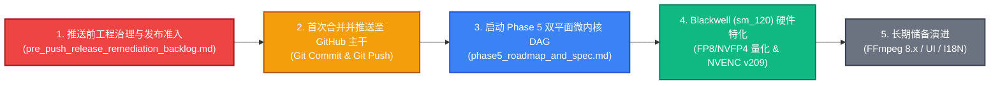

# CineRTX 待办事项与未来演进任务总索引 (TODO & Backlog Master Index)

> **目录定位**：`docs/TODO/`  
> **维护责任人**：CineRTX 系统架构委员会暨项目总监  
> **更新日期**：2026-11-01  
> **核心军规基准**：[`docs/spec/architecture.md`](../spec/architecture.md) §1.3

---

## 1. 核心工程铁律：奥卡姆剃刀与绝无冗余开关 (Occam's Razor & Zero Switches)

**【加任何开关之前，必须先反思三遍，确认是否有绝对不可替代的必然性】**

CineRTX 坚决奉行“如无必要，勿增实体”的极简主义设计哲学：
1. **禁绝一切形式的随意开关**：严禁随意增加环境变量开关（`RTX_ENABLE_XXX` / `RTX_DISABLE_XXX`）、命令行开关（`--feature-switch`）、CMake 条件编译宏（`RTX_WITH_XXX`）或内部降级旁路。
2. **反思三遍门禁**：在考虑引入任何开关前，必须连续执行三次独立深入反思：
   - *第一遍反思*：这个开关解决的是真实物理冲突，还是为了逃避推导确定性最优解而偷懒？
   - *第二遍反思*：能否通过内建的自适应推导、确定性最佳实践或架构闭环直接达成，而无需用户/环境配置？
   - *第三遍反思*：这个开关是否把本该由系统承担的设计决策与认知负担转嫁给了用户或运维？
3. **单一确定性产品路径**：系统所有行为保持确定、自包含、无分支，拒绝将简单问题复杂化。

---

## 2. 待办事项分类全景 (Task Classification)

| 类别 | 规范文档 / 工单文件 | 优先级 | 当前状态 | 核心目标与技术范围 |
| :--- | :--- | :--- | :--- | :--- |
| **代码与架构深度协查** | [委托书](../phase4/CineRTX_领域专家代码与架构全面深度协查委托书.md) / [专家裁决报告](../phase4/CineRTX%20代码与架构深度协查.md) / [施工方案](../phase4/CineRTX_全仓反Slop与极简架构重塑工程施工方案.md) | **P0 (阶段四归档)** | **施工方案已签发 (闭环待审)** | 领域专家已出具反 Slop 终审裁决与负向切除清单；施工方案与协查全案归入 `docs/phase4/` 备查。 |
| **推送前工程治理** | [`pre_push_release_remediation_backlog.md`](../phase4/pre_push_release_remediation_backlog.md) | **P0 (阶段四准入)** | **已闭环就绪** | 落实推送前静态审计（`RTX-AUDIT-2026-10-31-FINAL`）指出的 A-01 至 A-08 整改项，解决 Linux locale、启动 335MB 内存预分配、ODR 违规及文档外链问题。 |
| **开源准入最终验收** | [`CineRTX_开源准入与全栈工程终审专家验收委托书.md`](../phase4/CineRTX_开源准入与全栈工程终审专家验收委托书.md) | **P0 (发布准入)** | **委托书就绪 (待转交评审)** | 呈报领域专家评审委员会，对全仓物理零拷贝、Modern C++26 架构纯度、三区合规及脱敏清零执行最终穿透验收，提请签署 GitHub 开源发布令。 |
| **音频透传与混流** | [`audio_stream_copy_and_muxing.md`](./audio_stream_copy_and_muxing.md) | **P1 (核心)** | **待办立项 (Backlog)** | 解决转码后音频轨丢失/完全静音缺陷，实施 AVPacket 零拷贝流透传（Stream Copy）与唇音同步。 |
| **智能几何自适应** | [`smart_geometry_and_aspect_ratio.md`](./smart_geometry_and_aspect_ratio.md) | **P1 (核心)** | **待办立项 (Backlog)** | 解决 9:16 竖屏被强制拉伸压扁 3.16 倍缺陷，推导长宽比自适应竖屏 4K 与 Pillarbox 消色差黑边方案。 |
| **下一代架构演进** | [`phase5_roadmap_and_spec.md`](./phase5_roadmap_and_spec.md) | **P1 (核心)** | **专家批准立项** | 领域专家终审批准立项：双平面异步微内核 DAG 调度器（`GpuFrameToken`）、Blackwell sm_120 极限特化（64KB 大页、FP8/NVFP4 RIFE、NVENC v209 AV1 10-bit）。 |
| **媒体底层演进** | [`ffmpeg7_vs_ffmpeg8_selection_and_evolution.md`](./ffmpeg7_vs_ffmpeg8_selection_and_evolution.md) | **P2 (储备)** | **归档备查** | FFmpeg 7.1.1 静态内联锁定依据及面向未来 FFmpeg 8.x 主线特性的裁剪与演进评估。 |
| **UI 与交互重构** | [`ui_refactor_and_plugin_status.md`](./ui_refactor_and_plugin_status.md) | **P2 (储备)** | **方案就绪** | Win32 原生极简单 EXE 界面优化、DirectComposition 视口硬件加速与插件状态机解耦。 |
| **调试诊断去开关化** | [`gui_debug_log_elimination_and_debugview.md`](./gui_debug_log_elimination_and_debugview.md) | **P2 (储备)** | **方案就绪** | 拔除 `RTX_GUI_RESULT_LOG` 环境变量，废除磁盘文件落盘，全面改用 Windows 原生 `OutputDebugString` 与 DebugView 实时监听流。 |
| **本地化与国际化** | [`i18n_architecture_and_localization.md`](./i18n_architecture_and_localization.md) | **P3 (演进)** | **方案就绪** | 编译期 `constexpr` 字典映射、跨平台多语言资源包轻量化打包。 |
| **测试基准建设** | [`rife_cli_test_fixture.md`](./rife_cli_test_fixture.md) | **P3 (演进)** | **方案就绪** | RIFE 算子独立 CLI 测试夹具与 Blackwell 移动端离线压力测试套件。 |

---

## 3. 施工与发布依赖顺序 (Execution Dependency Order)

