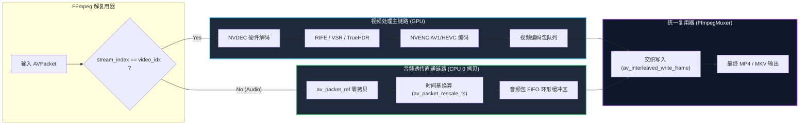

# CineRTX 音频流透传与音视频同步复用技术规约 (Audio Stream Copy & Muxing)

> **文档标识**：`SPEC-TODO-AUDIO-MUX-001`  
> **所属目录**：[`docs/TODO/audio_stream_copy_and_muxing.md`](./audio_stream_copy_and_muxing.md)  
> **优先级**：P1 (核心工业可用性增强)  
> **状态**：待办立项 (Backlog Item)  
> **关联源码**：[`src/core/hw_transcode.cpp`](../../src/core/hw_transcode.cpp), [`include/rtx/stream.h`](../../include/rtx/stream.h)

---

## 1. 缺陷背景与工业痛点 (Problem Statement)

在实测端到端超分辨率与插帧转码（如测试片源 `gemini_generated_video_6eaef4a7.mp4`）时发现：
- **致命缺陷：音频流完全丢失**。原片包含清晰的立体声音频轨（`Stream #0:1[0x2]: Audio: aac (LC) (mp4a / 0x6134706D), 48000 Hz, stereo, fltp, 128 kb/s`），转码后生成的 4K 目标容器内仅有一条视频流（`Stream #0:0`），音频流彻底缺失，导致转码视频处于完全静音状态。
- **工业影响**：作为影视级 RTX 转码引擎，视频修复或超分辨率后丢失音频属于“功能不可用”的致命缺陷，无法直接交付使用。

---

## 2. 根因剖析 (Root Cause Analysis)

审查 [`src/core/hw_transcode.cpp`](../../src/core/hw_transcode.cpp) 的解复用与封装逻辑可知：
1. **解复用器单视频绑定**：
   `FfmpegDemuxer` 在解析 `AVFormatContext` 时，通过 `av_find_best_stream(fmt_ctx, AVMEDIA_TYPE_VIDEO, ...)` 仅锁定了视频流索引，忽略了 `AVMEDIA_TYPE_AUDIO` 的流信息与包流。
2. **包循环直接丢弃**：
   在解复用主循环中，所有 `pkt.stream_index != video_stream_idx` 的 `AVPacket` 均被静默丢弃（`av_packet_unref`），音频数据被直接物理截断。
3. **复用器无音频流配置**：
   `FfmpegMuxer` 仅通过 NVENC 编码器输出创建了一个视频 `AVStream`，容器头（`avformat_write_header`）未注册任何音频流头，导致输出文件根本不存在音频轨。

---

## 3. 技术方案设计：无损音频流透传 (Audio Stream Copy)

遵循奥卡姆剃刀原则，**严禁引入冗余的音频软件重采样/重编码器**（避免引入复杂的 libmp3lame/libfdk_aac 依赖与 CPU 开销），采用标准工业级 **Stream Copy（流拷贝）** 方案。



### 3.1 解复用与流参数复制 (Demuxer Stream Setup)
- 在 `FfmpegDemuxer` 初始化阶段探测 `AVMEDIA_TYPE_AUDIO`：
  ```cpp
  int audio_stream_idx = av_find_best_stream(fmt_ctx_, AVMEDIA_TYPE_AUDIO, -1, -1, nullptr, 0);
  if (audio_stream_idx >= 0) {
      audio_stream_ = fmt_ctx_->streams[audio_stream_idx];
  }
  ```
- 导出 `AVCodecParameters` 与音频流时间基 `AVRational audio_time_base`。

### 3.2 封装器动态流配置 (Muxer Stream Configuration)
- 在 `FfmpegMuxer` 中添加音频流：
  ```cpp
  AVStream* out_audio_stream = avformat_new_stream(out_ctx_, nullptr);
  avcodec_parameters_copy(out_audio_stream->codecpar, in_audio_stream->codecpar);
  out_audio_stream->codecpar->codec_tag = 0; // 避免容器 tag 冲突
  ```
- 记录输入音频与输出音频的时间基转换比例。

### 3.3 音画交织与时间戳校准 (PTS/DTS Rescaling & Interleaving)
- 解复用器解出音频包后，直接投递到音频无锁环形队列：
  ```cpp
  av_packet_rescale_ts(pkt, in_stream->time_base, out_stream->time_base);
  av_interleaved_write_frame(out_ctx_, pkt);
  ```
- 确保在插帧（FRUC 2x/4x）倍频导致视频时间戳细分的情况下，音频时间戳绝对无漂移，严格保持 Lip-Sync（唇音同步）。

---

## 4. 交付验收标准 (Acceptance Criteria)

1. **音频轨完整检出**：
   使用 `ffprobe` 验证输出转码文件，必须包含原片的所有音频通道（采样率、声道数、比特率严格对齐）。
2. **音画严格同步**：
   在插帧 2x 场景下（如 24fps -> 48fps），音频时长与视频时长偏差必须小于 $\le 10\text{ms}$，绝无破音、爆音或音画脱节。
3. **零额外开销**：
   音频流透传 CPU 额外占用率小于 $0.1\%$，显存开销严格为 0。
