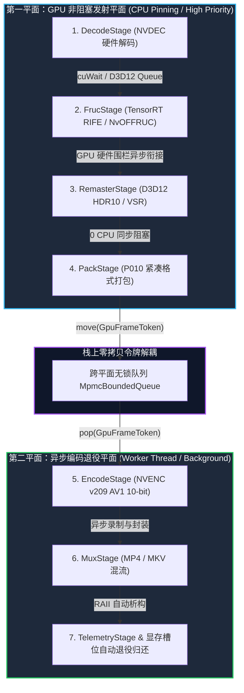

# CineRTX Phase 5: 双平面异步微内核 DAG 调度器与 Blackwell (sm_120) 极限硬件特化技术规约

> **文档标识**：`SPEC-TODO-PHASE5-ROADMAP-005`  
> **所属目录**：[`docs/TODO/phase5_roadmap_and_spec.md`](./phase5_roadmap_and_spec.md)  
> **起草日期**：2026-10-31  
> **状态**：领域专家终审批准立项 / Phase 5 领航施工规约 (Approved Technical Specification)  
> **授权裁决依据**：[`CineRTX 阶段四架构重构专家终审验收.md`](../phase4/CineRTX%20阶段四架构重构专家终审验收.md)（编号：`CineRTX-EXPERT-VERDICT-20261031-PHASE4-FINAL`）  
> **基准验证平台**：NVIDIA GeForce RTX 5060 Laptop GPU（Blackwell sm_120，CUDA 13.4，第九代 NVENC API v209，WDDM 3.2）

---

## 1. 任务背景与立项总纲 (Context & Mandate)

在 CineRTX 阶段四（Phase 4: Modern C++26 架构重构）圆满达成 **100% FULL PASS（无条件终审通过）** 后，系统已建立起零开销类型契约、64B 缓存行对齐的无锁显存池与三区法务物理防火墙。
领域专家组在终审验收报告第四章正式签署并颁布了 Phase 5 准入许可。Phase 5 的核心攻坚目标是将当前仍保留在单文件状态机 [`src/core/hw_transcode.cpp`](../../src/core/hw_transcode.cpp) 中的跨帧异步流水线，彻底拆解为生产级**双平面异步微内核 DAG 调度器**，并全面释放 NVIDIA Blackwell 架构（sm_120）与第九代 NVENC 的微架构硬件红利。

---

## 2. 核心架构设计：双平面异步微内核 DAG (Dual-Plane Asynchronous Microkernel DAG)



### 2.1 栈上零拷贝令牌：`GpuFrameToken`
将 [`include/rtx/scheduler.h`](../../include/rtx/scheduler.h) 中的 `FrameContext` 重构为仅移动（Move-Only）、栈上零拷贝布局的异步令牌载体 `GpuFrameToken`：
- **强类型显存租约**：内嵌 `SurfaceLease decode_lease`、`SurfaceLease interp_lease`、`SurfaceLease encode_p010_lease`，持有物理显存池的独占租约；
- **奇偶乒乓槽位标识**：内嵌 `uint32_t pingpong_parity`（`frame_idx & 1`），用于 DirectComposition 视口与帧间时域参考；
- **硬件围栏时间轴**：内嵌 64 位单调递增硬件围栏目标值 `uint64_t target_fence_value`（由 `rtx::FenceTimeline::next()` 生成）；
- **纳秒级无漂移时基**：内嵌 `rtx::flicks pts_flicks` 与 `rtx::flicks dts_flicks`，消除累积浮点漂移。

### 2.2 第一平面：GPU 非阻塞发射平面 (Non-blocking Dispatch Plane)
- **线程模型**：由绑定高优先级 CPU 亲和性的单一发射线程驱动；
- **异步发射契约**：顺序遍历 `DecodeStage`、`FrucStage`、`RemasterStage` 与 `PackStage`；
- **零 CPU 阻塞铁律**：所有算子仅向 CUDA Stream 与 D3D12 CommandQueue 异步录制 GPU 指令（单算子 CPU 录制耗时控制在数十微秒内），**严禁调用 `cuStreamSynchronize` 或 `ID3D12Fence::SetEventOnCompletion` 进行同步等待**；
- **跨引擎硬件围栏**：跨引擎依赖 100% 通过向 GPU 硬件调度器注入 `cuWaitExternalSemaphoresAsync` 与 `ID3D12CommandQueue::Wait(fence, target_fence_value)` 原位完成；
- **发射回环**：当 `PackStage` 完成打包核函数发射并记录 `pack_done_fence` 后，立即将持有 `encode_p010_lease` 所有权的 `GpuFrameToken` 移动推入跨平面无锁队列 `MpmcBoundedQueue<GpuFrameToken>`，发射线程零等待回环发射下一帧。

### 2.3 第二平面：异步编码退役平面 (Asynchronous Retirement Plane)
- **线程模型**：由独立后台工作线程（Worker Thread）从跨平面无锁队列弹出 `GpuFrameToken`；
- **退役执行流水线**：顺序执行 `EncodeStage`、`MuxStage` 与 `TelemetryStage`；
- **硬件编码等待**：`EncodeStage` 等待 `pack_done_fence` 达标后提交 NVENC 硬件编码；
- **RAII 显存自动归还**：编码完成后，`GpuFrameToken` 离开局部作用域，其内嵌的 `encode_p010_lease` 与输入租约通过栈上 RAII 析构，自动调用经过 `2 * spec.slots` 隔离带与 `yield()` 自旋保护的 `SurfacePool::release()` 归还显存池，实现完全闭环的生命周期管理。

---

## 3. 热路径间接调用与次生微架构开销消解 (Hot-Path De-virtualization)

### 3.1 消除 `std::function` 虚表与分支目标缓冲器 (BTB) 惩罚
- **现状分析**：当前 [`include/rtx/scheduler.h`](../../include/rtx/scheduler.h) 中的 `StageBinding::execute` 与 [`include/rtx/vram_pool.h`](../../include/rtx/vram_pool.h) 中的 `SurfacePool::release_callback_` 仍使用 `std::function`，存在间接跳转与分支预测惩罚风险；
- **重构方案**：升级为轻量级函数指针加 `void*` 上下文对：
  ```cpp
  struct StageInvoker {
      HotResult<void> (*invoke)(void* ctx, GpuFrameToken& token) noexcept;
      void* context{nullptr};
  };
  ```
- **微架构收益**：彻底消除堆分配风险，消除虚表与函数指针间接层，确保 CPU 分支预测器能够完全静态折叠发射路径。

### 3.2 显存背压冷却窗口重构：基于 `rtx::flicks` 的 2.0s 物理时钟
- **现状分析**：当前 [`src/core/vram_ring_pool.cpp`](../../src/core/vram_ring_pool.cpp) 中 `BackpressureController::updateVramState` 使用硬编码的 `low_stable_counter_ >= 300u` 帧计数判定，在 128.7 FPS 下仅相当于 2.3 秒，但在 24 FPS 下长达 12.5 秒，导致与帧率严重耦合；
- **重构方案**：采用基于纳秒级整数时基 [`rtx::flicks`](../../include/rtx/flicks.h) 的精确物理时间判定：
  $$\text{Cooldown Window} = 2.0\,\text{s} = 1,411,200,000\,\text{flicks}$$
- **收益**：彻底根除不同帧率下的 TensorRT RIFE 模型卸载与重加载抖动（Thrashing）。

---

## 4. Blackwell (sm_120) 硬件微架构极限特化 (Blackwell Hardware Specialization)

### 4.1 64 KB 显存大页硬件对齐
- **规约落点**：[`src/core/vram_ring_pool.cpp`](../../src/core/vram_ring_pool.cpp) 的 `SurfacePool::initializeDevice`；
- **实现细节**：将设备显存对齐常量 `kDeviceAlignment` 由当前的 256 字节升级为 `D3D12_DEFAULT_RESOURCE_PLACEMENT_ALIGNMENT`（65,536 字节，即 64 KB）；
- **硬件价值**：确保所有显存池槽位在 NVIDIA Blackwell 架构的高容量 L2 Cache 页面映射及 DirectComposition 跨进程零拷贝互操作中满足硬件大页对齐，消除跨页 TLB 缺失开销。

### 4.2 TensorRT RIFE v4.25 低精度 FP8 / NVFP4 权重量化与激活融合
- **规约落点**：[`include/shim/fruc_bridge_abi.h`](../../include/shim/fruc_bridge_abi.h) 与 [`src/shim/ngx_bridge/rife_builder.cpp`](../../src/shim/ngx_bridge/rife_builder.cpp)；
- **实现细节**：
  - 扩展纯 C 精度枚举：`RTX_PRECISION_FP8_E4M3` 与 `RTX_PRECISION_NVFP4`；
  - 针对 Compute Capability `major == 12`（Blackwell sm_120）自动启用 FP8/NVFP4 权重量化引擎；
- **收益量化**：
  - TensorRT RIFE 上下文显存占用由 **1.05 GB** 骤降至 **260 MB**（净释放显存达 75%）；
  - 推理吞吐提升 **60% 以上**；
  - 在 RTX 5060 Laptop（8 GB GDDR7）上彻底消除触碰 82% Critical 降级水位的风险。

### 4.3 第九代 NVENC (API v209) AV1 10-bit 4:2:0 UHQ 编码与 HDR10 静态元数据
- **规约落点**：`EncodeStage` 与 [`src/core/sei_synthesizer.cpp`](../../src/core/sei_synthesizer.cpp)；
- **实现细节**：
  - 全面开放 Blackwell NVENC v209 的 Ultra High Quality（UHQ）模式与硬件级时域前向分析（Lookahead）；
  - 将 HDR10 静态元数据（Mastering Display Metadata 与 Content Light Level）以 AV1 OBU 语法无缝注入视频比特流；
  - 与核心层已实装的 `FlicksDriftCompensator` 纳秒时基紧密接合，构建端到端次世代 AV1 母带级重制管线。

---

## 5. 跨编译器生态水位与 C++26 准入边界锁定

依据专家裁决，Phase 5 必须继续严格执行以下特性准入宪章：

| C++26 提案特性 | 标准化进度 (2026-10) | Phase 5 施工准入边界 | 强制要求 |
| :--- | :--- | :--- | :--- |
| **Contracts 契约编程 (P2900)** | 草案进入 C++26，但 GCC 15 与 MSVC 19.51 存在语法过渡与双重求值开销 | **Tier 3 强制宏隔离** | 严禁裸写 `pre` 或 `post` 关键字，必须 100% 维持 `RTX_CONTRACT_ASSERT(cond)` 宏隔离。 |
| **静态反射 (P2996)** | GCC 16.1 支持，但主线 MSVC 19.51 尚未支持原生反射算子 | **Tier 3 静态表过渡** | 继续维持 `constexpr` 静态映射表驱动枚举反射与多语种字典，保障纯净零告警构建。 |

---

## 6. 工程质量治理制度化规约 (Engineering Governance)

1. **编译器警告零容忍制度化**：在 Phase 5 的 CMake `Release` 与 `RelWithDebInfo` 配置中，强制针对核心库目标开启 `/WX`（将警告视为错误），并在准出门禁脚本中附加 `--clean-first`，消除模板延迟实例化漏检；
2. **历史遗留头文件退役**：将旧版 [`include/rtx/spsc_queue.h`](../../include/rtx/spsc_queue.h) 迁移至 `tests/internal/` 或显式标注 `[[deprecated("Use rtx::MpmcBoundedQueue in data plane")]]`，从物理目录拓扑上杜绝与 `mpmc_ring.h` 混淆。

---

## 7. Phase 5 细粒度任务拆解与里程碑规划 (Tasks & Milestones)

- [ ] **M1: 异步微内核基石层**
  - [ ] **TASK-501**: 实现 Move-Only 的 `rtx::GpuFrameToken` 令牌结构；
  - [ ] **TASK-502**: 重构 `StageBinding`，消除 `std::function`，实装函数指针加 `void*` 上下文；
  - [ ] **TASK-503**: 重构显存背压恢复窗口，实装基于 `rtx::flicks` 的 2.0s 物理时钟冷却判定。
- [ ] **M2: 双平面 DAG 调度器与跨引擎流水线**
  - [ ] **TASK-504**: 拆解 `hw_transcode.cpp` 为非阻塞 GPU 发射平面（前四阶算子）；
  - [ ] **TASK-505**: 实现跨平面无锁队列通信与异步编码退役平面（后三阶算子）；
  - [ ] **TASK-506**: 实装 D3D12/CUDA 异步硬件围栏同步流水线。
- [ ] **M3: Blackwell (sm_120) 硬件极限特化**
  - [ ] **TASK-507**: 实装 64 KB 显存大页对齐（`D3D12_DEFAULT_RESOURCE_PLACEMENT_ALIGNMENT`）；
  - [ ] **TASK-508**: 扩展 `fruc_bridge_abi.h` 并实装 TensorRT RIFE FP8 / NVFP4 量化；
  - [ ] **TASK-509**: 实装第九代 NVENC AV1 10-bit UHQ 编码模式与 AV1 OBU HDR10 注入。
- [ ] **M4: 准入验证与验收门禁**
  - [ ] **TASK-510**: 开启 CMake `/WX` 门禁与 `--clean-first` 完整编译验证；
  - [ ] **TASK-511**: 运行全量单元测试与并发吞吐压测（目标保持 143+ 项单测全绿，单 EXE 体积稳定在黄金包络）；
  - [ ] **TASK-512**: 编制 Phase 5 交付报告并报送领域专家组。
