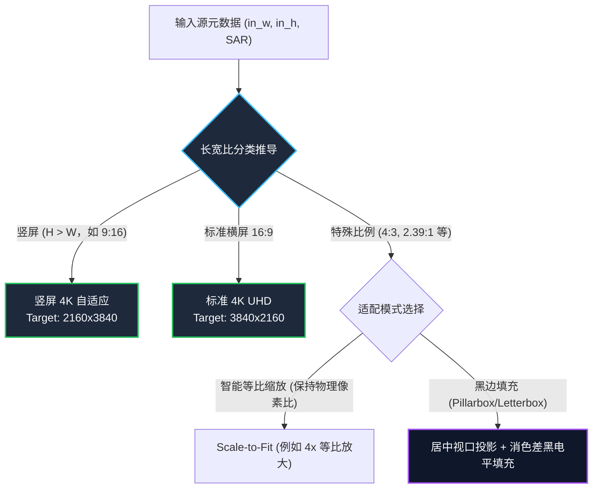

# CineRTX 智能几何与长宽比自适应技术规约 (Smart Geometry & Aspect Ratio Engine)

> **文档标识**：`SPEC-TODO-SMART-GEOMETRY-002`  
> **所属目录**：[`docs/TODO/smart_geometry_and_aspect_ratio.md`](./smart_geometry_and_aspect_ratio.md)  
> **优先级**：P1 (核心工业可用性增强)  
> **状态**：待办立项 (Backlog Item)  
> **关联源码**：[`src/core/hw_transcode.cpp`](../../src/core/hw_transcode.cpp), [`src/shim/ngx_bridge/bridge_exports.cpp`](../../src/shim/ngx_bridge/bridge_exports.cpp)

---

## 1. 缺陷背景与工业痛点 (Problem Statement)

在实测 9:16 移动端竖屏片源（如 `gemini_generated_video_7eb7a09e.mp4`，分辨率为 720x1280）时发现：
- **致命缺陷：画面严重畸变压扁**。
  系统固定将输出强制重采样为 16:9 4K UHD（3840x2160）：
  $$\text{Scale}_X = \frac{3840}{720} \approx 5.333\times, \quad \text{Scale}_Y = \frac{2160}{1280} = 1.6875\times$$
  水平缩放倍数是垂直倍数的 **3.1605 倍**！画面中人物与物体被严重压扁拉宽，完全失去物理几何真实性，产物视频不可用。
- **工业影响**：现代自媒体与流媒体时代，短视频（9:16）、电影宽银幕（2.35:1 / 2.39:1）及老片（4:3）极为普遍。强制无脑拉伸至 16:9 是严重工程违规。

---

## 2. 根因剖析 (Root Cause Analysis)

审查控制面与参数配置链可知：
1. **硬编码全局输出目标**：
   在 CLI 默认参数及 `hw_transcode.cpp` 中，默认 `out_w = 3840, out_h = 2160`，直接忽略了输入帧的源宽高比（`SAR` / `DAR`）。
2. **D3D12/VSR 视口未做居中黑边计算**：
   DirectX / RTX Video Super Resolution (VSR) 的输入与输出尺寸直接绑定了物理纹理，未在渲染管线或 VSR 调用前嵌入基于视口（`D3D12_VIEWPORT`）的等比映射矩阵，导致拉伸直接作用于全画面。

---

## 3. 技术方案设计：自适应几何引擎 (Smart Geometry Engine)

遵循奥卡姆剃刀原则，严禁让用户每次手动繁琐计算目标分辨率。系统内建**物理长宽比自适应推导算法**：

### 3.1 确定性目标分辨率自适应规则
对于默认的目标“4K”规格：
- **横屏片源 ($W \ge H$)**：目标基准为 $3840 \times 2160$（16:9）；
  - 若为 $2.39:1$ 宽银幕，可自适应输出 $3840 \times 1608$ 或保持 $3840 \times 2160$ 并在上下填充黑边（Letterbox）。
- **竖屏片源 ($H > W$)**：目标基准自动倒置为 $2160 \times 3840$（9:16 竖屏 4K），横向纵向缩放比均为 $3.0\times$（严格等比！）。
- **等比 4x 模式**：若未指定固定 4K 分辨率，默认执行 $4\times$ 整数倍等比超分（$W_{out} = 4 \times W_{in}, H_{out} = 4 \times H_{in}$）。

### 3.2 显存级居中视口与消色差黑边填充 (Pillarbox/Letterbox Zero-Bleed)
当用户明确要求将非 16:9 片源放入 16:9 容器时：
- 计算保持长宽比的居中渲染视口：
  $$\text{scale} = \min\left(\frac{W_{target}}{W_{in}}, \frac{H_{target}}{H_{in}}\right)$$
  $$W_{fit} = \text{round\_even}(W_{in} \times \text{scale}), \quad H_{fit} = \text{round\_even}(H_{in} \times \text{scale})$$
  $$X_{offset} = \frac{W_{target} - W_{fit}}{2}, \quad Y_{offset} = \frac{H_{target} - H_{fit}}{2}$$
- **黑电平安全性**：
  未覆盖的边缘区域必须使用窄范围 P010 消色差黑电平（$Y = \text{0x1000}, UV = \text{0x8000}$）进行显存清空（`cuMemsetD2D16` / D3D12 `ClearRenderTargetView`），坚决杜绝因显存未初始化或默认 0 导致的亮荧光绿边！

---

## 4. 交付验收标准 (Acceptance Criteria)

1. **几何保真度**：
   对 720x1280 竖屏输入，输出视频几何比例失真度严格为 $0.00\%$，人物与物体比例自然。
2. **黑边无偏色**：
   在填充黑边场景下，黑边区域像素值严格为标准黑电平，绝无边缘绿边、偏白或杂色渗出。
