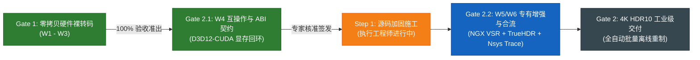
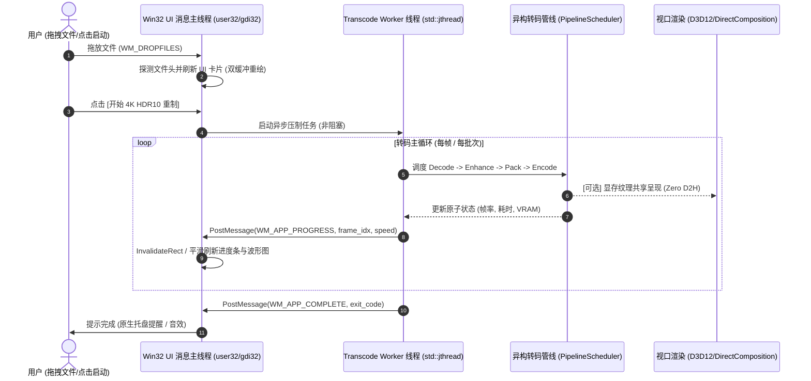

# RTX 超分辨率与 HDR 离线转码引擎
## Win32 原生极简单 exe GUI 演进架构方案 暨 领域专家咨询建议书

---

**文档编号**：`RTX-ARCH-20261024-WIN32-GUI-PROPOSAL`  
**文档性质**：GUI 演进架构规范与领域专家咨询提案  
**项目负责人 / 首席架构师**：Lead Architect  
**基准验证硬件**：`[REDACTED_HOST]`（NVIDIA GeForce RTX 5060 Laptop GPU, sm_120, 8123 MiB GDDR7, 驱动 617.14, CUDA 13.4, Windows 11）  
**关联核心构件**：
* 专家二阶段批复解读：[`phase2_expert_verdict_analysis_and_action_plan.md`](file:///C:/PUBLIC/[REDACTED_PROJ]/docs/phase2_expert_verdict_analysis_and_action_plan.md)
* 专家二阶段批复报告：[`docs/RTX转码引擎二阶段深度验收.md`](file:///C:/PUBLIC/[REDACTED_PROJ]/docs/RTX转码引擎二阶段深度验收.md)
* 二阶段返工复验报告：[`phase2_rework_acceptance_and_w4_milestone_report.md`](file:///C:/PUBLIC/[REDACTED_PROJ]/docs/phase2_rework_acceptance_and_w4_milestone_report.md)

---

## 1. 当前项目整体进展全景 (Project Status Overview)

目前工程处于**二阶段核心技术攻坚圆满收官、正向最终 Gate 2 冲刺**的成熟阶段。



### 1.1 各模块成熟度矩阵
1. **已完全就绪（生产级可用）**：
   * **Gate 1 硬件转码主干**：基于 [`nv_decoder.cpp`](file:///C:/PUBLIC/[REDACTED_PROJ]/src/core/nv_decoder.cpp) 与 [`nv_encoder.cpp`](file:///C:/PUBLIC/[REDACTED_PROJ]/src/core/nv_encoder.cpp) 的全硬件闭环流水线，实测 8-bit NV12 与 10-bit P010 压制全程 $D2H=0, H2D=0$（零主机内存回传）。
   * **W4 无头 D3D12-CUDA 外部显存互操作**：基于 [`d3d12_interop.cpp`](file:///C:/PUBLIC/[REDACTED_PROJ]/src/shim/ngx_bridge/d3d12_interop.cpp) 成功跑通 1080p 与 4K RGBA16F 显存句柄双向导入，硬件回环精度实测绝对零误差（`diff == 0`）。
   * **HDR10 规范合规**：完整实现 HEVC VUI 参数注入（Top-Left 色度相位、BT.2020 Non-constant Luma）与 MP4 容器级 `mdcv`/`clli` 盒注入。
   * **合规与跨平台测试体系**：102/102 单元测试全绿通过；5 个构建目标零闭源静态导入；Zig 与 MSVC 双轨无痛构建。
2. **正施工与调拨中（In Progress）**：
   * **Step 1 源码三项加固**：执行工程师正依专家批复落实 TLS 上下文脱靶保护、外部信号量 5 步硬件流同步规约及 `sdkPresent` 逻辑修复。
   * **W5/W6 专有依赖与合流**：等待 `RTX Video SDK`（`nvsdk_ngx_d.dll` 等）入库部署，随后立即合流 4K 中间纹理 `mid_4k_`、IGN 蓝噪声抖动与 Nsight Trace 1000 帧总线抓取。

---

## 2. 当前引擎使用与实操手册 (How to Use Current Engine)

当前引擎编译产物位于 `build/rework-zig/`（或 `build/rework-msvc/`），提供完备的 CLI 接口与自动化验证脚本。

### 2.1 硬件探针与环境检查
在转码前，首先执行环境探针确认 Blackwell 硬件与驱动就绪状态：
```powershell
# 控制台纯文本快速探针
.\build\rework-zig\rtx-transcode.exe --probe

# 自动化集成用的标准纯 ASCII JSON 输出
.\build\rework-zig\rtx-transcode.exe --probe --json
```
*预期输出*：
```json
{
  "cuda_available": true,
  "device_name": "NVIDIA GeForce RTX 5060 Laptop GPU",
  "compute_capability": "12.0",
  "driver_version": 61714,
  "vram_total_mb": 8123,
  "nvdec_available": true,
  "nvenc_available": true
}
```

### 2.2 真实硬件零拷贝离线转码
对本地存量 MP4/MKV 视频进行高吞吐硬件转码：

#### 场景 A：8-bit SDR 高效转码（基线压制）
```powershell
.\build\rework-zig\rtx-transcode.exe `
  --input "C:\Media\input_1080p.mp4" `
  --output "C:\Media\output_hevc_8bit.mp4" `
  --backend nvidia `
  --codec hevc `
  --bit-depth 8 `
  --preset 5 `
  --bitrate 8000
```

#### 场景 B：10-bit Main10 HDR 级转码（高画质母版）
```powershell
.\build\rework-zig\rtx-transcode.exe `
  --input "C:\Media\input_1080p.mp4" `
  --output "C:\Media\output_hevc_10bit.mp4" `
  --backend nvidia `
  --codec hevc `
  --bit-depth 10 `
  --preset 6 `
  --bitrate 15000 `
  --hdr-sidecar "C:\Media\output_hdr_meta.json"
```

### 2.3 自动化全套单元测试与门禁验证
在开发与宿主机迁移时，可一键验证当前环境的鲁棒性：
```powershell
# 1. 运行内置全量自测试（102 个测试用例，覆盖色彩科学、矩阵转换、互操作）
.\build\rework-zig\rtx_tests.exe

# 2. 执行 Gate 1 自动化门禁脚本（包含合成流无头回环测试）
powershell -ExecutionPolicy Bypass -File tools\verify_gate1.ps1 `
  -BuildDir build\rework-zig `
  -Container "C:\Media\input_1080p.mp4" `
  -Codec hevc `
  -BitDepth 10
```

---

## 3. 极简 Win32 原生单 exe GUI 架构方案设计

### 3.1 核心工程哲学与设计约束
* **绝对单 exe 产物**：构建输出为一个独立的 `rtx-transcode-gui.exe`（或直接将 CLI 与 GUI 合并在单一 `rtx-transcode.exe` 中）。
* **零重型框架依赖**：坚决禁止 Qt, Electron, CEF/Chromium, WPF, MFC, WxWidgets, Flutter 等运行时；**只依赖 Windows 原生基础系统 DLL**：
  * `kernel32.dll`：内存、线程、文件、动态库加载；
  * `user32.dll`：原生窗口创建、DPI 感知、消息循环泵；
  * `gdi32.dll`：双缓冲自绘、高质量文本渲染、图形基元；
  * `shell32.dll`：`WM_DROPFILES` 拖拽支持、外壳交互；
  * `comctl32.dll`：基础公用控件与通用样式；
  * `dwmapi.dll`：Windows 10/11 原生深色模式沉浸式标题栏。
* **双模一体化启动（CLI / GUI 无缝融合）**：
  * 可执行文件采用 Windows 子系统（`/SUBSYSTEM:WINDOWS`）。
  * **启动逻辑**：在 `WinMain` 入口率先检测 `__argc` 命令行参数。
    * 若传入了转码参数（如 `--input ...`），调用 `AttachConsole(ATTACH_PARENT_PROCESS)` 附加父控制台，重定向 `stdout`/`stderr`，以极速无头 CLI 模式运行；
    * 若无参数（双击启动）或带有 `--gui`，则进入 Win32 原生窗口与消息循环。

### 3.2 软件架构与线程模型



### 3.3 界面布局与自绘设计 (极简专业工业美学)
采用纯 GDI 内存 DC 双缓冲自绘，打造如顶级音频插件般的深色极简风格：
1. **沉浸式黑底深色模式**：
   * 调用 `DwmSetWindowAttribute(hwnd, DWMWA_USE_IMMERSIVE_DARK_MODE, ...)` 实现原生暗黑标题栏。
   * 全局背景色调采用 `#121212`，卡片采用 `#1E1E1E`，强调色采用 NVIDIA 标志性翠绿 `#76B900`。
2. **拖放区 (Drop Zone)**：
   * 虚线圆角框自绘，支持多文件/文件夹直接拖拽入列。
3. **实时硬件与吞吐监视器**：
   * 实时曲线绘制：GPU 占用率、编码器利用率、显存常驻量（VRAM 8GB 水位线）、PCIe 总线回传带宽（实时指示零拷贝状态）。
4. **零拷贝画面实时监视视口（高级可选）**：
   * 在主窗口内嵌一个子视口 HWND。
   * **核心突破**：利用引擎已有的无头 D3D12 设备，通过 `CreateSwapChainForHwnd` 创建 D3D12 交换链，直接将 `PingPong_NGX_Out`（4K RGBA16F）通过着色器映射呈现到该视口。**全程不经过 CPU 内存回读，零性能损失**！

---

## 4. 面向领域专家的咨询建议书草案 (Expert Consultation Dossier)

向领域专家请教时，应立足于架构师的高度，聚焦于**底层系统边界、单二进制许可合规、实时画面视口渲染及超高频消息泵解耦**四大专业议题。

以下为拟呈报给领域专家的正式咨询报告结构与核心问题清单：

---

### 《关于 RTX 转码引擎 Win32 极简原生单 exe GUI 演进路线与系统合规的技术咨询》

#### 咨询议题一：单二进制交付与 GPLv3 Plugin-Exception 许可隔离边界合规性
* **背景**：项目核心调度与 FFmpeg 封装采用 GPLv3（附带插件豁免条款），而 `rtx_shim` 与 `rtx_ngx_bridge` 为纯 C ABI 隔离层（MIT/Apache-2.0），宿主系统则动态调用 NVIDIA 闭源驱动与 SDK。用户提出“最终产物为单一 exe，拒绝附带一堆外挂 DLL”的交付需求。
* **请教问题**：
  1. 若将 Win32 UI 模块、核心调度器、以及开源垫片层（原 `rtx_shim.dll` 逻辑）**全量静态编译链接进单一可执行文件（Static Monolithic Binary）**，仅通过 `LoadLibraryExW(LOAD_LIBRARY_SEARCH_SYSTEM32)` 在运行时动态加载 NVIDIA 官方闭源 DLL（`nvcuvid.dll`, `nvEncodeAPI64.dll`, `nvsdk_ngx_d.dll`），此种分发形态是否依然严格符合 GPLv3 Plugin-Exception 的法律隔离边界？
  2. 抑或建议采用“PE 资源内嵌（Resource Embedding）”方案——单 exe 运行时检测并在 `%LOCALAPPDATA%` 释放隔离的 MIT 垫片 DLL 后动态加载？何种方案在法律合规性与反病毒误报（AV False Positive）之间最具工业稳健度？

#### 咨询议题二：Win32 窗口实时画面零拷贝渲染的架构选型 (D3D12 SwapChain vs DirectComposition)
* **背景**：引擎的核心优势是显存零拷贝（PCIe $D2H=0$）。在引入 GUI 时，若为了画面预览将 4K 10-bit 帧回读至主机内存（D2H 回读 4K 每帧达 16MB，60fps 达 1GB/s）再用 GDI 绘制，将彻底摧毁零拷贝基石。
* **请教问题**：
  1. 鉴于 W4 已初始化了无头 `ID3D12Device`，若直接在 Win32 主窗口的子控件 HWND 上创建 `IDXGISwapChain3/4` 进行实时画面呈现，专家建议采用何种呈现模式（如 Direct Flip、独立渲染线程、还是双缓冲挂载）才能将对 NVENC/Tensor Core 离线压制吞吐率的干扰压制在 1% 以内？
  2. 在压制 4K HDR10 时，Windows 桌面若处于 SDR 模式，D3D12 交换链应如何高效执行局部色调映射（Tonemapping to SDR）以供视口监视，而不污染送往 NVENC 的真实 HDR10 P010 显存表面？

#### 咨询议题三：超高频异构吞吐（>100 fps）与 Win32 原生消息泵的解耦策略
* **背景**：RTX 5060 在压制 1080p 时吞吐率可达数百帧每秒。Win32 的 `PostMessage` 队列深度存在上限（默认 10000），且在用户拖拽窗口、调整大小、或点击菜单时，系统会进入内部模态消息循环（`WM_ENTERSIZEMOVE`），导致主线程消息泵挂起。
* **请教问题**：
  1. 为防止工作线程因 UI 挂起而发生状态积压，专家推荐采用何种通信拓扑？（例如：无锁 SPSC 原子聚合状态桶 + UI 定时器 `SetTimer` 60Hz 降采样拉取，而非单帧推信通知）。
  2. 当 Win32 主窗口挂起或最小化时，后台 D3D12/CUDA 流水线如何确保不受 DWM 调度节流（Frame Throttle）的影响，始终维持 100% 满负荷离线压制？

#### 咨询议题四：Windows 原生高 DPI (Per-Monitor V2) 与无框架自绘控件规范
* **背景**：现代 Windows 11 环境在高分屏下常伴随 150%、200% 缩放，且在多屏幕拖拽时 DPI 频繁动态变更。
* **请教问题**：
  1. 在仅依赖 `user32` 和 `gdi32` 的前提下，实现一套零依赖、像素级锐利的自绘深色控件体系，在响应 `WM_DPICHANGED` 时，字体与坐标缩放的最佳工程实践是什么？
  2. 是否推荐引入轻量级 `DirectWrite` 与 `Direct2D`（均为 Windows 自带，无需外部 DLL），相比纯 GDI 在文字排版与硬件抗锯齿上是否有显著优势？

---

## 5. 项目架构师综合建议与下一步规划

1. **当前阶段重心**：
   * 优先保持聚焦：督促执行工程师率先完成 Step 1 三项源码加固并顺利跑通，打通 RTX Video SDK 桥接，顺利拿到 Gate 2 终审绿灯。
2. **GUI 方案分步演进策略**：
   * **第一步（极简融合）**：直接在当前工程的 `src/cli/` 同级开辟 `src/gui/`，利用纯 Win32 API 搭建一个单 exe 双模原型（支持拖拽排队、控制台重定向、基础进度条）。
   * **第二步（零拷贝增强）**：挂接 D3D12 SwapChain 视口，实现硬件纹理直接上屏。
3. **向专家呈报咨询**：
   * 待本建议书确认后，即可正式递交领域专家，获取权威的法律合规与视口架构指导。
