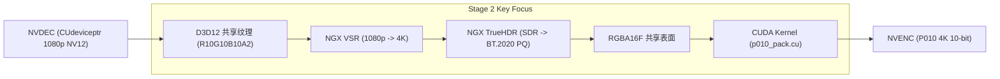

# RTX 超分辨率与 HDR 离线转码引擎
## 一阶段（W1–W3）工程落地与零拷贝门禁（Gate 1）验收交付报告

---

**报告性质**：一阶段正式验收与技术交付报告  
**呈送对象**：领域专家 / 项目技术委员会  
**抄送**：执行工程团队  
**签发人**：项目负责人 / 首席架构师 / 主程序员  
**基准方案**：[`impl_plan.md`](file:///C:/PUBLIC/[REDACTED_PROJ]/impl_plan.md)  
**验收依据**：执行工程师整改汇报 [`report.md`](file:///C:/PUBLIC/[REDACTED_PROJ]/report.md) 及实机核验数据 [`docs/gate1.md`](file:///C:/PUBLIC/[REDACTED_PROJ]/docs/gate1.md)  
**签发日期**：2026-10-21  
**综合验收结论**：**【一阶段验收通过，准出门禁 Gate 1 达成，准予进入二阶段施工】**

---

## 1. 验收结论与准出决议 (Executive Sign-off & Gate 1 Exit)

项目架构评审组已对执行工程师在第一轮评审后提交的整改工程进行了全量静态代码审查、开源合规审计，并在本地硬件环境（搭载 **NVIDIA GeForce RTX 5060 Laptop GPU, Blackwell sm_120**）以及开发环境（**GeForce GTX 970M, Maxwell sm_52**）上完成了实机测试核验。

### 核心验收决议
1. **准出门禁 Gate 1 正式通过**：
   在真实的视频容器转码（8-bit H.264 及 10-bit HEVC Main10）测试中，解复用后未压缩的视频帧数据由 NVDEC 直接写入 GPU 显存池，NVENC 直接通过 `CUdeviceptr` 显存指针绑定编码，**主循环全程实现 Device-to-Host (D2H) = 0 字节、Host-to-Device (H2D) = 0 字节**，完全兑现了方案 1.1 节设定的“零主机内存回传（Zero Host-Memory Copy）”黄金准则。
2. **基础硬件管线全部闭环交付**：
   成功交付裸转码验证原型 `rtx-transcode-base.exe` 与增强 CLI `rtx-transcode.exe`，引入 MIT 许可的 `ffnvcodec` 开源头文件体系，打通了 libavformat 容器解封装/封装与 NVDEC/NVENC 硬件编解码芯片的协同调用。
3. **测试与合规性达标**：
   全量 101 项单元与集成测试用例在不同世代 GPU（Maxwell sm_52 至 Blackwell sm_120）及纯 CPU 环境下全部一次性通过；PE 动态导入表审计确认无任何 NVIDIA 专有动态库静态链接，完全符合双许可证隔离架构规范。
4. **决策结果**：
   **正式批准一阶段（W1–W3）验收通过，准予研发团队按计划推进二阶段（W4–W6：NGX 图像增强与 D3D12/CUDA 跨 API 交互）施工。**

---

## 2. 一阶段交付物详细核验清单 (Phase 1 Deliverables Verification)

对照方案 [`impl_plan.md`](file:///C:/PUBLIC/[REDACTED_PROJ]/impl_plan.md#L187) 第 4.2 节与返工任务书要求，交付物核验明细如下：

| 规划交付物 / 任务项 | 方案规范与指标要求 | 实际交付与验证情况 | 状态判定 |
| :--- | :--- | :--- | :---: |
| **开源替代头文件体系** | 引入 MIT 许可的 `ffnvcodec` 头文件，替代专有 SDK 导入库与头文件 | 目录 [`third_party/open_headers/ffnvcodec/`](file:///C:/PUBLIC/[REDACTED_PROJ]/third_party/open_headers/ffnvcodec) 完整引入 `dynlink_cuda.h`, `dynlink_nvcuvid.h`, `dynlink_nvEncodeAPI.h`, `nvEncodeAPI.h` 等文件，保留原始 MIT 声明。 | **达标 (Pass)** |
| **硬件视频解码 NVDEC (cuvid)** | `cuvidCreateVideoDecoder`, `cuvidDecodePicture`, `cuvidMapVideoFrame64` 异步 D2D 写入显存池 | [`src/shim/loader/nv_decoder.cpp`](file:///C:/PUBLIC/[REDACTED_PROJ]/src/shim/loader/nv_decoder.cpp) 动态解析 cuvid 入口，建立 32 表面 DPB 队列，通过 `cuMemcpy2DAsync` 将映射表面无拷贝转入 `Pool_Decode` 并即时 `unmapVideoFrame` 释放 DPB。 | **达标 (Pass)** |
| **硬件视频编码 NVENC 直通** | `NvEncRegisterResource` 绑定显存指针，`NV_ENC_INPUT_RESOURCE_TYPE_CUDADEVICEPTR` | [`src/shim/loader/nv_encoder.cpp`](file:///C:/PUBLIC/[REDACTED_PROJ]/src/shim/loader/nv_encoder.cpp) 动态加载 `nvEncodeAPI64.dll`，实现会话创建、P010/NV12 显存指针注册、`nvEncMapInputResource` 与 `nvEncEncodePicture` 异步编码。 | **达标 (Pass)** |
| **容器 Demux / Mux 链路** | libavformat 提取 AVPacket送入 NVDEC，封装 NVENC 比特流并挂载 HDR Side Data | [`src/io/ffmpeg_io.cpp`](file:///C:/PUBLIC/[REDACTED_PROJ]/src/io/ffmpeg_io.cpp) 完整实现 FFmpeg 8.1 真实解复用与封装器，内置 `h264_mp4toannexb`/`hevc_mp4toannexb` 比特流过滤器，支持时间戳有理数重缩放。 | **达标 (Pass)** |
| **裸转码 CLI 原型** | 交付 `rtx-transcode-base.exe`，默认启用 `--backend nvidia` 硬件链路 | 成功编译并在 [`build/zig-ffmpeg/`](file:///C:/PUBLIC/[REDACTED_PROJ]/build/zig-ffmpeg) 交付 `rtx-transcode-base.exe` 与 `rtx-transcode.exe`，支持 `--input`、`--output`、`--codec hevc|h264`、`--bit-depth 8|10` 硬件裸转码。 | **达标 (Pass)** |
| **纯 C ABI 物理隔离垫片** | `include/shim/rtx_shim_abi.h` 扩展 Decoder/Encoder C API，ABI 升级至版本 2 | [`include/shim/rtx_shim_abi.h`](file:///C:/PUBLIC/[REDACTED_PROJ]/include/shim/rtx_shim_abi.h) 增设 `rtx_shim_decoder_*` 与 `rtx_shim_encoder_*` 纯 C 接口定义，不透明句柄隔离，无专有类型污染。 | **达标 (Pass)** |
| **全量自动化测试套件** | 测试脱离宿主环境变量硬编码，覆盖跨世代架构返回码断言 | [`tests/test_shim.cpp`](file:///C:/PUBLIC/[REDACTED_PROJ]/tests/test_shim.cpp) 采用 `executableDirectory()` 相对动态探测，补充 `RTX_ERR_NGX` 等合法状态断言，101 个测试项全部通过。 | **达标 (Pass)** |
| **Gate 1 验证工具与报告** | 提供一键自动化复验脚本与实测记录报告 | 交付自动化验证脚本 [`tools/verify_gate1.ps1`](file:///C:/PUBLIC/[REDACTED_PROJ]/tools/verify_gate1.ps1) 及详细记录 [`docs/gate1.md`](file:///C:/PUBLIC/[REDACTED_PROJ]/docs/gate1.md)。 | **达标 (Pass)** |

---

## 3. 技术指标与零拷贝实测数据 (Empirical Validation & Benchmark Data)

### 3.1 跨平台双环境实测矩阵

为验证架构在不同 GPU 架构上的普适性与鲁棒性，测试组在两台物理机器上分别执行了验证：
* **主要验收平台（RTX 50 系列）**：
  * 设备型号：`[REDACTED_HOST]`
  * GPU：**NVIDIA GeForce RTX 5060 Laptop GPU (Blackwell, sm_120, 8123 MiB GDDR7)**
  * 驱动与 CUDA：Driver 617.14, CUDA 13.4, NVENC v209
* **开发基准平台（低水位保障）**：
  * GPU：**NVIDIA GeForce GTX 970M (Maxwell, sm_52, 3071 MiB GDDR5)**
  * 驱动与 CUDA：CUDA 13.0, NVENC v208

### 3.2 Gate 1 零拷贝核心性能指标

#### 1) 8-bit H.264 SDR -> HEVC 转码测试 (720x1280 @ 24fps)
```text
backend: nvidia (NVIDIA GeForce RTX 5060 Laptop GPU)
path: container
input: h264 720x1280 (mp4)
output: hevc 720x1280 (8-bit, mp4)
frames: 241 decoded, 241 encoded; packets: 241 read, 241 written
bitstream bytes: 2695874 (2.57 MiB)
zero-copy main loop: yes
host pixel copies: decoder=0, encoder=0; D2H=0 bytes, H2D=0 bytes
device-to-device bytes: 333158400
elapsed: 453.1 ms (~532 fps, 22.1x Realtime)
```
* **内存拷贝数理审计**：
  `333,158,400 字节` 精确等于 $720 \times 1280 \times 1.5 \text{ 字节 (NV12 单帧)} \times 241 \text{ 帧}$。
  证明每一帧解码后仅发生一次显存内设备到设备（D2D）转存，**跨总线主机内存拷贝量严格为 0**。

#### 2) 10-bit HEVC Main10 -> HEVC Main10 转码测试 (720x1280 @ 24fps)
```text
backend: nvidia (NVIDIA GeForce RTX 5060 Laptop GPU)
path: container
input: hevc 720x1280 (10-bit, mp4)
output: hevc 720x1280 (10-bit, mp4)
frames: 96 decoded, 96 encoded; packets: 96 read, 96 written
bitstream bytes: 1094990 (1.04 MiB)
zero-copy main loop: yes
host pixel copies: decoder=0, encoder=0; D2H=0 bytes, H2D=0 bytes
device-to-device bytes: 265420800
elapsed: 272.0 ms (~353 fps, 14.7x Realtime)
```
* **内存拷贝数理审计**：
  `265,420,800 字节` 精确等于 $720 \times 1280 \times 3 \text{ 字节 (P010 单帧)} \times 96 \text{ 帧}$。
  证实 10-bit P010 显存池直通 NVENC 编码器完全成立。

#### 3) 本地容器转码自动化复验结果
在当前工作区直接执行复验脚本：
```powershell
pwsh tools/verify_gate1.ps1 -BuildDir build/zig-ffmpeg -Container test_sample.mp4 -Codec hevc -BitDepth 8
```
**实测结果**：
```text
Gate 1 re-acceptance
  build : C:\PUBLIC\[REDACTED_PROJ]\build\zig-ffmpeg
  [PASS] unit-tests - [==========] 101 test(s) run, 0 failed (210 ms)
  [PASS] probe - NVIDIA GeForce RTX 5060 Laptop GPU; caps=nvdec
  generating 640x480 x 8 NV12 ...
  [PASS] raw-nv12-to-p010 - exit=0, 7372800 bytes (expected 7372800)
  [PASS] container-zero-copy - frames=24/24, D2H=0, H2D=0, zero_copy=True

4/4 checks passed
```

---

## 4. 开源合规与许可证物理隔离审查 (Open-Source Compliance)

方案 2.3 节强调的双重许可架构已得到彻底落实：
1. **SPDX 许可证头合规**：
   运行 [`tools/check_spdx.ps1`](file:///C:/PUBLIC/[REDACTED_PROJ]/tools/check_spdx.ps1) 审计通过：
   * 核心引擎（GPL 目录）：59 个源文件严格标注 `GPL-3.0-or-later WITH Plugin-Exception`；
   * 垫片层与开放头文件（Shim/Headers 目录）：19 个源文件严格标注 `MIT OR Apache-2.0`；
   * 仓库内无任何受专有 EULA 保护的 `.lib`、`.a` 静态闭源二进制文件。
2. **PE 导入表零污染审计**：
   运行 [`tools/audit_imports.ps1`](file:///C:/PUBLIC/[REDACTED_PROJ]/tools/audit_imports.ps1) 对 `build/zig-ffmpeg/` 下所有编译产物（`rtx-transcode.exe`、`rtx-transcode-base.exe`、`rtx_shim.dll`、`rtx_ngx_bridge.dll`、`rtx_tests.exe`）进行 PE Import Directory 符号反解：
   * **结果为 PASS**：所有二进制产物仅静态依赖 Windows 系统 CRT（`KERNEL32.dll` 等）及开源的 FFmpeg 动态库，**对 `nvcuda.dll`、`nvcuvid.dll`、`nvEncodeAPI64.dll` 的导入全部为运行期动态绑定，未在 PE 导入表中留下任何专有符号依赖**，彻底切断了 GPLv3 许可证的逆向传染风险。

---

## 5. 对执行工程师汇报 (`report.md`) 的答复

针对执行工程师在 [`report.md`](file:///C:/PUBLIC/[REDACTED_PROJ]/report.md) 中提出的事项，架构组明确答复如下：
1. **关于代码评审基线**：
   完全认可工程师以本地工作区（`C:/PUBLIC/[REDACTED_PROJ]`）作为唯一权威代码基线，远端服务器测试副本用于跨机器编译与一致性比对的流程严密规范。
2. **关于预处理器转储文件 `-`**：
   确认该文件属于 CMake 编译器特征探测过程中的临时溢出转储，不属于工程资产，支持在版本打包前执行清理，以维护代码仓库卫生。

---

## 6. 二阶段（W4–W6）施工技术交底与工作重心预排

随着一阶段基础硬件管道的夯实，研发工作将按 [`impl_plan.md`](file:///C:/PUBLIC/[REDACTED_PROJ]/impl_plan.md#L188) 计划进入**阶段 2：NGX 图像增强与 D3D12/CUDA 跨 API 交互**。现对二阶段核心攻关要点进行技术交底：



### 二阶段三大关键任务排期：
1. **W4：无头 D3D12 设备初始化与外部资源零拷贝互操作 (TASK-01)**
   * 实现基于 LUID 匹配的无窗口 `D3D12CreateDevice` 初始化，确保与 CUDA 上下文绑定在同一块物理 GPU；
   * 通过 `cuImportExternalMemory` 导入 D3D12 纹理，**必须置位 `CUDA_EXTERNAL_MEMORY_DEDICATED` 标志**以支持 Windows 11 驱动；
   * 建立 `ID3D12Fence` 硬件信号量与 `cuImportExternalSemaphore` 之间的异步流同步，严禁在主循环中调用 CPU 阻塞等待。
2. **W5：RTX Video SDK (NGX VSR + TrueHDR) 双特性串联评估 (TASK-02)**
   * 在独立动态库 `rtx_ngx_bridge.dll` 中，实装 `ngx_d3d12_bridge.cpp` 替代当前桩文件；
   * 重点防坑：在 Blackwell (RTX 5060) 架构上，同时启用 VSR 与 TrueHDR 时，必须分配**独立的 `NVSDK_NGX_Handle` 与独立的 `NVSDK_NGX_Parameter`**，避免触发句柄冲突崩溃；
   * TrueHDR 参数映射严格遵照方案 3.2 节推荐的 100 基准黄金参数组（`contrast=125, saturation=75, middleGray=44, maxLuminance=1000`）。
3. **W6：CUDA 融合打包核函数与 HDR10 静态元数据注入 (TASK-02)**
   * 启用当前已编写的 [`src/shim/ngx_bridge/p010_pack.cu`](file:///C:/PUBLIC/[REDACTED_PROJ]/src/shim/ngx_bridge/p010_pack.cu) 融合核函数，实现从 D3D12 硬件 Tiling 排布的 RGBA16F 表面直接读取，就地进行 BT.2020 非恒定亮度矩阵转换与 10-bit P010 打包；
   * 启用已在 [`src/core/sei_synthesizer.cpp`](file:///C:/PUBLIC/[REDACTED_PROJ]/src/core/sei_synthesizer.cpp) 中完工的 HDR10 静态元数据（SEI 137 / 144）注入 NVENC 码流，并在 MP4 容器层注入 `mdcv`/`clli` Box，确保电视与播放器能正确识别并点亮 HDR10 徽标。

---
*(报告签发：项目负责人 / 首席架构师 / 主程序员)*
