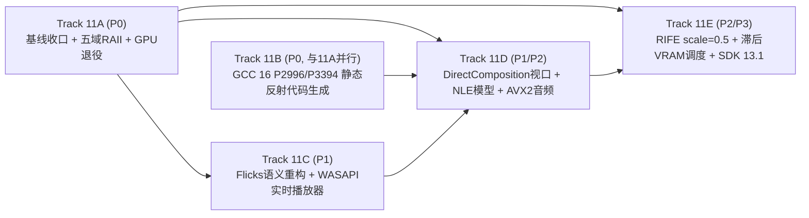

# CineRTX Phase 11（v0.3.0）SuperPower 施工总纲：五轨并行契约与物理文件隔离矩阵

- **文档编号**：`CINERTX-P11-SUPERPOWER-PLAN-005`
- **归档路径**：`docs/phase11/05_CineRTX_Phase11_SuperPower施工总纲_五轨并行契约与物理文件隔离矩阵.md`
- **权威裁决母本**：[`04_CineRTX Phase 11 冲突评判与方案.md`](./04_CineRTX Phase 11 冲突评判与方案.md)（综合采纳 [`03_CineRTX_Phase11_架构深度评审报告.md`](./03_CineRTX_Phase11_架构深度评审报告.md) 之架构基线，收敛 00–02 号文档全部 8 项冲突）
- **源码基线**：GitHub `main` 分支 `v0.2.0`（Commit [`52103a7`](https://github.com/zhaotong96/CineRTX/commit/52103a7363c9b431eb4ab8ea8da86007ebe2dd49)，78/78 GPU 单测 PASS）
- **目标里程碑**：`v0.3.0`（从“离线纯 GPU 视频重制器”跃迁至“异构 RAII 媒体运行时 + 实时播放器 + 最小可验收 NLE 垂直切片”）
- **签发角色**：多媒体系统工程与 GPU 异构计算首席领域专家

---

## 一、 Phase 11 架构不变量与全局硬红线（Architectural Invariants）

所有参与 Phase 11 施工的工程师（Track 11A–11E）在提交任何 PR 前必须无条件遵守以下 7 条架构铁律：

1. **五域异构绝对 RAII 与 GPU Fence 异步退役铁律（R-03）**：
   - 严禁引入任何 `initialize()/shutdown()`、`open()/close()`、`create()/destroy()` 两段式显式生命周期协议；所有新对象强制使用私有构造 + `static Result<T> create(...)` 工厂 + 析构自动按依赖逆序释放。
   - 任何涉及 GPU 异步执行的资源（D3D12 Backbuffer / Upload Buffer / SwapChain / CUDA External Memory）在析构或 `ResizeBuffers` 前**必须等待对应 Fence 值真正完成**；`WaitForSingleObject` 返回 `WAIT_TIMEOUT` 时**严禁忽略超时强行释放**，必须走 `GetDeviceRemovedReason()` 检查或延迟退役池。
2. **C++26 静态反射隔离边界铁律（R-02）**：
   - MSVC（截至 2026 年 11 月 [14.53 Preview](https://devblogs.microsoft.com/cppblog/msvc-build-tools-preview-updates-november-2026/)）尚无 P2996/P3394 实现，生产二进制继续由 MSVC `/MT` `/std:c++latest`（及 Zig 0.13 回退链）构建。
   - P2996/P3394 静态反射严格限定在独立零依赖子工程 `schema/` 中由 [GCC 16](https://gcc.gnu.org/gcc-16/changes.html)（`-std=c++26 -freflection`）编译运行，输出标准 C++23 消费文件与 `schema.json` 供主工程消费，CI 强制校验生成物 Diff 一致性。
3. **D3D12 与 DirectComposition 官方 API 严谨性铁律（R-05）**：
   - 严禁书写不存在的 `D3D12_COMMAND_QUEUE_PRIORITY_LOW`（合法枚举仅 [`NORMAL / HIGH / GLOBAL_REALTIME`](https://learn.microsoft.com/en-us/windows/win32/api/d3d12/ne-d3d12-d3d12_command_queue_priority)）；视口队列统一使用 `D3D12_COMMAND_QUEUE_PRIORITY_NORMAL` + Fence 节流 + 提交深度上限。
   - [`CreateSwapChainForComposition`](https://learn.microsoft.com/en-us/windows/win32/api/dxgi1_2/nf-dxgi1_2-idxgifactory2-createswapchainforcomposition) 强制采用 `DXGI_SWAP_EFFECT_FLIP_SEQUENTIAL` + 非零宽高 + `DXGI_SCALING_ASPECT_RATIO_STRETCH`，动态加载 `dcomp.dll`（`LOAD_LIBRARY_SEARCH_SYSTEM32`）。
4. **原生 `705,600,000 Hz` Flicks 语义铁律（R-06）**：
   - 全局锁定 `1 Flick = 1/705,600,000 s`（约 `1.417 ns`，绝不降采样至 `14,112,000 Hz`），在类型层面彻底分离**无状态绝对 PTS 换算**（保留源 `SourceTimestamp{pts, dts, time_base}`）与**有状态增量 Bresenham 余数结转**。
5. **调度控制面隔离铁律（R-05 / R-08）**：
   - 实时播放器 `MediaPlaybackSession`（Deadline 驱动、音频主时钟不阻塞、过期帧可丢弃）与离线 `RemasterPipeline`（吞吐优先、深流水背压）**严禁共用同一调度控制面**，仅复用底层解码、GPU 算子与封装抽象。
6. **许可证边界与 PE 二进制闭包红线**：
   - [`cmake/AuditSpdx.cmake`](../../cmake/AuditSpdx.cmake)：`include/shim/` 与 `src/shim/` 强制 `MIT OR Apache-2.0`，其余全仓强制 `GPL-3.0-or-later WITH Plugin-Exception`。
   - [`cmake/AuditImports.cmake`](../../cmake/AuditImports.cmake)：`CineRTX.exe` 体积严格保持在 `[1.2 MB, 12.0 MB]`，零泄露 FFmpeg / NVIDIA / MSVC 动态运行时伴生 DLL。
7. **实测口径诚实性铁律**：
   - 严禁拍脑袋引用未经实测的显存、FPS 或压缩率数字；任何性能声明必须附带完整测试口径（GPU 型号、驱动版本、SDK 版本、素材规格、编码参数、预热时长、统计窗口与重复次数）。

---

## 二、 五轨垂直切片依赖拓扑与工程师编组矩阵

Phase 11 遵循 **“资源秩序（11A）+ 契约秩序（11B） $\rightarrow$ 时间与实时执行秩序（11C） $\rightarrow$ 零回读合成与编辑秩序（11D） $\rightarrow$ 高阶算子与编码秩序（11E）”** 的渐进垂直切片拓扑：

| 施工单编号 | 分轨与优先级 | 承接工程师角色 | 前置依赖 | 对应独立施工文档 |
| :---: | :---: | :--- | :---: | :--- |
| **06** | **Track 11A (P0)** | 系统内核与 GPU 资源生命周期工程师 | 无 | [`06_CineRTX_Phase11_施工单_Track_11A_基线元数据收口与五域异构RAII退役体系.md`](06_CineRTX_Phase11_施工单_Track_11A_基线元数据收口与五域异构RAII退役体系.md) |
| **07** | **Track 11B (P0)** | 编译器工具链与契约架构工程师 | 无（**与 11A 严格并行**） | [`07_CineRTX_Phase11_施工单_Track_11B_C++26_P2996静态反射独立代码生成轨.md`](07_CineRTX_Phase11_施工单_Track_11B_C++26_P2996静态反射独立代码生成轨.md) |
| **08** | **Track 11C (P1)** | 媒体运行时与实时音视频同步工程师 | 11A | [`08_CineRTX_Phase11_施工单_Track_11C_Flicks语义重构与WASAPI实时播放内核.md`](08_CineRTX_Phase11_施工单_Track_11C_Flicks语义重构与WASAPI实时播放内核.md) |
| **09** | **Track 11D (P1/P2)** | 图形合成（DComp/D3D12）与 NLE 引擎工程师 | 11A + 11B + 11C | [`09_CineRTX_Phase11_施工单_Track_11D_DirectComposition零回读视口与统一NLE引擎及AVX2音频矩阵.md`](09_CineRTX_Phase11_施工单_Track_11D_DirectComposition零回读视口与统一NLE引擎及AVX2音频矩阵.md) |
| **10** | **Track 11E (P2/P3)** | GPU AI 推理与视频编解码优化工程师 | 11A + 11D | [`10_CineRTX_Phase11_施工单_Track_11E_VSR_FRUC显存感知自适应调度与SDK13.1分级接入.md`](10_CineRTX_Phase11_施工单_Track_11E_VSR_FRUC显存感知自适应调度与SDK13.1分级接入.md) |

---

## 三、 物理文件隔离矩阵（防止跨工程师合并冲突）

为保证 P0 双轨（11A / 11B）可 **0 冲突并行施工**，且后续轨道交接边界清晰，各轨道的独占修改/新建文件边界锁定如下：

| 施工分轨 | 允许修改的既有文件 | 允许新建的文件 | 严禁越界修改的文件 |
| :--- | :--- | :--- | :--- |
| **Track 11A** | `CMakeLists.txt`、`README.md`、`README_zh.md`、`include/rtx/i18n.h`、`src/core/hw_transcode_internal.h`、`src/core/hw_transcode.cpp`、`src/core/hw_transcode_stages.cpp`、`src/gui/preview_viewport.h/.cpp` | `docs/archive/HISTORY_SUMMARY_P1_P10.md`、`include/rtx/raii_owners.h`、`src/gui/d3d12_raii.h`、`tests/test_raii_retirement.cpp` | `include/rtx/param_schema.h`、`src/core/param_schema.cpp`、`src/cli/main.cpp`、`schema/*` |
| **Track 11B** | `include/rtx/param_schema.h`、`src/core/param_schema.cpp`、`src/cli/main.cpp`、`.github/workflows/ci.yml` | `schema/schema_model.hpp`、`schema/reflection_codegen.cpp`、`schema/CMakeLists.txt`、`schema/generated/param_schema.generated.hpp`、`schema/generated/param_schema.generated.inc`、`schema/generated/schema.json`、`tests/test_param_schema_reflection.cpp` | `src/core/hw_transcode*`、`src/gui/*`、`src/shim/*` |
| **Track 11C** | `include/rtx/flicks.h`、`include/rtx/rational.h`、`src/core/rational.cpp`、`src/io/ffmpeg_io.cpp`、`src/gui/workstation_canvas.h/.cpp` | `include/rtx/time_model.h`、`include/rtx/telemetry_bus.h`、`include/rtx/playback_session.h`、`src/core/playback_session.cpp`、`src/core/wasapi_audio_output.cpp`、`src/core/gop_seek_scheduler.cpp`、`tests/test_flicks_semantics.cpp`、`tests/test_playback_session.cpp` | `schema/*`、`src/shim/ngx_bridge/*` |
| **Track 11D** | `src/shim/ngx_bridge/d3d12_interop.h/.cpp`、`src/gui/preview_viewport.h/.cpp`、`src/gui/rtx_gui.cpp`、`src/core/job_queue.cpp`、`cmake/AuditImports.cmake` | `include/rtx/nle_project.h`、`src/core/nle_project.cpp`、`include/rtx/render_graph.h`、`src/core/render_graph.cpp`、`include/rtx/audio_mixer_avx2.h`、`src/core/audio_mixer_avx2.cpp`、`src/core/wsola_stretch.cpp`、`tests/test_nle_vertical_slice.cpp`、`tests/test_audio_mixer_avx2.cpp` | `src/shim/ngx_bridge/rife_*`、`src/shim/loader/nv_encoder.cpp` |
| **Track 11E** | `include/shim/ngx_bridge_abi.h`、`include/rtx/ngx_remaster.h`、`src/core/ngx_remaster.cpp`、`src/shim/ngx_bridge/bridge_exports.cpp`、`src/shim/ngx_bridge/rife_engine.cpp`、`src/shim/ngx_bridge/rife_pack.cu`、`src/core/hw_transcode_stages.cpp`、`src/shim/loader/nv_encoder.cpp`、`.gitmodules`（需基线审批） | `include/rtx/vram_scheduler.h`、`src/core/vram_scheduler.cpp`、`tests/test_vram_scheduler.cpp`、`tests/test_rife_scale05.cpp` | `schema/*`、`src/core/nle_project.*`、`src/core/wasapi_*` |

> **注**：`CMakeLists.txt` 与 `tests/CMakeLists.txt` 注册新增 `.cpp` 源文件时，采用按轨道分块注释区（`# --- Track 11A/11B/11C/11D/11E ---`）追加，最小化合并摩擦。

---

## 四、 Phase 11 全局总验收门禁矩阵（Master Sign-Off Gates）

- [ ] **Gate 11A-1**：`CineRTX.exe --version`、`CMakeLists.txt`、`README*.md` 与打包产物统一为 `0.3.0`；`i18n.h` 断言文本对齐 `125` 词条；`AuditSpdx.cmake` 与 `AuditImports.cmake` 100% PASS。
- [ ] **Gate 11A-2**：`NvidiaTranscodeSession` / `RemasterPipeline` / `PreviewViewport` 连续 100 次创建/销毁 + 每步失败注入零泄漏；GPU Fence 超时不强拆资源，Device Lost 可控恢复；工作线程退出严格先于缓冲区析构。
- [ ] **Gate 11B-1**：GCC 16（`-std=c++26 -freflection`）成功编译运行 `reflection_codegen`，20 项参数全量由生成物驱动；重复 `json_key`/`cli_flag` 触发编译期失败；MSVC `/std:c++latest` 与 Zig 构建全绿且 CI Diff 一致。
- [ ] **Gate 11C-1**：Flicks 非整除 `time_base`、VFR、B 帧乱序 PTS、Seek 跳变与负 PTS 测试全绿；`workstation_canvas` 无核心 `*_ms` 残留；全制式 SMPTE timecode 准确。
- [ ] **Gate 11C-2**：H.264/HEVC/AV1 原生解码回放、`IAudioClock` 主时钟跟随、倍速/暂停/GOP-Aware Seek/逐帧步进与音频热拔插（`AUDCLNT_E_DEVICE_INVALIDATED`）自动重连全绿；UI 线程零 GPU 阻塞。
- [ ] **Gate 11D-1**：DirectComposition 采用 `NORMAL` 队列 + `DXGI_SWAP_EFFECT_FLIP_SEQUENTIAL`，实测监看路径 `D2H == 0 B`；HDR/SDR 跨屏切换与反复缩放 100 次无撕裂/闪烁/泄漏。
- [ ] **Gate 11D-2**：1V+1A 最小 NLE 工程保存/重开/重链接、Trim/Split/Move/Delete、Undo/Redo 与多段硬切导出逐帧一致；音频回调零阻塞/分配/I/O，AVX2 混音与 WSOLA 变速达标。
- [ ] **Gate 11E-1**：`vsr-first` + RIFE `scale=0.5`（128 对齐 + `reflect101`）无边缘伪影；滞后 VRAM 调度器 4K 压制无 OOM；输出带完整实测口径的 SDK 13.1 分层 B 帧（7 vs 15 vs 31）与 UHQ 实测矩阵。

---

## 五、 启动前唯一待拍板项

- **产品驱动基线决策（供 Track 11E 使用，不阻塞 Track 11A–11D 立即开工）**：决定 `v0.3.0` 正式发行包继续维持 **R580 / `nv-codec-headers n13.0.19.1`** 兼容基线（仅先移植 GOP-Aware Seek 范式，13.1 特性放实验开关后），还是将最低驱动门槛提升至 **R610（≥ 610.0）** 并升版至 `13.1.15`。
