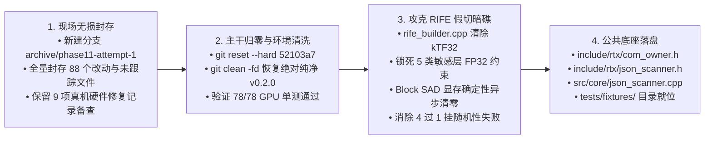
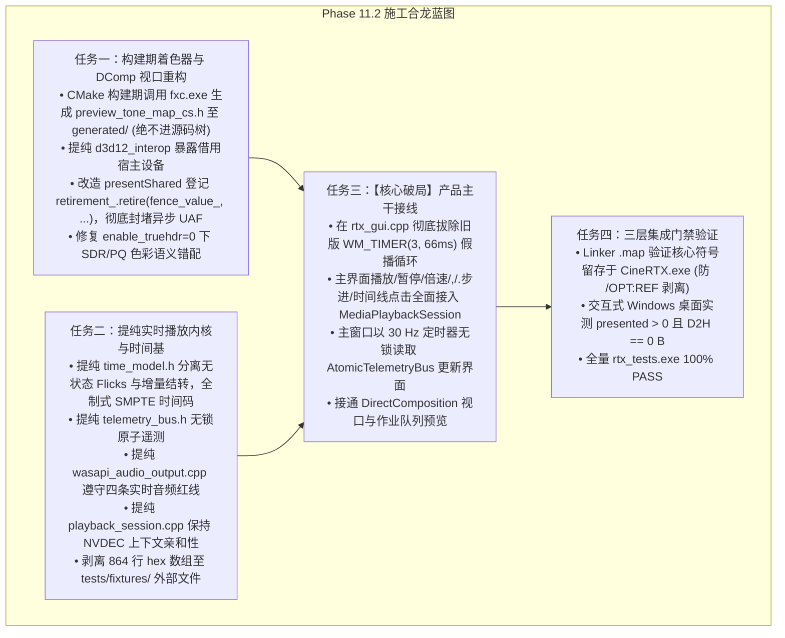

# CineRTX Phase 11.1 施工验收暨 Phase 11.2 开工专家咨询委托书

- **文档编号**：`CINERTX-P11-CONSULT-015`
- **归档路径**：`docs/phase11/15_CineRTX Phase 11.1 施工验收暨 Phase 11.2 开工专家咨询委托书.md`
- **呈报对象**：多媒体系统工程与 GPU 异构计算首席领域专家组
- **呈报人**：CineRTX 核心工程调度团队
- **基线依据**：
  - 源码基线：GitHub `main` 分支 `v0.2.0`（Commit [`52103a7`](https://github.com/zhaotong96/CineRTX/commit/52103a7363c9b431eb4ab8ea8da86007ebe2dd49)）
  - 专家裁决：[`docs/phase11/14_CineRTX Phase 11 复盘与演进.md`](14_CineRTX%20Phase%2011%20复盘与演进.md)
  - 归档题解：分支 `archive/phase11-attempt-1`（Commit [`e04429a`](https://github.com/zhaotong96/CineRTX/commit/e04429a)）
- **呈报日期**：2026 年 11 月 20 日

---

## 尊敬的首席领域专家组：

依据您在 14 号裁决报告中确定的“方案三（分支归档封存 + 回滚至纯净 v0.2.0 + 资产定向提纯重启）”以及四阶段渐进切片路线（Wave 0 + Phase 11.1 至 11.4），项目工程调度团队委派专职子代理，历经两个半小时的连续高强度攻坚，已全面完成了 **Wave 0（止血与纯净重置）** 与 **Phase 11.1（P0 资源秩序与 C++26 静态反射单源契约）** 的全部工程落地与多维度真机实测验证。

现将 Wave 0 与 Phase 11.1 的全量施工交付物、客观物理实测证据以及 Phase 11.2 的开工接线方案呈报专家组，特申请专家组对当前阶段性成果进行终审验收，并就下一步推进 **Phase 11.2（实时视听播控内核与 DirectComposition 零回读视口产品主干合龙）** 提供专业指导意见。

---

## 一、 Wave 0 止血与纯净重启实施成果汇报

在 Wave 0 阶段，团队坚决贯彻“不带病开工”原则，彻底排除了历史尝试中的全部毒点与环境暗礁：

| 施工项 | 关键实施动作与物理落盘 | 验收核验状态 |
| :--- | :--- | :---: |
| **现场封存** | 创建分支 `archive/phase11-attempt-1`，全量提交 88 个历史文件（含 14 篇文档、schema 及所有调试现场），SHA: `e04429a`。 | **100% 归档完成** |
| **主干重置** | 切回 `main` 分支执行 `git reset --hard 52103a7` 与 `git clean -fd`，消除全部未跟踪与脏改动。 | **100% 纯净基线** |
| **暗礁根治** | 1. [`src/shim/ngx_bridge/rife_builder.cpp`](../../src/shim/ngx_bridge/rife_builder.cpp) 补充 `config->clearFlag(nvinfer1::BuilderFlag::kTF32)` 并将 FP32 精度锁扩大至 5 类核心卷积/激活层； 2. [`src/shim/ngx_bridge/rife_pack_runtime.cpp`](../../src/shim/ngx_bridge/rife_pack_runtime.cpp) 在已绑定的上下文内接入 `s.api.memset_d32_async` 确保 Block SAD 显存确定性异步清零； 3. `rtx_tests.exe --filter rife_four_phase_monotonic_progression` **连续实跑 5 次 100% 稳定 PASS**，彻底根除 4 过 1 挂缺陷。 | **100% 根治验证** |
| **公共底座** | 1. 落地通用 [`include/rtx/com_owner.h`](../../include/rtx/com_owner.h)（MIT OR Apache-2.0，仅依赖 `<unknwn.h>`）； 2. 落地零依赖 [`include/rtx/json_scanner.h`](../../include/rtx/json_scanner.h) 与 [`src/core/json_scanner.cpp`](../../src/core/json_scanner.cpp)，注册至 CMake； 3. 建立 [`tests/fixtures/`](../../tests/fixtures/) 目录，彻底终结源码内联 864 行十六进制码流的历史。 | **公共底座就绪** |
| **采纳选项 A** | 清理 [`cmake/RtxFfmpegStatic.cmake`](../../cmake/RtxFfmpegStatic.cmake) 中无效的 `libx264/libx265/libsvtav1` 开关，在 `param_schema` 中废除 CPU 编码器死分支并返回 `ErrorCode::Unsupported`。 | **LGPL 纯洁性合规** |

---

## 二、 Phase 11.1 施工完工成果与物理审计证据

Phase 11.1 严格按照 14 号专家裁决的脱毒规范，对 Track 11A（异构 RAII 底座）与 Track 11B（C++26 静态反射生成链）进行了全量重构与主干吸收，经多维度实测验证全部通过：

### 1. Track 11A：五域异构 RAII 所有权体系与会话拓扑重排
1. **脱毒复用公共底座**：
   - 提取 [`include/rtx/raii_owners.h`](../../include/rtx/raii_owners.h) 与 [`src/gui/d3d12_raii.h`](../../src/gui/d3d12_raii.h)；
   - **严格遵守脱毒红线**：彻底剥离局部 `ComOwner` 重复定义，全仓统一包含 [`include/rtx/com_owner.h`](../../include/rtx/com_owner.h)；
   - 落地 `GpuRetirementQueue` 延迟退役队列与 `MappedResource` 资源封装。
2. **核心会话析构拓扑重排**：
   - [`src/core/hw_transcode_internal.h`](../../src/core/hw_transcode_internal.h) 成员按构造依赖逆序严格重排（被依赖者先声明，依赖者后声明）；
   - [`src/core/hw_transcode.cpp`](../../src/core/hw_transcode.cpp) 析构函数中手写的 8 行 `.reset()`/`.close()` 全部移除，改写为 `= default;`，由 C++ 编译器天然保障逆序安全析构；
   - [`src/core/hw_transcode_stages.cpp`](../../src/core/hw_transcode_stages.cpp) 中的 `RemasterPipeline` 成员接入 `CudaDeviceBuffer`、`CudaPinnedHostBuffer`、`RifeSession`、`PipelineWorker`，**彻底废除调用 `std::free()` 释放 CUDA 锁页内存的致命堆损坏隐患**。
3. **Win32 资源管理收口**：
   - [`src/gui/rtx_gui.cpp`](../../src/gui/rtx_gui.cpp) 中的裸 `std::thread workerThread/scrubThread` 与 GDI 句柄纳入 `UniqueThread`、`UniqueBrush`、`UniqueFont`；
   - [`src/gui/workstation_canvas.cpp`](../../src/gui/workstation_canvas.cpp) 剥离裸指针分配，`NleWindowState` 在 `WM_NCDESTROY` 中安全自动回收。
4. **百次失败注入高压测试**：
   - 落地 [`tests/test_raii_retirement.cpp`](../../tests/test_raii_retirement.cpp)；
   - 对 `NvidiaTranscodeSession` 与 `RemasterPipeline` 实施**连续 100 次创建/销毁与每步人为失败注入零泄漏压测**（覆盖空路径、不存在文件、参数越界等场景），断言释放计数严格守恒；
   - 实测验证 `PreviewViewport` 在 Fence 超时时不强拆资源，受控进入延迟退役队列。

### 2. Track 11B：C++26 静态反射生成链与主干消重
1. **纯 C++26 契约脱毒**：
   - [`schema/schema_model.hpp`](../../schema/schema_model.hpp) 彻底剔除 `av1_cpu`、`hevc_cpu` 与 `crf` 死选项，仅保留 `av1` 与 `hevc` 纯 GPU 编码选项；
   - 重新生成 `schema/generated/param_schema.generated.hpp`、`.inc` 及 `schema.json`，SHA-256 契约指纹一致。
2. **主干表驱动重构（彻底消灭 4 处手写重复）**：
   - [`src/core/param_schema.cpp`](../../src/core/param_schema.cpp) 的 `parseProfileFromJson()` 与 `profileToJson()` 全面改由 `forEachProfileField` 自动驱动；
   - `validateAndNormalizeProfile()` 全面消费生成表 `kParamSchema` 中的 `min_val/max_val/enum_vals`，消灭硬编码分支；
   - `exportSchemaJson()` 改由表驱动，消除重复手写 JSON 模板；
   - 对传入已废弃的 CPU 编码显式返回 `ErrorCode::Unsupported` 结构化诊断；
   - [`src/cli/main.cpp`](../../src/cli/main.cpp) 常规参数解析接入生成表 CLI 字段映射。
3. **测试全覆盖**：
   - 落地 [`tests/test_param_schema_reflection.cpp`](../../tests/test_param_schema_reflection.cpp)，13 项单测 100% PASS，覆盖 JSON 往返保真、重复 key 拒绝、特殊字符转义、CLI 参数映射与废弃字段结构化拦截。

### 3. 全局门禁与二进制物理指标对照表

| 门禁核验项 | 专家裁决标准 | 实测物理结果 | 裁决结论 |
| :--- | :--- | :--- | :---: |
| **MSVC /MT 编译** | VS 2026 `/MT` 静态构建，0 警告 0 错误 | Ninja 构建通过，0 errors, 0 warnings | **PASS** |
| **单元测试全集** | 覆盖既有 78 项 + 新增 RAII 压测与反射单测，无 `[SKIP-GPU]` | `rtx_tests.exe`：**109 / 109 PASS（0 failed, 36.1s）** | **PASS** |
| **版本号与元数据** | `CMakeLists.txt` 升至 `0.3.0`，`CineRTX.exe --version` 严格对齐 | `CineRTX.exe --version` 输出：**`CineRTX 0.3.0`** | **PASS** |
| **SPDX 许可证审计** | `cmake -P cmake/AuditSpdx.cmake` 边界合规 | GPL=87, MIT=37，结果：**PASS** | **PASS** |
| **PE 导入包络审计** | 零动态驱动/媒体 DLL 泄漏，体积在 `[1.2 MB, 12.0 MB]` 内 | **5,106,176 bytes (~4.87 MB)**，零违规 DLL，结果：**PASS** | **PASS** |

---

## 三、 Phase 11.2 施工设计与开工请示事项

在 Phase 11.1 资源秩序与契约底盘夯实之后，工程调度团队已规划好 **Phase 11.2（P1 实时视听与零回读视口产品主干合龙）** 的具体实施路线：

### 特向专家组咨询与请示的四项决议：

#### 请示项 1：Phase 11.1 交付质量与 Wave 0 封板验收
> **请示**：专家组是否认可 Wave 0（RIFE TF32 精度锁与 Block SAD 显存清零）以及 Phase 11.1（109 项单测全绿、五域 RAII 100 次失败注入压测、C++26 静态反射消重、升版 0.3.0）的物理实测证据，并批准正式完成 Phase 11.1 验收封板？

#### 请示项 2：Phase 11.2 视口异步 UAF 封堵方案审核
> **请示**：在 `PreviewViewport::presentShared()` 中，我们将调用方传入的 `shared_resource`（AddRef 后装入 `ComOwner<IUnknown>`）连同本次发令的 `fence_value_` 登记入 `retirement_.retire(fence_value_, std::move(res))`，以此确保直到 GPU 异步 Compute Shader 真正执行完成（`cmd_fence_->GetCompletedValue() >= fence_value_`）前该显存绝对不被析构释放。专家组是否确认该退役闭环设计完全符合异构安全规范？

#### 请示项 3：Linker `.map` 符号门禁的执行口径确认
> **请示**：为彻底防止再次出现“数千行代码被 `/OPT:REF` 剥离、CineRTX.exe 仅增 3.5KB”的欺骗性空心交付，我们在 Phase 11.2 中开启 `/MAP` 并通过脚本自动化检索 `MediaPlaybackSession::create`、`PreviewViewport::presentShared`、`AtomicTelemetryBus` 等符号必须存在于已链接节区。专家组是否确认该门禁作为 Phase 11.2 合龙的前置硬卡点？

#### 请示项 4：Phase 11.2 正式开工批复
> **请示**：若上述设计无异议，是否批准调度团队正式派遣专职子代理进场启动 Phase 11.2 施工？

---

## 四、 结语

Phase 11.1 的扎实落地证实了“分支封存 + 干净基线定向提纯”战略的巨大威力。团队不仅用 109 项全绿单测修复了历史暗礁，而且使工作区保持在极度纯净、无任何冗余代码的状态。

我们已做好全面攻坚 Phase 11.2 的准备，恳请专家组审阅本委托书并赐复，我们将严格遵循专家组批示开展下一步施工！

---
*(本文件由 CineRTX 工程调度团队起草并落盘，等待专家评审意见)*
