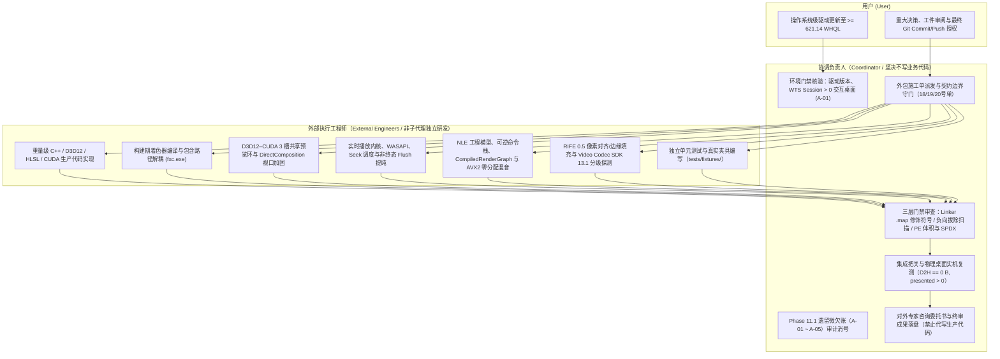

# CineRTX Phase 11 外包施工总纲暨协调负责人备忘录（终审修订版）

- **文档编号**：`CINERTX-P11-SUPERPOWER-PLAN-017-REV2`
- **归档路径**：`docs/phase11/17_CineRTX Phase 11 外包施工总纲暨协调负责人备忘录.md`
- **制定角色**：项目总协调负责人（Coordinator）
- **依据母本**：[`16_CineRTX Phase 11 演进计划.md`](./16_CineRTX%20Phase%2011%20演进计划.md)、[`21_CineRTX Phase11 施工方案深度审查.md`](./21_CineRTX%20Phase11%20施工方案深度审查.md)
- **基线版本**：Phase 11.1 基线（Commit `52103a7`，109/109 单测全绿，体积 4.87 MB）
- **目标里程碑**：`v0.3.0`（纯 GPU 异构 RAII 媒体运行时 + 零回读 DirectComposition 实时视听播放器 + 最小可验收 NLE 剪辑与 AVX2 音频矩阵 + RIFE 0.5/SDK 13.1）

---

## 一、 职责正交切分：外包执行工程师 vs. 协调负责人

为彻底吸取 Phase 11 首轮“多轨盲目并发、单测虚假绿线、主干集成空心化”的严重教训，根据用户最高指令与 21 号审查终审裁决，将后续 Phase 11.2 ~ Phase 11.4 的工程任务实施**绝对物理隔离的正交分工**：

---

## 二、 协调负责人专属备忘录（Coordinator Retained Duties）

协调负责人恪守“**不写业务代码，专注调度、契约守门与三层闭环验收**”铁律，以下 6 项核心职责严禁外包，全部由协调负责人亲自把关：

### 1. 物理环境与硬件准入门禁（A-01 核验）
- **前置硬条件**：用户在宿主机完成 NVIDIA 驱动升级后，协调负责人以只读命令核验：
  - `nvidia-smi --query-gpu=driver_version --format=csv,noheader` 必须 $\ge 621.14$。
  - `quser` 必须显示当前处于交互式控制台会话（`ID > 0` 且 `Active`，严禁 Session 0 无头环境）。
  - 若驱动未升级，协调负责人有权拒绝派发 Phase 11.2 的桌面视口实测任务。

### 2. Phase 11.1 遗留欠账消号把关（A-01 至 A-05）
在 Phase 11.2 开工首日，协调负责人逐项核验消号证据（注：实证确认 `rtx_gui.cpp` 中 `WorkstationApp` 已在 11.1 改用 `UniqueThread`、`UniqueBrush` 与 `UniqueFont`，无需重复改造）：
- **A-01**：驱动与桌面会话实据就位。
- **A-02**：`tests/test_raii_retirement.cpp` 必须接入 `tests/fixtures/` 真实媒体小文件，断言中段编解码失败注入下的句柄释放守恒，拒绝空路径提前短路。
- **A-03**：核验 `src/core/param_schema.cpp` 100% 切换至 `include/rtx/json_scanner.h`，删除私有重复扫描器。
- **A-04**：核验 RIFE 10 次连续单测全绿日志与 `verify_ssot.py` 运行实据。
- **A-05 / C-04**：核验 `src/gui/workstation_canvas.cpp` 的 `ChromeText::SendEncoder` 消除宽字符乱码，并从 UI 下拉框物理删除已废弃的 `av1_cpu`、`hevc_cpu` 与 `crf` 选项。

### 3. Linker `.map` 符号留存审计（防 /OPT:REF 剥离空心交付）
协调负责人执行 MSVC 链接器符号留存审计脚本，仅对 `CineRTX.exe.map`（保持 `/OPT:REF` 与 `/OPT:ICF` 开启）检索核心非内联符号条目：
- `MediaPlaybackSession::create` 与 `MediaPlaybackSession::seek`
- `WasapiAudioOutput::create`
- `GopSeekScheduler` 核心控制入口
- `PreviewViewport::presentShared` 与 `PreviewViewport::adoptDevice`
- （内联类 `AtomicTelemetryBus` 按专家裁决予以豁免，改由静态审查与运行时遥测验证）。

### 4. 负向拔除扫描与工程卫生硬门禁
协调负责人必须以自动化命令检验：
- `rg "runScrubPreviewAsync|SetTimer\(hwnd, 3, 66" src/gui/rtx_gui.cpp` 必须返回 **0 命中**。
- `rg "start_ms|duration_ms|playhead_ms|msToFlicks|sharedNleTimeline" src/gui/workstation_canvas.*`（11.3 起）必须返回 **0 命中**。
- `cmake -P cmake/AuditImports.cmake`：`CineRTX.exe` 体积必须在 `[1.2 MB, 12.0 MB]` 范围之内，且动态 DLL 依赖表零非法泄漏（严禁引入 FFmpeg / NVIDIA / MSVC 动态伴生库）。
- `cmake -P cmake/AuditSpdx.cmake`：全仓许可证分层合规 100% PASS。

### 5. 交互式桌面实测验收与闭环签署
协调负责人在交互式桌面下执行集成验收：
- 启动 `CineRTX.exe` 播放 H.264 / HEVC / AV1 素材，实测 `presented > 0` 且监看路径 `D2H == 0 B`。
- 验证 GOP-Aware Seek、音视频同步跟随、HDR/SDR 跨屏切换、100 次 `resizeSwapChain` 零崩溃。
- 全量运行 `rtx_tests.exe` 确保 100% PASS。

### 6. 受控文档归档与 Git 状态防御
- 将每阶段的专家委托书与验收实证作为实体文档落盘至 `docs/phase11/`。
- 绝不在未经用户明确授权下执行 `git commit` 或 `git push`。

---

## 三、 外包任务全景与 SuperPower 施工单分发矩阵

重量级代码实现按垂直切片解耦为 3 份正交的独立 SuperPower 施工单，分别派发给对应的外部执行工程师：

| 施工单号与工期 | 目标轨道与切片 | 承接工程师角色 | 核心重量级外包交付物 | 独立施工单路径 |
| :---: | :---: | :--- | :--- | :--- |
| **施工单 18** (3–4 工作日) | **Phase 11.2** (Track 11C + 11D-A) | 视听多媒体与 D3D12/DComp 图形工程师 | 1. CMake 构建期 `fxc.exe` 着色器编译管道与 `/MAP` 开启； 2. D3D12–CUDA 3 槽共享预览环与 `PreviewViewport` 4 项高危边界加固； 3. `MediaPlaybackSession` + WASAPI + `CUVID_PKT_DISCONTINUITY` 非终态 Seek 复位提纯； 4. `rtx_gui.cpp` 彻底拔除 66ms 假播与 CPU 回读接线。 | [`18_CineRTX Phase 11.2 SuperPower 施工单_实时视听内核与DirectComposition视口.md`](./18_CineRTX%20Phase%2011.2%20SuperPower%20施工单_实时视听内核与DirectComposition视口.md) |
| **施工单 19** (3–4 工作日) | **Phase 11.3** (Track 11D-B + 11D-C) | NLE 剪辑架构与高性能 AVX2 音频工程师 | 1. 基于 `json_scanner.h` 的 `NleProject` + 7 类可逆命令（含 `RelinkAssetCommand`）； 2. `workstation_canvas.cpp` 拔除全局时间线与 `*_ms` 残留； 3. `CompiledRenderGraph` 驱动实时预览与多段硬切容器导出（补全 NVENC `encode_frame.keyframe` 赋值）； 4. `mixAvx2()` 零堆分配重构与流式 `WsolaStreamState` 接入。 | [`19_CineRTX Phase 11.3 SuperPower 施工单_统一NLE引擎与零分配AVX2音频总线.md`](./19_CineRTX%20Phase%2011.3%20SuperPower%20施工单_统一NLE引擎与零分配AVX2音频总线.md) |
| **施工单 20** (4–5 工作日) | **Phase 11.4** (Track 11E) | GPU AI 推理与 NVENC 编解码优化工程师 | 1. ABI v5 `RtxRifeConfig`、RIFE scale=0.5 像素对齐/边缘镜像填充及 `.cu -> .ptx` 同步生成； 2. `VramAdaptiveScheduler` 基于 7300 MiB 实际 DXGI 预算建模与 4K 压制防 OOM； 3. Video Codec SDK 13.1 双模版本协商、多缓冲池与分层 B 帧探测； 4. 达成全量指标封板 **v0.3.0**。 | [`20_CineRTX Phase 11.4 SuperPower 施工单_RIFE高阶算子与SDK13.1分级实证.md`](./20_CineRTX%20Phase%2011.4%20SuperPower%20施工单_RIFE高阶算子与SDK13.1分级实证.md) |

---

## 四、 修订版物理文件隔离与防踩踏矩阵（21 号穿透修正）

按照 21 号审查裁决（C-01），全面纠正文件名并放行跨模块合法接线文件，确保外部工程师施工不发生权限越界阻断：

| 施工阶段 | 修正后允许修改的既有文件 | 允许新建的文件 | 严禁越界触碰的文件 |
| :--- | :--- | :--- | :--- |
| **Phase 11.2** (施工单 18 + A-02~05) | `CMakeLists.txt` `src/core/param_schema.cpp` `src/core/nvidia_shim.cpp` `src/core/ngx_remaster.cpp` `src/core/hw_transcode_stages.cpp` `src/core/job_queue.cpp` `src/shim/loader/nv_decoder.cpp` `src/shim/loader/nv_shim_static_table.cpp` `include/shim/rtx_shim_abi.h` `include/shim/ngx_bridge_abi.h` `include/rtx/nvidia_shim.h` `include/rtx/embedded_shim.h` `include/rtx/ngx_remaster.h` `src/shim/ngx_bridge/d3d12_interop.h/.cpp` `src/shim/ngx_bridge/bridge_exports.cpp` `src/gui/preview_viewport.h/.cpp` `src/gui/d3d12_raii.h` `src/gui/rtx_gui.cpp` `src/gui/workstation_canvas.cpp`（仅 A-05/C-04） `src/gui/shaders/preview_tone_map_cs.hlsl`（git rm 旧 .h） `tests/test_raii_retirement.cpp` | `include/rtx/time_model.h` `include/rtx/telemetry_bus.h` `include/rtx/playback_session.h` `src/core/playback_session.cpp` `src/core/wasapi_audio_output.cpp` `src/core/gop_seek_scheduler.cpp` `tests/fixtures/*` `tests/test_flicks_semantics.cpp` `tests/test_playback_session.cpp` | `schema/*` `src/core/nle_project.*` `src/core/render_graph.*` `src/core/audio_mixer_avx2.*` `src/shim/ngx_bridge/rife_*` `src/shim/loader/nv_encoder.cpp` |
| **Phase 11.3** (施工单 19) | `CMakeLists.txt` `src/gui/workstation_canvas.h/.cpp` `src/gui/rtx_gui.cpp`（NLE 快捷键与导出接线） `include/rtx/playback_session.h` `src/core/playback_session.cpp` `src/core/hw_transcode_stages.cpp` `include/rtx/audio_mixer_avx2.h` `src/core/audio_mixer_avx2.cpp` `tests/test_audio_mixer_avx2.cpp` | `include/rtx/nle_project.h` `src/core/nle_project.cpp` `include/rtx/render_graph.h` `src/core/render_graph.cpp` `src/core/wsola_stretch.cpp` `tests/test_nle_vertical_slice.cpp` | `src/gui/preview_viewport.*` `src/shim/ngx_bridge/rife_*` `src/shim/loader/nv_encoder.cpp` `schema/*` |
| **Phase 11.4** (施工单 20) | `CMakeLists.txt` `include/shim/ngx_bridge_abi.h` `include/rtx/ngx_remaster.h` `src/core/ngx_remaster.cpp` `src/shim/ngx_bridge/bridge_exports.cpp` `src/shim/ngx_bridge/rife_engine.h/.cpp` `src/shim/ngx_bridge/rife_builder.cpp` `src/shim/ngx_bridge/rife_pack_runtime.h/.cpp` `src/shim/ngx_bridge/rife_pack.cu` `src/shim/ngx_bridge/rife_pack.ptx` `src/core/hw_transcode.cpp` `src/core/hw_transcode_stages.cpp` `src/core/playback_session.cpp` `src/shim/loader/nv_encoder.cpp` | `include/rtx/vram_scheduler.h` `src/core/vram_scheduler.cpp` `tests/test_vram_scheduler.cpp` `tests/test_rife_scale05.cpp` | `src/gui/*` `schema/*` `src/core/nle_project.*` `src/core/wasapi_*` |

---

## 五、 外包验收与协作流程闭环

1. **派发交底**：协调负责人向外部执行工程师交付对应编号的 SuperPower 施工单及前序基线。
2. **独立施工**：外部工程师在被授权的隔离文件集合内开展开发与单测，严禁修改集合外文件。
3. **交付提请**：外部工程师提交 Patch / 分支，附带单测通过日志与自测证据。
4. **协调审查**：
   - 检查文件变更是否越界；
   - 执行 `CineRTX.exe.map` 修饰名留存分析；
   - 执行 `rg` 负向扫描；
   - 执行 `cmake -P cmake/AuditImports.cmake` 与 `AuditSpdx.cmake`；
   - 在交互式桌面运行端到端验收。
5. **合流封板**：验收 100% 达标后，协调负责人向用户汇报，经用户批准后统一办理合流与阶段打标。
