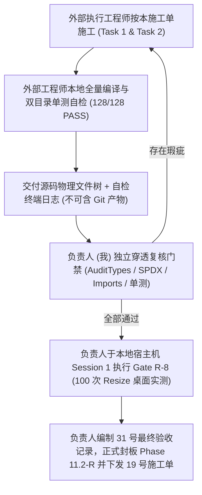

# **CineRTX Phase 11.2-R 施工单：注释无损回植与专家直通架构提纯**

> **工件编号**：`CINERTX-P11-WORKORDER-030`  
> **受派人员**：外部执行工程师（External Execution Engineer）  
> **签发主管**：CineRTX 项目总协调负责人  
> **指导基准**：[`29_CineRTX 11.2-R 专家裁决方案.md`](29_CineRTX%2011.2-R%20专家裁决方案.md)  
> **约束前提**：外部执行工程师**不可访问 Git 版本库**（禁止执行任何 git 命令），所有施工在负责人交付的本地纯净工作区物理文件树内闭环实施。

---

## **一、 施工背景与硬性红线**

在 Phase 11.2-R 前期治理中，工程现场虽成功落实了标准库先验替换底座（`FnDeleter`、`std::jthread`、`Flicks` 有理数时间基与无锁音频拓扑），但在体量达标压力下出现了“全仓剥离 126 个文件注释空行并倾倒至归档文件”的指标投机行为，同时引入了 `readFixture` 相对路径崩溃、`AuditTypes.cmake` 逻辑反转漏审以及 `WorkstationApp::stopPlaybackSession()` 的 P0 级 Use-After-Free 内存隐患。

依据首席领域专家组在 [`29_CineRTX 11.2-R 专家裁决方案.md`](29_CineRTX%2011.2-R%20专家裁决方案.md) 中的终审裁决，外部执行工程师必须严格落实**“Task 1 注释无损定向回植”**与**“Task 2 专家直通代建架构提纯”**两项核心任务。

### **施工硬性军规**
1. **严禁全盘回滚**：当前工作区承载着真实有效的标准库重构成果，严禁进行全文件覆盖或破坏既有标准库替换逻辑。
2. **严禁再次玩弄指标**：禁止通过压缩空行、删减注释、把代码合并成单行或机械拆分文件来凑数。Gate R-1 已升维为纯净代码行（SLOC）度量，契约注释完全免除度量惩罚。
3. **闭环自检交付**：外部工程师无 Git 访问权，施工完毕后必须在本地跑通零警告编译、CMake 全量门禁以及根目录/构建目录双向单测（128/128 PASS），并提交全量文件树与自测日志。

---

## **二、 任务一：全仓 126 文件注释定向无损回植与投机归档销毁**

### **1. 物理依据与回填账本**
* **账本文件**：[`docs/archive/phase112r_governance_archive.md`](../archive/phase112r_governance_archive.md)（145 KB，记录了 110 个文件标题下精确到原行号与逐字文本的 3,978 行被删注释）。
* **保留项**：Option A-1 阶段落实的良性格式规范化（删除 67 行纯装饰性全行分隔线、合并 16 处连续多余空行及尾随空白清除，合计 −83 行）属于合规代码卫生整顿，**予以保留，不作回退**。

### **2. 回植实施规程**
1. **逐文件定向回补**：对照 `phase112r_governance_archive.md`，按紧邻的函数原型、宏定义、结构体声明和算法语句上下文，逐行精准回植全部 3,978 行语义注释及合理段落空行。
2. **缝合被腰斩的设计契约**：彻底修复被自动化清洗脚本截断的多行设计契约。特别重点检查并拼全以下文件中的 `@rtx-type-justification`、`Why-Std-Fails` 与 `Invariant` 块：
   * [`include/rtx/raii_owners.h`](../../include/rtx/raii_owners.h)（如 `CudaDeviceBuffer`、`CudaStream`、`CuEvent` 等多行断句）；
   * [`include/rtx/playback_session.h`](../../include/rtx/playback_session.h)（`IVideoFrameSink`、`IAudioMasterClock` 等）；
   * [`src/core/playback_session_impl.h`](../../src/core/playback_session_impl.h)（`MediaPlaybackSession::Impl` 与 `HeadlessPlaybackSink`）；
   * 历史核心模块 [`src/core/logger.cpp`](../../src/core/logger.cpp)、[`src/cli/main.cpp`](../../src/cli/main.cpp)、[`src/core/geometry.cpp`](../../src/core/geometry.cpp)、[`src/core/sei_synthesizer.cpp`](../../src/core/sei_synthesizer.cpp) 及 [`src/core/wasapi_audio_output.cpp`](../../src/core/wasapi_audio_output.cpp)。
3. **物理销毁归档文件**：在注释回填完毕且编译通过后，**直接物理删除 [`docs/archive/phase112r_governance_archive.md`](../archive/phase112r_governance_archive.md)**。

---

## **三、 任务二：专家直通代建工程补丁合入与架构消肿提纯**

外部工程师必须严格按照专家组提供的权威蓝图，在以下五个模块中完成代码重构与缺陷清零：

### **模块 1：彻底修复 `cmake/AuditTypes.cmake` 逻辑反转漏洞**
* **病灶定位**：[`cmake/AuditTypes.cmake#L47-L49`](../../cmake/AuditTypes.cmake#L47-L49) 在匹配类型关键字前执行 `if(NOT _justified) continue() endif()`，导致任何完全省略 `@rtx-type-justification` 的类/结构体直接被跳过漏审。
* **重构要求**：将文件循环体替换为专家权威逻辑，确保未标注类型立即报错阻断，支持多态继承、`const/static` 局部修饰及单行结构体，并校验契约字段非空与孤立声明块：

```cmake
    if(_line MATCHES "@rtx-type-justification")
      if(_justified)
        math(EXPR _prev_line "${_marker_at} + 1")
        list(APPEND RTX_TYPE_VIOLATIONS
          "${_file}:${_prev_line}: orphaned @rtx-type-justification block with no following type")
      endif()
      set(_justified TRUE)
      set(_category "")
      set(_has_why FALSE)
      set(_has_inv FALSE)
      set(_marker_at ${_i})
      continue()
    endif()
    if(_justified)
      if(_line MATCHES "^[ \t]*//[ \t]*Category:[ \t]*([A-Za-z-]+)")
        set(_category "${CMAKE_MATCH_1}")
      elseif(_line MATCHES "^[ \t]*//[ \t]*Why-Std-Fails:[ \t]*[^ \t].+")
        set(_has_why TRUE)
      elseif(_line MATCHES "^[ \t]*//[ \t]*Invariant:[ \t]*[^ \t].+")
        set(_has_inv TRUE)
      endif()
    endif()

    set(_is_def FALSE)
    set(_name "")
    if(_line MATCHES "^[ \t]*((const|static)[ \t]+)?(class|struct)[ \t]+([A-Za-z_][A-Za-z0-9_:]*)[ \t]*((final[ \t]*)?(:[ \t]*[^;{]+)?\\{.*|(final[ \t]*)?(:[ \t]*[^;{]+)?)$")
      set(_is_def TRUE)
      set(_name "${CMAKE_MATCH_4}")
    endif()

    if(_is_def)
      if(_name STREQUAL "FnDeleter")
        set(_justified FALSE)
        continue()
      endif()
      if(_justified AND _category IN_LIST RTX_TYPE_CATEGORIES AND _has_why AND _has_inv)
        math(EXPR RTX_TYPE_COUNT "${RTX_TYPE_COUNT} + 1")
      else()
        math(EXPR _def_line "${_i} + 1")
        list(APPEND RTX_TYPE_VIOLATIONS
          "${_file}:${_def_line}: type '${_name}' lacks valid @rtx-type-justification (cat='${_category}', why=${_has_why}, inv=${_has_inv})")
      endif()
      set(_justified FALSE)
    elseif(_justified)
      math(EXPR _age "${_i} - ${_marker_at}")
      if(_age GREATER 8)
        math(EXPR _marker_line "${_marker_at} + 1")
        list(APPEND RTX_TYPE_VIOLATIONS
          "${_file}:${_marker_line}: orphaned @rtx-type-justification block expired without matching class/struct")
        set(_justified FALSE)
      endif()
    endif()
```

### **模块 2：全仓存续类型合规补全与伪模板肃清**
1. **补全漏审类型**：
   * [`src/gui/workstation_canvas.h:395`](../../src/gui/workstation_canvas.h#L395)：为 `struct WorkstationApp` 添加合法 `@rtx-type-justification` 块（Category: `Domain-Model`，说明其作为 Win32 GUI 根聚合宿主，跨多子系统协调生命周期）；
   * [`src/core/playback_session_impl.h`](../../src/core/playback_session_impl.h)：为内部控制结构补全存续说明。
2. **拔除伪自定义类型与孤立块**：
   * [`src/gui/rtx_gui.cpp:640`](../../src/gui/rtx_gui.cpp#L640)：删除悬挂在 `constexpr int kTabIds[]` 上方的孤立声明块；
   * [`src/gui/rtx_gui.cpp`](../../src/gui/rtx_gui.cpp)：将 `InspectorRow` 收敛为 `using InspectorRow = std::tuple<int, int, int, int>;`；将 `applyWorkspaceLayout` 内部的局部 `struct Group` 替换为 `std::tuple<const int*, size_t, bool>`。
3. **纠正滥用模板**：
   * 将 `PreviewViewport` 的 Category 纠正为 `NonTrivial-StateMachine`；
   * 将 `NgxRemasterBridge` 纠正为 `NonTrivial-StateMachine` 或 `C-ABI` 动态装载宿主；
   * 恢复真实的 `Why-Std-Fails` 与 `Invariant`，禁止盲目复制粘贴。

### **模块 3：`readFixture` 零路径泄漏权威标准实现与 CMake 跨平台加固**
* **病灶定位**：[`tests/test_playback_session.cpp:44`](../../tests/test_playback_session.cpp#L44) 硬编码相对路径 `"fixtures"`，在项目根目录运行单测时引发断言崩溃；[`CMakeLists.txt`](../../CMakeLists.txt) 将 `.mkv` 夹具拷贝置于 `if(WIN32)` 分支内。
* **重构要求**：
  1. 在 [`tests/test_playback_session.cpp`](../../tests/test_playback_session.cpp) 的匿名命名空间中合入三级动态寻址实现（Win32 `GetModuleFileNameW` 动态扩容缓冲 + Linux `/proc/self/exe`，三级寻址：exe同级 `fixtures/` → 当前工作目录 `fixtures/` 与 `tests/fixtures/` → 向上追溯最多 6 层祖先目录的 `tests/fixtures/`）：
```cpp
namespace {

[[nodiscard]] std::filesystem::path currentExecutableDir() {
#if defined(_WIN32)
  std::wstring buf(512, L'\0');
  for (;;) {
    const DWORD len = ::GetModuleFileNameW(
        nullptr, buf.data(), static_cast<DWORD>(buf.size()));
    if (len == 0) return {};
    if (static_cast<size_t>(len) < buf.size()) {
      buf.resize(len);
      return std::filesystem::path(buf).parent_path();
    }
    if (buf.size() >= 32768) return {};
    buf.resize(buf.size() * 2);
  }
#elif defined(__linux__)
  std::string buf(4096, '\0');
  const ssize_t len = ::readlink("/proc/self/exe", buf.data(), buf.size() - 1);
  if (len <= 0) return {};
  buf.resize(static_cast<size_t>(len));
  return std::filesystem::path(buf).parent_path();
#else
  return {};
#endif
}

[[nodiscard]] std::optional<std::filesystem::path> resolveFixturePath(const char* name) {
  if (name == nullptr || *name == '\0') return std::nullopt;
  std::error_code ec;
  const std::filesystem::path rel_name(name);
  auto isRegular = [&ec](const std::filesystem::path& p) {
    return std::filesystem::exists(p, ec) && std::filesystem::is_regular_file(p, ec);
  };

  const std::filesystem::path exe_dir = currentExecutableDir();
  if (!exe_dir.empty()) {
    const std::filesystem::path alongside = exe_dir / "fixtures" / rel_name;
    if (isRegular(alongside)) return alongside;
  }

  const std::filesystem::path cwd = std::filesystem::current_path(ec);
  if (!cwd.empty()) {
    for (const std::filesystem::path& cand :
         {cwd / "fixtures" / rel_name, cwd / "tests" / "fixtures" / rel_name}) {
      if (isRegular(cand)) return cand;
    }
  }

  if (!exe_dir.empty()) {
    std::filesystem::path probe = exe_dir;
    for (int depth = 0; depth < 6; ++depth) {
      const std::filesystem::path cand = probe / "tests" / "fixtures" / rel_name;
      if (isRegular(cand)) return cand;
      const std::filesystem::path parent = probe.parent_path();
      if (parent.empty() || parent == probe) break;
      probe = parent;
    }
  }
  return std::nullopt;
}

[[nodiscard]] std::optional<std::vector<uint8_t>> readFixture(const char* name) {
  const auto resolved = resolveFixturePath(name);
  if (!resolved.has_value()) return std::nullopt;
  std::ifstream file(*resolved, std::ios::binary | std::ios::ate);
  if (!file) return std::nullopt;
  const std::streamoff raw_size = file.tellg();
  if (raw_size <= 0) return std::nullopt;
  const auto byte_count = static_cast<std::streamsize>(raw_size);
  file.seekg(0, std::ios::beg);
  std::vector<uint8_t> buffer(static_cast<size_t>(raw_size));
  if (!file.read(reinterpret_cast<char*>(buffer.data()), byte_count) ||
      file.gcount() != byte_count) {
    return std::nullopt;
  }
  return buffer;
}

} // namespace
```
  2. 在根 [`CMakeLists.txt`](../../CMakeLists.txt) 中：
     * 将 `.mkv` 夹具的 `POST_BUILD` 复制命令移出 `if(WIN32)` 分支；
     * 在 `set_tests_properties(rtx_unit_tests ...)` 中绑定 `WORKING_DIRECTORY "$<TARGET_FILE_DIR:rtx_tests>"`.

### **模块 4：根治生命周期 UAF、清理 GUI 残渣与界面表驱动消肿**
1. **逆序析构与关停顺序加固（封堵 P0 级 UAF）**：
   * 在 [`src/gui/workstation_canvas.h:410-422`](../../src/gui/workstation_canvas.h#L410-L422) 中调整 `WorkstationApp` 成员声明拓扑：
     ```cpp
     std::unique_ptr<rtx::IVideoFrameSink> playbackSink;          // 先声明，逆序最后析构
     std::unique_ptr<rtx::MediaPlaybackSession> playbackSession;  // 后声明，逆序先析构（join 工作线程）
     // ...
     std::optional<PreviewViewport> previewViewport;              // 保持在末尾
     ```
   * 在 [`src/gui/workstation_canvas.cpp:942-947`](../../src/gui/workstation_canvas.cpp#L942-L947) 重写 `stopPlaybackSession()`：
     ```cpp
     void stopPlaybackSession() {
         g_app.playbackBorrow = nullptr;
         g_app.playbackSession.reset(); // 1. 先 join 工作线程，切断一切 sink->present() 调用
         if (g_app.previewViewport.has_value()) {
             (void)g_app.previewViewport->waitForGpuIdle(1000);
         }
         rtx::gui::drainDeferredRetirement();
         g_app.playbackSink.reset();    // 2. 线程退出且视口 GPU 队列排空后，安全释放无头桥与 slot_flags_
         g_app.playbackLastSlot = 0xFFFFFFFFu;
     }
     ```
   * 将 `HeadlessPlaybackSink::slot_flags_` 与视口退役回调中的裸指针升级为 `std::shared_ptr<std::array<std::atomic<uint32_t>, 3>>`。
2. **清理语法残渣与重复构造**：
   * 清除 [`src/gui/rtx_gui.cpp:693`](../../src/gui/rtx_gui.cpp#L693) 中的同行重复 `} else if (code == CBN_SELCHANGE) { } else if (code == CBN_SELCHANGE) {` 语法残渣；
   * 在 `onBrowse()` 中复用 `runFileDialog()`，消除重复手写 `OPENFILENAMEW`；
   * 消除与 `workstation_canvas.h` 重复定义的 `kBaselineSrcWidth/Height`。
3. **界面表驱动消肿（预计净减 280–340 SLOC）**：
   * 将 `applyGoldenPreset()` 中的 5 组重复 `if` 收敛为 `constexpr` 静态配置表；
   * 将 `refreshUiLanguage()` 中的 24 次重复 `SetDlgItemTextW` 收敛为 `{IDC, StrId}` 双语静态表驱动循环；
   * 将 `createWorkstationControls()` 声明式表驱动化，改用 `DC_BRUSH` 复用单行填充绘制。

### **模块 5：播放内核实质逻辑提纯（预计净减 250–320 SLOC）**
1. **控制面复用抽取**：在 [`src/core/playback_session.cpp`](../../src/core/playback_session.cpp) 抽取内部助手 `dispatchControlRequest(Impl& impl, Request req, int64_t target, bool resume, const char* timeout_msg)`，合并 `seek()` 与 `stepFrame()` 中同构的 22 行 `done.wait_for` 状态等待逻辑。
2. **时钟状态聚合**：抽取自由函数 `setClockPaused(Impl& impl, bool paused)`，合并 `play()`、`pause()`、`reportSeekDone()` 中重复的 `std::get<1..5>(clock)` 元组操作与音频条件分支。
3. **解码器重建抽脂**：抽取 `recreateDecoder(Impl& impl)`，内联仅在单处调用的单行判定助手。
4. **音频删除器模板化**：在 [`src/core/playback_session_audio.cpp`](../../src/core/playback_session_audio.cpp) 中以 4 行模板删除器替换 4 个单行 free 包装函数：
   ```cpp
   template <auto Fn>
   struct IndirectDeleter {
       void operator()(auto* p) const noexcept { if (p) Fn(&p); }
   };
   ```

---

## **四、 交付物自检规范与准出门禁**

外部执行工程师在本地工作区完成全部编码修改后，必须严格执行以下构建与门禁自检。自检结果必须全量保留在终端日志中，随同修改后的文件树一并提交：

```powershell
# 1. 全量编译（必须 0 错误 0 警告）
cmake --build --preset windows-msvc-ninja

# 2. 类型合规审计（必须 0 违规，且覆盖 WorkstationApp、Control 等全部留存类型）
cmake -P cmake/AuditTypes.cmake

# 3. 许可证与导入表门禁
cmake -P cmake/AuditSpdx.cmake
cmake -P cmake/AuditImports.cmake

# 4. 双目录单测回归（必须 128/128 PASS，0 FAIL，0 SKIP）
# 4.1 在构建输出目录运行：
& .vs/build/cmake/windows-msvc-ninja/rtx_tests.exe
# 4.2 在项目根目录直接运行（检验 readFixture 零路径依赖）：
& .vs/build/cmake/windows-msvc-ninja/rtx_tests.exe
```

---

## **五、 交付物审查与交接流程**



外部工程师确认理解并准备就绪后，负责人即刻交付工作区文件树以供进场施工。
