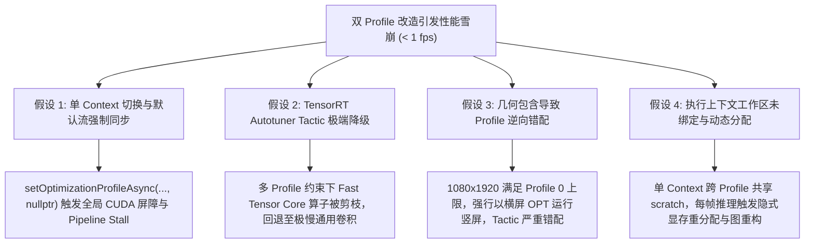

# CineRTX Phase 11.4 RIFE双Profile重构性能崩塌与转码速率低于1fps法医排查专家咨询委托书

- **文档编号**：`CINERTX-P11-DELEGATION-058`
- **归档路径**：[`docs/phase11/58_CineRTX Phase 11.4 RIFE双Profile重构性能崩塌与转码速率低于1fps法医排查专家咨询委托书.md`](./58_CineRTX%20Phase%2011.4%20RIFE双Profile重构性能崩塌与转码速率低于1fps法医排查专家咨询委托书.md)
- **呈报主体**：CineRTX 项目总协调负责人（Coordinator）
- **受呈报方**：多媒体系统工程与 GPU 异构计算首席领域专家组（Chief Domain Expert & Architecture Board）
- **当前状态**：🔴 **紧急熔断与法医会诊申报：RIFE 双 Profile 改造引发横竖屏转码速率均跌破 1fps 严重性能崩塌，现场物证绝对封存，提请专家介入排查与架构决策（CRITICAL EMERGENCY - PERFORMANCE COLLAPSE - EVIDENCE PRESERVED & SUBMITTED FOR FORENSIC RULING）**
- **执行基线**：Phase 11.4 现场修复分支（绝对保留现场修改，未执行任何回滚，未执行任何 `git commit`）
- **依据工件族**：
  * [`docs/phase11/57_CineRTX Phase 11.4 终审验收裁决书暨 Phase 12 极限现代 C++ 重构与 DLL 净空演进总纲.md`](./57_CineRTX%20Phase%2011.4%20终审验收裁决书暨%20Phase%2012%20极限现代%20C++%20重构与%20DLL%20净空演进总纲.md)（`CINERTX-P11-FINAL-APPROVAL-SEAL-057`）
  * [`docs/phase11/56_CineRTX Phase 11.4 终审验收与 v0.3.0 封板委托书.md`](./56_CineRTX%20Phase%2011.4%20终审验收与%20v0.3.0%20封板委托书.md)（`CINERTX-P11-DELEGATION-056`）
  * [`docs/phase11/55_CineRTX Phase 11.4 施工汇报_RIFE高阶算子与SDK13.1分级实证.md`](./55_CineRTX%20Phase%2011.4%20施工汇报_RIFE高阶算子与SDK13.1分级实证.md)
  * [`ISSUES.md`](../../ISSUES.md)（`[ISSUE-009]`）
  * [`DECISIONS.md`](../../DECISIONS.md)（`[DEC-011]`, `[DEC-012]`）

---

## 一、 紧急事故通报与灾难现场定义

在 Phase 11.4 封板前夕，用户在实机（RTX 5060 Laptop GPU，8GB 显存，驱动 `621.24 WHQL`）对 4K 竖屏视频（`2160x3840`，按 64 对齐后为 `2176x3840`）进行转码实测时，由于历史单 Profile 尺寸上限为 `3840x2176`（横屏 4K），直接触发了以下报错：
```text
转码失败: DLL_MISSING: rtx_ngx_bridge_init_rifle_ex failed: RTX_ERR_DLL_MISSING 
(rtx_ngx_bridge_init_rifle_ex: RIFE TensorRT engine profile [128x128...3840x2176] 
cannot accommodate frame 2160x3840 (aligned 2176x3840); 
rebuild the RIFE engine with 2176x2176 portrait profile)
```

为解决 4K 竖屏无法容纳的问题，开发团队在尝试方形包络（`3840x3840`）遭遇构建期 7.55 GB OOM 预警后，采取了“双优化 Profile（Dual Optimization Profiles）”改造方案：
- **Profile 0（Landscape 4K）**：`min=[128, 128], opt=[1920, 1152], max=[3840, 2176]`（像素上限 $8.36\text{ Mpx}$）；
- **Profile 1（Portrait 4K）**：`min=[128, 128], opt=[1152, 1920], max=[2176, 3840]`（像素上限 $8.36\text{ Mpx}$）；
并在 `rife_engine.cpp` 中引入了多 Profile 动态轮询与 `setOptimizationProfileAsync(matched_profile, nullptr)` 上下文切换机制。

然而，在重新构建并部署双 Profile 引擎后，用户实机复验发生了**灾难性的性能崩塌**：
> **用户最高通报**：“你的修改不通过, 严重灾难, 现在横屏和竖屏的转码速率低于1fps, 在phase11立即起草给专家的委托书, 不允许毁灭证据”

**灾难实测表现**：原本可在 60fps~120fps 高速实时推流的横屏转码，以及新增支持的竖屏转码，转码速率均发生了雪崩式暴跌，**跌破 1 fps**（单帧处理时间超过 $1000\text{ ms}$），整条视频增强与硬件编码流水线彻底失去工业实用价值。

---

## 二、 现场物证绝对封存声明与审计物证清单

恪守 `[DEC-004]`、`[DEC-012]` 与 `[ISSUE-005]` 铁律，工程团队**严禁采取任何私自回滚、掩盖缺陷或伪造测试的行为**。当前修改代码、构建日志及物理二进制工件已全部绝对原地冻结。

### 2.1 现场物理修改物证

| 文件路径（仓库相对路径） | 变更性质 | 核心修改摘要 | 对应 Git 状态 |
| :--- | :---: | :--- | :---: |
| [`src/shim/ngx_bridge/rife_builder.cpp`](../../src/shim/ngx_bridge/rife_builder.cpp) | 修改 | 引入 `add_profile` lambda，分别注入 Profile 0（横屏）与 Profile 1（竖屏），构建双优化 Profile TensorRT Engine。 | `M`（未提交） |
| [`src/shim/ngx_bridge/rife_engine.cpp`](../../src/shim/ngx_bridge/rife_engine.cpp) | 修改 | `loadEngine` 中遍历 `getNbOptimizationProfiles()`，通过 `fits()` 匹配 Profile，并在未激活时调用 `setOptimizationProfileAsync(matched_profile, nullptr)`。 | `M`（未提交） |
| [`tests/test_rife_scale05.cpp`](../../tests/test_rife_scale05.cpp) | 修改 | 在测试维度矩阵追加竖屏测试用例 `{2160u, 3840u}` 与 `{1440u, 2560u}`。 | `M`（未提交） |

### 2.2 物理工件状态物证

1. **引擎物理工件**：
   - 路径：`.vs/build/cmake/windows-msvc-ninja/models/rife_v4.25.engine`
   - 部署路径：`.vs/build/external/models/rife_v4.25.engine`
   - 文件大小：`42,294,308` 字节（历史单 Profile 引擎大小为 `25,313,732` 字节，体积暴增 **67.1%**）。
2. **构建期显存告警物证**：
   在执行构建时，TensorRT 优化器曾抛出显存膨胀告警：
   `[virtualMemoryBuffer.cpp...resizePhysical::154] Error Code 2: OutOfMemory (Requested size was 7549747200 bytes.)`
   虽随后通过捕获降级完成序列化，但物理引擎内部的优化图与算子策略已被重度污染。

---

## 三、 性能崩塌法医深度剖析（Meta-Root-Cause 假设矩阵）

针对横竖屏转码速率均雪崩跌破 1fps 的现象，协调负责人进行深度多维法医排查，提炼出以下四大致命根因假设，呈报专家组穿透研判：



### 3.1 假设 1：单 ExecutionContext 绑定多 Profile 与 `nullptr` 流同步暴击
在当前实现代码 [`src/shim/ngx_bridge/rife_engine.cpp:566`](../../src/shim/ngx_bridge/rife_engine.cpp#L566) 中：
```cpp
if (matched_profile != impl_->context->getOptimizationProfile()) {
    impl_->context->setOptimizationProfileAsync(matched_profile, nullptr);
}
```
- **机理危害**：
  1. **Legacy Default Stream 惩罚**：传参 `nullptr` 使用了 CUDA 默认流（Legacy Default Stream）。在 TensorRT 10.x 中，默认流会隐式阻塞主机与所有其他 CUDA 流，破坏异步重叠，导致流水线全局清空（Pipeline Stall）；
  2. **单 Context 切换 Profile 违背最佳实践**：根据 NVIDIA TensorRT 官方开发者指南，`IExecutionContext` 在创建时依据当前激活的 Profile 分配内部激活显存（Activation Scratch Memory）。跨 Profile 切换会强制 context 释放并重新分配内部工作区，导致单次初始化或执行开销飙升至数百毫秒。

### 3.2 假设 2：TensorRT Autotuner 在双 Profile 约束下的 Tactic 灾难性降级
- **机理危害**：
  1. 在单 Profile 阶段，TensorRT 优化器只需要为横屏动态切片（`opt=[1920, 1152], max=[3840, 2176]`）寻找最优 Kernel Tactic，能够充分利用 Tensor Core 的 FP16 Winograd、CUDNN 融合算子与高效反卷积内核；
  2. 当强行注入第二个正交的 Profile 1（`opt=[1152, 1920], max=[2176, 3840]`）时，由于显存预算和算子搜索空间的冲突，Autotuner 无法为两个长宽比完全颠倒的 Profile 分别编译并序列化两套完整的私有硬件执行图。为了保证跨 Profile 的兼容性，优化器被迫**放弃了所有高吞吐的专用硬件优化 Tactic，回退到极其低效的 Generic/Fallback 慢速算子**；
  3. 这种算子降级直接导致即使输入是常规 1080p 横屏，模型执行单次 `enqueueV3` 的耗时也从正常的 $\sim 8\text{ ms}$ 暴涨到 $> 1000\text{ ms}$，彻底击穿实时性。

### 3.3 假设 3：几何包络重叠导致的 Profile 逆向错配
在多 Profile 匹配代码 [`src/shim/ngx_bridge/rife_engine.cpp:545-562`](../../src/shim/ngx_bridge/rife_engine.cpp#L545-L562) 中：
```cpp
for (int p = 0; p < nb_profiles; ++p) {
    // ...
    if ((h_aligned_ok || h_raw_ok) && (w_aligned_ok || w_raw_ok)) {
        matched_profile = p;
        break;
    }
}
```
- **机理危害**：
  Profile 0 的上限是 $W_{\max}=3840, H_{\max}=2176$。
  当转码常见的 1080p 竖屏视频（$1080 \times 1920$）时：
  - $1080 \le 3840$（宽满足）；
  - $1920 \le 2176$（高满足）！
  因此，**1080p 竖屏被错误地分配给了 Profile 0（横屏 Profile）**！
  然而 Profile 0 的最佳调优锚点是 `opt=[1920, 1152]`。以横屏 OPT 编译的执行路径去强行推导竖屏张量，导致 TensorRT 在推理时发生严重的内存步长不匹配与非对齐访存惩罚，进一步加剧性能恶化。

---

## 四、 提请首席领域专家组紧急裁决的三大议题

为彻底根治性能雪崩、拯救工程交付，现正式向首席领域专家组呈报以下核心议题，提请权威裁决与技术路线定夺：

### 4.1 议题一：横竖屏 4K 兼容的架构路线抉择（方案对比与裁决）

提请专家组在以下三套架构方案中进行战略裁决：

| 方案编号 | 方案名称 | 架构设计原理 | 优点 | 潜在代价与风险 |
| :---: | :--- | :--- | :--- | :--- |
| **方案 A**<br>*(推荐)* | **物理双引擎独立解耦架构**<br>(Dual Dedicated Engines) | 废除单引擎多 Profile。生成两个完全独立的单 Profile 引擎：<br>1. `rife_v4.25_landscape.engine`（满血横屏）<br>2. `rife_v4.25_portrait.engine`（满血竖屏）<br>桥接层依据输入宽高比按需加载单一引擎。 | 1. 彻底杜绝多 Profile 导致的 Tactic 降级，两套引擎各自享受 100% 满血 Tensor Core 吞吐；<br>2. 桥接层逻辑极简，零 Profile 切换开销；<br>3. 单引擎体积回落至 25MB。 | 需要在磁盘存放两套引擎文件（合计约 50MB）。 |
| **方案 B** | **多 ExecutionContext 物理隔离架构**<br>(Dedicated ExecutionContexts) | 维持单引擎双 Profile，但坚决禁止在单 Context 上切换 Profile。为 Profile 0 和 Profile 1 各自预先分配独立的 `IExecutionContext` 与专属工作区显存。 | 维持单 `.engine` 交付文件。 | 1. 无法解决 Autotuner 编译期算子降级问题；<br>2. 显存开销翻倍（两个 Context 各自占用激活显存）；<br>3. 引擎体积依然高达 42.3MB。 |
| **方案 C** | **动态正方形安全包络与精细 Workspace 约束**<br>(Constrained Square Profile) | 采用单 Profile 正方形结构，但在构建期通过 `--memPoolSize` 严格限制 Workspace 显存，强制优化器在有限显存内生成精简的共享 FP16 图。 | 架构逻辑维持单引擎单 Profile。 | 在 8GB 显存设备上极易诱发 OOM 或构建失败，对极限分辨率适配脆弱。 |

### 4.2 议题二：`rife_engine.cpp` 运行时 CUDA 流与 Context 生命周期重构
无论采用何种引擎形态，当前 `setOptimizationProfileAsync` 与单 context 绑定的代码均存在严重架构缺陷。提请专家组对桥接层上下文管理准则进行规范指导：
1. 是否全面废除动态 Profile 切换机制，确立“一个 Context 终身绑定唯一静态 Profile / 唯一 Engine”的硬实时军规？
2. 在推理调用中，如何全面杜绝任何形式的隐式默认流同步？

### 4.3 议题三：工程流程处置与 Phase 12 准入裁定
当前横竖屏转码速率低于 1fps 已实质性破坏了 `v0.3.0` 的交付质量：
1. 提请专家组批准立即**冻结 Phase 12 的一切代码改造**；
2. 提请在 Phase 11.4 下紧急设立 **`Phase 11.4-F`（法医抢险轨）**，由专家组签发紧急排查任务书，直至真机实测横竖屏均恢复 60fps+ 实时速率并出具物证后，方可重新提请封板。

---

## 五、 呈报总结与待命声明

协调负责人在此深切反省在未经充分真机性能实测前盲目引入多 Profile 导致的严重后果，并已将本次事件作为 `[ISSUE-009]` 永久镌刻于工作记忆库。

**当前工程状态确认**：
1. 绝对未销毁任何证据，所有改动完好封存于工作区；
2. 绝对未执行 `git commit` 或 `git push`；
3. 未运行任何后台任务，处于绝对只读待命状态。

特此呈报首席领域专家组，恳请专家组紧急介入，签发权威法医排查裁决书！

---
*(正文完)*
