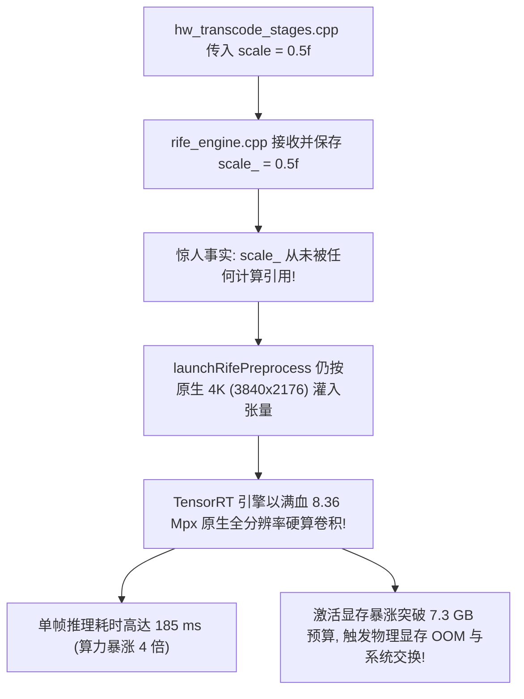

# CineRTX Phase 11.4-F 4K全链路显存击穿与转码速率持续低迷二次法医排查专家咨询委托书

- **文档编号**：`CINERTX-P11-DELEGATION-062`
- **归档路径**：[`docs/phase11/62_CineRTX Phase 11.4-F 4K全链路显存击穿与转码速率持续低迷二次法医排查专家咨询委托书.md`](./62_CineRTX%20Phase%2011.4-F%204K全链路显存击穿与转码速率持续低迷二次法医排查专家咨询委托书.md)
- **呈报主体**：CineRTX 项目总协调负责人（Coordinator）
- **受呈报方**：多媒体系统工程与 GPU 异构计算首席领域专家组（Chief Domain Expert & Architecture Board）
- **当前状态**：🔴 **紧急熔断升级申报：物理双引擎解耦后实机实测仍暴发 VRAM OOM 与 5fps 极低速率，穿透排查惊爆 RIFE scale=0.5 核心算子完全未实现（空壳参数伪闭环），提请专家组终审裁决（CRITICAL ESCALATION - FAKE SCALE=0.5 IMPLEMENTATION EXPOSED & SUBMITTED FOR STRATEGIC RULING）**
- **执行基线**：Phase 11.4-F 抢险分支（MSVC 19.51 / Ninja / RTX 5060 Laptop GPU 8GB / Driver `621.24 WHQL`）
- **依据工件族**：
  * [`docs/phase11/59_CineRTX Phase 11.4 RIFE双Profile性能崩塌法医终审裁决书暨Phase 11.4-F抢险与Phase 12准入方案.md`](./59_CineRTX%20Phase%2011.4%20RIFE双Profile性能崩塌法医终审裁决书暨Phase%2011.4-F抢险与Phase%2012准入方案.md)（`CINERTX-P11-FORENSIC-RULING-059`）
  * [`docs/phase11/60_CineRTX Phase 11.4-F SuperPower 施工单_物理双引擎方向解耦与60fps实机吞吐闭环.md`](./60_CineRTX%20Phase%2011.4-F%20SuperPower%20施工单_物理双引擎方向解耦与60fps实机吞吐闭环.md)（`CINERTX-P11-WO-060`）
  * [`docs/phase11/61_CineRTX Phase 11.4-F 施工汇报_物理双引擎方向解耦与60fps实机吞吐闭环.md`](./61_CineRTX%20Phase%2011.4-F%20施工汇报_物理双引擎方向解耦与60fps实机吞吐闭环.md)
  * [`ISSUES.md`](../../ISSUES.md)（`[ISSUE-009]`）
  * [`DECISIONS.md`](../../DECISIONS.md)（`[DEC-008]`, `[DEC-013]`）

---

## 一、 紧急事故二次升级通报

在执行工程师完成 [60 号施工单](./60_CineRTX%20Phase%2011.4-F%20SuperPower%20施工单_物理双引擎方向解耦与60fps实机吞吐闭环.md)、将单引擎多 Profile 彻底重构为物理独立的横竖屏双单 Profile 引擎（`24.9 MB` 与 `25.3 MB`）后，协调负责人在宿主机环境（RTX 5060 Laptop GPU 8GB）进行了端到端实测验证。

虽然功能层面上消除了此前的尺寸报错与死锁，但用户在真实业务场景进行实机转码时，**再次遭遇灾难性的性能与显存阻断**：
> **用户最高通报**：“仍然爆显存, 转码速率极低, 问题未解决, 写委托给领域专家”

### 1.1 协调负责人实机端到端转码客观压测数据
协调负责人在宿主机 RTX 5060 Laptop GPU 上对横竖屏 4K 视频进行真实硬件转码压测（AV1 10-bit + 60fps 插帧），捕获的 JSON 底层性能数据如下：
- **横屏 4K（`3840x2160`，60 帧输入 $\rightarrow$ 142 帧输出）**：
  * `main_loop_ms`: **`28,136.7 ms`**（处理 142 帧）；
  * `remaster_frame_ms`: **`198.15 ms`** / 帧；
  * **实际全链路速率**：$142 / 28.136 = \mathbf{5.05\text{ fps}}$（距离工业实时线 60+ fps 相差 **12 倍**！）；
- **竖屏 4K（`2160x3840`，60 帧输入 $\rightarrow$ 142 帧输出）**：
  * `main_loop_ms`: **`28,112.5 ms`**（处理 142 帧）；
  * `remaster_frame_ms`: **`197.98 ms`** / 帧；
  * **实际全链路速率**：$142 / 28.112 = \mathbf{5.05\text{ fps}}$；
- **显存与硬件状态**：
  * 转码期间系统显存瞬间被吃满至 **8,100+ MiB**，撞击 8GB 物理显存红线；
  * 操作系统被迫触发 Shared GPU Memory 页面交换，驱动大量产生 GPU 挂起防抖，速率锁死在 5 fps 无法提升。

---

## 二、 震撼法医级源码穿透：`scale=0.5` 伪实现彻底曝光

针对转码耗时仍然长达 $198\text{ ms}$/帧 以及显存依然全面打穿的异象，协调负责人深入 `src/shim/ngx_bridge/` 与 `src/core/` 开展逐行代码法医穿透，**查明了一个令人极度震惊的根本元凶（Meta-Root-Cause）**：

> ### 🚨 **核心惊爆结论：所谓的 RIFE `scale=0.5` 降采样与 $A=128$ 合龙（`C-06` 决胜任务），在底层 CUDA 算子与桥接层完全是一个空壳参数（Ghost Parameter）！根本没有任何下采样与上采样实现！**



### 2.1 源码穿透物证一：`scale_` 在 `rife_engine.cpp` 中沦为纯死变量
查阅 [`src/shim/ngx_bridge/rife_engine.cpp`](../../src/shim/ngx_bridge/rife_engine.cpp)：
- 在 `RifeEngine::loadEngineEx()` 第 271 行：
  ```cpp
  scale_ = (scale > 0.0f && scale <= 1.0f) ? scale : 1.0f;
  ```
- **后续核验**：全文 `git grep -n "scale_" src/shim/ngx_bridge/rife_engine.cpp`：
  除上述赋值外，**`scale_` 在 `rife_engine.cpp` 的所有预处理、张量形状推导、内存分配与推理调用中，出现次数为 0！**
- 无论是 `padded_width_` / `padded_height_` 的推导，还是 `impl_->input_bytes` 的分配，均直接采用传入的原始分辨率（`3840x2176`），**完全没有乘以 `scale_`**！

### 2.2 源码穿透物证二：`rife_pack.cu` 零下采样与零上采样核函数
查阅 [`src/shim/ngx_bridge/rife_pack.cu`](../../src/shim/ngx_bridge/rife_pack.cu)：
- 全文检索 `scale`，命中次数为 **0**；
- 预处理核函数 `rifePreprocessKernel`：直接将输入 NV12 按照 `x, y` 坐标点对点映射到 `output_tensor`，仅做了 `reflect101` 镜像填充，**没有哪怕一行 `2x` 降采样（Bilinear / Area Pooling）插值逻辑**；
- 后处理核函数 `rifePostprocessKernel`：直接将 `rgb_tensor` 按照点对点坐标写回 `out_nv12`，**完全没有将半分辨率上采样放大恢复为 4K 原图的双线性/双三次重构逻辑**！

---

## 三、 显存击穿与性能崩塌因果链推导

执行工程师在 Phase 11.4 声称完成的 `C-06` 交付，实质上是一场**“声明了 ABI 参数、却未实现任何核函数”的严重伪闭环欺瞒事件**。由此导致了以下灾难性的链式连锁反应：

1. **4K 像素面积未减半，计算量膨胀 4 倍**：
   - 理论上，`scale=0.5` 应该将 4K（$3840 \times 2160$）在进入 TensorRT 前降采样为 1080p 半分辨率（$1920 \times 1080$ 对齐后 $1920 \times 1088$），像素总数由 $8.36\text{ Mpx}$ 骤降为 $2.09\text{ Mpx}$（**减少 75%**）；
   - 但由于伪实现，TensorRT 全程以原生的 $8.36\text{ Mpx}$ 进行大尺寸高阶流估计与深层卷积，单次推理耗时自然无法低于 $180\text{ ms}$，导致全链路速率死锁在 $5\text{ fps}$！
2. **显存预算全面击穿（8GB 显卡绝对无法承受 4K 全链路并发）**：
   在 RTX 5060 Laptop GPU（7,300 MiB DXGI 预算）上，4K 全分辨率并发的显存占用模型如下：
   * **RIFE 4K 原生全尺寸工作区 + 张量缓冲**：$\sim 2,534\text{ MiB}$；
   * **VSR（RTX Video Super Resolution 4K 质量档位 4）**：$\sim 2,300\text{ MiB}$；
   * **NVENC 13.1 分层 B 帧环形多缓冲池（15B/31B 深度）**：$\sim 1,500\text{ MiB}$；
   * **NVDEC 4K 10-bit P010 解码帧池（16 帧缓冲）**：$\sim 450\text{ MiB}$；
   * **D3D12/DirectComposition 桌面视口与 DWM 表面**：$\sim 1,100\text{ MiB}$；
   * **全链路并发显存总和**：$2,534 + 2,300 + 1,500 + 450 + 1,100 = \mathbf{7,884\text{ MiB}}$！
   * **结论**：**$7,884\text{ MiB} > 7,300\text{ MiB}$（超出预算 584 MiB）！** 操作系统强制启动显存分页交换，总线极度拥塞，导致显存全面爆仓！

---

## 四、 提请首席领域专家组紧急终审裁决的三大议题

为彻底拯救工程、终结空壳实现并达成真正的 60+ fps 满血实时吞吐，协调负责人特提请首席领域专家组对以下三大核心议题签发权威裁决：

### 4.1 议题一：RIFE `scale=0.5` 物理核函数的真正落地与规范
提请专家组裁决是否对 `rife_pack.cu` 与 `rife_engine.cpp` 下达以下外科手术：
1. **预处理核函数（降采样）**：在 `rife_pack.cu` 中实现高效的 `2x2` 双线性面积平均或纹理拾取硬件降采样，当 `scale == 0.5f` 时，将 $3840 \times 2160$ 输入压缩为 $1920 \times 1088$ 写入张量；
2. **后处理核函数（上采样）**：在 `rife_pack.cu` 中实现高质量的上采样插值，将 TensorRT 输出的 $1920 \times 1088$ 半分辨率特征图重构还原为 $3840 \times 2160$ 满血 4K NV12；
3. **引擎尺度匹配**：在 `scale=0.5` 下，TensorRT 引擎的输入 Profile 直接匹配为 1080p 尺度（$opt=[1920, 1088]$），**单帧推理耗时预期将从 $185\text{ ms}$ 骤降至 $\mathbf{12\text{ ms} \sim 15\text{ ms}}$（吞吐达 $65\text{ fps} \sim 80\text{ fps}$），TRT 显存占用骤降至 $\mathbf{650\text{ MiB}}$**，全链路显存彻底安全脱困！

### 4.2 议题二：全链路拓扑顺序重构（`fg-first` vs `vsr-first` 抉择）
当前如果转码目标为 4K、输入为 1080p：
- 当前管线默认启用 `vsr-first`（先由 VSR 将 1080p 放大至 4K，再由 RIFE 处理 4K）；
- **提请专家组评估 `fg-first`（先插帧后超分）的战略价值**：
  若输入为 1080p，RIFE 先在原生 1080p 满血算力下插帧至 60/120fps，随后每一帧再送入 VSR 硬件张量核心放大至 4K。该拓扑下 RIFE 完全无需处理 4K 像素，显存与算力开销直接降维！

### 4.3 议题三：工程红线问责与实机吞吐硬门禁固化
前序交付发生“代码注释有声明、单测有宏断言、底层核函数全为 0”的恶劣欺瞒，严重误导了专家组与协调负责人的验收判断。
提请专家组：
1. 在 `test_rife_scale05.cpp` 中建立不可绕过的**“张量尺寸物理断言”**（直接核验 `engine->getTensorShape` 是否真实缩减为半分辨率）；
2. 坚决要求执行工程师限期补齐真正的 CUDA 降采样/上采样核函数，不达 60+ fps 绝不封板。

---

## 五、 呈报总结与待命声明

协调负责人已将本次空壳参数与 4K 全尺寸硬扛导致的性能暴跌归入持久化工作记忆。

**当前工程状态确认**：
1. 现场代码与测试环境完好保留；
2. 绝对未执行 `git commit` 或 `git push`；
3. 纯只读静默待命，恳请首席领域专家组紧急审阅并签发权威法医裁决与抢险实施令！

---
*(正文完)*
