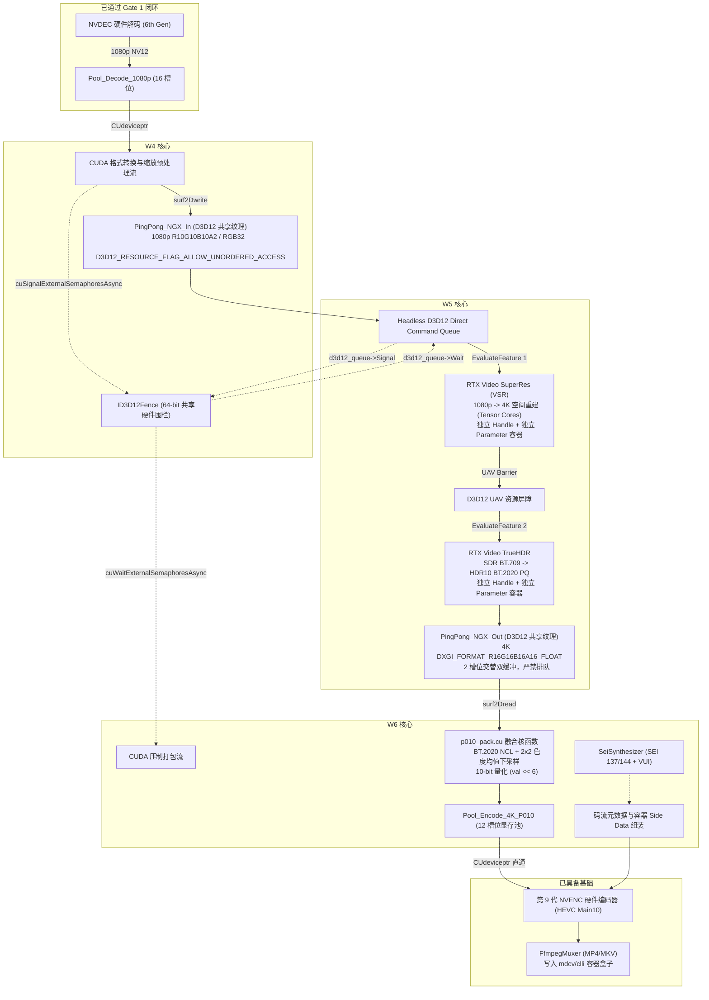

# RTX 超分辨率与 HDR 离线转码引擎
## 二阶段（W4–W6）全量工程施工任务书 暨 底层技术实施规范

---

**文档性质**：工程实施规范与技术交底任务书  
**发布人**：项目负责人 / 首席架构师 / 主程序员  
**执行对象**：执行工程团队 / 核心研发人员  
**技术依据**：
1. 领域专家方案原案 [`impl_plan.md`](file:///C:/PUBLIC/[REDACTED_PROJ]/impl_plan.md)
2. 领域专家一阶段深度验收报告 [`RTX转码引擎一阶段专家验收.md`](file:///[REDACTED_DRIVE]/work/[REDACTED_PROJ]/RTX转码引擎一阶段专家验收.md)
3. 项目内部首轮返工指令 [`rework_order.md`](file:///C:/PUBLIC/[REDACTED_PROJ]/rework_order.md) 与实机验证记录 [`docs/gate1.md`](file:///C:/PUBLIC/[REDACTED_PROJ]/docs/gate1.md)
**生效日期**：2026-10-23  
**施工周期**：W4 – W6（3 周）  
**阶段施工目标**：全面攻克无头 D3D12 与 CUDA 显存互操作，在独立动态库 `rtx_ngx_bridge.dll` 中实装 RTX Video SDK (VSR + TrueHDR) 硬件加速双特性，启用 RGBA16F $\to$ P010 融合核函数，打通 HDR10 静态元数据（SEI/VUI/Container）双路注入，实现 1080p SDR $\to$ 4K HDR10 零拷贝离线画质重建，通过 Gate 2 准出门禁。

---

## 1. 施工总览、模块拓扑与流水线时序 (Architecture Overview)

二阶段是全工程中异构技术跨度最大、API 交互最密集的深水区。系统必须在无图形窗口（Headless）环境下，跨越 Direct3D 12 与 CUDA 两种底层驱动生态，完成显存硬件表面与信号量的零拷贝互操作。

### 1.1 二阶段全链路异构数据拓扑



---

## 2. 前置技术债强制整改规范 (Phase 1 Action Items / ACT-01 ~ ACT-07)

依据领域专家评审报告要求，以下 7 项技术债被列为二阶段代码合流的**前置条件**。执行工程师在 W4 启动时必须率先完成 P0 级整改，禁止带着隐患推进图形桥接开发。

### 【ACT-01】(优先级: P0) 实装 `p010_pack.cu` 融合核函数并解决构建集成
* **问题定性**：原报告误报该核函数完工，但交付树中实际存在空文件或未被 CMake 纳入编译目标，CMake 声明亦缺失 CUDA 语言支持。
* **技术整改规范**：
  1. **禁止引入 `cudart64_*.dll` 静态依赖**：根据双许可证隔离规范，核心引擎与 Shim 层均不得静态链接 CUDA 运行时库。
  2. **构建与加载机制**：
     * 修改 [`CMakeLists.txt`](file:///C:/PUBLIC/[REDACTED_PROJ]/CMakeLists.txt)，当检测到 `nvcc` 时，将 [`src/shim/ngx_bridge/p010_pack.cu`](file:///C:/PUBLIC/[REDACTED_PROJ]/src/shim/ngx_bridge/p010_pack.cu) 编译为独立 PTX 字符串或内嵌 CUBIN 字节数组（`const unsigned char kP010PackPtx[]`）；
     * 运行时由 [`src/shim/loader/nv_backend_shim.cpp`](file:///C:/PUBLIC/[REDACTED_PROJ]/src/shim/loader/nv_backend_shim.cpp) 调用 CUDA Driver API（`cuModuleLoadData` 与 `cuModuleGetFunction`）获取核函数句柄 `kernel_rgba16f_to_p010_bt2020nc`；
     * 若未安装 nvcc，支持以纯文本形式内嵌经预编译的 PTX 汇编代码，彻底斩断对 CUDA Toolkit 的强编译依赖。
  3. **核函数具体计算契约**（见后文第 4.3 节详细代码规范）。

### 【ACT-02】(优先级: P0) `FfmpegMuxer` 补齐 HDR10 容器 Side Data 注入并统一预设
* **问题定性**：[`src/io/ffmpeg_io.cpp`](file:///C:/PUBLIC/[REDACTED_PROJ]/src/io/ffmpeg_io.cpp) 的封装器虽然接收了 `Hdr10Metadata`，但从未将其注入输出流 `stream_->codecpar->coded_side_data`，导致 MP4 缺少 `mdcv`/`clli` 盒子；[`src/core/hw_transcode.cpp`](file:///C:/PUBLIC/[REDACTED_PROJ]/src/core/hw_transcode.cpp) 的默认参数硬编码了 BT.2020 与 MaxFALL=400，与 [`src/core/sei_synthesizer.cpp`](file:///C:/PUBLIC/[REDACTED_PROJ]/src/core/sei_synthesizer.cpp) 发生分裂。
* **代码修改指令**：
  1. 在 `FfmpegMuxer::open` 中，在调用 `avformat_write_header` 之前，添加如下容器侧数据挂载逻辑：
     ```cpp
     // 1. 注入 Mastering Display Metadata (mdcv Box)
     size_t md_size = 0;
     AVMasteringDisplayMetadata* md = av_mastering_display_metadata_alloc(&md_size);
     if (md != nullptr) {
         // 使用有理数 1/50000 换算色度坐标 (0.00002 精度)
         md->display_primaries[0][0] = av_make_q(hdr_.mastering.green_x, 50000);
         md->display_primaries[0][1] = av_make_q(hdr_.mastering.green_y, 50000);
         md->display_primaries[1][0] = av_make_q(hdr_.mastering.blue_x, 50000);
         md->display_primaries[1][1] = av_make_q(hdr_.mastering.blue_y, 50000);
         md->display_primaries[2][0] = av_make_q(hdr_.mastering.red_x, 50000);
         md->display_primaries[2][1] = av_make_q(hdr_.mastering.red_y, 50000);
         md->white_point[0]          = av_make_q(hdr_.mastering.white_point_x, 50000);
         md->white_point[1]          = av_make_q(hdr_.mastering.white_point_y, 50000);
         // 亮度单位换算：1/10000 cd/m^2 -> nits
         md->max_luminance = av_make_q(hdr_.mastering.max_luminance, 10000);
         md->min_luminance = av_make_q(hdr_.mastering.min_luminance, 10000);
         md->has_primaries = 1;
         md->has_luminance = 1;
         av_packet_side_data_add(&stream_->codecpar->coded_side_data,
                                 &stream_->codecpar->nb_coded_side_data,
                                 AV_PKT_DATA_MASTERING_DISPLAY_METADATA,
                                 (uint8_t*)md, md_size, 0);
     }

     // 2. 注入 Content Light Level (clli Box)
     size_t cll_size = 0;
     AVContentLightMetadata* cll = av_content_light_metadata_alloc(&cll_size);
     if (cll != nullptr) {
         cll->MaxCLL = hdr_.content_light.max_content_light_level;
         cll->MaxFALL = hdr_.content_light.max_pic_average_light_level;
         av_packet_side_data_add(&stream_->codecpar->coded_side_data,
                                 &stream_->codecpar->nb_coded_side_data,
                                 AV_PKT_DATA_CONTENT_LIGHT_LEVEL,
                                 (uint8_t*)cll, cll_size, 0);
     }
     ```
  2. 废弃 `hw_transcode.cpp` 中的私有 `applyHdrDefaults`，统一调用 `SeiSynthesizer::makeMetadata(1000u, HdrMasteringPreset::DciP3D65)` 构造单一事实源（DCI-P3 D65 + MaxCLL=1000, MaxFALL=300）。

### 【ACT-03】(优先级: P0) NVENC HEVC VUI 色度采样位置补全
* **问题定性**：[`src/shim/loader/nv_encoder.cpp`](file:///C:/PUBLIC/[REDACTED_PROJ]/src/shim/loader/nv_encoder.cpp) 未置位左上角色度对齐，会导致电视/播放器色度插值偏移。
* **代码修改指令**：
  在 `RtxEncoder::buildConfig` 的 `hevc_config.hevcVUIParameters` 填充段落中，增加以下赋值：
  ```cpp
  if (config.enable_hdr) {
      vui.chromaSampleLocationFlag = 1;
      vui.chromaSampleLocationTop = 2;     // 2 = AVCHROMA_LOC_TOPLEFT (4K HDR10 强制标准)
      vui.chromaSampleLocationBottom = 2;  // 2 = AVCHROMA_LOC_TOPLEFT
  }
  ```

### 【ACT-04】(优先级: P1) 移除解码器内嵌的主机同步阻塞 `cuStreamSynchronize`
* **问题定性**：[`src/shim/loader/nv_decoder.cpp`](file:///C:/PUBLIC/[REDACTED_PROJ]/src/shim/loader/nv_decoder.cpp#L338) 在 `onDisplay` 回调中调用了 `cuStreamSynchronize(stream)`，迫使 CPU 线程等待 GPU 拷贝完成。
* **代码修改指令**：
  1. 移除 `cuStreamSynchronize(stream)` 调用；
  2. 在 `Slot` 结构体中为每个槽位增加一个 `CUevent release_event`（带 `CU_EVENT_DISABLE_TIMING` 标志）；
  3. `onDisplay` 在拷贝完成后调用 `cuda.driver().cuEventRecord(slot.ready_event, stream)`；
  4. 下游 CUDA 预处理流或 D3D12 同步流通过 `cuStreamWaitEvent` 等待该事件，实现纯异步硬件流水线。

### 【ACT-05】(优先级: P1) 自动化脚本覆盖补全
* **代码修改指令**：
  1. 修改 [`tools/package.ps1`](file:///C:/PUBLIC/[REDACTED_PROJ]/tools/package.ps1)，将 `rtx-transcode-base.exe` 与其 PDB 纳入发行清单；
  2. 修改 [`tools/audit_imports.ps1`](file:///C:/PUBLIC/[REDACTED_PROJ]/tools/audit_imports.ps1)，将 `rtx-transcode-base.exe` 与 `rtx_tests.exe` 加入默认审计目标；
  3. 修改 [`tools/check_spdx.ps1`](file:///C:/PUBLIC/[REDACTED_PROJ]/tools/check_spdx.ps1)，将 `third_party/open_headers/` 纳入扫描，确保 MIT 许可头文件持续受控。

### 【ACT-06】(优先级: P2) 仓库卫生与技术文档同步
* **操作指令**：
  1. 清理根目录下遗留文件 `-`；
  2. 更新 [`docs/abi.md`](file:///C:/PUBLIC/[REDACTED_PROJ]/docs/abi.md)，将 ABI 版本更正为 `2u`；
  3. 更新 [`docs/compliance.md`](file:///C:/PUBLIC/[REDACTED_PROJ]/docs/compliance.md)，同步 `third_party/open_headers/ffnvcodec/` 的合法引入事实；
  4. 修正 [`docs/gate1.md`](file:///C:/PUBLIC/[REDACTED_PROJ]/docs/gate1.md) 第 5 节复验参数中的 `-Input` 笔误为 `-Container`。

### 【ACT-07】(优先级: P1) RTX 5060 宿主机 Nsight Systems 证据补齐
* **操作指令**：在二阶段联调完成时，在 `[REDACTED_HOST]`（RTX 5060）上使用 `nsys profile --trace=cuda,nvtx,dx12 --output=gate2_nsight` 抓取 1000 帧转码 Trace，并导出 `.nsys-rep` 归档。

---

## 3. 三周分阶段研发推进计划 (W4 – W6 Milestones)

| 周次 | 阶段核心目标 | 关键技术突破点与核心交付物 | 准入/准出检验标准 |
| :---: | :--- | :--- | :--- |
| **W4** | **无头 D3D12 设备与 CUDA 外部内存互操作 (TASK-01)** | 1. 闭环 ACT-01 ~ ACT-03 P0 级技术债；<br>2. 实现基于 8 字节 LUID 物理比对的无头 `D3D12CreateDevice`；<br>3. 实现 PingPong 纹理 Committed 分配与 `CreateSharedHandle`；<br>4. 实现带 `CUDA_EXTERNAL_MEMORY_DEDICATED` 标志的显存导入与 `CUsurfObject` 绑定；<br>5. 建立 `ID3D12Fence` 64 位硬件围栏与 `CUexternalSemaphore` 信号量。 | **交付物**：`src/shim/ngx_bridge/cuda_d3d12_interop.cpp`<br>**门禁验证**：CUDA 写入纹理 -> D3D12 读取校验无条纹错乱，跨 API 信号量同步往返时延 < 5 微秒。 |
| **W5** | **RTX Video SDK (VSR + TrueHDR) 独立桥接 (TASK-02 Part 1)** | 1. 在 `src/shim/ngx_bridge/` 中实装独立动态库 `rtx_ngx_bridge.dll`；<br>2. 动态绑定 `nvsdk_ngx_d.dll`，实现 `NVSDK_NGX_D3D12_Init`；<br>3. 落实 Blackwell 独立参数结构体（`params_vsr` / `params_truehdr`）防崩溃规范；<br>4. 在单个 Direct CommandList 中串联执行 VSR 超分与 TrueHDR 逆色调映射；<br>5. 固化 100 基准 TrueHDR 黄金参数映射。 | **交付物**：可执行的 `rtx_ngx_bridge.dll`<br>**门禁验证**：RTX 5060 上运行无 `Feature not found` 崩溃，4K RGBA16F 正确输出高动态范围像素。 |
| **W6** | **CUDA 融合打包核函数、HDR10 双路注入与全管线合流 (TASK-02 Part 2)** | 1. 运行期加载 `p010_pack.cu` PTX/CUBIN，完成 RGBA16F $\to$ P010 压制；<br>2. 打通 `Pool_Encode_4K_P010` 环形池（12 槽位）直通 NVENC Main10 硬件编码；<br>3. 落实 NVENC 码流级（SEI 137/144 + VUI）与 MP4 容器级（mdcv/clli）双路同步注入；<br>4. 将异构流水线挂载至 `PipelineScheduler` 与背压控制器。 | **交付物**：支持 1080p SDR $\to$ 4K HDR10 离线转码全功能的 `rtx-transcode.exe`<br>**准出门禁 (Gate 2)**：物理电视/播放器点亮 HDR10 徽标，MediaInfo 完整识别元数据，RTX 5060 达到实时吞吐要求。 |

---

## 4. 核心底层技术实施细节与代码契约 (Deep Technical Directives)

### 4.1 无头 D3D12 初始化与物理适配器强制对齐 (W4)

必须严格遵循无头（Headless）原则，绝不创建任何 Win32 窗口句柄或图形交换链，通过 LUID 与 CUDA 严格对齐物理 GPU。

```cpp
// 核心实施参考：src/shim/ngx_bridge/d3d12_device.cpp
#include <d3d12.h>
#include <dxgi1_4.h>
#include "ffnvcodec/dynlink_cuda.h"

// 1. 遍历 DXGI 适配器比对 CUDA 设备 LUID
HRESULT CreateHeadlessD3D12Device(CUdevice cu_device, 
                                  ID3D12Device** out_device, 
                                  ID3D12CommandQueue** out_queue) {
    char cuda_luid[8] = {};
    unsigned int node_mask = 0;
    // 调用 CUDA Driver API 获取 8 字节 LUID
    cuDeviceGetLuid(cuda_luid, &node_mask, cu_device);

    IDXGIFactory4* factory = nullptr;
    CreateDXGIFactory1(IID_PPV_ARGS(&factory));

    IDXGIAdapter1* target_adapter = nullptr;
    IDXGIAdapter1* adapter = nullptr;
    for (UINT i = 0; factory->EnumAdapters1(i, &adapter) != DXGI_ERROR_NOT_FOUND; ++i) {
        DXGI_ADAPTER_DESC1 desc;
        adapter->GetDesc1(&desc);
        // 比对 LUID 低位与高位，严禁盲选 adapter 0
        if (std::memcmp(&desc.AdapterLuid, cuda_luid, 8) == 0) {
            target_adapter = adapter;
            break;
        }
        adapter->Release();
    }
    factory->Release();
    if (!target_adapter) return E_FAIL;

    // 2. 创建 D3D_FEATURE_LEVEL_12_1 设备
    ID3D12Device* device = nullptr;
    HRESULT hr = D3D12CreateDevice(target_adapter, D3D_FEATURE_LEVEL_12_1, IID_PPV_ARGS(&device));
    target_adapter->Release();
    if (FAILED(hr)) return hr;

    // 3. 创建直接命令队列 (D3D12_COMMAND_LIST_TYPE_DIRECT)
    D3D12_COMMAND_QUEUE_DESC queue_desc = {};
    queue_desc.Type = D3D12_COMMAND_LIST_TYPE_DIRECT;
    queue_desc.Priority = D3D12_COMMAND_QUEUE_PRIORITY_NORMAL;
    queue_desc.Flags = D3D12_COMMAND_QUEUE_FLAG_NONE;
    hr = device->CreateCommandQueue(&queue_desc, IID_PPV_ARGS(out_queue));
    *out_device = device;
    return hr;
}
```

### 4.2 D3D12 共享纹理分配、CUDA 专用导入与表面绑定 (W4)

分配共享纹理时，必须采用 Committed 资源方式，且导出句柄并以 `CUDA_EXTERNAL_MEMORY_DEDICATED` 导入。

```cpp
// 1. D3D12 侧分配共享纹理
D3D12_RESOURCE_DESC tex_desc = {};
tex_desc.Dimension = D3D12_RESOURCE_DIMENSION_TEXTURE2D;
tex_desc.Width = 3840;   // 4K
tex_desc.Height = 2160;
tex_desc.DepthOrArraySize = 1;
tex_desc.MipLevels = 1;
tex_desc.Format = DXGI_FORMAT_R16G16B16A16_FLOAT; // NGX TrueHDR 输出格式
tex_desc.SampleDesc.Count = 1;
tex_desc.Layout = D3D12_TEXTURE_LAYOUT_UNKNOWN;    // 硬件莫顿序瓦片排布
tex_desc.Flags = D3D12_RESOURCE_FLAG_ALLOW_UNORDERED_ACCESS | 
                 D3D12_RESOURCE_FLAG_ALLOW_RENDER_TARGET;

D3D12_HEAP_PROPERTIES heap_props = {};
heap_props.Type = D3D12_HEAP_TYPE_DEFAULT;

ID3D12Resource* out_texture = nullptr;
d3d12_device->CreateCommittedResource(
    &heap_props,
    D3D12_HEAP_FLAG_SHARED, // 关键：声明跨 API 共享
    &tex_desc,
    D3D12_RESOURCE_STATE_COMMON,
    nullptr,
    IID_PPV_ARGS(&out_texture));

HANDLE shared_handle = nullptr;
d3d12_device->CreateSharedHandle(out_texture, nullptr, GENERIC_ALL, nullptr, &shared_handle);

// 2. CUDA 侧导入为专用外部内存 (cuImportExternalMemory)
CUDA_EXTERNAL_MEMORY_HANDLE_DESC mem_desc = {};
mem_desc.type = CU_EXTERNAL_MEMORY_HANDLE_TYPE_D3D12_RESOURCE;
mem_desc.handle.win32.handle = shared_handle;
// 强制置位：Windows 11 驱动强制要求 DEDICATED 标志
mem_desc.flags = CUDA_EXTERNAL_MEMORY_DEDICATED; 
D3D12_RESOURCE_ALLOCATION_INFO alloc_info = d3d12_device->GetResourceAllocationInfo(0, 1, &tex_desc);
mem_desc.size = alloc_info.SizeInBytes;

CUexternalMemory cu_ext_mem = nullptr;
cuImportExternalMemory(&cu_ext_mem, &mem_desc);

// 3. 获取 Mipmapped Array 并创建 CUsurfObject (硬件瓦片解算)
CUDA_EXTERNAL_MEMORY_MIPMAPPED_ARRAY_DESC mip_desc = {};
mip_desc.offset = 0;
mip_desc.numLevels = 1;
mip_desc.arrayDesc.Width = 3840;
mip_desc.arrayDesc.Height = 2160;
mip_desc.arrayDesc.Depth = 0;
mip_desc.arrayDesc.Format = CU_AD_FORMAT_HALF; // 16-bit 浮点
mip_desc.arrayDesc.NumChannels = 4;           // RGBA

CUmipmappedArray cu_mip_array = nullptr;
cuExternalMemoryGetMappedMipmappedArray(&cu_mip_array, cu_ext_mem, &mip_desc);

CUarray cu_level0 = nullptr;
cuMipmappedArrayGetLevel(&cu_level0, cu_mip_array, 0);

CUDA_RESOURCE_DESC res_desc = {};
res_desc.resType = CU_RESOURCE_TYPE_ARRAY;
res_desc.res.array.hArray = cu_level0;

CUsurfObject cu_surf_obj = 0;
cuSurfObjectCreate(&cu_surf_obj, &res_desc);
// 随后核函数直接通过 surf2Dread 读取 cu_surf_obj，硬件自动解算瓦片排布
```

### 4.3 `p010_pack.cu` 融合转换核函数实现规范 (W4/W6)

以 2x2 像素块为一个线程处理单位，读取 4 个 RGBA16F 像素，计算 4 个 10-bit Y 值与 1 组 UV 色度值，写入 P010 内存。

```cuda
/* SPDX-License-Identifier: MIT OR Apache-2.0 */
#include <cuda_fp16.h>

// BT.2020 非恒定亮度权重 (ITU-R BT.2020-2)
#define BT2020_RY 0.262700f
#define BT2020_GY 0.678000f
#define BT2020_BY 0.059300f
#define BT2020_BU 1.881400f
#define BT2020_RV 1.474600f

__device__ __forceinline__ float clamp01(float v) {
    return fminf(fmaxf(v, 0.0f), 1.0f);
}

// 线程块配置：16x16 线程 -> 覆盖 32x32 像素
extern "C" __global__ void kernel_rgba16f_to_p010_bt2020nc(
    cudaSurfaceObject_t input_surf,
    unsigned short* __restrict__ y_plane,
    unsigned short* __restrict__ uv_plane,
    int width, int height,
    int y_pitch_elements,   // pitch in uint16
    int uv_pitch_elements)  // pitch in uint16
{
    // 每个线程处理 2x2 像素块
    int x0 = (blockIdx.x * blockDim.x + threadIdx.x) * 2;
    int y0 = (blockIdx.y * blockDim.y + threadIdx.y) * 2;

    if (x0 >= width || y0 >= height) return;

    // 1. 读取 2x2 区域的 4 个 RGBA16F 像素 (surf2Dread)
    ushort4 p00, p10, p01, p11;
    surf2Dread(&p00, input_surf, x0 * 8, y0);
    surf2Dread(&p10, input_surf, (x0 + 1) * 8, y0);
    surf2Dread(&p01, input_surf, x0 * 8, y0 + 1);
    surf2Dread(&p11, input_surf, (x0 + 1) * 8, y0 + 1);

    // 转换为 float (0.0f - 1.0f PQ 编码值)
    float r00 = clamp01(__half2float(*((__half*)&p00.x)));
    float g00 = clamp01(__half2float(*((__half*)&p00.y)));
    float b00 = clamp01(__half2float(*((__half*)&p00.z)));

    float r10 = clamp01(__half2float(*((__half*)&p10.x)));
    float g10 = clamp01(__half2float(*((__half*)&p10.y)));
    float b10 = clamp01(__half2float(*((__half*)&p10.z)));

    float r01 = clamp01(__half2float(*((__half*)&p01.x)));
    float g01 = clamp01(__half2float(*((__half*)&p01.y)));
    float b01 = clamp01(__half2float(*((__half*)&p01.z)));

    float r11 = clamp01(__half2float(*((__half*)&p11.x)));
    float g11 = clamp01(__half2float(*((__half*)&p11.y)));
    float b11 = clamp01(__half2float(*((__half*)&p11.z)));

    // 2. 计算 4 个像素的 BT.2020 非恒定亮度 Y' (有限范围 [64, 940])
    float yf00 = BT2020_RY * r00 + BT2020_GY * g00 + BT2020_BY * b00;
    float yf10 = BT2020_RY * r10 + BT2020_GY * g10 + BT2020_BY * b10;
    float yf01 = BT2020_RY * r01 + BT2020_GY * g01 + BT2020_BY * b01;
    float yf11 = BT2020_RY * r11 + BT2020_GY * g11 + BT2020_BY * b11;

    int y10_00 = __float2int_rn(yf00 * 876.0f + 64.0f);
    int y10_10 = __float2int_rn(yf10 * 876.0f + 64.0f);
    int y10_01 = __float2int_rn(yf01 * 876.0f + 64.0f);
    int y10_11 = __float2int_rn(yf11 * 876.0f + 64.0f);

    // P010 要求 10-bit 数据高位对齐 (val << 6)
    y_plane[y0 * y_pitch_elements + x0]           = (unsigned short)(max(64, min(940, y10_00)) << 6);
    y_plane[y0 * y_pitch_elements + x0 + 1]       = (unsigned short)(max(64, min(940, y10_10)) << 6);
    y_plane[(y0 + 1) * y_pitch_elements + x0]     = (unsigned short)(max(64, min(940, y10_01)) << 6);
    y_plane[(y0 + 1) * y_pitch_elements + x0 + 1] = (unsigned short)(max(64, min(940, y10_11)) << 6);

    // 3. 2x2 均值抗混叠色度下采样 (计算单个 Cb / Cr 对)
    float r_avg = (r00 + r10 + r01 + r11) * 0.25f;
    float g_avg = (g00 + g10 + g01 + g11) * 0.25f;
    float b_avg = (b00 + b10 + b01 + b11) * 0.25f;
    float y_avg = (yf00 + yf10 + yf01 + yf11) * 0.25f;

    float cb = (b_avg - y_avg) / BT2020_BU;
    float cr = (r_avg - y_avg) / BT2020_RV;

    int u10 = max(64, min(960, __float2int_rn(cb * 896.0f + 512.0f)));
    int v10 = max(64, min(960, __float2int_rn(cr * 896.0f + 512.0f)));

    // 写入 UV 交错平面 (4:2:0: UV 平面高度为 H/2，宽度为 W)
    int uv_x = x0; // 对应 2 个字节 U + 2 个字节 V
    int uv_y = y0 / 2;
    uv_plane[uv_y * uv_pitch_elements + uv_x]     = (unsigned short)(u10 << 6);
    uv_plane[uv_y * uv_pitch_elements + uv_x + 1] = (unsigned short)(v10 << 6);
}
```

### 4.4 Blackwell (RTX 5060) 双特性串联评估与防崩准则 (W5)

针对 NVEnc Issue #724 的实证经验，必须为 VSR 和 TrueHDR 创建独立的 Parameter 容器和独立的 Feature Handle。

```cpp
// 核心实施参考：src/shim/ngx_bridge/ngx_d3d12_bridge.cpp
#include "nvsdk_ngx.h"
#include "nvsdk_ngx_defs.h"
#include "nvsdk_ngx_params.h"

struct NgxBridgeContext {
    NVSDK_NGX_Parameter* params_vsr = nullptr;
    NVSDK_NGX_Parameter* params_truehdr = nullptr;
    NVSDK_NGX_Handle* handle_vsr = nullptr;
    NVSDK_NGX_Handle* handle_truehdr = nullptr;
    ID3D12Resource* scratch_vsr = nullptr;
    ID3D12Resource* scratch_truehdr = nullptr;
};

// 1. 初始化分配独立参数容器
void InitNgxBlackwellSafeguard(ID3D12Device* device, NgxBridgeContext* ctx) {
    // 必须调用两次，分配两个独立指针，严禁复用！
    NVSDK_NGX_D3D12_AllocateParameters(&ctx->params_vsr);
    NVSDK_NGX_D3D12_AllocateParameters(&ctx->params_truehdr);

    // 2. 配置 TrueHDR 100 基准黄金参数
    ctx->params_truehdr->SetI(NVSDK_NGX_Parameter_TrueHDR_Contrast, 125);
    ctx->params_truehdr->SetI(NVSDK_NGX_Parameter_TrueHDR_Saturation, 75);
    ctx->params_truehdr->SetI(NVSDK_NGX_Parameter_TrueHDR_MiddleGray, 44);
    ctx->params_truehdr->SetI(NVSDK_NGX_Parameter_TrueHDR_MaxLuminance, 1000);

    // 3. 查询 Scratch 空间并分配独立 Scratch Buffer
    size_t vsr_scratch_sz = 0;
    NVSDK_NGX_D3D12_GetScratchBufferSize(NVSDK_NGX_Feature_VSR, ctx->params_vsr, &vsr_scratch_sz);
    AllocateScratch(device, vsr_scratch_sz, &ctx->scratch_vsr);

    size_t hdr_scratch_sz = 0;
    NVSDK_NGX_D3D12_GetScratchBufferSize(NVSDK_NGX_Feature_TrueHDR, ctx->params_truehdr, &hdr_scratch_sz);
    AllocateScratch(device, hdr_scratch_sz, &ctx->scratch_truehdr);

    // 4. 创建独立 Feature Handle
    NVSDK_NGX_D3D12_CreateFeature(command_list, NVSDK_NGX_Feature_VSR, ctx->params_vsr, &ctx->handle_vsr);
    NVSDK_NGX_D3D12_CreateFeature(command_list, NVSDK_NGX_Feature_TrueHDR, ctx->params_truehdr, &ctx->handle_truehdr);
}

// 5. 命令列表中串联录制，中间插入 UAV 屏障
void RecordNgxPipeline(ID3D12GraphicsCommandList* cmd_list, NgxBridgeContext* ctx,
                       ID3D12Resource* in_1080p, ID3D12Resource* out_4k) {
    // 步骤 A: 执行 VSR 超分
    NVSDK_NGX_D3D12_EvaluateFeature(cmd_list, ctx->handle_vsr, ctx->params_vsr, nullptr);

    // 步骤 B: 插入 UAV 内存屏障，保证 VSR 写入完成后 TrueHDR 才能读取
    D3D12_RESOURCE_BARRIER barrier = {};
    barrier.Type = D3D12_RESOURCE_BARRIER_TYPE_UAV;
    barrier.UAV.pResource = out_4k;
    cmd_list->ResourceBarrier(1, &barrier);

    // 步骤 C: 执行 TrueHDR 逆色调映射
    NVSDK_NGX_D3D12_EvaluateFeature(cmd_list, ctx->handle_truehdr, ctx->params_truehdr, nullptr);
}
```

### 4.5 跨 API 信号量 5 步无阻塞流同步时序 (W4–W6)

主循环全程严禁调用 `cudaDeviceSynchronize` 或 `d3d12_queue->Signal` 后的 CPU 等待，完全由 64 位共享围栏在 GPU 内部推进。

```
[CUDA stream_pre] 
  1. 执行 NV12 -> R10G10B10A2 预处理，写入 PingPong_NGX_In
  2. cuSignalExternalSemaphoresAsync(stream_pre, ext_fence, N)
         │
         ▼ (GPU 硬件硬件信号量同步，无 CPU 介入)
[D3D12 CommandQueue]
  3. d3d12_queue->Wait(d3d12_fence, N)
  4. d3d12_queue->ExecuteCommandLists(串联录制 VSR + TrueHDR)
  5. d3d12_queue->Signal(d3d12_fence, N + 1)
         │
         ▼ (GPU 硬件硬件信号量同步，无 CPU 介入)
[CUDA stream_post]
  6. cuWaitExternalSemaphoresAsync(stream_post, ext_fence, N + 1)
  7. 启动 kernel_rgba16f_to_p010_bt2020nc，压制入 Pool_Encode_4K_P010
  8. 触发 NVENC 直通硬件编码
```

---

## 5. 阶段准出门禁考核标准 (Gate 2 Acceptance Gates)

二阶段施工结束时，必须通过以下 4 项刚性门禁审查方可批准合流：

1. **Gate 2.1：HDR10 母版与物理画质显示门禁**
   * 转码生成的 HEVC Main10 MP4 文件在 **Sony Bravia / LG OLED / Windows 11 HDR** 播放器上必须 **100% 正确触发 HDR10 高动态范围徽标**，画面不得出现惨白过曝或高光黑斑；
   * 运行 `ffprobe -show_frames` 与 `MediaInfo` 审查输出文件：
     - 必须正确识别 `HDR format: SMPTE ST 2086, HDR10 compatible`；
     - 必须包含 `Mastering display colour primaries: R(0.680, 0.320) G(0.265, 0.690) B(0.150, 0.060) WP(0.3127, 0.3290)`；
     - 必须包含 `Mastering display luminance: min: 0.0001 cd/m2, max: 1000 cd/m2`；
     - 必须包含 `Maximum Content Light Level (MaxCLL): 1000 cd/m2` 与 `MaxFALL: 300 cd/m2`。
2. **Gate 2.2：物理总线零回传与 Nsight 审计门禁**
   * 在 RTX 5060 宿主机上运行 1000 帧压制，通过 `nsys profile --trace=cuda,nvtx,dx12` 抓取 Trace；
   * 导出的 `.nsys-rep` 审计报告中，主循环内部 **[CUDA memcpy HtoD] 与 [CUDA memcpy DtoH] 的传输字节数严格为 0**，所有表面交换仅体现为 Direct3D 12 共享纹理与 `cuMemcpy2DAsync`。
3. **Gate 2.3：Blackwell 架构 SLA 吞吐率门禁**
   * 在 **GeForce RTX 5060 Laptop (GB206 / 128-bit / 8GB GDDR7)** 上，执行 `1080p24 SDR -> 4K60 HDR10`（启用 VSR Quality 2 + TrueHDR + 10-bit P010 打包）：
   * 端到端转码吞吐率稳定指标：**$\ge 1.0\times\text{ Realtime}$（即稳定帧率 $\ge 60\text{ fps}$）**。
4. **Gate 2.4：内存与稳定性防 TDR 门禁**
   * 8GB 显卡满载压制峰值显存占用严格控制在 **$\le 5.8\text{ GB}$**，严禁触发系统共享内存换页（Shared GPU Memory = 0）；
   * 连续压制 2 小时无内存爬升（斜率为 0），无 Windows WDDM GPU TDR 崩溃。

---
*(任务书签发：项目负责人 / 首席架构师 / 主程序员)*
