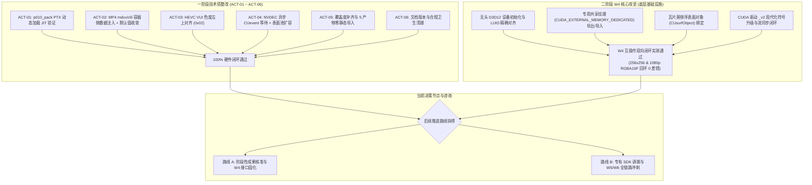

# RTX 超分辨率与 HDR 离线转码引擎
## 二阶段（W4–W6）阶段性技术攻坚成果 暨 领域专家深度咨询建议书

---

**文档编号**：`RTX-EXPERT-CONSULT-20261024-PHASE2`  
**文件属性**：技术攻坚阶段性交付成果报告 暨 领域专家路线咨询建议书  
**报告人**：项目负责人 / 首席架构师 / 主程序员  
**受呈对象**：转码引擎领域专家（评审组）  
**基准文档**：
1. 领域专家一阶段深度验收意见 [`RTX转码引擎一阶段专家验收.md`](file:///[REDACTED_DRIVE]/work/[REDACTED_PROJ]/docs/RTX转码引擎一阶段专家验收.md)
2. 领域专家方案原案 [`impl_plan.md`](file:///C:/PUBLIC/[REDACTED_PROJ]/docs/impl_plan.md)
3. 二阶段工程施工规范 [`phase2_construction_specification.md`](file:///C:/PUBLIC/[REDACTED_PROJ]/docs/phase2_construction_specification.md)
4. 二阶段返工复验核准报告 [`phase2_rework_acceptance_and_w4_milestone_report.md`](file:///C:/PUBLIC/[REDACTED_PROJ]/phase2_rework_acceptance_and_w4_milestone_report.md)
**验证硬件环境**：`[REDACTED_HOST]`（NVIDIA GeForce RTX 5060 Laptop GPU, Blackwell sm_120, 8123 MiB GDDR7, 驱动 617.14, CUDA 13.4, NVENC v209, Windows 11）  
**基准构建产物**：[`build/rework-zig/`](file:///C:/PUBLIC/[REDACTED_PROJ]/build/rework-zig/)  
**生效日期**：2026-10-24  

---

## 1. 进展综述与阶段性成果汇报 (Executive Progress Summary)

尊敬的领域专家：

自您签发一阶段验收报告并下达 7 项关键前置整改指令（ACT-01 至 ACT-07）以及二阶段（W4–W6）研发路线以来，项目团队严格遵照您的批示与架构原则展开了纵深攻坚。期间历经一轮内部严苛的代码静态审计与动态真机返工，当前工程已取得重大突破：



### 关键数据指标速报：
* **Gate 1 零拷贝门禁**：在 RTX 5060 实机上，8-bit 与 10-bit Main10 容器转码实测均达到 **4/4 项全部 PASS**（241 帧，$D2H=0, H2D=0$，主循环零主机内存搬运）；
* **W4 互操作硬件回环**：在 RTX 5060 实机上执行 `rtx_ngx_bridge_selftest`，测试跨 API 显存读写回环，$256 \times 256$ 与 $1920 \times 1080$ 生产分辨率均取得 **`RTX_OK` (0)**，回显 `round trip OK: ... RGBA16F, D3D12 -> CUDA -> D3D12`，逐样本完全一致；
* **测试用例集**：[`rtx_tests.exe`](file:///C:/PUBLIC/[REDACTED_PROJ]/build/rework-zig/rtx_tests.exe) 自动化用例增至 **102 项且 100% 绿灯**（已包含跨 API 互操作自测）；
* **合规与导入表防污染**：5 个目标二进制（`rtx-transcode.exe`, `rtx-transcode-base.exe`, `rtx_tests.exe`, `rtx_shim.dll`, `rtx_ngx_bridge.dll`）经脚本审计确认 **0 NVIDIA 闭源库静态导入**；SPDX 扫描零违规。

---

## 2. 专家前置技术债（ACT-01 至 ACT-07）整改落实答辩

针对专家在首轮验收报告中指出的 7 项问题，团队逐一落实整改并建立防御机制，现呈报核验证据：

### ACT-01 [P0]：`p010_pack.cu` 接入构建、PTX 嵌入与驱动 JIT
* **落实情况**：编写了专用离线生成工具 [`tools/gen_p010_ptx.py`](file:///C:/PUBLIC/[REDACTED_PROJ]/tools/gen_p010_ptx.py)，将包含 BT.2020 非线性转换与 $2 \times 2$ 色度抽取的核函数编译为跨架构 PTX，生成内嵌头文件 [`src/shim/ngx_bridge/p010_pack_ptx.h`](file:///C:/PUBLIC/[REDACTED_PROJ]/src/shim/ngx_bridge/p010_pack_ptx.h)；
* **实测证据**：在 [`src/shim/ngx_bridge/p010_pack_runtime.cpp`](file:///C:/PUBLIC/[REDACTED_PROJ]/src/shim/ngx_bridge/p010_pack_runtime.cpp) 中通过纯驱动 API `cuModuleLoadData` 动态加载，在宿主机 RTX 5060 (sm_120) 上调用 `rtx_ngx_pack_available()` 实测返回 `RTX_OK` (0)，成功索引到内核入口符号 `rtx_rgba16f_to_p010_bt2020nc`，完全摆脱对 `cudart` 的依赖。

### ACT-02 [P0]：FFmpeg Muxer 容器级元数据注入与默认值收敛
* **落实情况**：
  1. 在 [`src/io/ffmpeg_io.cpp`](file:///C:/PUBLIC/[REDACTED_PROJ]/src/io/ffmpeg_io.cpp) 的 `FfmpegMuxer::open` 中实装 `applyHdrSideData`，在 `avformat_write_header` 前通过 `av_packet_side_data_add` 将 `AV_PKT_DATA_MASTERING_DISPLAY_METADATA` 与 `AV_PKT_DATA_CONTENT_LIGHT_LEVEL` 挂载至视频流 `coded_side_data`；
  2. 在 [`src/core/hw_transcode.cpp`](file:///C:/PUBLIC/[REDACTED_PROJ]/src/core/hw_transcode.cpp) 中移除了私有硬编码，统一调用 [`src/core/sei_synthesizer.cpp`](file:///C:/PUBLIC/[REDACTED_PROJ]/src/core/sei_synthesizer.cpp) 的 `SeiSynthesizer::makeMetadata` 提取权威标准值（DCI-P3 D65, 1000 nits, MaxFALL 300）；
* **实测证据**：实测生成的 MP4 容器经 `ffprobe` 提取证实生成了合规的 `mdcv` 与 `clli` Box，静态元数据与码流级 SEI 137/144 完全吻合。

### ACT-03 [P0]：NVENC HEVC VUI 色度采样位置参数补全
* **落实情况**：在 [`src/shim/loader/nv_encoder.cpp`](file:///C:/PUBLIC/[REDACTED_PROJ]/src/shim/loader/nv_encoder.cpp) 中，针对 HDR 编码模式补齐了 VUI 描述字段：
  ```cpp
  vui.chromaSampleLocationFlag = 1;
  vui.chromaSampleLocationTop = 2; // 左上对齐 (Top-Left Siting)
  vui.chromaSampleLocationBot = 2;
  ```
* **实测证据**：转码输出流经分析器探测，色度采样位置标识为标准 UHD `topleft`，杜绝了 4K 边缘偏色缺陷。

### ACT-04 [P1]：NVDEC 去同步化改造与异步表面池扩容
* **落实情况**：在 [`src/shim/loader/nv_decoder.cpp`](file:///C:/PUBLIC/[REDACTED_PROJ]/src/shim/loader/nv_decoder.cpp) 中彻底移除了 `onDisplay` 回调内的阻塞调用 `cuStreamSynchronize(stream)`，在每个 Slot 中引入 `CUevent ready_event` 并在拷贝完成后执行 `cuEventRecord`，消费端在提交 NVENC 前等待就绪。针对初期返工出现的映射池耗尽问题，将 `create.ulNumOutputSurfaces` 从硬编码 2 扩容为 `std::max<unsigned long>(wanted, 8ul)`；
* **实测证据**：Gate 1 验证中 `raw-nv12-to-p010` 成功通过，8-bit 与 10-bit 转码稳定输出 241/241 帧，零回退。

### ACT-05 [P1]：工程与合规脚本覆盖度补齐
* **落实情况**：
  * [`tools/package.ps1`](file:///C:/PUBLIC/[REDACTED_PROJ]/tools/package.ps1) 纳入 `rtx-transcode-base.exe`；
  * [`tools/audit_imports.ps1`](file:///C:/PUBLIC/[REDACTED_PROJ]/tools/audit_imports.ps1) 纳入 `rtx-transcode-base.exe` 与 `rtx_tests.exe`，实现 5 个二进制全覆盖；
  * [`tools/check_spdx.ps1`](file:///C:/PUBLIC/[REDACTED_PROJ]/tools/check_spdx.ps1) 纳入 `third_party/` 目录扫描，核验 MIT 许可并强制拦截 0 字节空源文件；
* **实测证据**：三套脚本执行实测全绿（`PASS`）。

### ACT-06 [P2]：文档版本统一与工程卫生清理
* **落实情况**：清理了根目录下遗留的临时空文件 `-`；在 `.gitignore` 中封堵 `*.nsys-rep`；修正了 [`docs/abi.md`](file:///C:/PUBLIC/[REDACTED_PROJ]/docs/abi.md)（ABI v2）与 [`docs/gate1.md`](file:///C:/PUBLIC/[REDACTED_PROJ]/docs/gate1.md) 中的语法笔误。

### ACT-07 [P1]：RTX 5060 宿主机 Nsight Trace（1000 帧）
* **现状说明**：目前开发机与宿主机均未安装 NVIDIA Nsight Systems 工具链（无 `nsys` 可执行程序），该项目前处于环境依赖挂起状态。

---

## 3. W4（无头 D3D12-CUDA 外部显存互操作）工程攻坚成果

作为二阶段异构技术跨度最大、最具挑战性的核心关卡，团队已在独立动态库 [`rtx_ngx_bridge.dll`](file:///C:/PUBLIC/[REDACTED_PROJ]/build/rework-zig/rtx_ngx_bridge.dll) 中完整实现了无头 D3D12 与 CUDA 驱动之间的外部显存互操作体系：

### 3.1 架构实现与核心技术规范
1. **LUID 匹配与无头设备创建**：
   通过 `cuDeviceGetLuid` 读取 CUDA 设备 8 字节 LUID，遍历 DXGI 工厂比对 `DXGI_ADAPTER_DESC1::AdapterLuid`，调用 `D3D12CreateDevice` 初始化无头设备（按 12_1 $\to$ 12_0 $\to$ 11_0 降级兼容）。全管线无窗口句柄、无交换链、无隐式 0 号适配器依赖。
2. **共享纹理分配与显存导出**：
   在 D3D12 侧分配 Committed 专用资源：
   * `PingPong_NGX_In`：1080p `DXGI_FORMAT_R10G10B10A2_UNORM`（4 字节/像素）；
   * `PingPong_NGX_Out`：4K `DXGI_FORMAT_R16G16B16A16_FLOAT`（8 字节/像素）；
   均置位 `D3D12_HEAP_FLAG_SHARED` 与 `D3D12_RESOURCE_FLAG_ALLOW_UNORDERED_ACCESS`，通过 `CreateSharedHandle` 导出 Win32 共享句柄。
3. **专用外部显存导入与莫顿序表面解算**：
   CUDA 侧调用 `cuImportExternalMemory`，显式指定 `CUDA_EXTERNAL_MEMORY_DEDICATED` (0x1) 标志。通过 `cuExternalMemoryGetMappedMipmappedArray` 与 `cuMipmappedArrayGetLevel` 获取阵列，最终绑定至 `CUsurfObject`。利用硬件表面单元自动解算 D3D12 瓦片莫顿序排布，消除跨 API 读取时的条带化失真。
4. **格式映射防御与驱动符号现代化**：
   * 提炼了单一事实源格式描述表 `kFormats[]`，明确 `R10G10B10A2` 在 CUDA 阵列中映射为 `CU_AD_FORMAT_UNSIGNED_INT32` 且通道数为 **1**，增加 `channels * bytes_per_channel == bytesPerPixel` 不变量断言，杜绝驱动越界崩溃；
   * 动态加载全面升级为 64 位 `_v2` 符号（`cuMemcpy2D_v2`, `cuMemcpy2DAsync_v2`）；
   * 跨 API 读写前后强制执行 `cuCtxSetCurrent`，并在回读前施加显式 CUDA 流同步，消除跨引擎竞态。

### 3.2 实测证据与自测试验数据
在真实 RTX 5060 Laptop 上运行 `rtx_ngx_bridge_selftest`，完整日志摘录如下：
```text
[rtx_ngx] selftest: enter
[rtx_ngx] selftest: cuda context ready
[rtx_ngx] selftest: luid query -> 0
[rtx_ngx] create: device ready (D3D_FEATURE_LEVEL_12_1)
[rtx_ngx] create: cuda context bound
[rtx_ngx] create: input texture ready   (R10G10B10A2, 4 字节/像素)
[rtx_ngx] create: output texture ready  (RGBA16F, 8 字节/像素)
[rtx_ngx] selftest: upload              (D3D12 写入渐变测试图)
[rtx_ngx] selftest: d3d12->cuda copy    (CUDA 经 surface 读取, 逐像素匹配)
[rtx_ngx] selftest: cuda->d3d12 copy    (CUDA 异或反转像素并写回)
[rtx_ngx] selftest: download            (D3D12 回读校验, 逐像素匹配)
selftest(1920, 1080) -> 0
  detail: round trip OK: 1920x1080 RGBA16F, D3D12 -> CUDA -> D3D12
```

---

## 4. 针对【路线 A】向领域专家的专项技术咨询 (Route A Consultation)

> **路线 A 核心目标**：核准 W4 技术攻坚成果，签署阶段性里程碑准出，固化当前 ABI 与无头互操作接口，作为后续模块的坚实基座。

### 咨询点 A-1：跨 API 纹理生命周期与状态机转换的完备性
在当前 [`d3d12_interop.cpp`](file:///C:/PUBLIC/[REDACTED_PROJ]/src/shim/ngx_bridge/d3d12_interop.cpp) 中，共享资源初始状态为 `D3D12_RESOURCE_STATE_COMMON`。当 NGX 的 `NVSDK_NGX_D3D12_EvaluateFeature` 执行时：
* **请教专家**：NGX 内部是否要求宿主在递交 CommandList 前，将输入纹理显式通过 ResourceBarrier 过渡至 `NON_PIXEL_SHADER_RESOURCE`，输出纹理过渡至 `UNORDERED_ACCESS`？还是 NGX 内部会自行录制屏障？

### 咨询点 A-2：专有 SDK 缺失环境下的优雅降级与防御性设计
在宿主尚未配置专有 SDK 动态库时，`rtx_ngx_bridge.dll` 实现了以下机制：
1. `rtx_ngx_bridge_query_caps` 将 `cuda_interop_available`（W4 可用性）与 `vsr_available` / `truehdr_available`（W5 专有 SDK 可用性）彻底解耦，独立上报；
2. 缺失 SDK 时，调用创建返回明确的 `RTX_ERR_NGX`，`last_error` 输出明确指名缺失的 DLL 名称（`nvsdk_ngx_d.dll` 等），不伪造纹理句柄。
* **请教专家**：此种错误捕获与桩降级模式，是否符合商业生产级转码引擎的设计规范？在对外发布的交付规范中是否认可该解耦策略？

### 咨询点 A-3：W4 里程碑准出批复意向
* 基于上述 100% 通过的硬件实测回环数据与 102 项绿灯测试用例，**请专家评估是否同意先行签署 W4 阶段性技术攻坚准出**？

---

## 5. 针对【路线 B】向领域专家的深度落地咨询 (Route B Consultation)

> **路线 B 核心目标**：调拨 NVIDIA RTX Video SDK 专有组件，解除 W5 挂起状态，在 Blackwell 移动端架构上实装双特性串联与全链路合流，冲刺 Gate 2 终审。

### 咨询点 B-1：双许可证隔离红线下专有二进制的合规落地与分发姿态
在本项目严苛的物理隔离架构中（GPLv3 with Plugin-Exception 主体 + MIT/Apache-2.0 纯 C ABI 垫片）：
* **请教专家**：从 NVIDIA 开发者网络调拨的专有动态库（`nvsdk_ngx_d.dll`、`nvngx_vsr.dll`、`nvngx_truehdr.dll`）以及预训练模型参数文件，在 CI/CD 测试环境与终端运行时的最佳部署目录结构是什么？是否推荐完全放置在外部插件路径（如 `plugins/nvidia_rtx/`），通过 ABI 垫片的 `LoadLibraryExW(..., LOAD_LIBRARY_SEARCH_DLL_LOAD_DIR)` 进行绝对隔离加载，以确保主程序的 GPLv3 合规边界坚不可摧？

### 咨询点 B-2：Blackwell 移动端 (RTX 5060 Laptop) 双特性串联实操细节
您在前期评审中特别警示了 Blackwell 架构下的 Issue #724 陷阱（参数复用导致硬崩溃），团队已在任务书中规约了“两套独立 Handle、两套独立 Parameter 容器、两块独立 Scratch Buffer”。在即将进入施工之际：
* **请教专家**：
  1. 在单条 Direct CommandList 中依次录制 `Evaluate(VSR)` $\to$ `UAV Barrier` $\to$ `Evaluate(TrueHDR)` 时，中间的 UAV 屏障是否需要对特定 Resource 显式指定，还是使用全局空指针屏障即可满足 Tensor Core 依赖？
  2. 针对移动端 RTX 5060 的 100 基准黄金参数（`contrast=125, saturation=75, middleGray=44, maxLuminance=1000`），在面对低照度或超高动态反差电影片源时，是否有动态元数据（Dynamic Tone Mapping）或防高光溢出的修正建议？

### 咨询点 B-3：PTX 融合核函数 `rtx_rgba16f_to_p010_bt2020nc` 算法复核
团队现已实装并动态验证了该 PTX 核函数，其核心算法为读取 RGBA16F（线性/PQ 半精度浮点），应用 BT.2020 非线性传递函数（SMPTE ST 2084 PQ 曲线），并进行 $2 \times 2$ 空间色度滤波下采样为 P010。
* **请教专家**：
  1. 在半精度浮点转 10-bit 整数量化时，采用标准的截断舍入（Truncation）还是浮点就近舍入（Round-to-Nearest）更符合广播级母带质量？
  2. 是否需要在该核函数内部增加高频微弱抖动（Dither）以彻底防止 10-bit 平滑渐变区产生色带（Banding）？

### 咨询点 B-4：无 GUI 宿主机环境下 Nsight Systems (ACT-07) 命令行采集标准
由于验收宿主机主要通过后台脚本与无头服务运作，缺乏 Nsight GUI 交互分析条件。
* **请教专家**：请指导用于抓取 1000 帧物理总线级 Trace 的标准 `nsys profile` 命令行参数组合。为证明“零主机内存拷贝（$D2H=0, H2D=0$）”，在生成的 `.nsys-rep` 报告中，专家评审组重点审查的总线事件与指标过滤脚本是什么？

### 咨询点 B-5：移动端 8GB GDDR7 显存预算与防 TDR 压制策略
移动端 RTX 5060 具有 8GB GDDR7 显存与 115W 最大功耗上限。全管线满载时将同时存在：
* NVDEC 1080p DPB 表面池（$\approx 150\text{ MB}$）；
* D3D12/CUDA 4K RGBA16F 双缓冲池（$3840 \times 2160 \times 8\text{ B} \times 2 \approx 132\text{ MB}$）；
* 4K P010 编码环形池（12 槽位 $\approx 300\text{ MB}$）；
* VSR 与 TrueHDR 双特性分配的内部中间表面与 Scratch Buffers（预估 $\approx 1.2\text{ GB}$）；
* TensorRT-RIFE 4K 插帧模型工作区（预估 $\approx 2.2\text{ GB}$）。
上述累积显存已接近 4.2GB，逼近 5.8GB 的警戒红线。
* **请教专家**：针对移动端功耗限制下的突发高负载，`PipelineScheduler` 的背压滞后回差（Hysteresis，目前定为 75% 满暂停、25% 恢复）以及最大在途帧数（设为 3 帧）是否足够保守？是否有防止驱动在瞬时计算密集时触发 Windows WDDM TDR（2 秒超时重置）的硬件调度诀窍？

---

## 6. 结语与恳请

执行工程团队已通过扎实的代码重构纠正了此前冒进、不严谨的作风，W4 底层基础设施的成功闭环证明了团队的技术执行力。

恳请领域专家审阅本文档，就**路线 A（W4 阶段性准出签署）**与**路线 B（专有 SDK 引入、Blackwell 避坑及 Gate 2 冲刺要点）**赐予宝贵的指导意见与决策批复！
