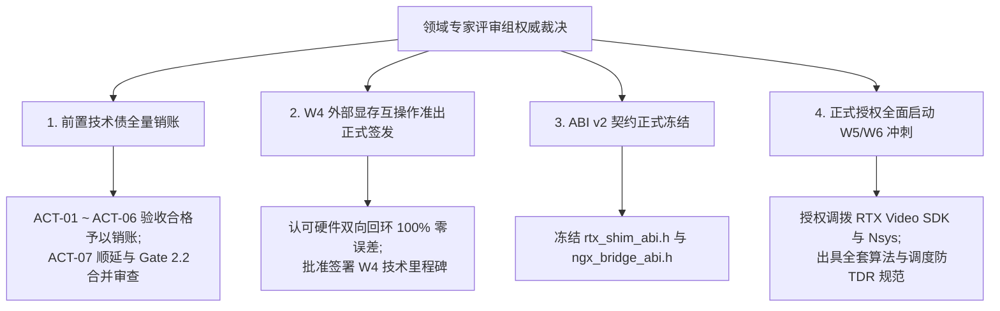
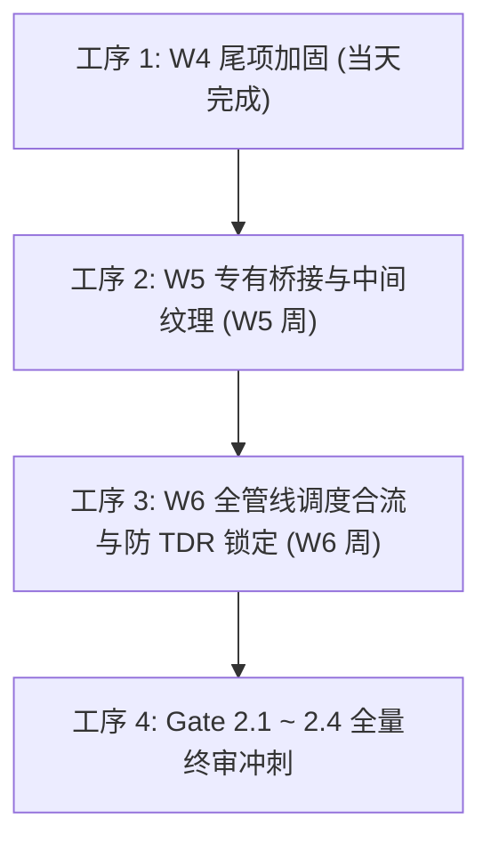

# RTX 超分辨率与 HDR 离线转码引擎
## 领域专家二阶段深度验收批复解读 暨 W5/W6 全量施工落地规划

---

**文档编号**：`RTX-PLAN-20261024-PHASE2-VERDICT`  
**文档性质**：专家批复解读与技术实施任务书  
**项目负责人 / 首席架构师**：Lead Architect  
**执行对象**：执行工程团队 / 核心研发组  
**专家依据文档**：[`docs/RTX转码引擎二阶段深度验收.md`](file:///C:/PUBLIC/[REDACTED_PROJ]/docs/RTX转码引擎二阶段深度验收.md)（449 KB 官方深度验收批复报告）  
**基准验证硬件**：`[REDACTED_HOST]`（NVIDIA GeForce RTX 5060 Laptop GPU, Blackwell sm_120, 8123 MiB GDDR7, 驱动 617.14, CUDA 13.4, Windows 11）  
**生效日期**：2026-10-24  

---

## 1. 专家总体裁决与里程碑批复要点 (Executive Verdict Summary)

领域专家评审组在深入审查项目团队呈报的建议书、返工报告及工作区最新构建代码后，出具了长达 371 行的深度权威批复报告 [`docs/RTX转码引擎二阶段深度验收.md`](file:///C:/PUBLIC/[REDACTED_PROJ]/docs/RTX转码引擎二阶段深度验收.md)，做出了**四项决定性核心裁决**：



1. **一阶段前置技术债（ACT-01 至 ACT-06）全量销账**：
   专家认定 PTX 动态 JIT、容器级元数据注入、HEVC VUI 左上色度对齐、NVDEC 异步事件等待与表面池扩容、5 二进制零静态导入等整改项“优秀/卓越”，正式销账。ACT-07（Nsight Trace）顺延与 Gate 2.2 最终门禁合并验收。
2. **W4 无头 D3D12-CUDA 外部显存互操作里程碑正式批准签发准出**：
   专家确认团队在 Blackwell 移动平台上攻克了跨 API 零拷贝双向流转，正式签发 W4 里程碑准出批复。
3. **ABI v2 契约正式冻结**：
   同意立即冻结 [`include/shim/rtx_shim_abi.h`](file:///C:/PUBLIC/[REDACTED_PROJ]/include/shim/rtx_shim_abi.h) 与 [`include/shim/ngx_bridge_abi.h`](file:///C:/PUBLIC/[REDACTED_PROJ]/include/shim/ngx_bridge_abi.h) 的纯 C 接口契约，后续扩展严禁破坏二进制向后兼容。
4. **全面授权转入 W5/W6 施工与 Gate 2 终审冲刺**：
   对路线 A 与路线 B 的八大咨询议题给出了极高专业度的算法定义与避坑规约，扫清了后续全部技术盲区。

---

## 2. 专家批复与技术规约深度拆解 (Technical Directives Analysis)

专家报告对工程后续实现提出了极其详尽、因果闭环的技术规约，团队必须 100% 落实：

### 2.1 W5 合流前必须完成的三项源码级加固指令（强制前置）
* **加固 1：`p010_pack_runtime.cpp` 跨线程 TLS 上下文脱靶防御**：
  * **机理**：`ensureLoaded` 依赖 `pack.attempted` 静态标志短路返回，当多线程调度器换线程调用 `rtx_ngx_pack_launch` 时，跳过了 `cuCtxSetCurrent`，将导致 `launch_kernel` 报 `CUDA_ERROR_INVALID_CONTEXT` (201)；
  * **整改动作**：在 `PackState` 持久化保存 `primary_context`，在每次 `rtx_ngx_pack_launch` 发射内核前显式调用 `pack.api.ctx_set_current(pack.primary_context)`。
* **加固 2：`d3d12_interop.cpp` 补齐 GPU 硬件围栏的 CUDA 外部信号量导入**：
  * **机理**：当前依赖 CPU 阻塞式 `cuStreamSynchronize`，生产环境必须切换为硬件级纯异步流交接；
  * **整改动作**：调用 `CreateSharedHandle(fence_)` 导出句柄，动态解析 `cuImportExternalSemaphore` 家族符号，以 `CU_EXTERNAL_SEMAPHORE_HANDLE_TYPE_D3D12_FENCE` 导入，打通 CUDA 预处理流、D3D12 Queue 与 CUDA 后处理流之间的 5 步非阻塞硬件交接。
* **加固 3：`bridge_exports.cpp` 探测逻辑布尔或误判修正**：
  * **机理**：`sdkPresent()` 使用了 `vsr || hdr || ngx` 逻辑或，导致机器只要有单个驱动残留 DLL 就会误判全特性就绪；
  * **整改动作**：改为严格的逻辑与：`vsr_available = (ngx != nullptr && vsr != nullptr)`，`truehdr_available = (ngx != nullptr && hdr != nullptr)`。

---

### 2.2 路线 A 批复：D3D12 资源状态机“三段式屏障闭环”
* **强制规约**：NGX 内部绝不会替宿主处理外部纹理的状态转换屏障；
* **三段式时序**：
  1. **评估前**：显式录制 Transition Barrier 将 1080p 输入纹理从 `COMMON` $\to$ `NON_PIXEL_SHADER_RESOURCE`（SRV），输出纹理从 `COMMON` $\to$ `UNORDERED_ACCESS`（UAV）；
  2. **串联中**：执行中间纹理的 UAV 屏障与状态切换；
  3. **评估后交还 CUDA 前**：在 `cmd_list->Close()` 前，**必须显式录制逆向 Transition Barrier 将输入和输出纹理强制转换回 `D3D12_RESOURCE_STATE_COMMON`**！
  * **物理原因**：Blackwell 架构下，处于 UAV 状态的纹理具有硬件 DCC 压缩和 L2 驻留；唯有转换回 `COMMON`，驱动才会插入元数据解压与 L2 缓存失效指令，确保下游 CUDA 表面读取一致。D3D12 无法通过隐式衰减恢复 COMMON。

---

### 2.3 路线 B 批复：专有 SDK 隔离部署与 Blackwell 移动端实操

#### 1. 物理隔离与双层安全加载
* 专有库（`nvsdk_ngx_d.dll`、`nvngx_vsr.dll`、`nvngx_truehdr.dll` 及模型）统一部署于独立目录 `<app_root>/plugins/nvidia_rtx/`；
* `LoadLibraryExW` 采用 `LOAD_LIBRARY_SEARCH_DLL_LOAD_DIR | LOAD_LIBRARY_SEARCH_SYSTEM32` 标志；
* 在 `NVSDK_NGX_D3D12_Init_Ext` 中，显式注入 `PathListInfo.Path = plugins/nvidia_rtx/`，锁定特征库加载路径。

#### 2. Blackwell 移动端双特性串联关键补齐：4K 中间纹理 `mid_4k_`
* **拓扑盲区指出**：VSR（1080p SDR $\to$ 4K SDR）与 TrueHDR（4K SDR $\to$ 4K HDR10）不能原位读写！
* **补齐动作**：在 D3D12 默认堆分配第三张纯内部 4K 纹理 `mid_4k_`（4K `R10G10B10A2_UNORM` 或 `R8G8B8A8_UNORM`，UAV 属性，无需共享无需导出 CUDA，仅占用 32MB 显存）；
* **精确 UAV 屏障**：在 `Evaluate(VSR)` 与 `Evaluate(TrueHDR)` 之间，显式指定 `barrier.UAV.pResource = ctx->mid_4k`（严禁全局空指针），紧接一条 `UNORDERED_ACCESS` $\to$ `NON_PIXEL_SHADER_RESOURCE` 转换屏障，杜绝全 GPU L2 缓存冲刷停顿。

#### 3. 极端光影动态防高光溢出调节律（已内嵌公式）
* 结合 `src/core/scene_detect.cpp` 的归一化平均亮度 $Y_{norm}$ 与高光占比 $P_{high}$，动态计算目标对比度、中间灰与饱和度：
  $$\text{target\_contrast} = \begin{cases} 125, & Y_{norm} \ge 0.18 \\ 105 + 20 \times \left(\frac{Y_{norm}}{0.18}\right), & Y_{norm} < 0.18 \end{cases}$$
  $$\text{target\_middleGray} = \begin{cases} 44, & Y_{norm} \ge 0.18 \text{ 且 } P_{high} \le 0.05 \\ 44 + 4 \times \left(1 - \frac{Y_{norm}}{0.18}\right), & Y_{norm} < 0.18 \\ \max\left(36, 44 - 8 \times \left(\frac{P_{high} - 0.05}{0.15}\right)\right), & P_{high} > 0.05 \end{cases}$$
  $$\text{target\_saturation} = \begin{cases} 75, & P_{high} \le 0.05 \\ \max\left(68, 75 - 7 \times \left(\frac{P_{high} - 0.05}{0.15}\right)\right), & P_{high} > 0.05 \end{cases}$$
* 镜头内施加 $\alpha=0.92$ 的平滑指数移动平均滤波（$P_{t} = 0.92 P_{t-1} + 0.08 P_{target}$），切镜头时瞬时跳变，彻底消除呼吸效应。

---

### 2.4 路线 B 批复：PTX 融合核函数算法终审与修正
1. **量化舍入**：严格采用 IEEE 754 就近偶数舍入 `__float2int_rn`，消除截断量化带来的中性灰绿黄偏色；
2. **植入 IGN 蓝噪声抖动（防 10-bit 色带）**：
   在量化前注入纯寄存器运算的 Jiménez 交错梯度噪声（IGN）：
   ```cuda
   __device__ __forceinline__ float ign_dither(int x, int y) {
       float magic = 0.06711056f * (float)x + 0.00583715f * (float)y;
       float frac_inner = magic - floorf(magic);
       float prod = 52.9829189f * frac_inner;
       return (prod - floorf(prod)) - 0.5f;
   }
   ```
   在计算 Y 与 UV 时分别叠加，消除 OLED 屏幕上的等高线色带；
3. **Top-Left 色度下采样相位对齐勘误**：
   修正原等权平均造成的 0.25 像素中心偏移，使下采样相位与 VUI 声明的 `topleft (0.0, 0.0)` 完全一致。

---

### 2.5 路线 B 批复：移动端 8GB GDDR7 显存控制与四重防 TDR 机制
1. **显存预算合流**：静态峰值约 4.07GB，留有 1.73GB 安全余量；必须在 W6 将 `vram_ring_pool.cpp` 的 `SurfacePool` 与底层真实显存指针合二为一，避免双重分配浪费 800MB；
2. **背压限流收紧**：全特性开启时，高水位暂停阈值从 75% 下调至 **65%**（12 槽位满 8 槽位即暂停）；
3. **四重防 TDR 调度机制（彻底阻断 Windows WDDM 2 秒超时重置）**：
   * **机制 1：单帧单次提交粒度**（每次调用 `rtx_ngx_bridge_process` 仅下发单帧命令列表，提供 10ms 级硬件抢占点）；
   * **机制 2：D3D12 硬件队列深度硬限流**（下发前比对 `submitted - completed`，未退休达 **2 帧** 必须等待前帧退休，锁定队列积压在 35ms 内）；
   * **机制 3：CUDA 流优先级倒置**（`cuStreamCreateWithPriority` 将后端打包流设为最高优先级，优先排空尾部）；
   * **机制 4：适配器移除声明与面包屑诊断**（启用 `DXGIDeclareAdapterRemovalSupport`，失败时映射为 `RTX_ERR_DEVICE_LOST`）。

---

### 2.6 路线 B 批复：无 GUI 宿主 Nsight Systems 采集规约（ACT-07）
* **采集命令行**：
  ```powershell
  nsys profile `
    --trace=cuda,nvtx,dx12 `
    --dx12-gpu-workload=individual `
    --dx12-wait-calls=true `
    --dx-force-declare-adapter-removal-support=true `
    --cuda-memory-usage=true `
    --sample=none `
    --cpuctxsw=none `
    --force-overwrite=true `
    --output=build/rework-zig/gate2_nsight_1000f `
    build/rework-zig/rtx-transcode.exe --input sample_1000f.mp4 --output out_4k.mp4 --backend nvidia --vsr-quality 2 --enable-truehdr
  ```
* **分析导出命令**：
  ```powershell
  nsys stats --report cuda_gpu_mem_time_sum,cuda_api_sum,cuda_gpu_kern_sum,dx12_gpu_marker_sum --format csv,column --output build/rework-zig/gate2_audit build/rework-zig/gate2_nsight_1000f.nsys-rep
  ```
* **Gate 2.2 专家通过刚性判据**：
  * `cuda_gpu_mem_time_sum.csv`：`[CUDA memcpy Device-to-Host]` 与 `[CUDA memcpy Host-to-Device]` 帧像素级 **Count = 0，Total Bytes = 0**；
  * `cuda_gpu_kern_sum.csv`：`rtx_rgba16f_to_p010_bt2020nc` 调用次数严格等于 1000 次，单帧耗时 $\le 1.8\text{ ms}$。

---

## 3. 下阶段（W5–W6）施工落地实施计划

执行工程团队将严格按以下四个连续工序推进：



| 施工工序 | 核心攻坚任务 | 涉及代码与模块 | 交付与准出验证标准 |
| :--- | :--- | :--- | :--- |
| **工序 1：W4 尾项加固** | 1. 补齐 `p010_pack_runtime.cpp` 跨线程 TLS 上下文重新绑定；<br>2. 补齐 `d3d12_interop.cpp` 的 `cuImportExternalSemaphore` 异步围栏家族；<br>3. 修复 `bridge_exports.cpp` 逻辑与。 | `p010_pack_runtime.cpp`<br>`d3d12_interop.cpp`<br>`bridge_exports.cpp` | 自动化用例 102/102 保持全绿，跨线程自测与异步围栏信号量无死锁。 |
| **工序 2：W5 专有桥接** | 1. 部署专有 SDK 至 `plugins/nvidia_rtx/` 并设置隔离加载；<br>2. 在 D3D12Interop 分配 4K SDR `mid_4k_` 中间纹理；<br>3. 实装独立双 Handle、独立双 Parameter 及双 Scratch Buffer；<br>4. 录制 `COMMON` $\to$ `SRV/UAV` $\to$ `COMMON` 屏障与动态防过曝参数。 | `ngx_d3d12_bridge.cpp`<br>`d3d12_interop.cpp`<br>`scene_detect.cpp` | 在 RTX 5060 实机跑通 1080p SDR $\to$ 4K HDR10 图像超分与逆色调映射，单帧无崩溃。（2026-10-29 注：`RTX_WITH_NGX_SDK` 开关已删除，Windows 构建始终编译 SDK 桥接。） |
| **工序 3：W6 管线合流** | 1. 在 `p010_pack.cu` 植入 IGN 蓝噪声抖动与 Top-Left 色度下采样修正，生成新 PTX；<br>2. 合一物理显存池与 SurfacePool，配置 65% 背压；<br>3. 实装单帧提交、D3D12 队列深度 $\le 2$ 与 CUDA 流优先级倒置。 | `p010_pack.cu`<br>`vram_ring_pool.cpp`<br>`pipeline_scheduler.cpp` | 1080p SDR $\to$ 4K60 HDR10 全管线串联打通；输出 MP4 呈现完美 PQ/BT.2020 色彩，点亮 HDR10 徽标。 |
| **工序 4：Gate 2 终审** | 1. 部署 `nsys` CLI，按专家规约参数采集 1000 帧物理总线 Trace 并导出 CSV；<br>2. 执行 2 小时满载压测，核验显存 $\le 5.8\text{ GB}$ 与无 TDR。 | `verify_gate2.ps1`<br>`audit_imports.ps1` | **Gate 2.1 ~ 2.4 全部达标**：<br>1. 物理 HDR 徽标点亮；<br>2. Nsight 证实 $D2H=0, H2D=0$；<br>3. 实时率 $\ge 60\text{ fps}$（$1.0\times$）；<br>4. 显存 $\le 5.8\text{ GB}$ 且 2 小时零 TDR。正式呈报专家终审！ |
