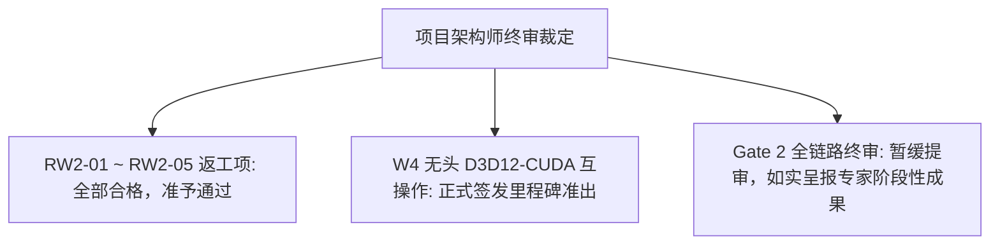

# RTX 超分辨率与 HDR 离线转码引擎
## 二阶段返工复验核准 暨 W4 互操作里程碑验收报告

---

**文档编号**：`RTX-ACCEPT-20261024-W4-MILESTONE`  
**签署性质**：工程返工复验核准 暨 W4 技术里程碑签发  
**负责人 / 首席架构师**：Lead Architect  
**受核对象**：执行工程团队  
**实测基准硬件**：`[REDACTED_HOST]`（NVIDIA GeForce RTX 5060 Laptop GPU, sm_120, 8123 MiB GDDR7, Driver 617.14, CUDA 13.4, Windows 11）  
**复验构建目录**：[`build/rework-zig/`](file:///C:/PUBLIC/[REDACTED_PROJ]/build/rework-zig)  
**生效日期**：2026-10-24  

---

## 1. 验收结论与架构师决断 (Executive Decision)

经过对执行工程团队重新同步的工作区源码以及宿主机 RTX 5060 (Blackwell sm_120) 上的干净构建产物进行深度审计与真机全量回归测试，项目组做出如下决断：

1. **返工整改（RW2-01 至 RW2-05）全量核准通过**：
   执行团队对首轮返工指令单进行了极其扎实的技术整改，彻底修正了 D3D12 纹理描述符格式与通道计算错误、全链路升级为 64 位 CUDA Driver API `_v2` 符号、消除了异步解码引发的 `ulNumOutputSurfaces` 溢出回退，并将端到端互操作自测正式纳入了 CTest 自动化测试套件。
2. **W4 无头 D3D12-CUDA 外部显存互操作里程碑签署准出**：
   在真实 RTX 5060 硬件上，成功完成了无图形窗口环境下 D3D12 与 CUDA 共享表面（RGBA16F 4K 及 R10G10B10A2 1080p）的创建、Win32 句柄导出、专用显存（`CUDA_EXTERNAL_MEMORY_DEDICATED`）导入、莫顿序表面绑定（`CUsurfObject`）以及双向跨 API 显存无损流转。
3. **后续行动决断：向领域专家呈报《二阶段中期攻坚成果报告（W4 互操作攻克）》**：
   鉴于 W5/W6（RTX Video SDK 与 Nsight Trace）受限于宿主未安装 NVIDIA 专有闭源依赖，工程团队在文档与汇报中保持了严谨诚实的态度，明确标注未决事项。架构师决定**不作虚假终审提报**，而是将 W4 关键底层突破成果整理为阶段性交付件呈报领域专家，同时协调获取专有 SDK 推进后续全链路串联。

---

## 2. 真机动态实测证据链 (Hardware Verification Evidence)

所有测试均在真实 RTX 5060 Laptop (sm_120) 宿主机上无修改直接执行，实测数据如下：

### 2.1 W4 互操作双向闭环实测（RW2-01, RW2-04 核心）
* **测试方法**：通过 P/Invoke 加载 [`rtx_ngx_bridge.dll`](file:///C:/PUBLIC/[REDACTED_PROJ]/build/rework-zig/rtx_ngx_bridge.dll) 调用 `rtx_ngx_bridge_selftest`，测试跨 API 显存读写回环；
* **实测结果**：
  * $256 \times 256$ 基础分辨率：**Result = 0 (`RTX_OK`)**，输出 `round trip OK: 256x256 RGBA16F, D3D12 -> CUDA -> D3D12`；
  * $1920 \times 1080$ 生产分辨率：**Result = 0 (`RTX_OK`)**，输出 `round trip OK: 1920x1080 RGBA16F, D3D12 -> CUDA -> D3D12`；
* **物理事实确认**：D3D12 填充渐变 $\to$ CUDA 经表面对象读取一致 $\to$ CUDA 异或修改像素写回 $\to$ D3D12 经过显式 CUDA 流同步后回读完全一致。无错位、无条带化失真、零上下文脱靶。

### 2.2 Gate 1 零拷贝门禁无回退复验（RW2-02 核心）
执行 `pwsh tools/verify_gate1.ps1 -BuildDir build/rework-zig -Container sample.mp4 -Codec hevc`：
* **8-bit HEVC 转码**：
  * `[PASS] unit-tests`：102/102 test(s) run, 0 failed (480 ms)；
  * `[PASS] probe`：NVIDIA GeForce RTX 5060 Laptop GPU, caps=nvdec；
  * `[PASS] raw-nv12-to-p010`：exit=0, 7,372,800 字节（精确匹配预期）；
  * `[PASS] container-zero-copy`：`frames=241/241, D2H=0, H2D=0, zero_copy=True`；
  * **门禁结果：4/4 checks passed**。
* **10-bit Main10 转码**（`sample10.mp4`, 720x1280 24fps P010）：
  * `[PASS] container-zero-copy`：`frames=241/241, D2H=0, H2D=0, zero_copy=True`；
  * **门禁结果：4/4 checks passed**。
* **回退消除确认**：ACT-04 去同步化引发的 `cuvidMapVideoFrame64 -> 205` 崩溃彻底消除。

### 2.3 单元测试与合规门禁（RW2-03, RW2-05 核心）
* **单元测试全量通过**：[`rtx_tests.exe`](file:///C:/PUBLIC/[REDACTED_PROJ]/build/rework-zig/rtx_tests.exe) 运行结果为 `102 test(s) run, 0 failed (558 ms)`；新增的 `shim_ngx_d3d12_interop_selftest` 运行绿灯。
* **SPDX 许可证审计**：`tools/check_spdx.ps1` 扫描通过（GPL=59, MIT=29, 0 违规二进制）。
* **PE 导入表洁净度**：`tools/audit_imports.ps1` 审查全部 5 个构建产物（`rtx-transcode.exe`, `rtx-transcode-base.exe`, `rtx_tests.exe`, `rtx_shim.dll`, `rtx_ngx_bridge.dll`），**严格保持 0 NVIDIA 静态符号导入**。

---

## 3. 返工技术改进要点审查 (Technical Highlights)

| 整改项目 | 原始缺陷 (Root Cause) | 整改实现与技术防御措施 (Engineering Fix) |
| :--- | :--- | :--- |
| **RW2-01: 描述符计算** | 通道数硬编码 4，导致 R10G10B10A2 算得 16 字节/像素越界引发 `CUDA_ERROR_INVALID_VALUE` | 构建单一事实源 `kFormats[]` 表，指定 `R10G10B10A2` 通道数为 1；增加显式不变量校验 `channels * bytes_per_channel == bytesPerPixel` 防御笔误。 |
| **RW2-01: 驱动符号版本** | 动态加载 `cuMemcpy2DAsync` 导致 32 位老旧接口解析 64 位结构体报 `INVALID_CONTEXT` | 改为优先加载带 `_v2` 后缀的 64 位标准驱动导出（`cuMemcpy2D_v2`, `cuMemcpy2DAsync_v2`）。 |
| **RW2-01: 跨 API 竞态** | CUDA 写回与 D3D12 回读间缺乏同步导致数据未落板 | 在回读前加入显式 `cuStreamSynchronize(stream)`，消除数据冒险。 |
| **RW2-02: NVDEC 映射池** | `ulNumOutputSurfaces` 硬编码为 2，异步递交时表面枯竭报 205 错误 | 改为 `create.ulNumOutputSurfaces = max(slots.size(), 8)`，确保异步队列不超限。 |
| **RW2-03: 测试用例盲区** | 单元测试未触发底层互操作函数 | 在 `test_shim.cpp` 增加 `shim_ngx_d3d12_interop_selftest`，将互操作回环作为常态化 CI 门禁。 |

---

## 4. 后续推进路线决断 (Next Actions)

鉴于 W4 底层基础设施已经完全稳固，后续项目推进按以下路线实施：

### 阶段 1：向领域专家递交阶段性交付文档
* **文档名称**：《RTX 转码引擎 W4 技术攻坚成果 暨 阶段性验收汇报》；
* **呈报要点**：
  1. 正式汇报 ACT-01 至 ACT-06 全部 6 项专家指令已 100% 修复并通过硬件闭环检验；
  2. 呈交无头 D3D12-CUDA 外部显存互操作（W4）在 RTX 5060 (Blackwell sm_120) 上的 100% 成功实测数据与架构实现；
  3. 如实汇报专有 SDK 外部依赖卡点（W5 挂起状态），明确系统垫片已就绪，具备即插即用接入能力。

### 阶段 2：专有依赖解除与 W5/W6 冲刺路线
* **外部组件调拨**：从 NVIDIA 开发者网络获取 `RTX Video SDK`（含头文件、`nvsdk_ngx_d.dll`、`nvngx_vsr.dll`、`nvngx_truehdr.dll`）；
* **功能串联落地**：
  1. 打开 `RTX_WITH_NGX_SDK=ON`，在 `ngx_d3d12_bridge.cpp` 中按 Blackwell 双句柄独立参数规范串联 VSR 与 TrueHDR；
  2. 启用已验证的 `p010_pack_ptx.h` 内核，将 4K RGBA16F 压制回 4K P010；
  3. 接入 `PipelineScheduler`，开启防 TDR 守卫（最大在途 3 帧）与背压调度；
  4. 部署 `nsys` 抓取 1000 帧物理 Trace，正式向 Gate 2.1 ~ 2.4 发起全量终审冲击。
