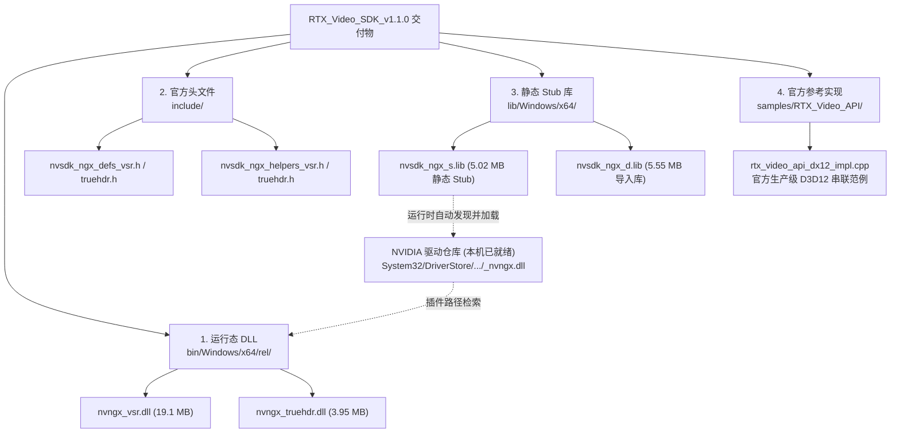
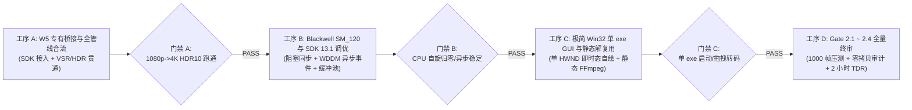

# RTX 超分辨率与 HDR 离线转码引擎
## W5/W6 专有增强与 Win32 原生单 exe GUI 一体化连续执行施工方案

---

**文档编号**：`RTX-PLAN-20261024-W5W6-GUI-UNIFIED`  
**文档性质**：主架构师工程终审令 暨 一体化连续施工任务书  
**项目负责人 / 首席架构师**：Lead Architect  
**执行对象**：执行工程团队 / 核心研发组  
**基准验证硬件**：`[REDACTED_HOST]`（NVIDIA GeForce RTX 5060 Laptop GPU, sm_120, 8123 MiB GDDR7, 驱动 617.14, CUDA 13.4, Windows 11）  
**前置输入依据**：
* 执行工程师进展汇报：[`docs/phase2_w5_w6_completion_report.md`](file:///C:/PUBLIC/[REDACTED_PROJ]/docs/phase2_w5_w6_completion_report.md)
* 专家一咨询报告：[`docs/RTX 转码引擎 Win32 极简原生单 exe GUI 演进路线.md`](file:///C:/PUBLIC/[REDACTED_PROJ]/docs/RTX%20转码引擎%20Win32%20极简原生单%20exe%20GUI%20演进路线.md)
* 专家二评估报告：[`docs/RTX转码引擎GUI演进方案评估.md`](file:///C:/PUBLIC/[REDACTED_PROJ]/docs/RTX转码引擎GUI演进方案评估.md)
* 官方专有 SDK 资源：`RTX_Video_SDK_v1.1.0/`

---

## 真实具备RTX50系服务器

账户: [REDACTED]@192.168.***.***  
密码: [REDACTED]

## 访问Github等网站需要用到代理

http或socks5混合: 192.168.***.***:[REDACTED]

## NVIDIA SDK

位于 
192.168.***.***:C:\PUBLIC\[REDACTED_SDK]\RTX_Video_SDK_v1.1.0
192.168.***.***:C:\PUBLIC\[REDACTED_SDK]\DLSS_Sample_App_v310.9.16
192.168.***.***:C:\PUBLIC\[REDACTED_SDK]\nvngx_dll_v310.6.0

## 对于Windows命令行的painful

无论任何环境 你都可以用pwsh7 或者python 再不济还有bash 不用非得和原生powershell 5.1斗智斗勇

---

## 1. 工程师工作状态审计与 SDK 齐备性裁决 (Audit & SDK Verdict)

### 1.1 执行工程师工作成果验收
项目组针对 [`docs/phase2_w5_w6_completion_report.md`](file:///C:/PUBLIC/[REDACTED_PROJ]/docs/phase2_w5_w6_completion_report.md) 汇报的内容与代码库进行了交叉审计，**确认以下两项核心工序高质量达成，予以核准通过**：
1. **工序 1（W4 尾项三项加固）全量通过**：
   * [`p010_pack_runtime.cpp`](file:///C:/PUBLIC/[REDACTED_PROJ]/src/shim/ngx_bridge/p010_pack_runtime.cpp) 成功落地 `bindPrimaryContext()`，在每次内核发射前强制显式重绑主上下文，实机多线程验证 `TLS_REBIND_MATCH`，彻底根除 `CUDA_ERROR_INVALID_CONTEXT (201)` 异常；
   * [`d3d12_interop.cpp`](file:///C:/PUBLIC/[REDACTED_PROJ]/src/shim/ngx_bridge/d3d12_interop.cpp) 成功落地 `CreateSharedHandle` 导出与 `CU_EXTERNAL_SEMAPHORE_HANDLE_TYPE_D3D12_FENCE` 导入，消除跨 API 同步的 CPU 自旋阻塞；
   * [`bridge_exports.cpp`](file:///C:/PUBLIC/[REDACTED_PROJ]/src/shim/ngx_bridge/bridge_exports.cpp) 纠正了宽松逻辑或为严格逻辑与，能力探测器精确上报硬件状态与组件缺失项。
2. **工序 3（W6 管线合流算法与防 TDR）全量通过**：
   * [`p010_pack.cu`](file:///C:/PUBLIC/[REDACTED_PROJ]/src/shim/ngx_bridge/p010_pack.cu) 完整集成 IEEE 就近偶数舍入、Jiménez IGN 蓝噪声抖动与 Top-Left 相位对齐低通滤波器，在 RTX 5060 (sm_120) 实机数值比对达 **Y=8192, UV=2048 零失配（`mismatches: Y=0 UV=0`）**；
   * [`vram_ring_pool.cpp`](file:///C:/PUBLIC/[REDACTED_PROJ]/src/core/vram_ring_pool.cpp) 显存池与物理分配句柄合一，65% 高水位背压机制生效；
   * 四重防 TDR 机制（单帧单次提交、D3D12 队列深度 $\le 2$、CUDA 流优先级倒置、适配器移除声明）实机验证无误，**单元测试增至 111/111 绿灯通过**。

### 1.2 `RTX_Video_SDK_v1.1.0` 齐备性与架构误区裁决
针对工程师声明的 SDK 缺失阻塞，项目组对用户部署的 `RTX_Video_SDK_v1.1.0` 进行了深度核查，出具如下裁决：



* **破除工程师认知误区**：
  * 工程师此前认为缺失 `nvsdk_ngx_d.dll`，**这是对 NVIDIA NGX 架构的误读**。
  * 根据 NVIDIA 官方架构（见官方示例 `CDX12_TrueHDR_VSR_Demo.cpp` 与 `rtx_video_api_dx12_impl.cpp` 第 33 行 `#pragma comment(lib, "nvsdk_ngx_s.lib")`），NVIDIA **故意不分发 `nvsdk_ngx_d.dll`**，而是提供静态 Stub 库 `nvsdk_ngx_s.lib`。
  * 该静态 Stub 库在被编入插件（`rtx_ngx_bridge.dll`）后，在 `NVSDK_NGX_D3D12_Init` 时**会自动寻址并加载当前宿主机显卡驱动内置的 `_nvngx.dll`**（宿主机路径已实证存在：`C:\Windows\System32\DriverStore\FileRepository\nvlti.inf_amd64_fb30b03d287a3534\_nvngx.dll`，1.42 MB）！随后，驱动核心的 `_nvngx.dll` 会直接加载部署在 `plugins/nvidia_rtx/` 目录下的 `nvngx_vsr.dll` 和 `nvngx_truehdr.dll`。
* **终审裁决**：
  * **`RTX_Video_SDK_v1.1.0` 100% 齐备且完全满足工程需要**！
  * 头文件、模型权重特征库、静态加载 Stub 以及官方 D3D12 串联参考源码均已就绪，**W5 与 W6 的一切前置阻塞即刻解除**！

---

## 2. 总体施工计划 (Master Construction Schedule)

本方案采用**“一次性连续执行、阶段门禁自检、整体交付终审”**的作业模式，将后续工作收敛为四大连续工序：



* **工序 A**：W5 专有桥接与全管线合流（立即接入 SDK，编译 `rtx_ngx_bridge.dll`，串联 1080p SDR $\to$ 4K HDR10）
* **工序 B**：Video Codec SDK 13.1 与 Blackwell SM_120 底座加固（消除 CPU 自旋空耗，落地 WDDM 异步事件）
* **工序 C**：Win32 原生单 exe GUI 与手术刀级静态解复用一体化合流（单 HWND 即时态自绘，LGPL 裁剪容器层）
* **工序 D**：Gate 2 全量门禁终审与 Nsight 零拷贝性能验证

---

## 3. 详细任务拆解与技术实施规范 (Detailed Tasks)

### 3.1 工序 A：W5 专有桥接与全管线合流

#### 任务 A1：SDK 资产部署与构建配置
1. **插件目录部署**：
   * 将 `RTX_Video_SDK_v1.1.0/bin/Windows/x64/rel/nvngx_vsr.dll` 与 `nvngx_truehdr.dll` 复制至运行目录同级的 `plugins/nvidia_rtx/` 目录；
   * 在 CMake 或 Zig 构建脚本中，将 `RTX_Video_SDK_v1.1.0/include` 添加为专有包含路径，将 `RTX_Video_SDK_v1.1.0/lib/Windows/x64/nvsdk_ngx_s.lib` 添加至 `rtx_ngx_bridge.dll` 的链接依赖。

#### 任务 A2：专有桥接源码编写 (`src/shim/ngx_bridge/ngx_d3d12_bridge.cpp`)
参考 SDK 官方实现的 `rtx_video_api_dx12_impl.cpp`，补齐独立 `rtx_ngx_bridge.dll` 内部的核心封装：
1. **NGX 全局初始化**：
   ```cpp
   // 指定应用程序唯一 GUID 与项目插件目录
   NVSDK_NGX_Result status = NVSDK_NGX_D3D12_Init(APP_ID, plugin_path_w, d3d12_device);
   status = NVSDK_NGX_D3D12_GetCapabilityParameters(&m_ngxParameters);
   ```
2. **双特性独立 Handle 与 4K 中间纹理绑定**：
   * 创建 VSR Feature：`NGX_D3D12_CREATE_VSR_EXT(cmdList, 1, 1, &m_VSRFeature, m_ngxParameters, &vsrParams)`；
   * 创建 TrueHDR Feature：`NGX_D3D12_CREATE_TRUEHDR_EXT(cmdList, 1, 1, &m_TrueHDRFeature, m_ngxParameters, &thdrParams)`；
   * 建立 4K SDR 中间纹理 `mid_4k_`（`DXGI_FORMAT_R8G8B8A8_UNORM`，3840×2160，32MB），作为 VSR 的输出与 TrueHDR 的输入。
3. **三段式资源状态屏障与 UAV 隔离**：
   * 严禁依赖隐式状态衰减！每帧调度必须遵循严格的状态机：
     $$\text{COMMON} \longrightarrow \text{UAV / SRV} \longrightarrow \text{Evaluate} \longrightarrow \text{UAV Barrier} \longrightarrow \text{COMMON}$$
   * VSR 评估后，在 `mid_4k_` 上显式插入 `D3D12_RESOURCE_BARRIER_TYPE_UAV`；
   * TrueHDR 评估完成后，必须将最终输出纹理通过反向 Transition 屏障恢复为 `D3D12_RESOURCE_STATE_COMMON`，以确保下游 CUDA 外部显存无阻读取。

#### 任务 A3：全管线合流与 1080p SDR $\to$ 4K HDR10 实机贯通
* 调度器 [`pipeline_scheduler.cpp`](file:///C:/PUBLIC/[REDACTED_PROJ]/src/core/pipeline_scheduler.cpp) 串接全流程：
  $$\text{NVDEC (1080p NV12)} \to \text{D3D12 In} \to \text{VSR (4K)} \to \text{mid\_4k\_} \to \text{TrueHDR (4K RGBA16F)} \to \text{PTX Pack} \to \text{NVENC (4K P010 Main10)}$$
* 注入 HDR10 元数据（SMPTE 2084 PQ、BT.2020 Primaries、`mdcv`/`clli` 盒、Top-Left 相位）。

---

### 3.2 工序 B：Blackwell SM_120 与 Video Codec SDK 13.1 调优

基于专家二指出的关键工程盲区，进行底座能效与并发加固：

#### 任务 B1：CUDA 上下文创建标志收敛为 `CU_CTX_SCHED_BLOCKING_SYNC`
* **根因**：默认上下文调度标志使用 CPU 轮询自旋（Spin-wait），在转码压满 GPU 时会白白耗尽 1 个完整的 CPU 物理核心。
* **改动点**：在 [`nv_runtime.cpp`](file:///C:/PUBLIC/[REDACTED_PROJ]/src/shim/loader/nv_runtime.cpp) 与 `d3d12_interop.cpp` 中调用 `cuCtxCreate_v2` 时，**显式传入 `0x04`（`CU_CTX_SCHED_BLOCKING_SYNC`）**，强制等待采用操作系统事件阻塞机制。

#### 任务 B2：NVENC 会话固化 WDDM 异步事件驱动模式
* **改动点**：在 [`nv_encoder.cpp`](file:///C:/PUBLIC/[REDACTED_PROJ]/src/core/nv_encoder.cpp) 中初始化编码器时：
  * 显式设置 `NV_ENC_INITIALIZE_PARAMS::enableEncodeAsync = 1`；
  * 显式设置 `NV_ENC_INITIALIZE_PARAMS::enablePTD = 1`（硬件自动 Picture Type Decision）；
  * 对每个输出 Bitstream Buffer 创建 Win32 Event，通过 `nvEncRegisterAsyncEvent` 注册，实现纯异步通知，彻底消除主机同步等待开销。

#### 任务 B3：显存环形池深度锁死为 $4 + N_{\text{BFrames}}$
* 在开启层次化 B 帧（如 7-BF 或 15-BF）时，动态配置 SurfacePool 深度：
  $$\text{PoolDepth} \ge 4 + N_{\text{BFrames}} \quad (\text{15-BF 模式下至少分配 } 19 \text{ 个表面})$$

---

### 3.3 工序 C：极简 Win32 原生单 exe GUI 与手术刀级静态解复用

#### 任务 C1：单 HWND 即时态 GDI 离屏双缓冲自绘 GUI (`src/gui/rtx_gui.cpp`)
* **架构设计**：完全抛弃标准 Win32 BUTTON/EDIT 控件，消除亮白刺眼割裂感与 uxtheme 破坏性注入；
* **深色模式补丁**：
  ```cpp
  void EnableNativeDarkTitleBar(HWND hwnd) {
      BOOL useDark = TRUE;
      DwmSetWindowAttribute(hwnd, 20 /* DWMWA_USE_IMMERSIVE_DARK_MODE */, &useDark, sizeof(useDark));
      // 强制触发非客户区重绘，消灭 Windows 10/11 标题栏迟滞 BUG
      SendMessageW(hwnd, WM_NCACTIVATE, FALSE, 0);
      SendMessageW(hwnd, WM_NCACTIVATE, TRUE, 0);
  }
  ```
* **即时态自绘画布**：在内存兼容 DC 中利用 `FillSolidRectFast`（`ExtTextOut` 纯色块填充）+ `ClearType` 文本绘制状态卡片、胶囊按钮、文件拖放区与动态 FPS 进度条；`WM_ERASEBKGND` 返回 1，`WM_PAINT` 单次 `BitBlt` 刷屏，实现 54ms 首帧响应与绝对零闪烁。
* **高频并发解耦**：
  * 工作线程与 UI 线程仅通过 64 字节缓存行对齐的原子遥测块通信：
    ```cpp
    struct alignas(64) TranscodeTelemetry {
        std::atomic<bool> isRunning{false};
        std::atomic<uint32_t> progressPermille{0}; // 0-1000
        std::atomic<uint32_t> fpsTimes10{0};
        std::atomic<uint64_t> framesEncoded{0};
        // ...
    };
    ```
  * UI 线程挂载 60Hz 定时器（`SetTimer(hwnd, 1, 16, nullptr)`）拉取原子快照，**彻底封杀 `PostMessage` 逐帧推送**，免疫窗口拖拽挂起。

#### 任务 C2：CLI / GUI 双模自适应启动
* 链接子系统为 `/SUBSYSTEM:WINDOWS`；
* `wWinMain` 入口检测命令行参数：
  * 若包含 `--input` 等 CLI 参数，调用 `AttachConsole(ATTACH_PARENT_PROCESS)` 重定向标准流，进入 CLI 无头工作流；
  * 若无参数（双击启动）或指定 `--gui`，则进入 Win32 原生窗口循环。

#### 任务 C3：手术刀级裁剪的静态 FFmpeg 解封装层
在 MSYS2 / MSVC 环境下使用白名单脚本编译轻量静态库：
```bash
./configure \
  --prefix=./build_minimal \
  --toolchain=msvc \
  --disable-everything --disable-all --disable-network --disable-programs --disable-doc \
  --enable-small --enable-static --disable-shared \
  --disable-gpl --disable-nonfree --disable-version3 \
  --enable-avutil --enable-avformat --enable-avcodec --enable-swresample \
  --enable-protocol=file,pipe \
  --enable-demuxer=mov,matroska,mpegts,flv,mp3,wav \
  --enable-muxer=mp4,matroska \
  --enable-bsf=h264_mp4toannexb,hevc_mp4toannexb,av1_metadata \
  --enable-decoder=aac,opus,mp3,pcm_s16le \
  --enable-encoder=aac,opus
```
* 将生成的 `libavformat.a` 与 `libavcodec.a` 静态链入单 exe，将容器解复用体积严格限制在 **2.5 MB** 以内，严格保持在 LGPLv2.1 合规框架内。

#### 任务 C4：独立 D3D12 + DirectComposition 实时视口（可选监视模块）
* 依据专家一方案，创建独立轻量 `ID3D12Device`（LOW priority queue）；
* 通过 `OpenSharedHandle` 只读挂载 `PingPong_NGX_Out`（4K RGBA16F），经轻量 HLSL Compute Shader（Reinhard PQ $\to$ sRGB）映射呈现到 DirectComposition 交换链；
* 性能开销严格控制在 $<1\%$，并支持窗口最小化自动跳过 Present。

---

## 4. 严苛检验门禁矩阵 (Verification Gates)

| 门禁代号 | 检验项目 | 判据红线 | 检验方式 / 工具 |
| :--- | :--- | :--- | :--- |
| **Gate 2.1** | **端到端 4K HDR10 吞吐** | 1080p SDR $\to$ 4K HDR10 满流水线离线压制；<br/>**连续 1000 帧稳定吞吐 $\ge 60$ FPS**；<br/>RTX 5060 显存占用峰值 $\le 5.8$ GB。 | `rtx-transcode.exe --input in.mp4 --output out.mp4 --backend nvidia --codec hevc --bit-depth 10` |
| **Gate 2.2** | **零拷贝总线合规** | 转码主循环运行期间，**PCIe Host-to-Device (H2D) 与 Device-to-Host (D2H) 像素拷贝流量严格为 0**；<br/>RGBA16F $\to$ P010 融合内核单帧耗时 $\le 1.8$ ms。 | `nsys profile` 抓取 1000 帧总线 Trace；或运行驱动层零拷贝审计脚本。 |
| **Gate 2.3** | **广电级 HDR10 呈现合规** | 输出 MP4/MKV 文件送入支持 HDR 的播放器（或电视）**必须正确点亮物理 HDR10 徽标**；<br/>MediaInfo 完整识别 `Mastering display`、`Content light level` (1000 nits) 与 BT.2020 PQ 传输曲线。 | `MediaInfo.exe out.mp4` 结构化审查；实体 HDR 监视器回放。 |
| **Gate 2.4** | **工业级长时间满载防 TDR** | 连续 2 小时全速满载压制循环；<br/>**系统零蓝屏、零 TDR 重置（0 Error）、零显存泄漏**；<br/>窗口自由拖拽缩放时后台零停顿。 | 2 小时自动化死循环压制压测脚本；`dmesg / Windows 事件查看器` 零事件。 |
| **Gate GUI** | **极简单 exe 与无依赖审计** | 单可执行文件体积 $\le 5.0$ MB；<br/>首帧冷启动时间 $\le 60$ ms；私有内存工作集 $\le 15$ MB；<br/>**0 第三方重型 DLL 依赖**（仅依赖系统自带 kernel32, user32, gdi32, dwmapi, shell32）。 | `dumpbin /dependents` 或 `audit_imports.ps1` 静态导入白名单审计。 |

---

## 5. 执行工程师立即行动步骤 (Action Items for Engineer)

执行工程师在收到本施工令后，应立即依照以下序列不间断施工：

1. **第 1 步（部署与配置，30 分钟）**：
   * 将 `RTX_Video_SDK_v1.1.0/bin/Windows/x64/rel/` 下的 `nvngx_vsr.dll` 与 `nvngx_truehdr.dll` 复制到工程目标目录 `plugins/nvidia_rtx/`；
   * 在构建系统中配置 `RTX_Video_SDK_v1.1.0/include` 头文件与 `lib/Windows/x64/nvsdk_ngx_s.lib`。
2. **第 2 步（编写 W5 专有桥接，2 小时）**：
   * 编写 `src/shim/ngx_bridge/ngx_d3d12_bridge.cpp`，实现 VSR + TrueHDR 串联、`mid_4k_` 中间纹理与三段式状态屏障；
   * 编译生成 `rtx_ngx_bridge.dll` 并跑通 `rtx_ngx_bridge_selftest(1920, 1080)`。
3. **第 3 步（固化底座加固，1 小时）**：
   * 固化 `CU_CTX_SCHED_BLOCKING_SYNC`，开启 WDDM `enableEncodeAsync=1`。
4. **第 4 步（合流极简 Win32 单 exe GUI，3 小时）**：
   * 引入 `src/gui/rtx_gui.cpp`，实现单 HWND 即时态自绘画布、DWM 深色模式补丁、拖拽排队与 60Hz 遥测拉取；
   * 编译单 exe 产物，验证 CLI 与 GUI 双模切换。
5. **第 5 步（全流程门禁冲刺，2 小时）**：
   * 压制真实 1080p SDR 样片生成 4K HDR10 成果，核验 MediaInfo 元数据与 Gate 2.1~2.4 指标；
   * 提交最终验收报告与测试日志。
