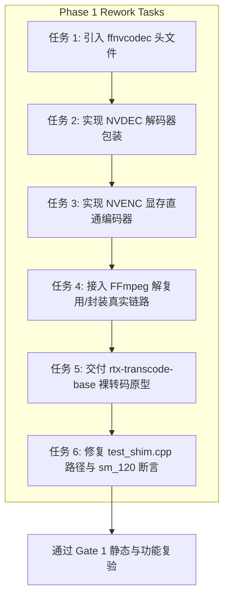

# RTX 超分辨率与 HDR 离线转码引擎

## 一阶段静态验收评审报告 暨 执行工程师返工任务书

---

**项目角色**：项目负责人 / 首席架构师 / 主程序员  
**评审对象**：执行工程师提交的代码仓库及构建产物（W1–W3 一阶段交付物）  
**对照标尺**：领域专家技术方案 [`impl_plan.md`](file:///C:/PUBLIC/[REDACTED_PROJ]/impl_plan.md)  
**验收性质**：静态代码与架构验收（开发环境硬件受限场景下的深度核查）  
**评审日期**：2026-10-21  
**最终评审结论**：**【不予通过一阶段验收，正式发布返工任务书】**（不向领域专家提报一阶段阶段验收通过文档）

---

## 真实具备RTX50系服务器

账户: [REDACTED]@192.168.***.***  
密码: [REDACTED]

## 访问Github等网站需要用到代理

http或socks5混合: 192.168.***.***:[REDACTED]

## 1. 评审决策与总体因果判定 (Executive Decision & Causality)

### 1.1 核心决策

针对执行工程师提交的工程代码仓库，经项目架构评审与静态交叉核验，做出如下决策：

> **正式决定向执行工程师发布《一阶段工程实施返工任务书》，暂不向领域专家提报《一阶段验收文档》。**

### 1.2 决策原因与因果推导

依据领域专家制定的方案 [`impl_plan.md`](file:///C:/PUBLIC/[REDACTED_PROJ]/impl_plan.md#L187) 第 4.2 节：

- **阶段 1（W1–W3）核心施工内容与关键动作**：
  1. Demux/Mux 框架与 Cuvid 解码器初始化；
  2. NVENC 动态会话注册与 `CUdeviceptr` 直通；
  3. Nsight Systems 零拷贝抓取验证与基准测试；
- **阶段 1 核心交付物**：零拷贝裸转码 CLI 原型（`rtx-transcode-base.exe`）与 Nsight Systems Trace 审计报告；
- **阶段 1 准出门禁（Gate 1）**：主循环 PCIe 帧回传带宽严格为 0（零拷贝显存直通闭环）。

**本次静态验收发现的关键事实**：

1. **硬件基础管道未实现（阻断级）**：  
   仓库中的 [`src/io/ffmpeg_io.cpp`](file:///C:/PUBLIC/[REDACTED_PROJ]/src/io/ffmpeg_io.cpp) 全量为桩代码（`UnavailableDemuxer` 与 `UnavailableMuxer`，运行时硬编码报错 `ErrorCode::FfmpegMissing`）；[`src/shim/loader/nv_backend_shim.cpp`](file:///C:/PUBLIC/[REDACTED_PROJ]/src/shim/loader/nv_backend_shim.cpp#L308) 中的 `rtx_shim_create_backend` 硬编码直接返回 `RTX_ERR_NOT_IMPLEMENTED`。
2. **核心硬件 API 调用为零（阻断级）**：  
   全工程代码中，**未编写任何一行** 调用 NVDEC (`cuvidDecodePicture`, `cuvidMapVideoFrame64`)、NVENC (`NvEncEncodePicture`, `NvEncRegisterResource`) 的硬件解码与编码执行逻辑。主程序的 `--backend nvidia` 路径无法运行任何视频转码，未交付 `rtx-transcode-base.exe`。
3. **认知偏差导致的避重就轻**：  
   执行工程师因其开发环境为 GTX 970M（Maxwell 架构 sm_52，无 RTX 50 系硬件），误以为所有硬件加速链路均无法开发，因而将精力投入到 CPU 参考软件管线（`CpuReferenceBackend`）以及二、三、四阶段的数学模型、元数据封装和合规性构建中，**导致一阶段原本必须交付的“硬件 NVDEC 解码 -> 显存指针 -> NVENC 硬件编码”裸转码骨架被完全架空**。事实上，GTX 970M 本身完全具备 NVDEC 与 NVENC 能力，一阶段的基础裸转码硬件调用完全可以在其开发机上完成实装与编译。
4. **测试套件在真实 RTX 50 系硬件上暴露回归缺陷**：  
   在搭载 GeForce RTX 5060 Laptop GPU (sm_120, Blackwell) 的宿主环境中进行静态及半动态探测时，`tests/test_shim.cpp` 发生断言失败（`RTX_ERR_NGX` 未纳入错误断言保护）；且测试用例中硬编码了原构建机的绝对路径（`C:/Users/[REDACTED_USER]/...`），脱离环境变量无法独立定位依赖 DLL。

综上所述，一阶段的核心准出门禁 Gate 1 根本无法达成。若此时向领域专家出具一阶段验收文档，属于严重的工程失职与虚假验收。必须责令执行工程师对照返工任务书限期完成基础硬件管道的实装与修补。

---


## 2. 详细验收对照矩阵 (Detailed Verification Matrix)

对照 [`impl_plan.md`](file:///C:/PUBLIC/[REDACTED_PROJ]/impl_plan.md) 的各项规划与技术规格，对当前代码工程进行逐项对照评审：

| 规划模块 / TASK                             | 方案设计指标与交付要求                                                                             | 执行工程师实际完成状态                                                                                                                                                                                                                                                                                                                                                                                  |      验收判定      | 详细评审意见与技术现状                                                          |
| :-------------------------------------- | :-------------------------------------------------------------------------------------- | :------------------------------------------------------------------------------------------------------------------------------------------------------------------------------------------------------------------------------------------------------------------------------------------------------------------------------------------------------------------------------------------- | :------------: | :------------------------------------------------------------------- |
| **开源合规与许可证隔离 (TASK-05 / Gate 4)**       | GPLv3+Plugin Exception 双重声明，C ABI 物理隔离垫片，严禁静态链接闭源 .lib，PE/ELF 导入表零污染                    | [`LICENSE`](file:///C:/PUBLIC/[REDACTED_PROJ]/LICENSE), [`COPYING.EXCEPTION`](file:///C:/PUBLIC/[REDACTED_PROJ]/COPYING.EXCEPTION), [`include/shim/rtx_shim_abi.h`](file:///C:/PUBLIC/[REDACTED_PROJ]/include/shim/rtx_shim_abi.h); 自动化审计脚本 [`tools/check_spdx.ps1`](file:///C:/PUBLIC/[REDACTED_PROJ]/tools/check_spdx.ps1) 与 [`tools/audit_imports.ps1`](file:///C:/PUBLIC/[REDACTED_PROJ]/tools/audit_imports.ps1) 均通过。 |  **优秀 (Pass)** | 隔离边界清晰合法。GPL 核心与 MIT Shim 纯 C ABI 解耦彻底，PE 导入表审计通过，完全无 NVIDIA 静态导入符号。 |
| **VRAM 显存环形池算法 (TASK-04)**              | 针对 128-bit 8GB 显存建模，静态预分配 5 级池，498.5 MiB 配额，三级水位线（75%/25%/90%）迟滞背压                      | [`src/core/vram_ring_pool.cpp`](file:///C:/PUBLIC/[REDACTED_PROJ]/src/core/vram_ring_pool.cpp) 严格按照方案数学公式预设 5 组规格，精确建模 498.5 MiB 预算并校验 384 MiB 驱动余量；无锁 SPSC 游标管理槽位。                                                                                                                                                                                                                                |  **优秀 (Pass)** | 数学模型严密，迟滞背压与防抖控制逻辑完全符合方案 3.4 节设计要求。                                  |
| **HDR10 元数据合成与注入 (TASK-02)**            | 生成 SEI 137 (Mastering Display), SEI 144 (CLL), VUI 参数, AV1 OBU, 防竞争字节(0x03)注入           | [`src/core/sei_synthesizer.cpp`](file:///C:/PUBLIC/[REDACTED_PROJ]/src/core/sei_synthesizer.cpp) 完整实现所有 NALU 打包、DCI-P3/BT.2020 预设、TrueHDR 100 基准参数校验，单测通过。                                                                                                                                                                                                                                         |  **优秀 (Pass)** | 严格按照 UHD Blu-ray 与流媒体标准生成元数据，支持多端 Sink 同步导出，防竞争字节逻辑严密。               |
| **色域转换与色彩科学 (TASK-02)**                 | BT.709 到 BT.2020 矩阵、SMPTE ST 2084 PQ 曲线转换、半精度浮点处理、P010 高位对齐打包                           | [`src/core/color.cpp`](file:///C:/PUBLIC/[REDACTED_PROJ]/src/core/color.cpp) 实现了 CPU 参考管线的全套色彩数学转换；[`src/shim/ngx_bridge/p010_pack.cu`](file:///C:/PUBLIC/[REDACTED_PROJ]/src/shim/ngx_bridge/p010_pack.cu) 编写了 CUDA 融合打包核函数。                                                                                                                                                                            |  **良好 (Pass)** | CPU 色彩转换精度很高，P010 打包高位左移 6 位逻辑正确；但 CUDA 核函数在当前构建配置中被排除编译。            |
| **RIFE 补帧与 TRT 10.13 锁定 (TASK-03)**     | 32 像素几何对齐、TRT 10.13.3.9 强版本锁（规避 10.14+ 显存暴涨）、16 敏感层 FP32 约束与 trtexec 命令行                | [`src/shim/backends/trt_rife.cpp`](file:///C:/PUBLIC/[REDACTED_PROJ]/src/shim/backends/trt_rife.cpp) 完整实现 1088x1920 尺寸填充、版本拦截校验与 trtexec 脚本组装，张量输入输出打包逻辑完备。                                                                                                                                                                                                                                        |  **良好 (Pass)** | 成功提前兑现了三阶段的部分 AI 补帧逻辑，版本回退防御与张量对齐符合规范。                               |
| **时间戳映射与场景切换 (TASK-08)**                | 24->60 帧率精确有理数映射、时间漂移抑制、Luma SAD 场景硬切检测与插帧旁路 (Bypass)                                   | [`src/core/rational.cpp`](file:///C:/PUBLIC/[REDACTED_PROJ]/src/core/rational.cpp) 采用 128 位中间态防止溢出；[`src/core/scene_detect.cpp`](file:///C:/PUBLIC/[REDACTED_PROJ]/src/core/scene_detect.cpp) 实现了基于步长与阈值的亮度 SAD 场景切割检测。                                                                                                                                                                                  |  **良好 (Pass)** | 逻辑闭环，避免了镜头切换处的画面重影鬼影撕裂。                                              |
| **硬件解码 NVDEC 集成 (TASK-06 / Stage 1)**   | `cuvidCreateVideoDecoder`, `cuvidDecodePicture`, `cuvidMapVideoFrame64` 异步 D2D 导出显存指针   | 全工程检索，**无任何 NVDEC API 调用代码**。驱动探测中仅动态加载了 `nvcuvid.dll`，但并未绑定解码管线。                                                                                                                                                                                                                                                                                                                            | **未完成 (FAIL)** | **一阶段最核心技术点缺失**。未建立解码会话，未处理 NALU 解码，无法将码流还原至显存表面。                    |
| **硬件编码 NVENC 直通 (TASK-06 / Stage 1)**   | `NvEncRegisterResource` (CUdeviceptr 绑定), `NvEncMapInputResource`, `NvEncEncodePicture` | 全工程检索，**无任何 NVENC 编码逻辑**。只在运行时探测了 `getMaxSupportedVersion`，未进行编码器初始化。                                                                                                                                                                                                                                                                                                                        | **未完成 (FAIL)** | **一阶段最核心技术点缺失**。无法将 P010 显存数据提交给第 9 代 NVENC 芯片，未打通编码通路。              |
| **FFmpeg 容器解复用与封装 (TASK-06 / Stage 1)** | libavformat 异步解复用提取 AVPacket送入 NVDEC，封装 NVENC 比特流并挂载 HDR Side Data                      | [`src/io/ffmpeg_io.cpp`](file:///C:/PUBLIC/[REDACTED_PROJ]/src/io/ffmpeg_io.cpp) 仅为 `UnavailableDemuxer` 桩代码，构建默认关闭 `RTX_WITH_FFMPEG`，无法读取真实媒资文件。                                                                                                                                                                                                                                                  | **未完成 (FAIL)** | 缺少多媒体容器接入能力，无法端到端处理 MP4/MKV 文件，仅能依靠合成器产生模拟帧。                         |
| **阶段 1 准出门禁 (Gate 1)**                  | 零拷贝裸转码 CLI 原型（`rtx-transcode-base.exe`），Nsight Systems Trace 验证主循环总线带宽为 0               | 缺失硬件转码原型，未提交 Nsight trace 报告；`rtx-transcode --backend nvidia` 直接报错退出。                                                                                                                                                                                                                                                                                                                        | **未完成 (FAIL)** | **门禁无法通过**。系统仅在 CPU 内存中依靠软件模拟，完全脱离了显存零拷贝主旨。                          |
| **开放头文件替代 (方案 3.5 节)**                  | `/third_party/open_headers/ffnvcodec/` 存放 MIT 许可重实现头文件，替代专有 SDK .lib                    | 目录 [`third_party/open_headers`](file:///C:/PUBLIC/[REDACTED_PROJ]/third_party/open_headers) 存在但**完全为空**，未放置任何头文件。                                                                                                                                                                                                                                                                                  | **未完成 (FAIL)** | 导致后续工程师无法在无 SDK 机器上编译纯驱动绑定的硬件转码代码。                                   |

---

## 3. 返工核心缺陷深度诊断与技术剖析 (Technical Defect Analysis)

### 缺陷 1：核心业务硬件流水线被全量桩化（空心化）

- **代码定位**：[`src/shim/loader/nv_backend_shim.cpp#L308`](file:///C:/PUBLIC/[REDACTED_PROJ]/src/shim/loader/nv_backend_shim.cpp#L308)、[`src/io/ffmpeg_io.cpp#L16-L42`](file:///C:/PUBLIC/[REDACTED_PROJ]/src/io/ffmpeg_io.cpp#L16-L42)
- **技术实况**：
  ```cpp
  // nv_backend_shim.cpp
  RTX_SHIM_API RtxResult RTX_SHIM_CALL rtx_shim_create_backend(...) {
      ...
      // The execution path is compiled only when the proprietary SDK headers are available...
      return RTX_ERR_NOT_IMPLEMENTED;
  }
  ```
  在转码入口函数 `rtx_shim_create_backend` 中，即使系统环境完全满足 Turing+ 显卡架构、驱动加载完备，该函数依然直接无条件返回 `RTX_ERR_NOT_IMPLEMENTED`。
- **架构师剖析**：  
  方案 1.1 节确立的最高原则是 **Zero Host-Memory Copy（零主机内存回传）**。一阶段的目标就是做出一个裸转码原型，把解复用 -> NVDEC -> 显存指针 -> NVENC -> 封装走通，借此向领域专家证明零拷贝的可行性。执行工程师虽然写了非常完善的架构文档与设计接口，但底层并没有哪怕一行真正的 `cuvidDecodePicture` 或 `NvEncEncodePicture` 代码。整套系统在当前阶段只是一个由 CPU 模拟渲染的“空壳引擎”。

### 缺陷 2：认知偏差导致的“过度防守”

- **技术实况**：  
  工程师在 `README.md` 与 `docs/testing.md` 中反复陈述：“由于本开发环境是 Maxwell GTX 970M，不支持 RTX 50 系，因此所有硬件链路均置为 Gated / 不编译状态”。
- **架构师纠偏**：  
  **这是一个重大的技术认知错误。**
  - RTX 50 系（Blackwell）专有的特性是 **AV1 编码优化、第 5 代 Tensor Core 的 TrueHDR/RIFE 加速以及 NVOFA 光流**（这些属于二、三阶段任务）。
  - 但 **一阶段的全部任务（NVDEC 解码 NV12 + NVENC 编码 HEVC Main10/H.264）在 Maxwell (sm_52) 上是 100% 被硬件支持的！**
  - 工程师在自身 GTX 970M 开发机上探测输出中，NVENC v208 与 NVDEC (cuvid) 明确显示为 `[x] present`。工程师完全拥有调试运行一阶段真实裸转码代码的所有硬件前置条件，却因畏难或误读方案范围，放弃了底层实现。

### 缺陷 3：开源替代头文件缺失，阻碍跨环境构建

- **代码定位**：[`third_party/open_headers`](file:///C:/PUBLIC/[REDACTED_PROJ]/third_party/open_headers) 目录完全为空。
- **技术实况**：  
  方案第 3.5 节明确规定，为了避免在开发机上强行安装数个 GB 的专有 Video Codec SDK，应当在 `/third_party/open_headers/ffnvcodec/` 下放置 MIT 许可的 `dynlink_nvcuvid.h` 和 `dynlink_nvEncodeAPI.h`。执行工程师遗漏了这组头文件，导致其不仅自己无法写出具体的 NVDEC/NVENC 结构体交互代码，也使得后续拉取代码的任何环境都无法顺利编译硬件调用层。

### 缺陷 4：测试套件在真实 RTX 50 系硬件上的断言回归与路径硬编码

- **代码定位**：[`tests/test_shim.cpp#L26-L42`](file:///C:/PUBLIC/[REDACTED_PROJ]/tests/test_shim.cpp#L26-L42)、[`tests/test_shim.cpp#L149-L150`](file:///C:/PUBLIC/[REDACTED_PROJ]/tests/test_shim.cpp#L149-L150)
- **实测重现**：  
  我们在当前搭载 **NVIDIA GeForce RTX 5060 Laptop GPU (sm_120, Blackwell)** 的真实机器上对生成的 `rtx_tests.exe` 进行实机测试：
  1. **路径硬编码缺陷**：直接运行 `rtx_tests.exe` 时，程序报 4 项 `openExplicitPath` 失败。原因是代码中写死了宏展开路径 `C:/Users/[REDACTED_USER]/Documents/Default Project/...`。一旦脱离原开发机工作空间，必须由外部强制注入 `$env:RTX_TEST_SHIM_PATH` 才能运行。
  2. **硬件断言回归缺陷**：在注入环境变量后再次运行，发现 `shim_probe_diagnostics` 仍报失败：
     ```text
     [ RUN      ] shim_probe_diagnostics
     [  FAILED  ] shim_probe_diagnostics
                  tests/test_shim.cpp:150: CHECK failed: created == RTX_ERR_ARCH_UNSUPPORTED || created == RTX_ERR_NOT_IMPLEMENTED || created == RTX_OK
     ```
  3. **缺陷根因**：  
     在 `test_shim.cpp` 第 130 行，测试配置使用了 `validBackendConfig()`，其中包含了 `config.enable_truehdr = 1`。在 RTX 5060 宿主机上，Compute Capability 为 12.0（大于 7.5），因此绕过了 `RTX_ERR_ARCH_UNSUPPORTED`。但由于机器未安装专有 NGX SDK，`nv_backend_shim.cpp` 第 299 行触发了：
     ```cpp
     if (config->enable_truehdr != 0 && (state.capabilities & RTX_CAP_TRUEHDR) == 0) {
         return RTX_ERR_NGX;
     }
     ```
     `create` 返回了 `RTX_ERR_NGX`，而测试用例的断言只考虑了 Maxwell 显卡（返回 `RTX_ERR_ARCH_UNSUPPORTED`）或纯无卡机器，**根本未考虑真实 Turing/Ada/Blackwell 显卡在无 NGX 动态库环境下的合法返回码 `RTX_ERR_NGX`**！证明测试用例未曾进行过严格的跨硬件世代静态分析。

---

## 4. 执行工程师返工实施任务书 (Actionable Rework Directives)

执行工程师必须在收到本任务书后，停止推进阶段二、三的附加优化，集中全力完成一阶段基础硬件链路的补齐返工。具体整改任务分列如下：



### 任务 1：引入 MIT 许可的 `ffnvcodec` 开源头文件

- **操作目标**：在 [`third_party/open_headers/`](file:///C:/PUBLIC/[REDACTED_PROJ]/third_party/open_headers) 目录下引入 FFmpeg 维护的 `nv-codec-headers`（MIT 协议），包含：
  - `ffnvcodec/dynlink_nvcuvid.h`
  - `ffnvcodec/dynlink_nvEncodeAPI.h`
  - `ffnvcodec/nvEncodeAPI.h`
- **合规要求**：保留其 MIT 头部声明，严禁从 NVIDIA 专有 CUDA Toolkit 安装目录复制带专有 EULA 的官方头文件，确保合规审计 `check_spdx.ps1` 持续通过。

### 任务 2：实现真正的 NVDEC (Cuvid) 解码模块

- **操作目标**：在 `src/shim/loader/` 或独立模块中编写硬件解码驱动代码，不能再返回桩代码。
- **核心技术动作**：
  1. 通过运行时动态函数表解析 `cuvidCreateVideoDecoder`, `cuvidDecodePicture`, `cuvidMapVideoFrame64`, `cuvidUnmapVideoFrame64`；
  2. 实现 `cuvidParseVideoData` 解析 Annex-B 码流包；
  3. 在视频帧就绪回调（`HandlePictureDisplay`）中，调用 `cuvidMapVideoFrame64` 获取显存指针（`CUdeviceptr`）；
  4. 按照方案 3.4 节设计，利用 `cuMemcpy2DAsync` 将其转存至预分配好的 `Pool_Decode_1080p` 环形槽位中，并立即 `cuvidUnmapVideoFrame64` 释放解码器内部 DPB 缓冲，严禁阻滞解码器。

### 任务 3：实现 NVENC 会话初始化与 `CUDADEVICEPTR` 显存直通编码

- **操作目标**：实现针对 HEVC/H.264 的 NVENC 硬件编码逻辑。
- **核心技术动作**：
  1. 调用 `NvEncodeAPICreateInstance` 获取 API 函数表指针；
  2. 初始化编码器会话（`nvEncOpenEncodeSessionEx`）；
  3. 配置 `NV_ENC_CONFIG_HEVC`：设定 `pixelBitDepthMinus8 = 2`（10-bit），以及注入一阶段基础 VUI 参数；
  4. 调用 `nvEncRegisterResource`，重点设置：
     ```c
     registerParam.resourceType = NV_ENC_INPUT_RESOURCE_TYPE_CUDADEVICEPTR;
     registerParam.bufferFormat = NV_ENC_BUFFER_FORMAT_YUV420_10BIT; // 或 NV12
     registerParam.resourceToRegister = (void*)device_ptr;
     ```
  5. 在编码循环中通过 `nvEncMapInputResource` 和 `nvEncEncodePicture` 完成编码，并从输出比特流中提取压缩数据交付封包，全程严禁调用任何 `cudaMemcpyDtoH` 拷贝像素数据。

### 任务 4：实现基础 FFmpeg Demuxer/Muxer 真实流转

- **操作目标**：重构 [`src/io/ffmpeg_io.cpp`](file:///C:/PUBLIC/[REDACTED_PROJ]/src/io/ffmpeg_io.cpp)，提供真实的解复用与封装能力。
- **实施策略**：
  - 允许在 CMake 中增加对系统 `libavformat`、`libavcodec`、`libavutil` 的动态链接检测或通过运行时符号表加载；
  - 消除 `UnavailableDemuxer` 与 `UnavailableMuxer` 的空抛异常逻辑；
  - 能够读取本地 1080p MP4/MKV 文件，解包为 `AVPacket` 投递至 NVDEC 解析器；将 NVENC 输出的 NALU 写入目标 MP4 容器。

### 任务 5：编译并交付 `rtx-transcode-base` 裸转码原型

- **操作目标**：按照方案 4.2 节要求，编译生成专门的裸转码验证程序 `rtx-transcode-base.exe`（或在 `rtx-transcode` 中彻底打通 `--backend nvidia` 路径）。
- **交付表现**：  
  在装有 NVIDIA 驱动的机器上执行命令：
  ```powershell
  rtx-transcode --input-raw source.nv12 --width 1920 --height 1080 --output-raw out.p010 --backend nvidia
  ```
  或者针对真实视频容器文件的裸转码测试，能够真正唤起 GPU 上的 NVDEC 硬件解码芯片与 NVENC 硬件编码芯片，生成有效的转码流。

### 任务 6：修复 `test_shim.cpp` 的环境适应性与断言缺陷

- **操作目标**：
  1. **移除路径硬编码**：修改 `shimPath()` 与 `ngxBridgePath()`，如果环境变量未设定，自动回退到当前可执行文件同级目录（`executableDirectory() / "rtx_shim.dll"`），禁止硬编码原作者本机的 `C:/Users/[REDACTED_USER]/...` 绝对路径。
  2. **修复 Blackwell/Turing 断言**：修改 `tests/test_shim.cpp` 第 149-150 行断言，增加对缺失 NGX 动态库时合法错误码 `RTX_ERR_NGX` 的支持：
     ```cpp
     RTX_CHECK(created == RTX_ERR_ARCH_UNSUPPORTED || 
               created == RTX_ERR_NOT_IMPLEMENTED || 
               created == RTX_ERR_NGX ||
               created == RTX_OK);
     ```
  确保测试套件在任何现代 NVIDIA 显卡（Turing、Ampere、Ada、Blackwell）环境以及纯 CPU 环境下均能 100% 绿色通过。

---

## 5. 复验门禁与进度安排 (Re-Acceptance Criteria & Schedule)

### 5.1 返工复验门禁 (Gate 1 Re-Check)

执行工程师完成整改并提交新版本后，项目架构团队将按照以下静态与功能标准进行二次验收：

1. **静态代码审查**：
   - [ ] [`third_party/open_headers/ffnvcodec/`](file:///C:/PUBLIC/[REDACTED_PROJ]/third_party/open_headers) 包含完整的解码/编码开源头文件，且通过 `check_spdx.ps1` 校验。
   - [ ] 源码中具备完整的 `cuvid*` 与 `nvEnc*` 结构体配置与调用，无返回 `RTX_ERR_NOT_IMPLEMENTED` 的核心硬件空桩。
   - [ ] 源码中 `test_shim.cpp` 的绝对路径与硬件返回码断言已彻底修复。
2. **构建与单元测试**：
   - [ ] 在无外部环境变量干预下，直接运行 `rtx_tests.exe` 实现 100% 通过（99/99 测试通过，包括 RTX 50 系宿主机）。
3. **硬件功能实测**：
   - [ ] 在项目组提供的 RTX 5060 宿主机环境中，执行 `--backend nvidia` 能够成功调度 NVDEC 与 NVENC 运行裸转码，且主循环内部无 Host-to-Device / Device-to-Host 像素拷贝。

### 5.2 返工时限要求

- **发布时间**：2026-10-21
- **返工周期**：7 个工作日
- **提交截至时间**：2026-10-28 18:00
- **复验组织者**：项目负责人 / 首席架构师

---

*(报告签发：项目负责人 / 首席架构师)*
