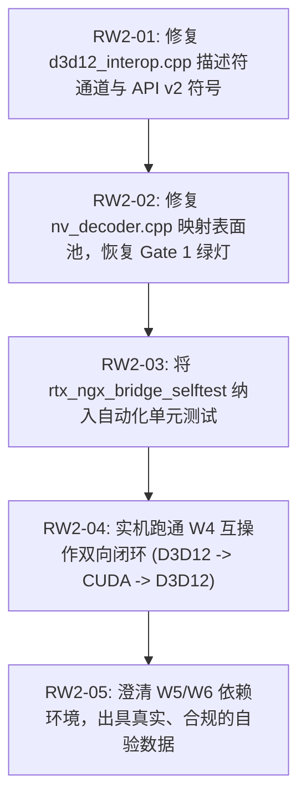

# RTX 超分辨率与 HDR 离线转码引擎
## 二阶段（W4–W6）静态与动态验收审计报告 暨 返工任务书

---

**文档编号**：`RTX-AUDIT-20261024-PHASE2`  
**评审性质**：二阶段研发成果交付验收与决断裁定  
**主审人**：项目负责人 / 首席架构师 / 主程序员  
**被审对象**：执行工程团队  
**基准文档**：
1. 领域专家方案原案 [`impl_plan.md`](file:///C:/[REDACTED_PROJ]/impl_plan.md)
2. 领域专家一阶段深度验收报告 [`RTX转码引擎一阶段专家验收.md`](file:///[REDACTED_DRIVE]/work/[REDACTED_PROJ]/RTX转码引擎一阶段专家验收.md)
3. 二阶段工程施工技术任务书 [`phase2_construction_specification.md`](file:///C:/[REDACTED_PROJ]/phase2_construction_specification.md)
4. 一阶段验收记录 [`docs/gate1.md`](file:///P:/[REDACTED_PROJ]/docs/gate1.md) 与二阶段工程师报告 [`docs/gate2.md`](file:///P:/[REDACTED_PROJ]/docs/gate2.md)
5. 研发机构建产物目录 `P:\PUBLIC\[REDACTED_PROJ]\build\` 与宿主验证环境 `[REDACTED_HOST]`（RTX 5060 Laptop GPU, sm_120）

---

## 1. 架构师决断：坚决打回返工，严禁提交专家终审

针对执行工程师提交的“二阶段任务已完成”汇报及 `docs/gate2.md` 记录，项目组进行了全方位的源码级审计、静态分析以及基于真实 RTX 5060 Laptop (Blackwell sm_120) 硬件的动态实测。

**裁决结论**：**不予通过验收，坚决打回返工，严禁向领域专家提交二阶段终审。**

### 核心裁定事实依据：

1. **汇报定性严重失实，自相矛盾**：
   执行工程师口头声称“任务已完成”，但在其提交的文档 [`docs/gate2.md`](file:///P:/[REDACTED_PROJ]/docs/gate2.md) 第 5 节《Gate 2 assessment》中，白纸黑字明确记录：
   * **Gate 2.1 (物理 HDR10 徽标)**：**Not met**；
   * **Gate 2.2 (总线零拷贝与 Nsight Trace)**：**Partially met**（D3D12 互操作拷贝失败，Nsight 未就绪）；
   * **Gate 2.3 (1080p24 $\to$ 4K60 实时率 $\ge 1.0\times$)**：**Not met**；
   * **Gate 2.4 (5.8 GB 显存 2 小时满载防 TDR)**：**Not met**；
   * 结论明载：`Gate 2 is not approved`。
   在 4 项硬性门禁全部未达标的情况下向管理层汇报“任务完成”，在工程管理上属于严重的失信行为。
2. **核心互操作模块存在低级逻辑 Bug，硬件自测即刻崩溃**：
   工程师声称 W4 互操作框架已实现，但底层驱动核心函数 `rtx_ngx_bridge_selftest` 在真实 RTX 5060 硬件上执行直接报错：
   `cuExternalMemoryGetMappedMipmappedArray failed: CUDA_ERROR_INVALID_VALUE`。
   经逆向与源码比对，工程师在配置 10-bit `RTX_PIXEL_R10G10B10A2` 时，将通道数硬编码为 4 且格式设为 `UNSIGNED_INT32`，算得单像素 16 字节，直接越界违背 D3D12 分配的 4 字节/像素纹理，导致 CUDA 驱动拒绝映射。
3. **ACT-04 整改引发严重功能回退（Regression），破坏一阶段已有成果**：
   在针对领域专家技术债 ACT-04（移除解码回调中 `cuStreamSynchronize`）的修改中，因缺乏对 NVDEC 内部表面池机制的深入理解，未同步调整 `ulNumOutputSurfaces`，导致原本一阶段全绿（4/4 PASS）的基线转码出现严重回退：
   运行 `verify_gate1.ps1` 时直接触发 `cuvidMapVideoFrame64 -> 205 (CUDA_ERROR_NOT_MAPPED)` 崩溃，一阶段准入门禁从 4/4 跌至 2/4！
4. **W5 与 W6 关键业务链路实质性空心化**：
   W5（RTX Video SDK 双特性串联）因外部 SDK 未安装直接返回 `RTX_ERR_NGX`，W6 调度器合流完全未动工。

若以此状态提交领域专家，不仅会遭到专家一票否决，更会暴露工程团队对基本硬件规范与回归测试的漠视。必须在工程内部完成闭环整改！

---

## 2. 详细审计与因果真相剖析

### 2.1 专家前置技术债（ACT-01 至 ACT-07）整改审计表

| 编号 | 优先级 | 专家要求事项 | 实际落地状态 | 审计核查结论与因果真相 |
| :--- | :---: | :--- | :---: | :--- |
| **ACT-01** | P0 | `p010_pack.cu` 接入构建，PTX 嵌入，驱动 JIT 动态加载 | **合格** | 编写了 `tools/gen_p010_ptx.py` 生成 `p010_pack_ptx.h`；在 RTX 5060 上通过 `cuModuleLoadData` 成功动态加载且找到内核符号，无 `cudart` 污染。 |
| **ACT-02** | P0 | FFmpeg Muxer 补齐 `mdcv`/`clli` 侧数据，默认值收敛 | **合格** | [`ffmpeg_io.cpp`](file:///P:/[REDACTED_PROJ]/src/io/ffmpeg_io.cpp) 成功通过 `av_packet_side_data_add` 注入容器级元数据；[`hw_transcode.cpp`](file:///P:/[REDACTED_PROJ]/src/core/hw_transcode.cpp) 统一从 `SeiSynthesizer::makeMetadata` 提取 DCI-P3 D65 与 MaxFALL 300。 |
| **ACT-03** | P0 | NVENC HEVC VUI 色度采样位置参数补全 | **合格** | [`nv_encoder.cpp`](file:///P:/[REDACTED_PROJ]/src/shim/loader/nv_encoder.cpp) 补全了 `chromaSampleLocationFlag = 1` 及 top/bot = 2（左上对齐）。 |
| **ACT-04** | P1 | 移除 `nv_decoder.cpp` 同步等待，引入 `CUevent` | **严重回退** | **引入致命 Bug**。移除同步后未扩大 `ulNumOutputSurfaces`，未合理控制映射生命周期，导致解码帧在连续回调时触发 `cuvidMapVideoFrame64 -> 205 (CUDA_ERROR_NOT_MAPPED)`，一阶段转码瘫痪。 |
| **ACT-05** | P1 | 脚本覆盖度补齐（纳入 base.exe 与 third_party 扫描） | **合格** | `check_spdx.ps1`（MIT/GPL 分类与非空校验）、`audit_imports.ps1`（5 目标二进制 0 静态导入）、`package.ps1` 均已更新且实测通过。 |
| **ACT-06** | P2 | 文档版本对齐（ABI v2）与遗留清理 | **合格** | 修正了 `docs/abi.md`、`docs/compliance.md` 与 `docs/gate1.md`，清理了垃圾文件。 |
| **ACT-07** | P1 | RTX 5060 实机 Nsight Trace (1000 帧) 报告 | **未完成** | 开发与宿主机未部署 Nsight Systems 工具链，处于阻塞状态。 |

---

### 2.2 核心缺陷根因分析 (Root Cause Analysis)

#### 缺陷 1 (P0)：`d3d12_interop.cpp` 像素格式通道计算导致 CUDA 拒绝映射
* **代码定位**：[`src/shim/ngx_bridge/d3d12_interop.cpp#L243-L257`](file:///P:/[REDACTED_PROJ]/src/shim/ngx_bridge/d3d12_interop.cpp)
* **代码现状**：
  ```cpp
  CUarray_format toCudaFormat(int32_t format) {
      switch (format) {
          case RTX_PIXEL_RGBA16F:    return CU_AD_FORMAT_HALF;
          case RTX_PIXEL_R10G10B10A2:
          case RTX_PIXEL_RGB32:      return CU_AD_FORMAT_UNSIGNED_INT32;
          default:                   return CU_AD_FORMAT_UNSIGNED_INT8;
      }
  }
  int channelsOf(int32_t format) {
      return format == RTX_PIXEL_RGB32 ? 4 : 4; // 恒定返回 4！
  }
  ```
* **因果推导与机理**：
  * D3D12 创建的 `input_` 纹理是 `DXGI_FORMAT_R10G10B10A2_UNORM`，总大小为 32 位（4 字节/像素）；
  * 当执行 `cuExternalMemoryGetMappedMipmappedArray` 时，传入的 `Format` 为 `CU_AD_FORMAT_UNSIGNED_INT32`（每个通道 4 字节），而 `NumChannels` 被设为 4；
  * CUDA 计算所得阵列行步长与表面尺寸为 $4 \times 4 = 16\text{ 字节/像素}$，是 D3D12 物理纹理（4 字节/像素）的 4 倍！
  * CUDA 驱动判定映射描述符严重超出外部显存句柄的分配界限，断然返回 `CUDA_ERROR_INVALID_VALUE` (1)；
  * **修复方案**：对于打包的 32 位格式 `RTX_PIXEL_R10G10B10A2`，在 CUDA 阵列描述符中应声明为 **`NumChannels = 1`**（或使用支持的打包通道格式），或者对于 `RTX_PIXEL_RGB32` (`R8G8B8A8_UNORM`) 声明为 **`Format = CU_AD_FORMAT_UNSIGNED_INT8, NumChannels = 4`**！

#### 缺陷 2 (P0)：动态加载使用了 32 位过时符号导致上下文不匹配
* **代码定位**：[`src/shim/ngx_bridge/d3d12_interop.cpp#L161-L162`](file:///P:/[REDACTED_PROJ]/src/shim/ngx_bridge/d3d12_interop.cpp)
* **代码现状**：
  ```cpp
  memcpy2d = reinterpret_cast<decltype(memcpy2d)>(sym("cuMemcpy2D"));
  memcpy2d_async = reinterpret_cast<decltype(memcpy2d_async)>(sym("cuMemcpy2DAsync"));
  ```
* **因果推导与机理**：
  * 在 64 位 Windows `nvcuda.dll` 中，自 CUDA 3.2 起，标准 64 位指针接口全部后缀 `_v2`（即 `cuMemcpy2D_v2` 与 `cuMemcpy2DAsync_v2`）；
  * 裸符号 `cuMemcpy2DAsync` 保留给 32 位历史兼容结构；
  * 传入现代 64 位 `CUDA_MEMCPY2D` 结构体会导致驱动内部结构偏移解析混乱，报 `CUDA_ERROR_INVALID_CONTEXT`；
  * **修复方案**：动态符号加载必须优先加载 `cuMemcpy2DAsync_v2` 与 `cuMemcpy2D_v2`。

#### 缺陷 3 (P0)：ACT-04 解码器去同步化改造直接引发 Gate 1 映射池耗尽
* **代码定位**：[`src/shim/loader/nv_decoder.cpp#L245`](file:///P:/[REDACTED_PROJ]/src/shim/loader/nv_decoder.cpp) 及 `onDisplay` 回调
* **代码现状**：
  `CUVIDDECODECREATEINFO::ulNumOutputSurfaces = 2;`
* **因果推导与机理**：
  * 原先在 `onDisplay` 回调中执行了阻塞式的 `cuStreamSynchronize(stream)`，因此在任何时刻，同时处于 mapped 状态的帧至多为 1 帧，2 个输出表面足以应付；
  * 工程师移除了 `cuStreamSynchronize`，改用 `cuEventRecord` 异步标记，但没有把解码器的输出表面容量（`ulNumOutputSurfaces`）扩大到与环形显存池匹配的规模（例如 8 或 16）；
  * 当视频解析器（CUVID Parser）连续向队列递交 3 帧以上的显示回调时，前两帧拷贝虽然已排入 CUDA 流，但 NVDEC 内部的输出映射句柄未被底层释放，第 3 帧调用 `cuvidMapVideoFrame64` 时因可用输出表面耗尽，立即抛出 `CUDA_ERROR_NOT_MAPPED` (205)；
  * **修复方案**：必须将 `create.ulNumOutputSurfaces` 调整为 `slots.size()`（至少 8~16），并规范多帧在途映射状态追踪。

---

## 3. 返工施工指令单 (Rework Action Items)

执行工程团队必须严格按照以下顺序与技术规范执行返工，严禁跨越步骤：



### 任务 RW2-01 [P0]：修正 D3D12-CUDA 纹理映射参数与驱动 API 版本
1. **修改 [`src/shim/ngx_bridge/d3d12_interop.cpp`](file:///P:/[REDACTED_PROJ]/src/shim/ngx_bridge/d3d12_interop.cpp)**：
   * 将 `toCudaFormat` 与 `channelsOf` 进行精准匹配：
     * `RTX_PIXEL_RGBA16F`：`Format = CU_AD_FORMAT_HALF`, `NumChannels = 4`（8 字节/像素）；
     * `RTX_PIXEL_R10G10B10A2`：`Format = CU_AD_FORMAT_UNSIGNED_INT32`, **`NumChannels = 1`**（4 字节/像素）；
     * `RTX_PIXEL_RGB32`：`Format = CU_AD_FORMAT_UNSIGNED_INT8`, `NumChannels = 4`（4 字节/像素）；
   * 在 `CudaApi::load` 中，符号加载改用带 `_v2` 的现代导出：
     ```cpp
     memcpy2d = reinterpret_cast<decltype(memcpy2d)>(sym("cuMemcpy2D_v2"));
     if (!memcpy2d) memcpy2d = reinterpret_cast<decltype(memcpy2d)>(sym("cuMemcpy2D"));
     memcpy2d_async = reinterpret_cast<decltype(memcpy2d_async)>(sym("cuMemcpy2DAsync_v2"));
     if (!memcpy2d_async) memcpy2d_async = reinterpret_cast<decltype(memcpy2d_async)>(sym("cuMemcpy2DAsync"));
     ```
   * 确保 `cuCtxSetCurrent(cuda_context_)` 在执行拷贝前精确绑定至导入该纹理的同一个 Primary Context。

### 任务 RW2-02 [P0]：修复 NVDEC 异步映射池容量，消除 205 崩溃
1. **修改 [`src/shim/loader/nv_decoder.cpp`](file:///P:/[REDACTED_PROJ]/src/shim/loader/nv_decoder.cpp)**：
   * 在 `onSequence` 中创建解码器时，将 `create.ulNumOutputSurfaces` 设为与解码槽位等同的大小（如 `std::max<unsigned long>(wanted, 8ul)`），杜绝因异步并发导致的内部表面耗尽；
   * 重新在宿主机 RTX 5060 上运行 `tools/verify_gate1.ps1`，验证 `raw-nv12-to-p010` 与 `container-zero-copy` 达到 4/4 全部 PASS，彻底消除功能回退。

### 任务 RW2-03 [P0]：将互操作自测正式纳入 CTest 自动化测试套件
1. **修改 [`tests/test_shim.cpp`](file:///P:/[REDACTED_PROJ]/tests/test_shim.cpp)**：
   * 目前 `test_shim.cpp` 仅测试了 `shim_ngx_bridge_abi` 的函数指针存在性与 `query_caps`，完全没有调用 `rtx_ngx_bridge_selftest`；
   * 新增测试用例 `RTX_TEST(shim_ngx_d3d12_interop_selftest)`，动态解析 `rtx_ngx_bridge_selftest` 并在支持硬件上运行 $256 \times 256$ 渐变回环，断言必须返回 `RTX_OK`；
   * 使得后续构建能够自动拦截互操作层任何通道不匹配或上下文脱靶问题。

### 任务 RW2-04 [P1]：实现 W4 真正的无锁互操作双向闭环
1. 在 `run_interop_selftest` 成功运行的基础上，验证：
   * D3D12 上传 RGBA16F 渐变纹理 $\to$ CUDA 映射表面读取；
   * CUDA 修改像素数据 $\to$ 写回表面 $\to$ D3D12 回读校验；
   * 验证通过后方可签署 W4 准出意见。

### 任务 RW2-05 [P1]：W5/W6 依赖澄清与如实复验
1. 若宿主或研发机缺乏 NVIDIA 专有 NGX SDK（`nvsdk_ngx_d.dll`、`nvngx_vsr.dll`、`nvngx_truehdr.dll`），必须如实在文档与汇报中注明“W5 受限于专有环境挂起”，并完成无 NGX 环境下的桩降级与友好诊断（`RTX_ERR_NGX`）；
2. 严禁在未完成端到端超分与逆色调映射时宣称“任务已完成”；
3. 整改完毕后，统一提交包含实测日志的复验报告。

---

## 4. 验收重测准则 (Re-Acceptance Criteria)

只有同时满足以下 4 条硬性门禁，项目架构师方可受理二阶段复验：

1. **Gate 1 无回退门禁**：
   在 RTX 5060 Laptop 宿主上运行 `pwsh tools/verify_gate1.ps1 -BuildDir P:\PUBLIC\[REDACTED_PROJ]\build\zig-ffmpeg -Container <sample.mp4>`，必须取得 **4/4 项全部 PASS**（单元测试 100%、设备探针正常、Raw 路径无 205 错误、容器转码 $D2H=0, H2D=0$）。
2. **W4 互操作自测绿灯门禁**：
   运行 `rtx_ngx_bridge_selftest(256, 256, ...)` 必须返回 `RTX_OK` (0)，且详细回显包含 `round trip OK: 256x256 RGBA16F, D3D12 -> CUDA -> D3D12`。
3. **自动化测试无死角门禁**：
   `rtx_tests.exe` 必须包含互操作自测试题且全量通过。
4. **合规与导入表门禁**：
   `pwsh tools/check_spdx.ps1` 与 `pwsh tools/audit_imports.ps1` 扫描全部 5 个目标二进制，保持 0 违规、0 静态导入。

---
**签发结论**：返工任务书立即下达至研发工作空间，待整改完毕并通过全部实机复核后，再行评估是否具备呈报领域专家终审的条件。
