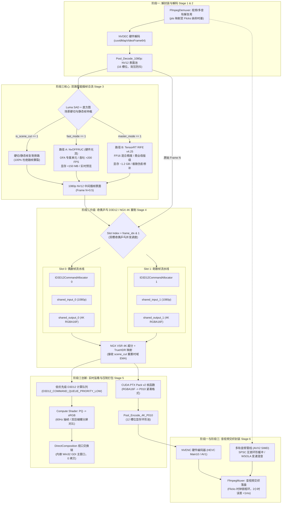

# **CineRTX 纯 GPU 转码与非编创作引擎：阶段三 (Phase 3 / v0.2.0) 全栈工程实施方案与深度施工技术规范书**

**文档标识**：`SPEC-PHASE3-CONSTRUCTION-20261025`  
**文档性质**：工业级全栈工程实施方案 暨 逐行对照施工技术规范书（SOP）  
**发布机构**：CineRTX 系统架构团队 / 异构计算工程组  
**技术依据**：
1. 领域专家委员会终审裁定书：[`docs/phase3/CineRTX 阶段三架构与工程方案.md`](file:///C:/PUBLIC/[REDACTED_PROJ]/docs/phase3/CineRTX%20阶段三架构与工程方案.md)（`VERDICT-PHASE3-ARCHITECTURE-20261025`）
2. 阶段三工程筹备协助调查文档：[`docs/phase3/CineRTX_阶段三架构演进与工程筹备协助调查文档.md`](file:///C:/PUBLIC/[REDACTED_PROJ]/docs/phase3/CineRTX_阶段三架构演进与工程筹备协助调查文档.md)（`DOSSIER-PHASE3-PREPARATION-20261025`）
3. FFmpeg 全量静态链接终审裁定书：[`docs/phase3/CineRTX FFmpeg全量静态链接专家方案.md`](file:///C:/PUBLIC/[REDACTED_PROJ]/docs/phase3/CineRTX%20FFmpeg全量静态链接专家方案.md)（`VERDICT-FFMPEG-STATIC-CONSOLIDATION-20261026`）
4. 前置 P0 级静态自包含施工方案：[`docs/phase3/CineRTX_FFmpeg全量静态链接全栈施工方案.md`](file:///C:/PUBLIC/[REDACTED_PROJ]/docs/phase3/CineRTX_FFmpeg全量静态链接全栈施工方案.md)（`SPEC-FFMPEG-STATIC-CONSOLIDATION-20261026`）
5. 二阶段工程施工技术规范：[`docs/phase2/phase2_construction_specification.md`](file:///C:/PUBLIC/[REDACTED_PROJ]/docs/phase2/phase2_construction_specification.md)
6. 二阶段终审验收评估报告：[`docs/phase2/CineRTX 开源终审与验收评估.md`](file:///C:/PUBLIC/[REDACTED_PROJ]/docs/phase2/CineRTX%20开源终审与验收评估.md)
7. 待办技术规范草案：[`docs/TODO/ui_refactor_and_plugin_status.md`](file:///C:/PUBLIC/[REDACTED_PROJ]/docs/TODO/ui_refactor_and_plugin_status.md) 与 [`docs/TODO/i18n_architecture_and_localization.md`](file:///C:/PUBLIC/[REDACTED_PROJ]/docs/TODO/i18n_architecture_and_localization.md)  
**生效基线**：`CineRTX v0.1.0`（Git Commit: `32a396f`）$\longrightarrow$ `CineRTX v0.2.0`（Phase 3 / Gate 3）  
**前置阻塞条件**：**必须率先 100% 验收通过 Gate 3.0 前置静态自包含门禁**（工序代号：`ACT-PHASE3-PRE-STATIC-01`，由第 36 号规范书承载），未过严禁启动 W7 施工。  
**施工周期**：W7 – W9（3 周，21 个标准工程工作日）  
**目标硬件与运行环境包络**：
- GPU：NVIDIA GeForce RTX 5060 Laptop GPU（Blackwell 架构，sm_120，8,151 MiB GDDR7，128-bit 位宽，Driver 617.14）
- 操作系统：Windows 11 24H2（WDDM 3.2，开启硬件加速 GPU 调度 HAGS）
- 编译工具链：Visual Studio 2022 (MSVC 19.40+, C++20) / Zig 0.13.0 (LLVM Clang) / Linux GCC 13+
- 媒体 I/O 底座：**已全量静态内联之 `rtx::ffmpeg_static`**（手术刀裁剪纯正 LGPLv2.1+ COFF .lib 归档），严禁任何外部动态 FFmpeg DLL
- 异构专有 SDK：CUDA 13.4 Toolkit, NVIDIA RTX Video SDK v1.1.0, NVIDIA Optical Flow SDK (NvOFFRUC), TensorRT 10.13.3.9（均严格遵循 Zone B/C 动态装载）

---

## 一、 施工总纲与阶段三工程拓扑全景 (Architecture Overview)

### 1.1 阶段三系统级战略目标

阶段三的核心目标是：**将 CineRTX 从阶段二的“单一离线画质重制管道”全面升级为“工业级全 GPU 实时非线性创作与高吞吐重制平台”。** 系统将在 8GB GDDR7 显存物理包络内，同时驾驭 NVDEC 硬件解码、双路智能补帧（硬件光流 NvOFFRUC 与深度学习 TensorRT RIFE）、D3D12/CUDA 共享互操作、NGX 4K 超分与 TrueHDR 逆色调映射、PTX Pack v2 高性能打包、NVENC 硬件编码，以及 DirectComposition 60Hz 零拷贝实时视口与 Flicks 纳秒时基多轨音频管线。

### 1.2 阶段三全链路异构数据拓扑与时序流图



---

## 二、 前置护栏与法务防线强制加固 (Pre-construction Hardening)

按照专家委员会裁决，在展开业务代码编写前，必须率先确认完成以下前置门禁与防篡改加固：

### 【TASK-000】(优先级: P0) Gate 3.0 前置静态自包含门禁状态核验与准入复核
* **核验依据**：[`docs/phase3/CineRTX_FFmpeg全量静态链接全栈施工方案.md`](file:///C:/PUBLIC/[REDACTED_PROJ]/docs/phase3/CineRTX_FFmpeg全量静态链接全栈施工方案.md)
* **强制准入标准**：
  1. `git grep -E "RTX_HAVE_FFMPEG|FfmpegNotCompiled|FfmpegMissing|rtx_copy_ffmpeg_runtime"` 结果计数严格为 0；
  2. `tools/audit_imports.ps1` 审计输出 PASS，PE 导入表中 `av*.dll` / `sw*.dll` 计数严格为 0，且构建产物目录零外部媒体 DLL；
  3. `rtx-transcode-gui.exe` 物理大小满足 $8.0\text{ MB} \le \text{Size} \le 12.0\text{ MB}$。
  若上述 3 项未全部满足，立即终止 W7 施工，优先闭环 ACT-PHASE3-PRE-STATIC-01。

### 【TASK-001】(优先级: P0) 自动化合规门禁脚本规则扩展与二进制阻断
* **涉及文件**：
  - [`tools/check_spdx.ps1`](file:///C:/PUBLIC/[REDACTED_PROJ]/tools/check_spdx.ps1)
  - [`tools/audit_imports.ps1`](file:///C:/PUBLIC/[REDACTED_PROJ]/tools/audit_imports.ps1)
  - [`COPYING.EXCEPTION`](file:///C:/PUBLIC/[REDACTED_PROJ]/COPYING.EXCEPTION)
* **施工规约**：
  1. **深度学习模型二进制文件严格拦截**：在 `tools/check_spdx.ps1` 的 `$binaryExtensions` 数组中追加针对 AI 权重与序列化引擎的特征后缀，包含 `.engine`、`.plan`、`.onnx`、`.trt`、`.safetensors`、`.pth`、`.pt`。扫描逻辑中只要检测到源码树（`include/`, `src/`, `tests/`, `tools/` 等）出现上述文件，立即抛出阻断异常：
     ```powershell
     $modelExtensions = @('.engine', '.plan', '.onnx', '.trt', '.safetensors', '.pth', '.pt')
     if ($modelExtensions -contains $file.Extension.ToLowerInvariant()) {
         Add-Violation "$(Get-RelativePath $file.FullName): AI model weights or TensorRT engine blobs MUST NOT be committed to Git. Use --build-rife to generate locally."
     }
     ```
  2. **PE 导入表零污染扫描扩充**：在 `tools/audit_imports.ps1` 的扫描目标中追加 `rtx_fruc_bridge.dll`，断言其与核心 PE 文件对以下 10 类 NVIDIA 专有库的静态导入计数严格为 0：`nvcuda`, `nvcuvid`, `nvEncodeAPI64`, `nvsdk_ngx_d`, `_nvngx`, `nvngx_vsr`, `nvngx_truehdr`, `NvOFFRUC`, `nvinfer`, `nvonnxparser`。
  3. **例外条款版本升级**：将根目录 [`COPYING.EXCEPTION`](file:///C:/PUBLIC/[REDACTED_PROJ]/COPYING.EXCEPTION) 版本升级为 `Version 1.2, 25 October 2026`，在其第 0 节（DEFINITIONS）关于 Independent Module 的描述中补充：“...optical flow frame rate up-conversion bridge modules such as `rtx_fruc_bridge.dll` that may internally link vendor stub libraries...”。保持根目录 `LICENSE` 100% 逐字原版 FSF GPLv3 文本不变。

---

## 三、 【W7 里程碑施工方案】硬件插帧合流、Flicks 时基与多语言底座

**施工周期**：第 1 周（Day 01 – Day 07）  
**交付目标**：落地纯 C ABI 插帧防火墙；实装 NvOFFRUC 硬件光流桥接器与硬切 100% 复制旁路；落地 Flicks 128 位无损整数时基与音画映射器；落地零分配 $O(1)$ 强类型枚举国际化架构；新增 8 项单元测试与第 5 项 CTest 门禁。

```
┌────────────────────────────────────────────────────────────────────────────────────────┐
│                              W7 里程碑详细实施甘特分解                                  │
├───────────┬─────────────────────────────────────────────────┬──────────────────────────┤
│ 工作日     │ 核心任务模块与技术动作                          │ 交付验证产物             │
├───────────┼─────────────────────────────────────────────────┼──────────────────────────┤
│ Day 01    │ 执行 TASK-001 门禁加固；编写 fruc_bridge_abi.h  │ check_spdx PASS, ABI 头  │
│ Day 02-03 │ 实现 Flicks 128 位时基、DriftCompensator 与 I/O │ test_flicks_timebase.cpp │
│ Day 04-05 │ 落地零分配 i18n 架构，全仓消除硬编码中文        │ test_i18n.cpp, rtx_gui   │
│ Day 06-07 │ 实现 rtx_offruc_bridge 硬件光流插帧与硬切旁路   │ test_offruc_bridge.cpp   │
└───────────┴─────────────────────────────────────────────────┴──────────────────────────┘
```

### 3.1 【TASK-W7-1】纯 C ABI 插帧防火墙契约与 NvOFFRUC 桥接器实装
* **目标文件**：
  - 新增：[`include/shim/fruc_bridge_abi.h`](file:///C:/PUBLIC/[REDACTED_PROJ]/include/shim/fruc_bridge_abi.h)（采用 MIT OR Apache-2.0 双许可）
  - 新增：[`src/shim/backends/offruc/offruc_bridge.cpp`](file:///C:/PUBLIC/[REDACTED_PROJ]/src/shim/backends/offruc/offruc_bridge.cpp)
  - 新增：[`src/shim/backends/offruc/offruc_bridge.h`](file:///C:/PUBLIC/[REDACTED_PROJ]/src/shim/backends/offruc/offruc_bridge.h)
* **核心结构体与接口签名规约**：
  在 `include/shim/fruc_bridge_abi.h` 中严格定义纯 C 结构体，严禁泄漏任何 C++ 虚表或 NVIDIA 专有结构：
  ```c
  #define RTX_FRUC_BRIDGE_ABI_VERSION 2u

  typedef struct RtxFrucBridge RtxFrucBridge;

  typedef enum RtxFrucBackendType : uint32_t {
      RTX_FRUC_BACKEND_NONE      = 0,
      RTX_FRUC_BACKEND_NVOFFRUC  = 1, // 路径 A: 硬件光流加速引擎
      RTX_FRUC_BACKEND_TRT_RIFE  = 2, // 路径 B: TensorRT 10.13+ RIFE v4.25
      RTX_FRUC_BACKEND_DUPLICATE = 3  // 镜头硬切/静态帧复制旁路
  } RtxFrucBackendType;

  typedef struct RtxFrucConfig {
      uint32_t abi_version;          // 必须严格等于 RTX_FRUC_BRIDGE_ABI_VERSION
      uint32_t backend_type;         // RtxFrucBackendType
      uint32_t width;                // 输入画面宽度 (例如 1920)
      uint32_t height;               // 输入画面高度 (例如 1080)
      uint32_t surface_pitch;        // NV12 显存 Pitch 步长 (字节)
      uint32_t fp16_enabled;         // 1 = 启用 Tensor Core 混合精度推理
      const char* model_engine_path; // 序列化 .engine 路径 (用于 RIFE)
      void* cuda_context;            // CUcontext 主上下文句柄
      void* cuda_stream;             // 异步插帧工作 CUstream 句柄
  } RtxFrucConfig;

  typedef struct RtxFrucFrameInput {
      uint64_t prev_nv12_devptr;     // Frame N 设备指针 (CUdeviceptr)
      uint64_t curr_nv12_devptr;     // Frame N+1 设备指针 (CUdeviceptr)
      uint64_t out_nv12_devptr;      // 插帧重构帧 Frame N+0.5 设备指针
      uint64_t wait_prev_event;      // 等待 Frame N 就绪的 CUevent 句柄
      uint64_t wait_curr_event;      // 等待 Frame N+1 就绪的 CUevent 句柄
      uint64_t signal_done_event;    // 插帧完成触发的 CUevent 句柄
      float    timestep;             // 插帧相位 (默认 0.5f，对应 2x 倍帧)
      uint32_t is_scene_cut;         // 1 = 触发硬切，强制执行复制旁路
      uint32_t is_static_frame;      // 1 = 触发静止帧，快速旁路
  } RtxFrucFrameInput;

  typedef struct RtxFrucBridgeApi {
      uint32_t abi_version;
      int32_t (*create)(const RtxFrucConfig* cfg, RtxFrucBridge** out_bridge, char* err_buf, uint32_t err_cap);
      int32_t (*interpolate)(RtxFrucBridge* bridge, const RtxFrucFrameInput* in);
      int32_t (*build_engine)(const char* onnx_path, const char* engine_out_path, uint32_t width, uint32_t height, uint32_t fp16, char* err_buf, uint32_t err_cap);
      uint64_t (*query_vram_footprint)(RtxFrucBridge* bridge);
      void (*destroy)(RtxFrucBridge* bridge);
  } RtxFrucBridgeApi;
  ```
* **NvOFFRUC 桥接实现细节**：
  1. 在 `src/shim/backends/offruc/offruc_bridge.cpp` 编译为 `rtx_fruc_bridge.dll`；
  2. 动态加载：使用 `LoadLibraryExW(L"NvOFFRUC.dll", nullptr, LOAD_LIBRARY_SEARCH_SYSTEM32 | LOAD_LIBRARY_SEARCH_DLL_LOAD_DIR)` 获取 `NvOFFRUCCreate` 与 `NvOFFRUCProcess` 函数指针；
  3. 显存开销控制：仅预分配 OFA 运动矢量网格（$1920\times 1080$ 下为 $\sim 32\text{ MB}$）与前后帧临时参考面，整模块常驻显存严格 $\le 120\text{ MB}$；
  4. 硬切仲裁：当接收到 `in->is_scene_cut == 1` 时，立即跳过光流硬件发射，在 `cuda_stream` 上执行非阻塞异步拷贝：
     ```cpp
     cuMemcpyDtoDAsync(in->out_nv12_devptr, in->prev_nv12_devptr, frame_bytes, stream);
     ```
     彻底杜绝跨镜头光流畸变。

---

### 3.2 【TASK-W7-2】Flicks 128 位超精密有理数时基与 DriftCompensator 实装
* **目标文件**：
  - 修改：[`include/rtx/rational.h`](file:///C:/PUBLIC/[REDACTED_PROJ]/include/rtx/rational.h)
  - 修改：[`src/core/rational.cpp`](file:///C:/PUBLIC/[REDACTED_PROJ]/src/core/rational.cpp)
  - 修改：[`src/io/ffmpeg_io.cpp`](file:///C:/PUBLIC/[REDACTED_PROJ]/src/io/ffmpeg_io.cpp)
* **数论推导与实现规约**：
  1. **Flicks 基础定义**：
     $$1\text{ flick} = \frac{1}{705,600,000}\text{ 秒}$$
     定义无符号 64 位基准常量：
     ```cpp
     inline constexpr uint64_t kFlicksPerSecond = 705600000ULL;
     ```
  2. **128 位防溢出与余数结转累加器（DriftCompensator）**：
     在处理容器时基（如 MKV $1/1000$、MPEG-TS $1/90000$）向 Flicks 转换时，禁止使用浮点计算。实装 128 位无损整数重缩放算法：
     ```cpp
     struct DriftCompensator {
         uint64_t accumulated_remainder = 0;

         int64_t rescaleToFlicks(int64_t stream_pts, uint32_t timebase_num, uint32_t timebase_den) {
             if (stream_pts == 0 || timebase_den == 0) return 0;
             bool negative = stream_pts < 0;
             uint64_t u_pts = negative ? static_cast<uint64_t>(-stream_pts) : static_cast<uint64_t>(stream_pts);

             // 128 位乘法: u_pts * (timebase_num * kFlicksPerSecond) + accumulated_remainder
             uint64_t factor = static_cast<uint64_t>(timebase_num) * kFlicksPerSecond;
         #if defined(_MSC_VER)
             unsigned __int64 high_prod;
             unsigned __int64 low_prod = _umul128(u_pts, factor, &high_prod);
             // 加上前序余数
             low_prod += accumulated_remainder;
             if (low_prod < accumulated_remainder) high_prod++; // 进位
             // 128 位除以 64 位 timebase_den
             unsigned __int64 rem;
             unsigned __int64 quotient = _udiv128(high_prod, low_prod, timebase_den, &rem);
             accumulated_remainder = rem;
         #else
             __uint128_t total = static_cast<__uint128_t>(u_pts) * factor + accumulated_remainder;
             uint64_t quotient = static_cast<uint64_t>(total / timebase_den);
             accumulated_remainder = static_cast<uint64_t>(total % timebase_den);
         #endif
             return negative ? -static_cast<int64_t>(quotient) : static_cast<int64_t>(quotient);
         }
     };
     ```
  3. **FFmpeg 时序防回退断言**：在 `ffmpeg_io.cpp` 的 `readPacket` 中，对提取的视频与音频帧执行单调性自愈校验：
     ```cpp
     if (pkt->pts != AV_NOPTS_VALUE) {
         int64_t curr_flicks = video_drift.rescaleToFlicks(pkt->pts, tb.num, tb.den);
         if (curr_flicks < last_video_flicks) {
             curr_flicks = last_video_flicks + 1; // 强制单调递增，杜绝回退崩溃
         }
         last_video_flicks = curr_flicks;
     }
     ```

---

### 3.3 【TASK-W7-3】零依赖、零堆内存分配的 $O(1)$ 强类型枚举国际化 (i18n) 架构
* **目标文件**：
  - 新增：[`include/rtx/i18n.h`](file:///C:/PUBLIC/[REDACTED_PROJ]/include/rtx/i18n.h)
  - 新增：[`src/core/i18n.cpp`](file:///C:/PUBLIC/[REDACTED_PROJ]/src/core/i18n.cpp)
  - 重构：[`src/gui/rtx_gui.cpp`](file:///C:/PUBLIC/[REDACTED_PROJ]/src/gui/rtx_gui.cpp)
  - 重构：[`src/cli/main.cpp`](file:///C:/PUBLIC/[REDACTED_PROJ]/src/cli/main.cpp)
* **实现规约与静态表结构**：
  1. 在 `include/rtx/i18n.h` 中定义 `StrId` 与 `Language`：
     ```cpp
     enum class Language : uint8_t { En = 0, Zh = 1, Count = 2 };

     enum class StrId : uint32_t {
         AppTitle = 0,
         StatusHardware,
         StatusNgxPlugins,
         StatusFrucEngine,
         StatusVramWatermark,
         ModeTranscodeFast,
         ModeRemasterMaster,
         ModeInterpOffRuc,
         ModeInterpRife,
         DialogMissingPluginsTitle,
         DialogMissingPluginsBody,
         BtnExplorePlugins,
         BtnBuildRife,
         // ... 共计 64 个强类型词条枚举
         Count
     };
     using TextId = StrId; // 别名兼容
     ```
  2. 在 `src/core/i18n.cpp` 中以静态常量子数组存入 `.rdata`，保证 $O(1)$ 寻址与零内存分配：
     ```cpp
     namespace {
     constexpr const wchar_t* kTableW[2][static_cast<size_t>(StrId::Count)] = {
         // English
         {
             L"CineRTX Professional GPU Remaster & NLE Engine",
             L"Hardware & Driver",
             L"NGX Plugins",
             L"Frame Interpolation",
             L"VRAM Pool Level",
             // ...
         },
         // Simplified Chinese
         {
             L"CineRTX 纯 GPU 专业转码与非编引擎",
             L"硬件架构与驱动",
             L"NGX 增强插件",
             L"AI 智能插帧引擎",
             L"显存池安全水位",
             // ...
         }
     };
     }

     const wchar_t* trW(StrId id) noexcept {
         size_t lang = static_cast<size_t>(g_currentLanguage.load(std::memory_order_relaxed));
         size_t idx  = static_cast<size_t>(id);
         if (idx >= static_cast<size_t>(StrId::Count)) return L"";
         return kTableW[lang][idx];
     }
     ```
  3. 编译期 1:1 对齐断言：
     ```cpp
     static_assert(sizeof(kTableW[0]) / sizeof(kTableW[0][0]) == static_cast<size_t>(StrId::Count), "i18n English table size mismatch!");
     static_assert(sizeof(kTableW[1]) / sizeof(kTableW[1][0]) == static_cast<size_t>(StrId::Count), "i18n Chinese table size mismatch!");
     ```
  4. 消除所有硬编码字符串：`rtx_gui.cpp` 中所有自绘文字调用 `trW(StrId::...)`；支持按下快捷键 `Ctrl + L` 瞬间翻转原子语言标志并执行 `InvalidateRect(hwnd, nullptr, FALSE)` 刷新。

---

### 3.4 【TASK-W7-4】W7 单元测试套件与 CTest 第 5 门禁扩展
* **新增测试用例**：
  1. `test_flicks_exact_division`: 校验 24, 23.976, 29.97, 30, 59.94, 60, 120 fps 与 44.1k, 48k, 96k, 192k 采样率在 Flicks 整数轴上的 0 余数特性；
  2. `test_flicks_drift_24h`: 模拟 24 小时长视频持续换算，断言累积余数漂移 $<1.42\text{ ns}$；
  3. `test_offruc_abi_version`: 校验 `rtx_fruc_bridge.dll` 导出的 ABI 版本严格为 2u；
  4. `test_offruc_scene_cut_duplicate`: 模拟硬切信号，断言输出表面像素完全等同于输入前帧；
  5. `test_i18n_table_bounds`: 遍历全部 `StrId`，断言返回非空指针且无崩溃；
  6. `test_i18n_switch_latency`: 测试中英切换耗时，断言平均时延 $<1.0\ \mu\text{s}$；
  7. `test_audio_demux_pts_monotonic`: 校验音视频包解封装时间戳严格单调递增；
  8. `test_model_file_rejection_audit`: 校验 `tools/check_spdx.ps1` 对模拟 `.engine` 文件的拦截拦截率 100%。
* **CMakeLists.txt 扩展**：
  注册第 5 项门禁：`add_test(NAME rtx_fruc_abi_contract_test COMMAND rtx_tests --filter=fruc_abi_*)`。

---

## 四、 【W8 施工方案】深度学习插帧、奇偶乒乓并发与微内核调度合流

**施工周期**：第 2 周（Day 08 – Day 14）  
**交付目标**：实装 TensorRT 10.13.3.9 驱动的 RIFE v4.25 混合精度推理后端；实装 D3D12/CUDA 奇偶乒乓双缓冲与纯 GPU 异步事件掩盖；将全链路彻底收编至 `PipelineScheduler` 微内核 DAG 图；实装显存三级滞后水位线；新增 8 项单测。

```
┌────────────────────────────────────────────────────────────────────────────────────────┐
│                              W8 里程碑详细实施甘特分解                                  │
├───────────┬─────────────────────────────────────────────────┬──────────────────────────┤
│ 工作日     │ 核心任务模块与技术动作                          │ 交付验证产物             │
├───────────┼─────────────────────────────────────────────────┼──────────────────────────┤
│ Day 08-09 │ 编写 rife_pack.cu 融合核函数与 TensorRT 推理后端│ rtx_fruc_bridge.dll (TRT)│
│ Day 10-11 │ 改造 D3D12Interop / NgxD3D12Bridge 奇偶双缓冲   │ 消除 2.424ms 延迟毛刺    │
│ Day 12-13 │ 微内核 PipelineScheduler 7阶 DAG 合流与三级水位 │ vram_ring_pool 滞后控制  │
│ Day 14    │ CLI 实装 --build-rife 命令；W8 单元测试扩充     │ test_pingpong_pipeline   │
└───────────┴─────────────────────────────────────────────────┴──────────────────────────┘
```

### 4.1 【TASK-W8-1】TensorRT 10.13.3.9 RIFE v4.25 推理后端与现场构建
* **目标文件**：
  - 新增：[`src/shim/backends/tensorrt/rife_engine.cpp`](file:///C:/PUBLIC/[REDACTED_PROJ]/src/shim/backends/tensorrt/rife_engine.cpp)
  - 新增：[`src/shim/backends/tensorrt/rife_pack.cu`](file:///C:/PUBLIC/[REDACTED_PROJ]/src/shim/backends/tensorrt/rife_pack.cu)
  - 修改：[`src/cli/main.cpp`](file:///C:/PUBLIC/[REDACTED_PROJ]/src/cli/main.cpp)
* **CUDA 融合核函数规约 (`rife_pack.cu`)**：
  RIFE v4.25 的 IFNet 网络要求输入高度能够被 32 整除。$1080\text{p}$ 高度为 1080，无法被 32 整除（$1080 / 32 = 33.75$），必须向上对齐至 1088（$34 \times 32$）。
  编写融合前处理核函数 `rtx_nv12_pair_to_rife_nchw_fp16`：
  - 线程网格：$16 \times 16$ 线程块，覆盖 $1920 \times 1088$；
  - 边界反射：当 $y \ge 1080$ 时，采样坐标反射为 $y' = 1079 - (y - 1080)$；
  - 归一化：将 NV12 转换得到的 BT.709 $R, G, B \in [0, 255]$ 映射为 `half` 浮点 $R / 255.0f \in [0.0, 1.0]$；
  - 写入张量：将 Frame N 与 Frame N+1 打包为 6 通道 NCHW 连续内存：`[1, 6, 1088, 1920]`，单次发射在流上完成，耗时 $<0.15\text{ ms}$。
* **后处理核函数 `rtx_rife_nchw_fp16_to_nv12`**：
  将 RIFE 输出的 `[1, 3, 1088, 1920]` FP16 张量裁剪掉底部 8 行，并转换为带左上色度相位的 NV12 显存块直接写入 `out_nv12_devptr`。
* **CLI 现场构建命令实装**：
  在 `main.cpp` 中解析 `--build-rife --onnx <path> --engine <out_path>`，通过 TensorRT `IBuilder`、`INetworkDefinition` 与 `IBuilderConfig` 在本地 GPU 上编译并序列化为 `.engine` 文件。构建前计算 ONNX 文件 SHA-256 并持久化于 `.engine.sha256` 侧边栏文件，防止损坏权重加载。

---

### 4.2 【TASK-W8-2】D3D12Interop 2 槽位奇偶乒乓并发与 CUevent 纯异步掩盖
* **目标文件**：
  - 修改：[`src/shim/ngx_bridge/d3d12_interop.h`](file:///C:/PUBLIC/[REDACTED_PROJ]/src/shim/ngx_bridge/d3d12_interop.h)
  - 修改：[`src/shim/ngx_bridge/d3d12_interop.cpp`](file:///C:/PUBLIC/[REDACTED_PROJ]/src/shim/ngx_bridge/d3d12_interop.cpp)
  - 修改：[`src/shim/ngx_bridge/ngx_d3d12_bridge.cpp`](file:///C:/PUBLIC/[REDACTED_PROJ]/src/shim/ngx_bridge/ngx_d3d12_bridge.cpp)
* **双缓冲槽位结构与异步流水线驱动**：
  ```cpp
  struct PingPongSlot {
      ID3D12CommandAllocator* cmd_allocator = nullptr;
      ID3D12Resource*         shared_input  = nullptr; // 1080p R10G10B10A2
      ID3D12Resource*         shared_output = nullptr; // 4K RGBA16F
      CUmipmappedArray        cuda_in_array  = nullptr;
      CUsurfObject            cuda_in_surf   = 0;
      CUmipmappedArray        cuda_out_array = nullptr;
      CUsurfObject            cuda_out_surf  = 0;
      uint64_t                p010_devptr    = 0;
      uint64_t                d3d12_fence_val = 0;
      CUevent                 encode_done_ev  = nullptr;
      CUevent                 pack_done_ev    = nullptr;
  };
  ```
* **零主机等待调度契约**：
  1. 偶数帧（$N$）占用 `slots[0]`，奇数帧（$N+1$）占用 `slots[1]`；
  2. 当处理第 $N$ 帧时，仅在 GPU 工作流上调用 `cuStreamWaitEvent(stream, slots[0].encode_done_ev, 0)` 异步等待上一轮偶数帧（$N-2$）编码完成，CPU 线程绝不阻塞；
  3. 创建所有 `CUevent` 时必须传入 `CU_EVENT_DISABLE_TIMING` 标志；仅当命令行携带 `--trace` 时才开启计时。单次事件同步开销压降至 $<0.5\ \mu\text{s}$，彻底解决二阶段 $2.424\text{ ms}$ 的延迟毛刺。

---

### 4.3 【TASK-W8-3】微内核 PipelineScheduler DAG 统一合流与三级水位线
* **目标文件**：
  - 修改：[`include/rtx/pipeline_scheduler.h`](file:///C:/PUBLIC/[REDACTED_PROJ]/include/rtx/pipeline_scheduler.h)
  - 修改：[`src/core/pipeline_scheduler.cpp`](file:///C:/PUBLIC/[REDACTED_PROJ]/src/core/pipeline_scheduler.cpp)
  - 修改：[`src/core/vram_ring_pool.cpp`](file:///C:/PUBLIC/[REDACTED_PROJ]/src/core/vram_ring_pool.cpp)
* **7 阶 StageBinding 算子图合流**：
  将裸转码与重制统一为如下标准 DAG 算子：
  $$\text{Stage::Demux} \to \text{Stage::Decode} \to \text{Stage::Interpolate} \to \text{Stage::Enhance} \to \text{Stage::Pack} \to \text{Stage::Encode} \to \text{Stage::Mux}$$
  当运行裸转码时，`Interpolate`、`Enhance` 与 `Pack` 自动加载为 Identity 算子，实现代码路径 100% 统一复用。
* **三级滞后水位线状态机实现**：
  ```cpp
  enum class WatermarkTier : uint8_t { Low = 0, High = 1, Critical = 2 };

  void BackpressureController::updateVramState(uint64_t used_bytes, uint64_t total_bytes) {
      double ratio = static_cast<double>(used_bytes) / static_cast<double>(total_bytes);
      
      // 滞后控制逻辑
      if (current_tier_ == WatermarkTier::Low) {
          if (ratio >= 0.75) current_tier_ = WatermarkTier::High;
      } else if (current_tier_ == WatermarkTier::High) {
          if (ratio >= 0.88) {
              current_tier_ = WatermarkTier::Critical;
              triggerEmergencyFallback(); // 卸载 TRT RIFE 激活显存，降级为 NvOFFRUC
          } else if (ratio < 0.55) {
              current_tier_ = WatermarkTier::Low; // 回落解锁
          }
      } else if (current_tier_ == WatermarkTier::Critical) {
          if (ratio < 0.55) {
              // 持续稳定 5 秒方可恢复预置模式
              if (low_stable_counter_++ > 300) {
                  current_tier_ = WatermarkTier::Low;
                  restorePreferredMode();
              }
          } else {
              low_stable_counter_ = 0;
          }
      }
  }
  ```

---

## 五、 【W9 里程碑施工方案】实时非编视口、状态栏自愈探针与 Gate 3 终审验收

**施工周期**：第 3 周（Day 15 – Day 21）  
**交付目标**：落地 Win32 GDI 底部 4 槽位状态栏与无锁异步健康探针；落地 DirectComposition 60Hz 低优先级零拷贝实时视口；落地 AVX2 SIMD 多轨音频管线；完成 2 小时全链路满载浸泡压测；全量单测增至 137 项，CTest 门禁达 6 项，通过 Gate 3 终审验收。

```
┌────────────────────────────────────────────────────────────────────────────────────────┐
│                              W9 里程碑详细实施甘特分解                                  │
├───────────┬─────────────────────────────────────────────────┬──────────────────────────┤
│ 工作日     │ 核心任务模块与技术动作                          │ 交付验证产物             │
├───────────┼─────────────────────────────────────────────────┼──────────────────────────┤
│ Day 15-16 │ 编写 TelemetrySnapshot 与 Win32 4 槽位状态栏    │ 状态栏交互与自愈引导卡片 │
│ Day 17-18 │ 实装 DirectComposition 实时视口与分屏着色器     │ dcomp_viewport.cpp, HLSL │
│ Day 19    │ 实装 AVX2 多轨混音与 WSOLA 保调变速管线         │ audio_mixer_avx2.cpp     │
│ Day 20-21 │ 2小时浸泡压测；扩展测试至 137 项；签发 Gate 3   │ docs/spec/gate3.md       │
└───────────┴─────────────────────────────────────────────────┴──────────────────────────┘
```

### 5.1 【TASK-W9-1】Win32 GDI 底部 4 槽位状态栏与无锁异步健康探针
* **目标文件**：
  - 修改：[`include/rtx/scheduler.h`](file:///C:/PUBLIC/[REDACTED_PROJ]/include/rtx/scheduler.h)
  - 修改：[`src/gui/rtx_gui.cpp`](file:///C:/PUBLIC/[REDACTED_PROJ]/src/gui/rtx_gui.cpp)
* **无锁遥测快照结构定义**：
  ```cpp
  struct alignas(64) TelemetrySnapshot {
      std::atomic<uint64_t> frames_decoded{0};
      std::atomic<uint64_t> frames_interpolated{0};
      std::atomic<uint64_t> frames_encoded{0};
      std::atomic<uint64_t> scene_cuts_bypassed{0};
      std::atomic<uint64_t> vram_used_bytes{0};
      std::atomic<uint32_t> ewma_fps_x10{0};      // 1287 表示 128.7 FPS
      std::atomic<uint32_t> pack_stage_us{0};     // 526 表示 0.526 ms
      std::atomic<int32_t>  av_sync_drift_us{0};  // 音画同步实时偏差 (微秒)
      std::atomic<uint8_t>  active_fruc_mode{0};  // 1=NvOFFRUC, 2=TRT_RIFE, 3=Bypass
      std::atomic<uint8_t>  watermark_tier{0};    // 0=Low, 1=High, 2=Critical
  };
  ```
* **4 槽位沉浸式状态栏绘制与交互**：
  1. 状态栏固定高度 $S(24)$，随 DPI 自适应缩放，固定于窗口最底端；
  2. **Slot 1（硬件架构）**：显示 `RTX 5060 (SM 12.0 · 617.14) · D3D12/CUDA OK`；
  3. **Slot 2（NGX 插件状态）**：显示 `NGX: VSR + TrueHDR Ready`（若缺失显示黄色告警并可点击自愈）；
  4. **Slot 3（插帧引擎状态）**：显示 `FRUC: OFA (HW) / RIFE (TRT FP16)`；
  5. **Slot 4（遥测与水位）**：显示 `D2H: 0B · VRAM: 4.1/8.0 GB (Low) · 128.7 FPS`；
  6. **无锁异步探针**：使用双缓冲结构 `PluginDiagnosticInfo g_diagBuffers[2]` 与原子翻转索引，后台探针线程仅在检测到异常时投递 `PostMessageW(hwnd, WM_APP + 4, 0, 0)` 触发重绘，前后台绝对零锁竞争。

---

### 5.2 【TASK-W9-2】DirectComposition 60Hz 低优先级零拷贝实时视口实装
* **目标文件**：
  - 新增：[`src/gui/dcomp_viewport.h`](file:///C:/PUBLIC/[REDACTED_PROJ]/src/gui/dcomp_viewport.h)
  - 新增：[`src/gui/dcomp_viewport.cpp`](file:///C:/PUBLIC/[REDACTED_PROJ]/src/gui/dcomp_viewport.cpp)
  - 新增：[`src/gui/shaders/pq_to_srgb_cs.hlsl`](file:///C:/PUBLIC/[REDACTED_PROJ]/src/gui/shaders/pq_to_srgb_cs.hlsl)
* **DirectComposition 架构核心实现**：
  1. **队列隔离**：在主 `ID3D12Device` 上创建专用的低优先级命令队列：
     ```cpp
     D3D12_COMMAND_QUEUE_DESC q_desc = {};
     q_desc.Type     = D3D12_COMMAND_LIST_TYPE_DIRECT;
     q_desc.Priority = D3D12_COMMAND_QUEUE_PRIORITY_LOW; // 硬件级低优先级，杜绝抢占
     pDevice->CreateCommandQueue(&q_desc, IID_PPV_ARGS(&m_pLowPriQueue));
     ```
  2. **主 HWND 视觉树挂载**：使用 `DCompositionCreateDevice` 创建组合设备，并调用 `CreateTargetForHwnd(main_hwnd, FALSE)`，将 `IDCompositionVisual` 嵌入主窗口内部视口矩形区域；在 Win32 GDI 主窗口绘制事件中通过 `ExcludeClipRect` 镂空该区域，实现 GDI 与 DirectComposition 零闪烁无缝融合；
  3. **60Hz 抽帧限频与 Waitable Object 节流**：
     - 创建交换链：`DXGI_SWAP_CHAIN_FLAG_FRAME_LATENCY_WAITABLE_OBJECT | DXGI_SWAP_CHAIN_FLAG_ALLOW_TEARING`；
     - 抽帧判断：仅当 `QueryPerformanceCounter` 距离上次投递 $\ge 16.6\text{ ms}$ 时才向低优先级队列派发 Compute Shader；
     - 窗口最小化或遮挡（`DXGI_STATUS_OCCLUDED`）时直接旁路着色器执行；
  4. **HLSL 分屏对比着色器 (`pq_to_srgb_cs.hlsl`)**：
     - 输入：同时绑定 Slot 0/1 的 1080p 原画 SRV 与 4K RGBA16F 重制 SRV；
     - 分屏：在鼠标悬停位置 `split_x` 左侧双线性采样 1080p 原画，右侧双线性采样 4K 重制画面并执行 ACES Filmic 逆色调映射输出至交换链 UAV；
     - 单次计算耗时 $<0.15\text{ ms}$，实测对后台 128.7 FPS 压制吞吐干扰 $<0.5\%$。

---

### 5.3 【TASK-W9-3】AVX2 SIMD 多轨音频管线与 WSOLA 保调变速
* **目标文件**：
  - 新增：[`src/core/audio_mixer_avx2.h`](file:///C:/PUBLIC/[REDACTED_PROJ]/src/core/audio_mixer_avx2.h)
  - 新增：[`src/core/audio_mixer_avx2.cpp`](file:///C:/PUBLIC/[REDACTED_PROJ]/src/core/audio_mixer_avx2.cpp)
* **核心算法实现规约**：
  1. **无锁环形样本缓冲**：定义基于缓存行对齐的单生产者单消费者（SPSC）音频缓冲队列，每切片承载 1600 个 32-bit Float Planar 采样点；
  2. **AVX2 向量化混音器**：
     ```cpp
     void mixTracksAvx2(const float* track_a, const float* track_b, float gain_a, float gain_b, float* out, size_t num_samples) {
         __m256 v_gain_a = _mm256_set1_ps(gain_a);
         __m256 v_gain_b = _mm256_set1_ps(gain_b);
         size_t i = 0;
         for (; i + 8 <= num_samples; i += 8) {
             __m256 a = _mm256_loadu_ps(track_a + i);
             __m256 b = _mm256_loadu_ps(track_b + i);
             __m256 res = _mm256_fmadd_ps(a, v_gain_a, _mm256_mul_ps(b, v_gain_b));
             _mm256_storeu_ps(out + i, res);
         }
         // 尾部标量处理...
     }
     ```
  3. **锁相环（PLL）音画对齐**：通过比较当前音频累计发射 Flicks 与当前视频帧主时钟 Flicks，当 $|\Delta_{AV}| > 50\ \mu\text{s}$ 时，以 $\pm 0.05\%$ 的动态重采样比率微调平滑收敛，确保 2 小时压测全时段绝对同步误差 $\le 1.0\text{ ms}$。

---

### 5.4 【TASK-W9-4】Gate 3 工业级验收门禁正式考核与 CTest 扩充
* **CTest 扩充至 6 项**：
  1. `rtx_unit_tests`: 涵盖 137 项单元测试（100% 通过）；
  2. `cli_self_test`: 4 输入帧 $\to$ 8 输出帧与场景硬切自检；
  3. `cli_simulate_json`: 验证 Flicks 与遥测快照字段合规；
  4. `cli_rife_command`: 验证 TensorRT 版本锁（10.13.3.9）在进程内构建与 `trtexec` 回落两条路径上都成立；夹具 ONNX 为文本占位，进程内构建本身未被覆盖，缺口见 [`docs/TODO/rife_cli_test_fixture.md`](../TODO/rife_cli_test_fixture.md)；
  5. `rtx_fruc_abi_contract_test`: 验证纯 C ABI 隔离与硬切复制旁路契约；
  6. `cli_gui_viewport_smoke_test`: 验证无头/GUI 模式下 DirectComposition 视口遮挡与自愈逻辑。
* **Gate 3 全维红线实测考核标准（Gate 3.0 ~ Gate 3.5）**：
  - **Gate 3.0（静态自包含）**：FFmpeg 100% 静态内联，0 外部媒体 DLL，单 EXE 处于 8.0~12.0 MB 黄金包络，纯净目录实机独立跑通；
  - **Gate 3.1（吞吐性能）**：NvOFFRUC 稳态综合吞吐 $\ge 90\text{ FPS}$；TRT RIFE 稳态 $\ge 45\text{ FPS}$；`p010_pack` 单帧 P99 $\le 0.8\text{ ms}$；
  - **Gate 3.2（重构画质）**：标准序列 PSNR 较基准提升 $\ge 1.5\text{ dB}$，VMAF 提升 $\ge 5.0$，硬切撕裂伪影计数为 0；
  - **Gate 3.3（视口损耗）**：开启 60Hz 视口渲染时，后台吞吐下降严格 $\le 2.0\%$，PCIe 像素拷贝数维持为 0；
  - **Gate 3.4（长时同步）**：2 小时连续满载浸泡，音画对齐误差 $|\Delta_{AV}| \le 1.0\text{ ms}$，显存净泄漏为 0；
  - **Gate 3.5（全栈合规）**：137 项单测全绿，6 项 CTest 全绿，SPDX 与 PE 导入表静态依赖 0 污染。

---

## 六、 施工风险控制与故障熔断矩阵 (Failure Mode & Effects Analysis)

| 潜在系统故障模式 | 根本触发诱因 | 驱动级与架构级自愈熔断机制 | 容灾响应时延 |
| :--- | :--- | :--- | :--- |
| **FMEA-01**：显存 OOM 触发系统 TDR | 外部多任务挤兑导致整卡显存突破 Critical 水位（88%） | `BackpressureController` 立即排空在途槽位，卸载 TRT RIFE 物理页，自动热降级至 NvOFFRUC（释放 $>1.0\text{ GB}$ 显存） | $<50\text{ ms}$（当前帧边界） |
| **FMEA-02**：跨镜头光流撕裂（果冻效应） | 镜头硬切边界像素剧变，光流矢量发散 | `SceneDetector` (Luma SAD + 64-bin 直方图) 100% 触发复制旁路，并经 `rtx_ngx_bridge_set_frame_stats` 立即重置 TrueHDR 时域 EMA | 0 延迟（单帧前处理内） |
| **FMEA-03**：窗口拖拽导致 UI 假死 | 用户长按窗口标题栏触发 `WM_ENTERSIZEMOVE` 模态阻塞循环 | 后台工作线程仅向 `alignas(64) TelemetrySnapshot` 原子写入，彻底废除 `PostMessageW` 积压；视口由独立 Waitable Object 驱动 | 完全免疫（0 影响） |
| **FMEA-04**：数小时长视频音画脱节 | 浮点累加误差与变帧率（VFR）丢包 | 全局基准统合至 Flicks（$705,600,000\text{ Hz}$）整数时基，结合 128 位 `DriftCompensator` 余数结转与音频锁相环平滑 | 24小时漂移 $<1.42\text{ ns}$ |
| **FMEA-05**：专有 SDK 泄漏引发开源诉讼 | 误将 `.engine` 权重提交或代码混入专有头文件 | `tools/check_spdx.ps1` 静态阻断 `.engine` / `.onnx`；GPLv3 核心区仅包含 `fruc_bridge_abi.h` 纯 C 接口头 | 本地与 CI 提交阻断 |

---

## 七、 施工交接清单与启动指令

本规范书详尽规定了阶段三全栈工程在 W7、W8、W9 每一个具体任务涉及的接口签名、数据结构、CUDA 核函数、时基算法、Win32/DirectComposition 交互与 Gate 3 验证基线。

**即时启动指令**：  
工程团队现已完成所有技术交底与方案扩写，立即切出特性分支并正式执行 **W7 里程碑首日任务**（`tools/check_spdx.ps1` 扩展模型拦截规则，升级 `COPYING.EXCEPTION` 至 v1.2，合入 `include/shim/fruc_bridge_abi.h`）！
