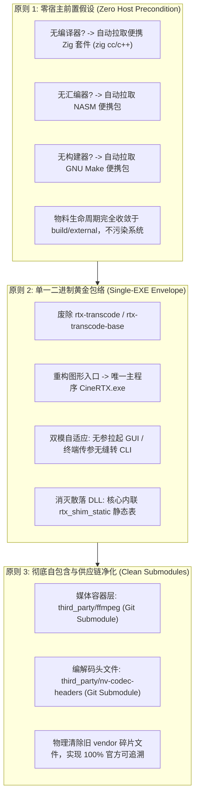
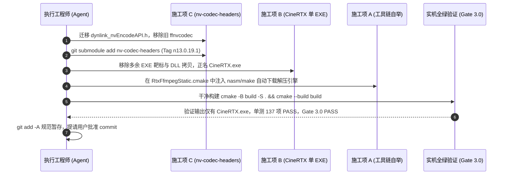

# CineRTX 阶段三终极重构施工方案：零假设工具链自举、单 EXE 产物收敛与 nv-codec-headers 规范化接入

> **状态**：方案待审阅（Ready for Review）  
> **责任执行**：Antigravity Agent  
> **核心工作区**：`C:\PUBLIC\[REDACTED_PROJ]`  
> **关联 Fork 仓库**：
> * FFmpeg: `https://github.com/zhaotong96/FFmpeg.git`（分支 `release/7.1`）
> * nv-codec-headers: `https://github.com/zhaotong96/nv-codec-headers.git`（Tag `n13.0.19.1`）

---

## 一、 顶层架构哲学与核心设计契约

根据用户的最新顶层架构决议，CineRTX 阶段三的构建与交付体系全面贯彻以下四大核心准则：



---

## 二、 施工项详案设计

### 施工项 A：工具链与编译器“零假设”自举引擎（Toolchain Bootstrap）

#### 1. 编译器自举规范（Zig Fallback）
* **检测机制**：
  * 若宿主机已安装并配置好 MSVC (`cl.exe`)、Clang 或 GCC，优先以宿主原生编译器驱动构建；
  * 若宿主机处于“完全裸机”状态（未安装任何 C/C++ 编译器），由 CMake 工具链在 `project()` 阶段自动自举：
    1. 检测 `cl.exe gcc clang zig`，若全部缺失；
    2. 自动从官方 CDN 拉取 `zig-windows-x86_64-0.13.0.zip`（~40 MB，SHA-256 锁定）至 `build/external/download/`；
    3. 解压至 `build/external/tools/zig/` 并设置为 C/C++ 编译器；
    4. CMake 以 `zig c++` 作为 C/C++ 工具链，实现免安装全量编译。
  * [`build.bat`](../../build.bat) 仅负责在宿主机连 CMake 都没有时补齐 CMake 本体；Ninja、编译器、nasm/make 与 submodule 均由 CMake 侧负责。

#### 2. FFmpeg 辅助构建工具就地拉取与沙箱化
在 [`cmake/RtxFfmpegStatic.cmake`](../../cmake/RtxFfmpegStatic.cmake) 中深度集成工具链补齐逻辑：
* **`nasm.exe` 汇编器**：
  * 检测：`find_program(NASM_EXE NAMES nasm.exe nasm)`；
  * 缺失处理：通过 `file(DOWNLOAD)` 自动拉取 `https://www.nasm.us/pub/nasm/releasebuilds/2.16.03/win64/nasm-2.16.03-win64.zip`（官方 200 OK 权威源，附 GitHub 官方 Release 容灾镜像），提取至 `build/external/tools/nasm/`；
* **`make.exe` 构建器**：
  * 检测：`find_program(MAKE_EXE NAMES make.exe mingw32-make.exe)`；
  * 缺失处理：自动从官方发布包拉取便携独立版 `make.exe`（~200 KB）至 `build/external/tools/make/`；
* **环境注入**：
  * 在 CMake 调用 [`tools/build_ffmpeg_static.bat`](../../tools/build_ffmpeg_static.bat) 时，将上述工具路径直接作为局部 PATH 传入，确保即使系统 PATH 为空，FFmpeg 手术刀编译依然 100% 成功。

---

### 施工项 B：二进制产物极净化与单文件 `CineRTX.exe` 收敛

#### 1. 废除冗余可执行程序靶标
在 [`CMakeLists.txt`](../../CMakeLists.txt) 中彻底下线以下历史过渡靶标：
* 移除 `add_executable(rtx-transcode ...)`
* 移除 `add_executable(rtx-transcode-base ...)`

#### 2. 确立唯一主程序 `CineRTX.exe`
* 将 `rtx-transcode-gui` 重构命名为 **`CineRTX`**，设定 `OUTPUT_NAME "CineRTX"`；
* 依托 [`src/gui/rtx_gui.cpp`](../../src/gui/rtx_gui.cpp) 现有的双模机制：
  * **无参数运行（从资源管理器双击）**：启动 DirectComposition 视口渲染的 Win32 GUI；
  * **携带参数运行（从终端命令行调用，如 `CineRTX.exe --probe` / `--simulate` / `--input-raw ...`）**：自动调用 `AttachConsole(ATTACH_PARENT_PROCESS)`，无损执行全部 CLI 转码与自检功能。

#### 3. 彻底清除输出目录中的 3 个散落 DLL
* 彻底移除 `rtx_copy_shim_runtime` 的 POST_BUILD 拷贝机制；
* 解码/编码 ABI 表由核心已链接的 `rtx_shim_static` 全量承载；在无外部动态库时，[`src/core/nvidia_shim.cpp`](../../src/core/nvidia_shim.cpp) 的 `loadEmbedded()` 静态表直连显卡驱动；
* 构建输出根目录下**仅存在唯一一个二进制产物：`CineRTX.exe`**（在开启测试时仅包含 `rtx_tests.exe` 用于 CI）。

---

### 施工项 C：`nv-codec-headers` 规范化 Submodule 接入

#### 1. 接入用户 Fork 仓库
* 远程仓库地址：`https://github.com/zhaotong96/nv-codec-headers.git`
* 挂载分支/Tag：`n13.0.19.1`（Commit: `ee1c8a8c`）
* 挂载目标路径：[`third_party/nv-codec-headers`](../../third_party/nv-codec-headers)

#### 2. 原创薄封装层迁移与旧 Vendor 物理切除
* 将原创编写的动态加载器包装头文件 [`dynlink_nvEncodeAPI.h`](../../third_party/open_headers/ffnvcodec/dynlink_nvEncodeAPI.h)（2 KB）规范迁移至 CineRTX 项目自有目录 [`include/shim/dynlink_nvEncodeAPI.h`](../../include/shim/dynlink_nvEncodeAPI.h)；
* 物理删除旧目录 [`third_party/open_headers/ffnvcodec/`](../../third_party/open_headers/ffnvcodec/) 下的所有遗留文件；
* 更新 [`CMakeLists.txt`](../../CMakeLists.txt) 头文件包含路径为 `${CMAKE_CURRENT_SOURCE_DIR}/third_party/nv-codec-headers/include`；
* 同步更新 [`tools/check_spdx.ps1`](../../tools/check_spdx.ps1) 许可证合规审计规则，将 `third_party/nv-codec-headers` 作为官方 Submodule 纳入豁免校验。

---

## 三、 一体化施工工序与验证里程碑（Execution Roadmap）



### 1. 详细操作步骤
1. **执行工序 C-1**：迁移 `dynlink_nvEncodeAPI.h` 至 `include/shim/`，从 Git 索引与工作区物理删除 `third_party/open_headers/ffnvcodec/`；
2. **执行工序 C-2**：执行 `git submodule add -b n13.0.19.1 https://github.com/zhaotong96/nv-codec-headers.git third_party/nv-codec-headers` 并更新 `.gitmodules`；
3. **执行工序 B-1**：修改 `CMakeLists.txt`，移除 `rtx-transcode`、`rtx-transcode-base`，将 `rtx-transcode-gui` 正式更名为 `CineRTX`（输出文件为 `CineRTX.exe`），移除 DLL 自动拷贝；
4. **执行工序 A-1**：在 `cmake/RtxFfmpegStatic.cmake` 中加入 `nasm` 与 `make` 的缺失自动下载解压逻辑，保障零宿主前置假设；
5. **执行工序 A-2**：提供免环境配置的一键引导脚本 `build.bat`，仅在宿主机缺少 CMake 时补齐 CMake 本体；Ninja 与编译器自举均在 CMake 侧完成；
6. **实机验证门禁**：
   - 彻底删除 `build/` 目录；
   - 执行 `cmake -B build -S . -DCMAKE_BUILD_TYPE=RelWithDebInfo && cmake --build build --config RelWithDebInfo -j`；
   - 验证产物目录是否**仅有 `CineRTX.exe`**；
   - 运行全量 137 项单元测试（100% PASS）；
   - 运行 Gate 3.0 导入表与单 EXE 审计（100% PASS）；
   - 运行 SPDX 许可证合规审计（100% PASS）；
7. **交付暂存**：执行 `git add -A` 全量规范化暂存，向用户提请提交审批。

---

## 四、 预期交付产物目录结构对比

```text
旧产物结构 (冗余繁杂):
build/RelWithDebInfo/
├── rtx-transcode.exe        (冗余)
├── rtx-transcode-base.exe   (冗余)
├── rtx-transcode-gui.exe    (待更名)
├── rtx_shim.dll             (散落)
├── rtx_ngx_bridge.dll       (散落)
├── rtx_fruc_bridge.dll      (散落)
└── rtx_tests.exe            (仅测试保留)

新产物结构 (极度纯净):
build/RelWithDebInfo/
├── CineRTX.exe              (★ 唯一自包含核心交付物: GUI+CLI 二合一)
└── rtx_tests.exe            (仅开发配置 RTX_BUILD_TESTS=ON 时存在)
```
