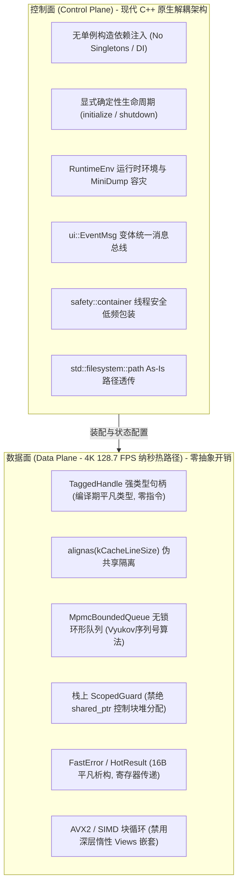

# CineRTX Phase 4: Modern C++26 架构重构与代码风格对齐全栈工程施工方案

**方案编号**: PLAN-PHASE4-MODERN-CPP26-20261031  
**生效基线**: CineRTX Phase 3 验收交付态（Git Commit: `46dbaac`，137 项单测全绿，单 EXE 自包含闭环）  
**对齐规约**: 现代 C++ 规范与通用解耦工程指南  
**签发机构**: CineRTX 系统架构委员会 / 阶段四工程指挥部  
**适用对象**: 阶段四执行工程师（Execution Engineer）  
**文档状态**: 正式工程执行指导书（Official Action Plan）

---

## 目录

- [一、 阶段四战略定位与核心设计哲学（Plan & Usage Guide）](#一-阶段四战略定位与核心设计哲学plan--usage-guide)
  - [1.1 控制面与数据面双域解耦准则（Bifurcation Principle）](#11-控制面与数据面双域解耦准则bifurcation-principle)
  - [1.2 Google C++ 头文件包含规范（强制执行）](#12-google-c-头文件包含规范强制执行)
  - [1.3 C++26 特性使用准则与编译器宏门控](#13-c26-特性使用准则与编译器宏门控)
  - [1.4 双轨多态适配器（Dual-Track Polyglot Shim）使用方法](#14-双轨多态适配器dual-track-polyglot-shim使用方法)
  - [1.5 Pure C ABI 零阻抗胶水层（rtx::abi::invokeHot）使用方法](#15-pure-c-abi-零阻抗胶水层rtxabiinvokehot使用方法)
- [二、 六大波次自底向上（Bottom-Up）细粒度可勾选任务卡片（Task Cards）](#二-六大波次自底向上bottom-up细粒度可勾选任务卡片task-cards)
  - [Wave 0：类型、时基与错误契约基石层（~1,088 LOC）](#wave-0类型时基与错误契约基石层1088-loc)
  - [Wave 1：显存环形池与无锁并发原语层（966 LOC）](#wave-1显存环形池与无锁并发原语层966-loc)
  - [Wave 2：Pure C ABI 胶水与驱动桥接层（~9,606 LOC）](#wave-2pure-c-abi-胶水与驱动桥接层9606-loc)
  - [Wave 3：静态 FFmpeg 媒体 I/O 与位流层（2,259 LOC）](#wave-3静态-ffmpeg-媒体-io-与位流层2259-loc)
  - [Wave 4：微内核 DAG 调度器与转码核心层（4,689 LOC）](#wave-4微内核-dag-调度器与转码核心层4689-loc)
  - [Wave 5：现代化 GUI 视口与 CLI 统一入口层（2,787 LOC）](#wave-5现代化-gui-视口与-cli-统一入口层2787-loc)
- [三、 阶段四可勾选质量门禁（Checkable Quality Gates & Checklists）](#三-阶段四可勾选质量门禁checkable-quality-gates--checklists)
- [四、 执行工程师代码地图与避坑指南（Toolbox & Code Map）](#四-执行工程师代码地图与避坑指南toolbox--code-map)

---

## 一、 阶段四战略定位与核心设计哲学（Plan & Usage Guide）

### 1.1 控制面与数据面双域解耦准则（Bifurcation Principle）

根据《[CineRTX C++26 架构重构专家方案.md](./CineRTX%20C++26%20架构重构专家方案.md)》的顶级裁决，在 CineRTX 高吞吐媒体管线与控制系统构建中，必须实施**控制面与数据面严格解耦**：



1. **控制面（Control Plane）**：包括启动入口、配置解析、插件探测、组件装配、UI 消息分发及 DAG 拓扑补齐。**100% 贯彻现代原生解耦规范**，消灭一切全局静态单例，消灭裸字符串路径，以确定性生命周期管理系统。
2. **数据面（Data Plane）**：包括显存池槽位租借（SurfaceLease）、D3D12/CUDA 奇偶乒乓双缓冲提交、P010 显存打包（<500 微秒预算）、AVX2 音频混音及 NALU 切片。**严禁在帧循环中引入隐式堆分配或递归锁**！必须使用栈上 `rtx::ScopedGuard` 与无锁 MPMC 队列。

---

### 1.2 Google C++ 头文件包含规范（强制执行）

全仓所有 `.h` 与 `.cpp` 文件必须严格执行 Google C++ 官方规范引入次序（相关头文件 -> C 系统/平台头 -> C++ 标准库头 -> 第三方库头 -> 工程内部头），级与级之间空一行，级内按字典序排列，严禁出现带编号的分级注释：

```cpp
#include "rtx/hw_transcode.h"

#ifndef WIN32_LEAN_AND_MEAN
#define WIN32_LEAN_AND_MEAN
#endif
#include <windows.h>

#include <algorithm>
#include <expected>
#include <filesystem>
#include <format>
#include <span>
#include <vector>

#include <libavcodec/avcodec.h>
#include <libavformat/avformat.h>

#include "rtx/status.h"
#include "rtx/types.h"
```

---

### 1.3 C++26 特性使用准则与编译器宏门控

开发环境以 **MSVC 19.40+ / 19.51+ (`/std:c++latest`)** 为基准，同时兼容 **GCC 14+** 与 **Clang 19+**。特性分级准入如下：

| 级别 | 包含特性 | 准入要求与替代策略 |
| :--- | :--- | :--- |
| **Tier 1（全仓普及）** | `std::expected`, `views::zip`, `views::enumerate`, `ranges::to`, `assign_range`, `<format>`, `<print>`, `std::source_location`, `std::span`, `std::mdspan` | 强制使用，全面替代手写循环、`snprintf` 与输出参数。 |
| **Tier 1.5（宏门控）** | `= delete("reason")`, `_` 未命名占位符, `[[nodiscard("reason")]]` | 通过 `RTX_DELETE("reason")` 等宏进行包装，在旧前端平滑退化。 |
| **Tier 2（受限场景）** | 变长参数索引 `Ts...[I]`, 协程生成器 `std::generator<T>`, 执行策略 `par_unseq` | `Ts...[I]` 仅在 `HandleWrapper` 内部使用；`std::generator` 仅限 I/O 与控制面；`par_unseq` 仅限 CPU 参考后端，严禁进入 GPU 调度线程。 |
| **Tier 3（隔离过渡）** | 契约编程断言（Contracts P2900）, 静态反射（Reflection P2996） | 严禁直接使用裸关键字；断言统一使用 `RTX_CONTRACT_ASSERT(cond)`；枚举反射暂以 constexpr 静态表驱动。 |
| **Tier 4（全面禁止）** | 原生模式匹配 `inspect`, 平凡可重定位（推迟至 C++29） | 100% 采用 `std::variant` + `rtx::Overloaded` + `std::visit` 实现模式匹配。 |

---

### 1.4 双轨多态适配器（Dual-Track Polyglot Shim）使用方法

为保证 **137 项存量单测在任意中间步骤 100% 编译通过且行为无损**，在 [`include/rtx/status.h`](../../include/rtx/status.h) 中必须实装继承自 `std::expected<T, Error>` 的双轨适配器：

```cpp
// 新代码编写风格 (C++23/26 Monadic 链式调用):
auto result = pool.acquire()
    .and_then([](SlotHandle slot) -> Result<SurfaceLease> {
        return SurfaceLease{slot};
    })
    .transform([](SurfaceLease lease) {
        return lease.devicePtr();
    });

// 旧单测与旧代码保持零修改兼容:
Result<int> legacy = Result<int>::ok(42);
if (legacy.ok()) {
    int val = legacy.valueOr(0);
}
Status st = Result<void>::fail(ErrorCode::Timeout, "timeout message"); // 隐式转换测试 test_status.cpp:63
```

- **热路径（FastError / HotResult）**：8 字节平凡析构类型，专用于 `SurfacePool::acquire()` 与 C ABI 边界，100% 触发 SROA 标量替换，通过 RAX/RDX 寄存器直接传递。
- **冷路径（Error / Result）**：24 字节，成功路径零堆分配；仅在报错时分配 `ErrorPayload` 堆对象。

---

### 1.5 Pure C ABI 零阻抗胶水层（rtx::abi::invokeHot）使用方法

在 [`include/rtx/abi_glue.h`](../../include/rtx/abi_glue.h) 中使用声明式调用器替代冗长手写检查与强转：

```cpp
// 消除裸指针输出参数，自动将 SlotHandle 解包并把 C ABI 返回值封入 HotResult
HotResult<SurfaceHandle> res = rtx::abi::invokeOutHot<SurfaceHandle>(
    g_backend->register_surface, 
    ErrorCode::NgxFailure, 
    device_handle, 
    slot_handle // 自动从 TaggedHandle 解包为 uint32_t
);
```

---

## 二、 六大波次自底向上（Bottom-Up）细粒度可勾选任务卡片（Task Cards）

执行工程师须严格按照 **Wave 0 $\rightarrow$ Wave 1 $\rightarrow$ Wave 2 $\rightarrow$ Wave 3 $\rightarrow$ Wave 4 $\rightarrow$ Wave 5** 顺序执行。每一张任务卡片均可独立勾选，完成一个波次后必须跑通对应门禁方可推进！

---

### Wave 0：类型、时基与错误契约基石层（~1,088 LOC）

- [ ] **Task 0.1: 实装双层错误模型与双轨多态 `rtx::Result<T>`**
  - **目标文件**: [`include/rtx/status.h`](../../include/rtx/status.h)
  - **交付内容**:
    - [ ] 实现 8 字节平凡析构的 `FastError` 与 `HotResult<T> = std::expected<T, FastError>`；
    - [ ] 实现冷指针装箱的 `ErrorPayload`（含 `source_location`、`message`、`detail`），成功路径 0 堆分配；
    - [ ] 实现 `Result<T> : public std::expected<T, Error>`，保留 `.ok()`, `.code()`, `.valueOr()`, `.status()` 及静态工厂 `ok()`, `fail()`, `fromStatus()`；
    - [ ] 实现 `Result<void>` 与 `operator Status()` 隐式转换（保障 `test_status.cpp:63` 编译通过）；
    - [ ] 严格排布 Google C++ 头文件包含规范。
  - **验收命令**: `ctest --test-dir build -R test_status --output-on-failure`（100% PASS）。

- [ ] **Task 0.2: 实装强类型标签化句柄体系与多态包装器**
  - **目标文件**: [`include/rtx/types.h`](../../include/rtx/types.h)
  - **交付内容**:
    - [ ] 实现 `TaggedHandle<Tag, ValueType, InvalidValue>` 强类型句柄体系；
    - [ ] 实装 `operator ValueType()` 隐式退化兼容层（保障 `test_vram.cpp:77` 存量调用无缝编译）；
    - [ ] 实装三路比较运算符 `<=>` 与 `operator==`（基于 ISO C++20 标准）；
    - [ ] 定义核心领域句柄：`SlotHandle` (uint32_t), `DeviceHandle` (int32_t), `SurfaceHandle` (uint64_t), `StreamHandle` (uint64_t), `EventHandle` (uint64_t)；
    - [ ] 实装 `HandleWrapper<Ts...>` 多态包装器与 `Overloaded` 变长访问者模板；
    - [ ] 静态断言校验 `sizeof(SlotHandle) == 4` 且为平凡可复制类型。
  - **验收命令**: 编译通过且 `static_assert` 零告警。

- [ ] **Task 0.3: 重构帧平面类型与元数据投影**
  - **目标文件**: [`src/core/types.cpp`](../../src/core/types.cpp)
  - **交付内容**:
    - [ ] 使用 `template <auto MemberPtr>` 成员指针投影技术重写平面步长/高度校验；
    - [ ] 使用 `std::span<const uint8_t>` 与 `std::span<uint8_t>` 替代裸指针深拷贝；
    - [ ] 规范 Google C++ 头文件包含顺序。

- [ ] **Task 0.4: 重构 128 位有理数时基与 Flicks 时间模型**
  - **目标文件**: [`include/rtx/flicks.h`](../../include/rtx/flicks.h), [`include/rtx/rational.h`](../../include/rtx/rational.h), [`src/core/rational.cpp`](../../src/core/rational.cpp)
  - **交付内容**:
    - [ ] 将 Flicks 时基计算全面升级为 `constexpr` 编译期求值；
    - [ ] 实现 `std::is_eq(a <=> b)` 强序三路比较；
    - [ ] 将格式化逻辑升级为 `<format>`。
  - **验收命令**: `ctest --test-dir build -R test_flicks_timebase --output-on-failure`（100% PASS）。

- [ ] **Task 0.5: 重构国际化映射表与 HDR 元数据**
  - **目标文件**: [`include/rtx/i18n.h`](../../include/rtx/i18n.h), [`src/core/i18n.cpp`](../../src/core/i18n.cpp), [`include/rtx/hdr.h`](../../include/rtx/hdr.h)
  - **交付内容**:
    - [ ] 将多语种静态映射表升级为 `std::string_view` 与 `constexpr` 静态字典；
    - [ ] 清理头文件冗余包含。
  - **验收命令**: `ctest --test-dir build -R test_i18n --output-on-failure`（100% PASS）。

- [ ] **Wave 0 阶段准出 Checkpoint**:
  - [ ] 全仓 137 项单测 100% PASS；
  - [ ] Wave 0 覆盖文件 100% 满足 Google C++ 头文件包含规范。

---

### Wave 1：显存环形池与无锁并发原语层（966 LOC）

- [ ] **Task 1.1: 实现缓存行对齐无锁多生产者多消费者队列（MPMC）**
  - **目标文件**: 创建 [`include/rtx/mpmc_ring.h`](../../include/rtx/mpmc_ring.h)
  - **交付内容**:
    - [ ] 实现基于 Vyukov 序列号算法的 `MpmcBoundedQueue<T>`（要求 `T` 为平凡可复制）；
    - [ ] 关键原子变量与槽位结构按 `alignas(kCacheLineSize)` 缓存行严格隔离，根除伪共享；
    - [ ] 实现零内存分配的 `tryPush(item)` 与 `tryPop(out_item)`；
    - [ ] 基于 C++20 标准三路比较语法实装 `std::is_eq(diff <=> 0)`。
  - **验收命令**: 编译通过，无线程竞态告警。

- [ ] **Task 1.2: 重构显存环形池接口定义与生命周期契约**
  - **目标文件**: [`include/rtx/vram_pool.h`](../../include/rtx/vram_pool.h)
  - **交付内容**:
    - [ ] 将槽位索引全面升级为强类型 `SlotHandle`；
    - [ ] 彻底拔除导致 Issue 04 锁争用的 `std::mutex pool_mutex_`；
    - [ ] 空闲列表升级为 `MpmcBoundedQueue<SlotHandle>`；
    - [ ] 确立显式生命周期控制：`initialize(spec)`、`shutdown()`、`[[nodiscard]] isInitialized()`；
    - [ ] 在 `SurfaceLease` 中实现基于栈上 RAII 的槽位归还逻辑。

- [ ] **Task 1.3: 重构显存环形池实现与三级滞后回线背压调度**
  - **目标文件**: [`src/core/vram_ring_pool.cpp`](../../src/core/vram_ring_pool.cpp)
  - **交付内容**:
    - [ ] 对齐显式确定性生命周期，`shutdown()` 具备幂等性与逆序释放安全性；
    - [ ] 采用 `std::is_eq(a <=> b)` 重写状态机比较；
    - [ ] 维护 55% (Low)、75% (High)、88% (Critical) 三级滞后回线水位计算；
    - [ ] 100% 兼容存量 `test_vram.cpp` 的 API 契约。
  - **验收命令**:
    - `ctest --test-dir build -R test_vram --output-on-failure`（100% PASS）；
    - `ctest --test-dir build -R test_concurrency --output-on-failure`（100% PASS）。

- [ ] **Wave 1 阶段准出 Checkpoint**:
  - [ ] 静态审计 Issue 04（多线程归还锁争用）彻底清零；
  - [ ] 全仓 137 项单测 100% PASS。

---

### Wave 2：Pure C ABI 胶水与驱动桥接层（~9,606 LOC）

- [ ] **Task 2.1: 构建零开销 C ABI 胶水层与栈上 ScopedGuard**
  - **目标文件**: 创建 [`include/rtx/abi_glue.h`](../../include/rtx/abi_glue.h)
  - **交付内容**:
    - [ ] 实装栈上零堆分配的 `rtx::ScopedGuard<F>`（彻底淘汰每帧调用 `std::shared_ptr<void>(nullptr, deleter)` 的反模式）；
    - [ ] 实装 `rtx::abi::projectArg`：编译期自动将 `TaggedHandle` 解包为 C ABI 标量整数；
    - [ ] 实装 `rtx::abi::invokeHot`：自动校验非空指针，返回 `HotResult<void>`；
    - [ ] 实装 `rtx::abi::invokeOutHot<OutT>`：消除调用端裸指针输出参数，直接返回 `HotResult<OutT>`。

- [ ] **Task 2.2: 重构动态库加载器与驱动后端桥接**
  - **目标文件**: [`src/shim/loader/dyn_library_win32.cpp`](../../src/shim/loader/dyn_library_win32.cpp), [`src/shim/loader/nv_runtime.cpp`](../../src/shim/loader/nv_runtime.cpp), [`src/core/nvidia_shim.cpp`](../../src/core/nvidia_shim.cpp)
  - **交付内容**:
    - [ ] 动态加载与符号表初始化全面采用 `rtx::ScopedGuard` 保护局部生命周期；
    - [ ] 统一采用 `rtx::abi::invokeHot` 封装底层驱动调用；
    - [ ] 严格锁定 `LOAD_LIBRARY_SEARCH_DLL_LOAD_DIR | LOAD_LIBRARY_SEARCH_SYSTEM32` 安全标志；
    - [ ] 绝不包含任何 NVIDIA 专有头文件，维持 GPLv3 物理隔离。

- [ ] **Task 2.3: 重构 Zone C 桥接库与奇偶乒乓双缓冲状态机**
  - **目标文件**: [`src/shim/ngx_bridge/d3d12_interop.cpp`](../../src/shim/ngx_bridge/d3d12_interop.cpp), [`src/shim/ngx_bridge/pingpong_ring.cpp`](../../src/shim/ngx_bridge/pingpong_ring.cpp), [`src/shim/ngx_bridge/rife_builder.cpp`](../../src/shim/ngx_bridge/rife_builder.cpp)
  - **交付内容**:
    - [ ] 奇偶乒乓帧调度逻辑改用 `std::views::zip` 与栈上 `ScopedGuard`；
    - [ ] 动态符号查找逻辑保持纯 C ABI 导出；
    - [ ] 规范关键异步与显存资源交互处的工程注释，明确前置条件与异常安全边界。

- [ ] **Wave 2 阶段准出 Checkpoint**:
  - [ ] 运行 `pwsh -File tools/audit_imports.ps1`：0 专有静态导入，单 EXE 闭环；
  - [ ] 运行 `ctest --test-dir build -R test_shim --output-on-failure`（100% PASS）。

---

### Wave 3：静态 FFmpeg 媒体 I/O 与位流层（2,259 LOC）

- [ ] **Task 3.1: 贯彻 Path As-Is 规范重构文件 I/O 接口**
  - **目标文件**: [`include/rtx/io.h`](../../include/rtx/io.h), [`src/io/ffmpeg_io.cpp`](../../src/io/ffmpeg_io.cpp)
  - **交付内容**:
    - [ ] 文件路径参数全面从 `std::string` / `const char*` 升级为 `const std::filesystem::path&`；
    - [ ] 贯彻 Path As-Is 铁律：直接透传 `path` 并在底层调用平台安全打开接口，根除路径字符转码；
    - [ ] 封装无状态自定义删除器：`using SafeFormatCtx = std::unique_ptr<AVFormatContext, AvFormatCloser>`；
    - [ ] 返回值全面单子化：升级为 `Result<void>` 与 `Result<AVPacket>`。

- [ ] **Task 3.2: 重构内存自环 I/O（Memory AVIO）**
  - **目标文件**: [`src/io/memory_avio.h`](../../src/io/memory_avio.h), [`src/io/memory_avio.cpp`](../../src/io/memory_avio.cpp)
  - **交付内容**:
    - [ ] 缓冲区操作全面采用 `std::span<std::byte>` 与 `std::span<const std::byte>`；
    - [ ] 实现显式 `initialize()` 与 `shutdown()`；
    - [ ] 使用 `rtx::ScopedGuard` 保护内存分配生命周期。

- [ ] **Task 3.3: 重构位流过滤器与 NALU 解析器**
  - **目标文件**: [`src/io/bitstream.cpp`](../../src/io/bitstream.cpp), [`src/io/raw_io.cpp`](../../src/io/raw_io.cpp)
  - **交付内容**:
    - [ ] 使用 `std::span<const uint8_t>` 替代裸指针 + 长度对；
    - [ ] 使用 `std::views::slide` 或 `std::views::pairwise` 重构起始码扫描逻辑；
    - [ ] 准许在 Annex-B 枚举中使用 `std::generator`（仅限 I/O 控制流）。

- [ ] **Wave 3 阶段准出 Checkpoint**:
  - [ ] 执行 `git grep -E "std::string.*_path|const char\*.*_path" src/io/ include/rtx/io.h` $\longrightarrow$ **0 命中**；
  - [ ] 运行 `ctest --test-dir build -R test_io --output-on-failure`（100% PASS）。

---

### Wave 4：微内核 DAG 调度器与转码核心层（4,689 LOC）

- [ ] **Task 4.1: 先锋靶标：重构 CPU 参考后端**
  - **目标文件**: [`src/core/cpu_backend.cpp`](../../src/core/cpu_backend.cpp)
  - **交付内容**:
    - [ ] 率先作为先锋模块验证 Modern C++26 重构全流程；
    - [ ] 离线像素计算引入 `std::execution::par_unseq` 并发加速（严格隔离在 CPU 参考链路，不影响 GPU 流）；
    - [ ] 返回值全面迁移为 `Result<void>`。

- [ ] **Task 4.2: 重构微内核 DAG 调度器与 Ranges 声明式管线**
  - **目标文件**: [`include/rtx/scheduler.h`](../../include/rtx/scheduler.h), [`src/core/pipeline_scheduler.cpp`](../../src/core/pipeline_scheduler.cpp)
  - **交付内容**:
    - [ ] 基于 C++23 标准 ranges 语法，用 `std::views::transform` 与 `std::ranges::to<std::vector>()` 重写 `completeStageDag`；
    - [ ] 路径操作对齐 Path As-Is：`TraceRecorder::save(const std::filesystem::path&)`；
    - [ ] 遥测序列化全面采用 `<format>` 替代 `std::ostringstream`；
    - [ ] 显式生命周期控制：`PipelineScheduler::initialize()` 与 `shutdown()`。
  - **验收命令**: `ctest --test-dir build -R test_scheduler --output-on-failure`（100% PASS）。

- [ ] **Task 4.3: 核心拆解手术：将 hw_transcode.cpp 模块化拆分为 7 阶算子**
  - **目标文件**: [`src/core/hw_transcode.cpp`](../../src/core/hw_transcode.cpp), [`include/rtx/hw_transcode.h`](../../include/rtx/hw_transcode.h)
  - **交付内容**:
    - [ ] 将 1,737 行过程式大函数拆解为标准的 7 阶 `StageBinding`：
      - `DecodeStage`（NVDEC 解码至 NV12 环形池）
      - `FrucStage`（可选 NvOFFRUC / RIFE 帧插值准备）
      - `RemasterStage`（D3D12/NGX VSR + TrueHDR 重制）
      - `PackStage`（P010 奇偶双缓冲显存打包）
      - `EncodeStage`（NVENC HEVC Main10 异步提交）
      - `MuxStage`（静态 FFmpeg 封装写盘）
      - `TelemetryStage`（无锁帧率与显存水位聚合）
    - [ ] 实行构造函数依赖注入，彻底根除函数内部的局部静态对象；
    - [ ] 全面采用 `rtx::ScopedGuard` 管理每帧显存租约释放。

- [ ] **Task 4.4: 重构音频混音、色彩矩阵与场景检测**
  - **目标文件**: [`src/core/audio_mixer_avx2.cpp`](../../src/core/audio_mixer_avx2.cpp), [`src/core/color.cpp`](../../src/core/color.cpp), [`src/core/scene_detect.cpp`](../../src/core/scene_detect.cpp), [`src/core/sei_synthesizer.cpp`](../../src/core/sei_synthesizer.cpp)
  - **交付内容**:
    - [ ] 音频与色彩数值密集型循环保持确定性 AVX2 内建指令，严禁嵌套深层 Views；
    - [ ] 直方图统计采用 `std::views::slide` 与 `std::ranges::fold_left`；
    - [ ] 色彩空间转换矩阵全面提升为 `constexpr` 编译期常量表。
  - **验收命令**:
    - `ctest --test-dir build -R test_audio_mixer --output-on-failure`（100% PASS）；
    - `ctest --test-dir build -R test_pingpong_pipeline --output-on-failure`（100% PASS）。

- [ ] **Wave 4 阶段准出 Checkpoint**:
  - [ ] 全仓 137 项单测 100% PASS；
  - [ ] `hw_transcode.cpp` 圈复杂度降低 70% 以上，全算子满足微内核 DAG 调度契约。

---

### Wave 5：现代化 GUI 视口与 CLI 统一入口层（2,787 LOC）

- [ ] **Task 5.1: 规范重构 CLI 进程级生命周期入口**
  - **目标文件**: [`src/cli/main.cpp`](../../src/cli/main.cpp), [`src/cli/shim_probe.cpp`](../../src/cli/shim_probe.cpp)
  - **交付内容**:
    - [ ] 实装 `initRuntimeEnvironment()`：强制设置 `.utf8` 区域、SetConsoleOutputCP(CP_UTF8)，根除中文控制台崩溃；
    - [ ] 导出 `NvOptimusEnablement = 0x00000001`，强制唤醒 NVIDIA 独立显卡高性能模式；
    - [ ] 挂载 `SetUnhandledExceptionFilter` 调用 `MiniDumpWriteDump` 抓取 TDR/崩溃现场；
    - [ ] 实装顶层应用上下文 `EngineApplication`：实现确定性正向 `initialize()` 与逆向 `shutdown()`，全仓 **0 单例**。

- [ ] **Task 5.2: 规范重构 GUI 视口与事件总线**
  - **目标文件**: [`src/gui/rtx_gui.cpp`](../../src/gui/rtx_gui.cpp), [`src/gui/dcomp_viewport.cpp`](../../src/gui/dcomp_viewport.cpp)
  - **交付内容**:
    - [ ] 引入 `ui::EventMsg = std::variant<...>` 联合事件体，配合 `rtx::Overloaded` 统一分发 UI 操作；
    - [ ] 视口刷新使用低优先级 D3D12 只读句柄，通过原子快照与渲染管线完全解耦；
    - [ ] 清理 Win32 消息循环中的散乱全局状态。

- [ ] **Task 5.3: 全平台生产级全量回归验收**
  - **交付内容**:
    - [ ] 运行 `./build/RelWithDebInfo/CineRTX.exe --probe --json` 验证硬件探针；
    - [ ] 运行真实 4K HDR10 视频硬件转码回环测试；
    - [ ] 运行 `./build/RelWithDebInfo/CineRTX.exe` 验证原生 GUI 极速启动与视口渲染。

- [ ] **Wave 5 阶段准出 Checkpoint**:
  - [ ] 全套 5 项质量门禁（Gate 3.0+）全绿通过！

---

## 三、 阶段四可勾选质量门禁（Checkable Quality Gates & Checklists）

在阶段四全周期中，执行工程师每完成一个波次合入前，必须逐项核对并勾选以下五大准出门禁：

```text
======================= 阶段四持续验证门禁清单 =======================
```

- [ ] **GATE-01: Google C++ 头文件包含顺序与解耦审计**
  - [ ] 所有修改的 `.h` 与 `.cpp` 均遵循：对应头文件 $\rightarrow$ 工程头 $\rightarrow$ 第三方头 $\rightarrow$ Win32头 $\rightarrow$ 标准库头；
  - [ ] 公开核心头文件（`include/rtx/`）零冗余专有包含，前置声明最大化；
  - [ ] 验证指令：人工复核 + 脚本语法静态扫描。

- [ ] **GATE-02: Path As-Is 规范（零裸字符串路径）**
  - [ ] 所有路径接收点强制使用 `const std::filesystem::path&`；
  - [ ] 底层文件打开直接使用 `path` 构造流，禁止 `.string()` 转码中转；
  - [ ] 验证指令：
    ```bash
    git grep -E "std::string.*_path|const char\*.*_path" include/ src/core/ src/io/
    # 预期输出：0 命中
    ```

- [ ] **GATE-03: 零单例与显式确定性生命周期审计**
  - [ ] 全仓严禁出现 `static Class& instance()` 或静态局部变量所有权；
  - [ ] 所有资源池与状态机强制实装幂等的 `initialize()`、`shutdown()` 与 `[[nodiscard]] isInitialized()`；
  - [ ] 验证指令：
    ```bash
    git grep -iE "static.*instance\(" include/ src/
    # 预期输出：0 命中
    ```

- [ ] **GATE-04: PE 导入表静态审计与单 EXE 黄金体积包络**
  - [ ] 外部 FFmpeg 动态库导入计数强制为 **0**；
  - [ ] NVIDIA 专有驱动/SDK 静态导入强制为 **0**；
  - [ ] 发布态 `CineRTX.exe` 单文件体积严格收敛在 **8.0 MB – 12.0 MB** 黄金包络内；
  - [ ] 验证指令：
    ```powershell
    pwsh -File tools/audit_imports.ps1 -BuildDir build/RelWithDebInfo
    # 预期输出：PASS
    ```

- [ ] **GATE-05: 137 项全量单元测试与压力测试零回归**
  - [ ] 内存自环 I/O、时间基、错误单子、无锁并发环形池、DAG 调度器等全量用例 100% PASS；
  - [ ] 验证指令：
    ```powershell
    ctest --test-dir build --build-config RelWithDebInfo --output-on-failure
    # 预期输出：100% tests passed, 0 tests failed out of 137
    ```

---

## 四、 执行工程师代码地图与避坑指南（Toolbox & Code Map）

### 4.1 核心架构范式与目标代码模块映射表

| 核心架构范式 | 关键工程模式与约束 | CineRTX 目标文件落点 |
| :--- | :--- | :--- |
| 显式生命周期与依赖注入 | 禁绝单例、显式生命周期、构造注入、Path As-Is、Google 包含规范、异常安全文档化 | 全局头文件、[`src/cli/main.cpp`](../../src/cli/main.cpp)、[`src/core/hw_transcode.cpp`](../../src/core/hw_transcode.cpp) |
| 强类型与变体访问者 | `TaggedHandle<Tag>`, `Overloaded` 访问者, NTTP 成员指针投影 `template <auto M>` | [`include/rtx/types.h`](../../include/rtx/types.h), [`src/core/types.cpp`](../../src/core/types.cpp), [`include/rtx/vram_pool.h`](../../include/rtx/vram_pool.h) |
| 运行期初始化与容灾转储 | 进程环境配置（UTF-8 代码页 65001）、`MiniDumpWriteDump` 故障快照、显式逆序销毁 | [`src/cli/main.cpp`](../../src/cli/main.cpp), [`src/gui/rtx_gui.cpp`](../../src/gui/rtx_gui.cpp), [`src/core/runtime_env.cpp`](../../src/core/runtime_env.cpp) |
| 边界隔离与并发防护 | 前向声明隔离、缓存行对齐 `alignas(kCacheLineSize)`、`[[nodiscard]]`、`std::expected` | [`include/rtx/mpmc_ring.h`](../../include/rtx/mpmc_ring.h), [`include/rtx/status.h`](../../include/rtx/status.h), [`include/rtx/vram_pool.h`](../../include/rtx/vram_pool.h) |
| 事务状态机与范围视图 | 匿名命名空间隔离、三路比较 `std::is_eq(a <=> b)`、`assign_range`、`std::views::zip` | [`src/core/hw_transcode.cpp`](../../src/core/hw_transcode.cpp), [`src/core/vram_ring_pool.cpp`](../../src/core/vram_ring_pool.cpp) |
| 统一事件总线与解耦视口 | 层次命名空间、`std::variant` 消息体、UI 异步事件总线与 DirectComposition 视口解耦 | [`src/gui/rtx_gui.cpp`](../../src/gui/rtx_gui.cpp), [`src/gui/dcomp_viewport.h`](../../src/gui/dcomp_viewport.h) |
| 纯函数计算与数学基元 | 零全局状态纯函数数值计算、`std::views::enumerate`、折叠表达式批量分发 | [`src/core/rational.cpp`](../../src/core/rational.cpp), [`include/rtx/flicks.h`](../../include/rtx/flicks.h) |

---

### 4.2 执行工程师常用工具箱命令集

```powershell
# 1. 干净配置构建（开启 MSVC /std:c++latest 模式）
cmake -B build -S . -DCMAKE_BUILD_TYPE=RelWithDebInfo

# 2. 并行编译全部目标
cmake --build build --config RelWithDebInfo -j

# 3. 运行全量 137 项单元测试
ctest --test-dir build --build-config RelWithDebInfo --output-on-failure

# 4. 运行指定模块测试（例：显存池单测）
ctest --test-dir build -R test_vram --output-on-failure

# 5. 执行 PE 导入表静态闭环审计
pwsh -File tools/audit_imports.ps1 -BuildDir build/RelWithDebInfo

# 6. 执行全仓 SPDX 许可证合规审计
pwsh -File tools/check_spdx.ps1

# 7. 静态扫描裸字符串路径残留
git grep -E "std::string.*_path|const char\*.*_path" include/ src/core/ src/io/

# 8. 静态扫描遗留单例
git grep -iE "static.*instance\(" include/ src/
```

---

### 4.3 避坑指南（三大高危红线）

> [!WARNING]
> **红线 1：严禁在热路径中使用 `std::shared_ptr<void>(nullptr, deleter)`**  
> 在部分场景中使用的基于 `std::shared_ptr<void>(nullptr, deleter)` 作用域卫士手法，由于标准库必定会为捕获的 lambda 分配 24~64 字节的堆控制块并在退出时执行原子锁屏障。在 128.7 FPS 的转码热路径中，**必须 100% 替换为栈分配零堆开销的 `rtx::ScopedGuard`**！

> [!CAUTION]
> **红线 2：严禁破坏 Windows 换行符与无 BOM 编码**  
> 所有新创建和修改的代码文件、Markdown 文档，必须使用 **UTF-8 无 BOM** 编码保存，并保持原生 **CRLF** 换行符，避免 Git 产生全文件换行符污染。

> [!IMPORTANT]
> **红线 3：坚守三区法务物理隔离，严禁包含专有头文件**  
> 第一区（`src/core/`, `src/io/`, `src/gui/`, `src/cli/`）遵循 GPLv3，严禁直接 `#include <NvInfer.h>` 或 `#include <nvEncodeAPI.h>`。一切专有驱动与模型交互必须由第二区 MIT 授权的纯 C ABI（[`include/shim/`](../../include/shim/)）动态中转！
