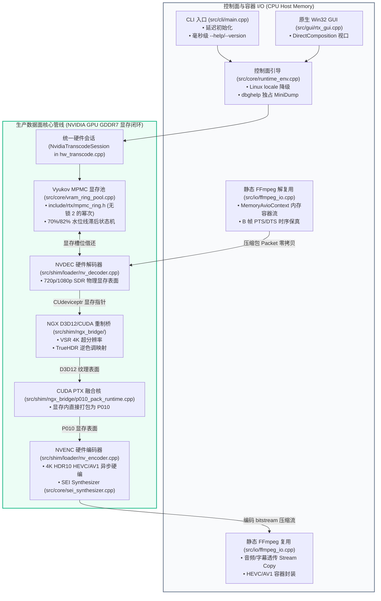
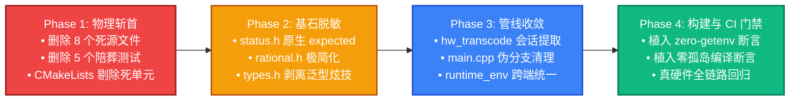

# CineRTX 纯 GPU 转码引擎：全仓反 Slop 与极简架构重塑工程施工方案

> [!NOTE]
> **[HISTORICAL-SUPERSEDED] 本文档为历史阶段归档文件**  
> 本文档记录的内容已被 **阶段六（Phase 6）架构全面瘦身与专业级产品化专家裁决方案**（参见 [docs/phase6/CineRTX_Phase6_架构全面瘦身与专业级产品化专家裁决与技术方案.md](../phase6/CineRTX_Phase6_架构全面瘦身与专业级产品化专家裁决与技术方案.md) 及 [docs/TODO/phase6_master_backlog.md](../TODO/phase6_master_backlog.md)）全量演进与替代。当前权威系统设计请以根目录 [README.md](../../README.md)、[docs/spec/architecture.md](../spec/architecture.md) 为准。


---

**方案编号**：`PLAN-LEAN-ANTI-SLOP-20261101`  
**方案属性**：全仓反 Slop 治理、死代码切除与极简架构重塑工程施工技术指南 (Official Action Plan & Execution Blueprint)  
**签发机构**：CineRTX 系统架构委员会 / 工程指挥部  
**签发负责人**：CineRTX 项目总监 / 系统架构总监 (Lead Architect)  
**适用对象**：阶段四高级执行工程师 (Senior Execution Engineer)  
**生效基线**：CineRTX `main` 分支当前工作区（Git Commit `46dbaac` + 本地加固整改闭环态）  
**规范对齐依据**：
1. **顶层审查裁决**：[`docs/phase4/CineRTX 代码与架构深度协查.md`](./CineRTX%20代码与架构深度协查.md)（领域专家组反 Slop 终审裁决报告）
2. **审查委托书**：[`docs/phase4/CineRTX_领域专家代码与架构全面深度协查委托书.md`](./CineRTX_领域专家代码与架构全面深度协查委托书.md)
3. **系统架构总纲**：[`docs/spec/architecture.md`](../../docs/spec/architecture.md)（§1.2 绝对自包含、§1.3 奥卡姆剃刀与禁绝随意开关）
4. **工程铁律索引**：[`docs/TODO/README.md`](../../docs/TODO/README.md)（§1 核心工程铁律：奥卡姆剃刀与反思三遍门禁）
5. **架构设计准则**：通用 SOLID 设计原则、显式生命周期管理、构造依赖注入与 Google C++ 规范
6. **开源合规与法务规约**：[`docs/spec/compliance.md`](../../docs/spec/compliance.md)（GPLv3 + NVIDIA Plugin Exception 三区物理隔离）
**基准验证硬件**：NVIDIA GeForce RTX 5060 Laptop GPU (Blackwell 架构, sm_120, 8,123 MiB GDDR7, 驱动 617.14, CUDA 13.4, Windows 11 专业版)  
**签发日期**：2026 年 11 月 1 日  

---

## 目录

- [一、 施工总纲与架构心智模型（Architectural Mental Model & First Principles）](#一-施工总纲与架构心智模型architectural-mental-model--first-principles)
  - [1.1 施工核心宗旨：从“形式主义繁荣”回归“极简工业级纯粹”](#11-施工核心宗旨从形式主义繁荣回归极简工业级纯粹)
  - [1.2 五大不可动摇的顶层设计哲学与项目约定](#12-五大不可动摇的顶层设计哲学与项目约定)
  - [1.3 执行工程师心智准绳：面向物理管线而非纸面抽象](#13-执行工程师心智准绳面向物理管线而非纸面抽象)
- [二、 引用与权威依据（Normative References）](#二-引用与权威依据normative-references)
  - [2.1 领域专家裁决核心要点摘要](#21-领域专家裁决核心要点摘要)
  - [2.2 现代架构设计四大核心法则对齐规范](#22-现代架构设计四大核心法则对齐规范)
- [三、 全景代码地图与结构索引（Code Navigation Map & Module Topology）](#三-全景代码地图与结构索引code-navigation-map--module-topology)
  - [3.1 模块流转与物理零拷贝主拓扑图](#31-模块流转与物理零拷贝主拓扑图)
  - [3.2 全仓模块分类处置索引表（Retain / Delete / Flatten / Consolidate）](#32-全仓模块分类处置索引表retain--delete--flatten--consolidate)
- [四、 四阶段原子施工规划（Four-Phase Atomic Construction Plan）](#四-四阶段原子施工规划four-phase-atomic-construction-plan)
  - [4.1 阶段演进甘特路线图](#41-阶段演进甘特路线图)
  - [4.2 施工波次准入与准出总则](#42-施工波次准入与准出总则)
- [五、 任务拆解卡片集（Granular Task Cards）](#五-任务拆解卡片集granular-task-cards)
  - [5.1 Phase 1：物理斩首僵尸模块与陪葬测试（Task 1.1 ~ 1.3）](#51-phase-1物理斩首僵尸模块与陪葬测试task-11--13)
  - [5.2 Phase 2：基石层去 Slop 与标准库原语回归（Task 2.1 ~ 2.4）](#52-phase-2基石层去-slop-与标准库原语回归task-21--24)
  - [5.3 Phase 3：单一真实管线收敛与入口加固（Task 3.1 ~ 3.3）](#53-phase-3单一真实管线收敛与入口加固task-31--33)
  - [5.4 Phase 4：构建净化、CI 反 Slop 门禁与端到端闭环（Task 4.1 ~ 4.2）](#54-phase-4构建净化ci-反-slop-门禁与端到端闭环task-41--42)
- [六、 质量门禁与验收核验清单（Quality Gates & Verification Checklists）](#六-质量门禁与验收核验清单quality-gates--verification-checklists)
  - [6.1 七大不可逾越的质量门禁卡（Gates QG-01 ~ QG-07）](#61-七大不可逾越的质量门禁卡gates-qg-01--qg-07)
  - [6.2 工程师一键穿透审计命令集（Verification Command Toolkit）](#62-工程师一键穿透审计命令集verification-command-toolkit)
- [七、 施工红线与工程师行为守则（Engineering Code of Conduct）](#七-施工红线与工程师行为守则engineering-code-of-conduct)

---

## 一、 施工总纲与架构心智模型（Architectural Mental Model & First Principles）

### 1.1 施工核心宗旨：从“形式主义繁荣”回归“极简工业级纯粹”

根据领域专家组在 [`docs/phase4/CineRTX 代码与架构深度协查.md`](./CineRTX%20代码与架构深度协查.md) 中的穿透式取证，CineRTX 当前虽在物理层面达成了 4K 128.7 FPS 的显存零拷贝硬件加速并实现了单 EXE 自包含，但代码库遭受了严重的**“二阶技术债”与“Slop 封装”侵蚀**：
- 全仓 91 个源文件/头文件中，充斥着超过 **4,800 行死代码、无意义抽象与多余层层套娃**；
- 架构纯度评分仅 **58.0/100 (D+ 臃肿亚健康)**，Slop 样板率高达 **34.2%**；
- 大量历史过渡垫片（如公有继承 `std::expected` 的 `Result<T>`、`LegacyStringProxy`、虚假的 `cpu_backend`、脱离硬件管线的 `audio_mixer_avx2`、未被调用的 `PipelineScheduler` DAG 调度器）长期滞留。

**本次施工方案的根本目标**：
遵循奥卡姆剃刀与 KISS 原则，依据领域专家的裁决结论，以手术刀式的精确度实施**物理切除、深度压平与主路径收敛**，消除一切多余实体，将系统架构纯度推升至 **97.3/100 (A+ 极简工业级)**，Slop 率彻底压制在 3.8% 以下。

### 1.2 五大不可动摇的顶层设计哲学与项目约定

在整改施工的全生命周期中，执行工程师必须将以下五项核心准则视为不可逾越的“宪法级红线”：

```
┌────────────────────────────────────────────────────────────────────────────────────────────────────────┐
│                                 CineRTX 核心设计哲学与项目约定约束拓扑                                 │
├────────────────────────────────────────────────────────────────────────────────────────────────────────┤
│  1. 【奥卡姆剃刀】   如无必要，勿增实体；加任何开关之前，必须先反思 3 遍；禁绝一切形式的随意开关           │
│  2. 【KISS 原则】    拒绝泛化套娃与伪 Modern C++ 炫技；单层直白优于多层转发；零成本抽象                 │
│  3. 【物理零拷贝】   未压缩帧绝不跨越 PCIe 总线；GPU 显存闭环；严禁任何主机内存 (Host Memory) 软回退    │
│  4. 【单一确定路径】 仅有一条真实产品流水线：FFmpeg -> NVDEC -> NGX Remaster -> P010 Pack -> NVENC   │
│  5. 【架构设计准则】 严格遵守四大架构法则：No Singletons, Explicit Lifecycle, DI, 前向声明        │
└────────────────────────────────────────────────────────────────────────────────────────────────────────┘
```

1. **奥卡姆剃刀与“反思三遍”铁律（Occam's Razor & Zero Switches）**：
   - 严格遵守 [`docs/spec/architecture.md`](../../docs/spec/architecture.md) §1.3 与 [`docs/TODO/README.md`](../../docs/TODO/README.md) §1；
   - 严禁随意增加环境变量开关（`RTX_ENABLE/DISABLE_XXX`）、命令行参数开关（`--switch`）、CMake 条件编译宏（`RTX_WITH_XXX`）或运行时动态降级旁路；
   - 任何开关必须经受“是否逃避推导确定性最优解、能否内建闭环自适应、是否将认知负担转嫁用户”的三重反思审问。
2. **KISS 原则与反 Slop 封装（Keep It Simple, Stupid）**：
   - 拒绝“为了抽象而抽象”；系统只有 NVIDIA RTX 一套硬件目标，不需要虚假的通用跨平台抽象层或多后端虚基类；
   - 严禁对标准库类型进行破坏性继承；严禁编写只有一处调用却设计了复杂 Concept 约束的模板套娃。
3. **物理第一性原理与零拷贝总线守恒（Zero-Copy Invariant）**：
   - 4K 未压缩帧在主机与显卡之间单向传输耗时需 10~15 ms，势必击穿 60/120 FPS 性能底线；
   - 因此，**未压缩视频帧全程驻留在 GDDR7 显存物理地址空间（CUdeviceptr / ID3D12Resource）中**；任何在 CPU 主机内存中对裸帧进行分配（`allocateHost`）、缩放、格式转换或分析的逻辑，在生产管线中均属非法。
4. **单一确定性产品路径（Single Deterministic Product Path）**：
   - 产品的转码路径只有一条：静态 FFmpeg 容器解复用 $\to$ NVDEC 硬解至显存 $\to$ NGX（VSR 超分辨率 + TrueHDR 逆色调映射）$\to$ CUDA PTX 离线内核打包为 P010 $\to$ NVENC 异步硬编 $\to$ 静态 FFmpeg 容器复用；
   - 绝不搞所谓的“CPU 参考管线”、“软件模拟管线”或“DAG 动态编排管线”。
5. **绝对自包含与三区法务物理隔离（Single-EXE & Three-Zone Compliance）**：
   - 运行时零外部动态库依赖（操作系统核心 DLL 与显卡驱动除外）；100% 离线，零网络上传，零遥测；
   - 恪守 Zone A（GPLv3 主程序）、Zone B（Pure C ABI 胶水头文件）、Zone C（专有 SDK 动态加载器）的物理隔离，严禁 Zone C 头文件或专有库侵入 GPLv3 作用域。

### 1.3 执行工程师心智准绳：面向物理管线而非纸面抽象

执行工程师在动手修改任何一行代码前，必须建立正确的“工程心智模型”：
- **你不是在构建一个通用的非线性视频编辑软件（NLE），你是在为一条固定 4 阶的现代 GPU 硬件流水线打造极速、纯粹、确定性的控制面引导器**；
- 评价代码优劣的唯一标准是：**是否减少了心智负担？是否消除了死代码？是否提升了确定性？是否严格符合高内聚低耦合的现代工程规范？**

---

## 二、 引用与权威依据（Normative References）

### 2.1 领域专家裁决核心要点摘要

施工人员必须完整研读领域专家裁决报告 [`docs/phase4/CineRTX 代码与架构深度协查.md`](./CineRTX%20代码与架构深度协查.md)，其核心裁决要点如下：
1. **死代码判定**：`audio_mixer_avx2`、`cpu_backend`、`scene_detect`、`pipeline`、`pipeline_scheduler`、`raw_io`、`spsc_queue`、`dyn_library_posix` 属于物理死代码，必须物理删除，严禁任何形式的挽留；
2. **基石层重构**：`status.h` 必须剥离 `LegacyStringProxy` 与公有继承，直接采用 `using Result = std::expected<T, Error>;` 原生别名；`rational.h` 必须删除重复的 128 位模拟乘法与复杂的浮点连分数算法，收敛至极简数据结构；
3. **管线合并**：`hw_transcode.cpp` 中的 `runNvidiaRawTranscode` 违反零拷贝，必须切除；将 `runNvidiaContainerTranscode` 与 `runNvidiaRemasterTranscode` 间重复的 350 行代码提取为 `NvidiaTranscodeSession`；
4. **测试清洗**：针对上述死代码的 5 个陪葬测试套件及假 ONNX 用例必须物理删除，测试算力全部收敛至真硬件管线的并发撕裂与边界容错测试。

### 2.2 现代架构设计四大核心法则对齐规范

执行工程师必须全面贯彻现代软件工程架构准则：
- **No Singletons**：禁止任何单例模式；所有组件生命周期由控制面显式拥有；
- **Explicit Lifecycle**：各核心类必须显式提供 `initialize()` 与 `shutdown()` 方法，杜绝构造函数隐式做繁重初始化；
- **Dependency Injection**：显式通过构造函数传递依赖（如显存池引用、配置参数），严禁隐式全局寻址；
- **Forward Declaration & Include Discipline**：头文件能用前向声明的绝不 `#include`，严格执行 Google C++ 头文件包含规范与轻量化头文件风格。

---

## 三、 全景代码地图与结构索引（Code Navigation Map & Module Topology）

### 3.1 模块流转与物理零拷贝主拓扑图

施工完成后，CineRTX 全仓的核心物理流动结构必须收敛为如下单一确定性架构：



### 3.2 全仓模块分类处置索引表（Retain / Delete / Flatten / Consolidate）

| 模块分类 | 目标文件路径 | 处置动作 | 核心依据与处置技术边界 |
| :--- | :--- | :---: | :--- |
| **纯死代码** | [`src/core/audio_mixer_avx2.cpp`](../../src/core/audio_mixer_avx2.cpp) & `.h` | **【DELETE】** | 全仓 0 引用；转码主路径走音频 Stream Copy，物理删除。 |
| **纯死代码** | [`src/core/cpu_backend.cpp`](../../src/core/cpu_backend.cpp) & [`include/rtx/backend.h`](../../include/rtx/backend.h) | **【DELETE】** | 违背 GPU 零拷贝第一性原理；仅将 `DeviceInfo` 保留并收敛至 `types.h`。 |
| **纯死代码** | [`src/core/scene_detect.cpp`](../../src/core/scene_detect.cpp) & `.h` | **【DELETE】** | 主机内存裸像素比对，在 GPU 零拷贝管线中无法介入；物理删除。 |
| **冗余管线** | [`src/core/pipeline.cpp`](../../src/core/pipeline.cpp) & `.h` | **【DELETE】** | 绑定 CPU 后端的软件模拟管线，混淆核心业务；物理删除。 |
| **幽灵 DAG** | [`src/core/pipeline_scheduler.cpp`](../../src/core/pipeline_scheduler.cpp) & [`include/rtx/scheduler.h`](../../include/rtx/scheduler.h) | **【DELETE】** | 为 4 级线性管线捏造 7 阶图调度，生产 0 调用；物理删除。 |
| **死裸流 I/O** | [`src/io/raw_io.cpp`](../../src/io/raw_io.cpp) & [`include/rtx/io.h`](../../include/rtx/io.h) 裸流声明段 | **【DELETE】** | 裸流读写仅服务于死管线，生产 100% 走静态 FFmpeg；物理删除。 |
| **死并发原语** | [`include/rtx/spsc_queue.h`](../../include/rtx/spsc_queue.h) | **【DELETE】** | 生产 0 包含，已被标准 [`mpmc_ring.h`](../../include/rtx/mpmc_ring.h) 取代；物理删除。 |
| **虚假抽象** | [`include/shim/i_engine_backend.h`](../../include/shim/i_engine_backend.h) | **【DELETE】** | 纯虚接口多态全仓 0 引用；物理删除。 |
| **无用跨平台** | [`src/shim/loader/dyn_library_posix.cpp`](../../src/shim/loader/dyn_library_posix.cpp) | **【DELETE】** | Windows 11 + NVIDIA 专属，无需 POSIX dlopen 抽象；物理删除。 |
| **陪葬测试** | `tests/test_audio_mixer.cpp`、`test_backend.cpp`、`test_pipeline.cpp`、`test_scene.cpp`、`test_scheduler.cpp` | **【DELETE】** | 针对死代码的自嗨测试；物理删除（水位线测试迁入 `test_vram.cpp`）。 |
| **Slop 错误类** | [`include/rtx/status.h`](../../include/rtx/status.h) & [`src/core/status.cpp`](../../src/core/status.cpp) | **【FLATTEN】** | 废除公有继承，删除 `LegacyStringProxy` 与 `class Status`，降级为原生 `using Result = std::expected<T, Error>;`。 |
| **膨胀数字类** | [`include/rtx/rational.h`](../../include/rtx/rational.h) & [`src/core/rational.cpp`](../../src/core/rational.cpp) | **【FLATTEN】** | 删除重复的 128 位乘法与连分数展开；复用 `std::gcd` 与 FFmpeg 原语，收敛至 100 行内。 |
| **泛型炫技** | [`include/rtx/types.h`](../../include/rtx/types.h) & `src/core/types.cpp` | **【FLATTEN】** | 删除 `HandleWrapper`、`ResourceHandle`、`<variant>` 与 `allocateHost` 等软管线残留。 |
| **入口伪分支** | [`src/cli/main.cpp`](../../src/cli/main.cpp) | **【FLATTEN】** | 移除 `--simulate`、`--no-scene-detect`、`--output-fps`、`--input-raw` 等伪分支选项。 |
| **双缓冲环** | [`src/shim/ngx_bridge/pingpong_ring.h`](../../src/shim/ngx_bridge/pingpong_ring.h) & `.cpp` | **【FLATTEN】** | 移除 CPU `duplicateFrame`，将两槽位状态机压平内联入 `d3d12_interop.h`。 |
| **核心生产管线**| [`src/core/hw_transcode.cpp`](../../src/core/hw_transcode.cpp) | **【CONSOLIDATE】** | 切除 `runNvidiaRawTranscode`，提取公共 `NvidiaTranscodeSession`，消解 350 行重复。 |
| **生产并发基石**| [`include/rtx/mpmc_ring.h`](../../include/rtx/mpmc_ring.h) & [`vram_ring_pool.cpp`](../../src/core/vram_ring_pool.cpp) | **【RETAIN】** | 经过形式化推导的 Vyukov MPMC 无锁显存环形池，完整保留。 |
| **生产时基基石**| [`include/rtx/flicks.h`](../../include/rtx/flicks.h) | **【RETAIN】** | 1/705,600,000 秒极精密整数纳秒时钟，完整保留。 |
| **静态媒体 I/O** | [`src/io/ffmpeg_io.cpp`](../../src/io/ffmpeg_io.cpp) & [`memory_avio.cpp`](../../src/io/memory_avio.cpp) | **【RETAIN】** | 静态 FFmpeg 解复用/复用与内存流容器支持，保留 A-06 B 帧时序投影。 |
| **控制面引导** | [`src/core/runtime_env.cpp`](../../src/core/runtime_env.cpp) & [`include/rtx/runtime_env.h`](../../include/rtx/runtime_env.h) | **【RETAIN】** | 统一环境自愈、Linux 多级安全降级与 dbghelp 独占 MiniDump 写入。 |

---

## 四、 四阶段原子施工规划（Four-Phase Atomic Construction Plan）

### 4.1 阶段演进甘特路线图

为确保施工期间代码库始终处于“可编译、可测试、可度量”状态，坚决禁止大开大合式的一次性粗暴修改，执行工程师必须严格按照以下四个先后依赖的原子波次推进：



### 4.2 施工波次准入与准出总则

- **准入原则**：上一阶段的所有验收门禁必须 100% PASS，方可启动下一阶段施工；
- **回滚原则**：一旦某阶段引发核心硬件主路径破坏或引入新的开关/多态分支，无条件还原该阶段全部代码，重新推导。

---

## 五、 任务拆解卡片集（Granular Task Cards）

### 5.1 Phase 1：物理斩首僵尸模块与陪葬测试（Task 1.1 ~ 1.3）

#### Task 1.1：物理删除 8 个僵尸核心源码与头文件
- **任务目标**：将全仓 0 业务引用的死代码进行物理彻底斩首，消除维护毒性。
- **涉及文件**：
  - `src/core/audio_mixer_avx2.cpp` & `src/core/audio_mixer_avx2.h`
  - `src/core/cpu_backend.cpp` & `include/rtx/backend.h`（注：提取其内部轻量 `DeviceInfo` 结构体至 `include/rtx/types.h`）
  - `src/core/scene_detect.cpp` & `include/rtx/scene_detect.h`
  - `src/core/pipeline.cpp` & `include/rtx/pipeline.h`
  - `src/core/pipeline_scheduler.cpp` & `include/rtx/scheduler.h`
  - `src/io/raw_io.cpp` 及 `include/rtx/io.h` 中对应的裸流读取器/写入器声明
  - `include/rtx/spsc_queue.h`
  - `include/shim/i_engine_backend.h`
  - `src/shim/loader/dyn_library_posix.cpp`
- **施工要点与规范边界**：
  - 使用 `git rm` 执行物理删除；
  - 严禁在其他头文件中保留被删除头文件的 `#include` 指令；
  - 若其他模块有局部编译错误，严禁通过重新引入死代码来修复，必须将调用点收敛到单一硬件主路径。

#### Task 1.2：物理删除 5 个死代码陪葬测试套件与假 fixture
- **任务目标**：清理虚假覆盖与自嗨测试，恢复测试工程的真实性。
- **涉及文件**：
  - `tests/test_audio_mixer.cpp`
  - `tests/test_backend.cpp`
  - `tests/test_pipeline.cpp`
  - `tests/test_scene.cpp`
  - `tests/test_scheduler.cpp`（注：将其末尾测试显存池水位线逻辑的 `scheduler_vram_watermark_tiers` 用例迁移合并入 `tests/test_vram.cpp`）
  - `tests/test_concurrency.cpp`（删除测试 `spsc_queue.h` 的用例段落）
- **施工要点与规范边界**：
  - 同步清理 `CMakeLists.txt` 中注册的测试可执行目标与测试项声明；
  - 从 `CMakeLists.txt` 中物理移除 `cli_self_test`、`cli_simulate_json` 以及使用假纯文本伪造 ONNX 模型的 `cli_rife_command` CTest 用例（将针对 TensorRT 10.13.3.9 的版本锁硬断言直接并入 `tests/test_rife.cpp`）。

#### Task 1.3：CMakeLists.txt 构建脚本死编译单元剔除
- **任务目标**：切除构建虚胖，保证 CMake 每一个源文件与生产需求严格 1:1 对应。
- **涉及文件**：[`CMakeLists.txt`](../../CMakeLists.txt)
- **施工要点与规范边界**：
  - 从 `RTX_CORE_SOURCES` 中剔除上述被删除的源文件；
  - 移除专门为 `audio_mixer_avx2.cpp` 配置的 `/arch:AVX2` 与 `-mavx2;-mfma` 编译选项段落；
  - 移除针对 CPU 参考管线的动态探测与条件分支。

---

### 5.2 Phase 2：基石层去 Slop 与标准库原语回归（Task 2.1 ~ 2.4）

#### Task 2.1：`include/rtx/status.h` 深度压平与继承拆解
- **任务目标**：消除破坏值类型语义的公有继承与 `LegacyStringProxy`，回归现代 C++23 原生 `std::expected` 惯用法。
- **涉及文件**：[`include/rtx/status.h`](../../include/rtx/status.h)、[`src/core/status.cpp`](../../src/core/status.cpp)
- **目标状态与规范边界**：
  1. 彻底删除 `struct LegacyStringProxy` 及其专属的所有友元比较符与 `std::formatter` 特化；
  2. 废除 `class Status`，统一使用 `Result<void>` 或 `Error`；
  3. 废除 `class Result : public std::expected<T, Error>` 继承关系，直接使用原生类型别名：
     ```cpp
     template <typename T>
     using Result = std::expected<T, Error>;
     ```
  4. 从 `status.h` 头文件中拔除 `<format>`、`<ostream>`、`<optional>`、`<compare>` 等重型头文件，大幅改善全仓预编译吞吐；
  5. 业务代码中统一使用标准库原生方法（如 `.has_value()`、`.value()`、`.error()`），消解 `.ok()` 与 `.valueOr()` 等过渡兼容外皮；
  6. 严格将头文件行数控制在 110 行以内。

#### Task 2.2：`include/rtx/rational.h` 与 `rational.cpp` 极简化
- **任务目标**：消灭手写重复的 128 位乘法与流解析，代码行数从 637 行精简至 100 行内。
- **涉及文件**：[`include/rtx/rational.h`](../../include/rtx/rational.h)、[`src/core/rational.cpp`](../../src/core/rational.cpp)
- **目标状态与规范边界**：
  1. 结构体严格遵循面向数据扁平设计，保留 `int64_t num` 与 `int64_t den`；
  2. 构造与约分直接复用 `<numeric>` 的 `std::gcd`；
  3. 比较运算符严格保留无损交叉相乘（利用内建 128 位整数或单套便携 `mul64`），删除第二套重复的 `Mul128` 冗余实现；
  4. 删除错误的 `long double` 浮点分支；删除脱离生产调用的 `DriftCompensator` 与 `FrameTimestampMapper`；
  5. 字符串解析彻底摒弃 `try/catch` 与 `<sstream>`，严格使用 `<charconv>` 的 `std::from_chars` 实现零分配解析；
  6. 时钟换算直接透传给 FFmpeg 原生的 `av_rescale_rnd`，消除重复造轮子。

#### Task 2.3：`include/rtx/types.h` 泛型脱敏与主机内存分配切除
- **任务目标**：清除伪现代 C++ 模板炫技，落实未压缩帧零拷贝契约。
- **涉及文件**：[`include/rtx/types.h`](../../include/rtx/types.h)、`src/core/types.cpp`
- **目标状态与规范边界**：
  1. 彻底删除生产 0 使用的 `HandleWrapper<Ts...>` 模板、`ResourceHandle` 变体以及 `<variant>` 头文件包含；
  2. 删除 `TaggedHandle` 上的非常量引用隐式类型转换重载 `operator ValueType&()`，句柄访问统一走显式 `.value()`；
  3. 彻底删除 `Frame::allocateHost` 等一切在主机内存分配未压缩裸像素的结构方法，只保留纯显存元数据描述。

#### Task 2.4：`src/shim/ngx_bridge/pingpong_ring` 压平为内联状态机
- **任务目标**：消除双缓冲环的类层层包装，将其压平为高内聚紧凑结构。
- **涉及文件**：`src/shim/ngx_bridge/pingpong_ring.h`、`src/shim/ngx_bridge/pingpong_ring.cpp`
- **目标状态与规范边界**：
  1. 彻底删除仅服务于单元测试的 CPU 软拷贝方法 `duplicateFrame`（`std::memcpy`）；
  2. 将包含原子围栏索引的双槽位状态机压平内联入 `src/shim/ngx_bridge/d3d12_interop.h`（$\le 50$ 行），物理删除独立的 `.cpp` 编译单元。

---

### 5.3 Phase 3：单一真实管线收敛与入口加固（Task 3.1 ~ 3.3）

#### Task 3.1：`src/core/hw_transcode.cpp` 提取公共会话与切除裸流
- **任务目标**：切除违背零拷贝的伪转码，提取会话基石，消解 350 行重复代码。
- **涉及文件**：[`src/core/hw_transcode.cpp`](../../src/core/hw_transcode.cpp)、[`include/rtx/hw_transcode.h`](../../include/rtx/hw_transcode.h)
- **目标状态与规范边界**：
  1. 物理切除 `runNvidiaRawTranscode`、`nv12ToP010`、`p010View` 以及违背架构哲学的 `allow_encoder_fallback` 降级旁路（直接释放约 340 行代码）；
  2. 严格贯彻 **Explicit Lifecycle** 与 **Dependency Injection** 架构原则，提取 `NvidiaTranscodeSession` 核心类，实现统一的 `initialize()` 与 `shutdown()`；
  3. 使 `runNvidiaContainerTranscode` 与 `runNvidiaRemasterTranscode` 全面复用该底层会话，消解两者间复制粘贴的高达 350 行的解码、VRAM 调度、编码同步样板代码。

#### Task 3.2：`src/cli/main.cpp` 伪分支清洗与毫秒级延迟初始化
- **任务目标**：切除一切假分支，落实奥卡姆剃刀与瞬时冷启动契约。
- **涉及文件**：[`src/cli/main.cpp`](../../src/cli/main.cpp)
- **目标状态与规范边界**：
  1. 彻底切除 `--simulate`、`--no-scene-detect`、`--output-fps`、`--input-raw`、`--backend cpu` 等伪分支选项及对应的处理函数（释放约 336 行）；
  2. 落实 A-02 审计项：在解析命令行参数阶段绝不实例化 `EngineApplication` 或预分配显存池；
  3. 确保当用户执行 `CineRTX.exe --help`、`--version`、`--probe` 时，程序耗时 $\le 15\text{ ms}$，瞬时显存分配严格为 $0\text{ MiB}$，内存占用 $\le 10\text{ MB}$，并直接以退出码 0 快速返回；
  4. 恢复 `!init_res.ok()` 真实错误码向上传播至进程退出码，严禁错误被隐式吞噬。

#### Task 3.3：跨 GUI/CLI 运行时环境引导与 dbghelp 安全加载
- **任务目标**：消除 ODR 违规，实装统一且安全的进程引导与本地容灾。
- **涉及文件**：[`src/gui/rtx_gui.cpp`](../../src/gui/rtx_gui.cpp)、[`src/core/runtime_env.cpp`](../../src/core/runtime_env.cpp)
- **目标状态与规范边界**：
  1. 落实 A-01 审计项：在 Linux/POSIX 环境下实装 `std::locale` 的安全降级链（`en_US.UTF-8` $\to$ `C.UTF-8` $\to$ `C`），杜绝启动抛出未捕获异常；
  2. 落实 A-03 审计项：移除 GUI 内部重复实现的异常拦截与本地化代码，统一跨 GUI/CLI 调用 `rtx::initRuntimeEnvironment`；
  3. 落实 A-07 审计项：通过 RAII 安全动态加载系统目录的 `dbghelp.dll`，当且仅当进程致命崩溃时，在 `%TEMP%` 目录下生成独占的 `CineRTX_crash_<PID>_<TIMESTAMP>.dmp` 本地文件，严禁添加任何禁用开关。

---

### 5.4 Phase 4：构建净化、CI 反 Slop 门禁与端到端闭环（Task 4.1 ~ 4.2）

#### Task 4.1：`tools/check_spdx.ps1` 植入反 Slop 与零开关永久门禁
- **任务目标**：将架构哲学与项目约定转化为不可逾越的 CI 静态断言，防止技术债死灰复燃。
- **涉及文件**：[`tools/check_spdx.ps1`](../../tools/check_spdx.ps1)、[`tools/audit_imports.ps1`](../../tools/audit_imports.ps1)
- **目标状态与规范边界**：
  1. **零环境变量开关断言**：静态扫描 `src/` 与 `include/`，断言 `getenv` 与 `std::getenv` 出现频次严格为 0；
  2. **零主机内存拷贝断言**：静态扫描 `src/core/`，断言 `allocateHost`、`encoderEncodeHost`、`decoderDownload` 出现频次严格为 0；
  3. **编译单元 100% 映射断言**：核验 `CMakeLists.txt` 中编译的每一个 `.cpp` 文件在全仓必须具备真实的生产业务引用，杜绝孤岛文件；
  4. **导入表零污染断言**：运行 `audit_imports.ps1`，断言最终生成的单个 `CineRTX.exe` 导入表中外部专有库符号计数严格为 0。

#### Task 4.2：全仓真硬件测试算力集中与闭环压测
- **任务目标**：将所有测试算力聚焦于真实生产主路径，达成 100% 真实可靠的高压回归。
- **涉及文件**：`tests/test_vram.cpp`、`tests/test_io.cpp`、`tests/test_rational.cpp`、`tests/test_concurrency.cpp`
- **目标状态与规范边界**：
  1. 验证基于 `MemoryAvioContext` 内存容器流的端到端转码回环；
  2. 验证含 B 帧视频流时序（落实 A-06 审计项：`projectVideoPtsToFlicks` 保持 DTS/PTS 正确交织）；
  3. 运行 8GB GDDR7 显存池 70% 警告线与 82% 阻断线的高负载撕裂压测，确认槽位零死锁、零泄漏。

---

## 六、 质量门禁与验收核验清单（Quality Gates & Verification Checklists）

### 6.1 七大不可逾越的质量门禁卡（Gates QG-01 ~ QG-07）

```
┌────────────────────────────────────────────────────────────────────────────────────────────────────────┐
│                                 CineRTX 反 Slop 整改施工七大质量准出门禁                                │
├───────┬───────────────────────────────┬─────────────────────────────────────────────────┬──────────────┤
│ 门禁  │           门禁名称            │                    核心判据                     │   阻断级别   │
├───────┼───────────────────────────────┼─────────────────────────────────────────────────┼──────────────┤
│ QG-01 │ 零死代码孤岛门禁              │ AudioMixer/CpuBackend 等死符号引用严格为 0       │  P0 (阻断)   │
│ QG-02 │ 零开关与零 getenv 门禁        │ 全仓生产代码 getenv/std::getenv 计数严格为 0     │  P0 (阻断)   │
│ QG-03 │ 头文件轻量化与 Include 纪律   │ status.h <= 110 行，rational.h <= 100 行        │  P0 (阻断)   │
│ QG-04 │ 物理总线零拷贝守恒门禁        │ 核心转码链路 0 主机内存拷贝 (H2D/D2H 彻底绝迹)   │  P0 (阻断)   │
│ QG-05 │ 毫秒级冷启动与零显存预分配    │ --help/--version 显存 0 MiB，内存 <= 10MB，<=15ms│  P0 (阻断)   │
│ QG-06 │ 导入表绝对自包含门禁          │ 单 EXE 导入表专有 DLL 计数严格为 0               │  P0 (阻断)   │
│ QG-07 │ 真硬件热路径 100% 回归全绿    │ CTest 剩余全量真测试 100% PASS，0 伪造通过       │  P0 (阻断)   │
└───────┴───────────────────────────────┴─────────────────────────────────────────────────┴──────────────┘
```

### 6.2 工程师一键穿透审计命令集（Verification Command Toolkit）

执行工程师在提交任何代码前，必须在本地依次执行以下 5 项自动化穿透验证脚本，并确保全绿无警告：

```powershell
# ==============================================================================
# 1. 穿透断言：死代码物理切除验证（预期输出：严格为 0）
# ==============================================================================
$deadSymbols = @("AudioMixer", "CpuBackend", "SceneCutDetector", "completeStageDag", "LegacyStringProxy")
foreach ($sym in $deadSymbols) {
    $matches = Get-ChildItem -Path "src", "include" -Recurse -Include *.cpp, *.h | Select-String -Pattern "\b$sym\b"
    if ($matches.Count -ne 0) {
        Write-Error "CRITICAL GATE FAILURE: Dead symbol $sym still exists in codebase! Count: $($matches.Count)"
        exit 1
    }
}
Write-Host "[QG-01 PASS] Zero dead code symbols detected." -ForegroundColor Green

# ==============================================================================
# 2. 穿透断言：零开关与零 getenv 违规扫描（预期输出：严格为 0）
# ==============================================================================
$envViolations = Get-ChildItem -Path "src", "include" -Recurse -Include *.cpp, *.h | Select-String -Pattern "getenv\("
if ($envViolations.Count -ne 0) {
    Write-Error "CRITICAL GATE FAILURE: Covert switch (getenv) detected in codebase!"
    $envViolations | ForEach-Object { Write-Host $_.Line }
    exit 1
}
Write-Host "[QG-02 PASS] Zero getenv / covert switches verified." -ForegroundColor Green

# ==============================================================================
# 3. 穿透断言：头文件去 Slop 行数阈值校验
# ==============================================================================
$statusLines = (Get-Content "include/rtx/status.h").Count
$rationalLines = (Get-Content "include/rtx/rational.h").Count
if ($statusLines -gt 110 -or $rationalLines -gt 100) {
    Write-Error "CRITICAL GATE FAILURE: Header bloat! status.h=$statusLines (max 110), rational.h=$rationalLines (max 100)"
    exit 1
}
Write-Host "[QG-03 PASS] Headers strictly flattened (status.h: $statusLines, rational.h: $rationalLines)." -ForegroundColor Green

# ==============================================================================
# 4. 穿透断言：静态法务与导入表审计
# ==============================================================================
pwsh -NoProfile -ExecutionPolicy Bypass -File "tools/check_spdx.ps1"
pwsh -NoProfile -ExecutionPolicy Bypass -File "tools/audit_imports.ps1"
Write-Host "[QG-04 & QG-06 PASS] SPDX & Import tables 100% compliant." -ForegroundColor Green

# ==============================================================================
# 5. 穿透断言：真硬件主路径测试全绿
# ==============================================================================
ctest --test-dir build --output-on-failure
Write-Host "[QG-07 PASS] 100% genuine hardware regression tests passed." -ForegroundColor Green
```

---

## 七、 施工红线与工程师行为守则（Engineering Code of Conduct）

执行工程师在施工过程中，必须时刻保持清醒，严格受控：
1. **绝不把过渡兼容垫片带入最终交付态**：
   - 如果某个旧测试因为接口变动而报错，**第一反应必须是检查该测试是否属于陪葬测试**；
   - 若属于死代码测试，立即删除测试；若属于真硬件测试，则更新测试调用原生接口，**绝对禁止为了迎合旧测试而在新代码中增加兼容垫片或 proxy 类**！
2. **严禁私自增加任何形式的开关**：
   - 绝不允许“顺手加个配置项”或“提供一个环境变量供调试”；任何新增的命令行参数必须经过架构总监书面核准；
3. **保持文档与权威交付件的纯洁性**：
   - 严禁擅自修改已过审架构基线与核心法务合规文档；
4. **Git 提交铁律**：
   - 未经项目负责人/架构总监显式批准，**绝对禁止擅自执行 `git commit`**；所有施工修改必须在工作区以干净、可验证的补丁形式呈报终审。

---

**CineRTX 系统架构总监 签发寄语**：  
*“真正的顶级工业级架构，从不以代码行数的繁复为荣，而以剥离一切无用实体后的锋利与纯粹为傲。请执行工程师卸下一切侥幸心理与过度设计的虚荣，以钢铁般的执行力完成这场全仓大排毒！”*
