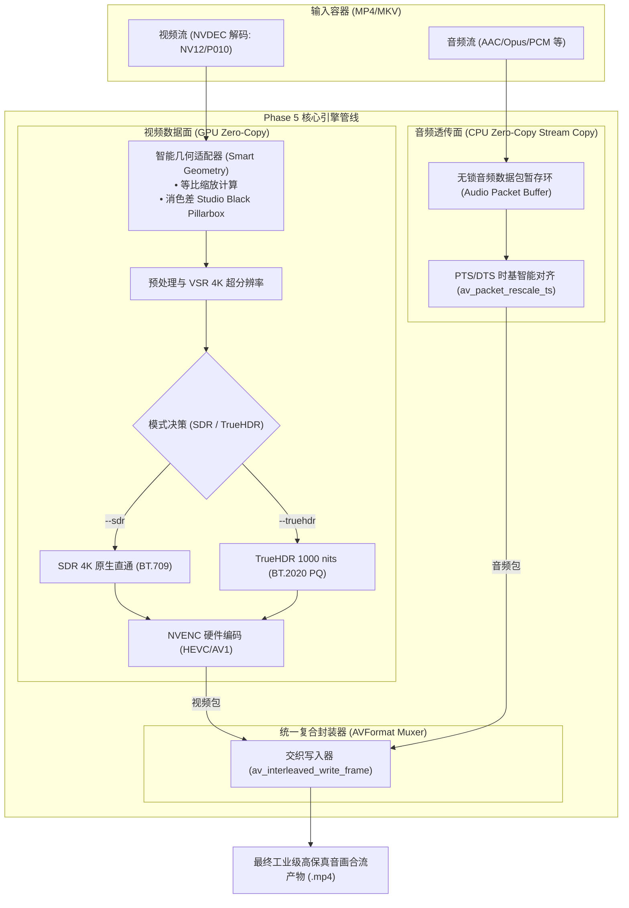

# CineRTX Phase 5: 全媒体工业可用性与产品化落地工程施工方案

> [!NOTE]
> **[HISTORICAL-SUPERSEDED] 本文档为历史阶段归档文件**  
> 本文档记录的内容已被 **阶段六（Phase 6）架构全面瘦身与专业级产品化专家裁决方案**（参见 [docs/phase6/CineRTX_Phase6_架构全面瘦身与专业级产品化专家裁决与技术方案.md](../phase6/CineRTX_Phase6_架构全面瘦身与专业级产品化专家裁决与技术方案.md) 及 [docs/TODO/phase6_master_backlog.md](../TODO/phase6_master_backlog.md)）全量演进与替代。当前权威系统设计请以根目录 [README.md](../../README.md)、[docs/spec/architecture.md](../spec/architecture.md) 为准。


**方案编号**: PLAN-PHASE5-MEDIA-USABILITY-20261108  
**生效基线**: Git Commit `145d79d`（核心画质热修已闭环，89 项单元测试全绿）  
**签发机构**: CineRTX 架构委员会 / 阶段五工程指挥部  
**适用对象**: 阶段五执行工程师（Execution Engineer）  
**文档状态**: 正式工程执行指导书（Official Action Plan）

---

## 目录

- [一、 阶段五核心战略使命与系统架构哲学](#一-阶段五核心战略使命与系统架构哲学)
  - [1.1 核心攻坚战：从“算法可用”到“商业交付可用”](#11-核心攻坚战从算法可用到商业交付可用)
  - [1.2 控制面与数据面双域解耦原则在 Phase 5 的继承](#12-控制面与数据面双域解耦原则在-phase-5-的继承)
  - [1.3 Google C++ 包含规范与现代 C++26 编程纪律](#13-google-c-包含规范与现代-c26-编程纪律)
- [二、 四大工程波次细粒度施工任务卡（Task Cards）](#二-四大工程波次细粒度施工任务卡task-cards)
  - [Wave 1：音频轨零拷贝流透传与交织复用（Audio Stream Copy & Interleaved Muxing）](#wave-1音频轨零拷贝流透传与交织复用audio-stream-copy--interleaved-muxing)
  - [Wave 2：9:16 竖屏自适应智能几何与消色差黑边填充（Smart Geometry & Pillarbox Padding）](#wave-2916-竖屏自适应智能几何与消色差黑边填充smart-geometry--pillarbox-padding)
  - [Wave 3：SDR 原生 4K 直通与色彩回路解耦（Native SDR Passthrough & Mode Decoupling）](#wave-3sdr-原生-4k-直通与色彩回路解耦native-sdr-passthrough--mode-decoupling)
  - [Wave 4：日志净化、观测性与绿色自包含打包闭环（Logging, Observability & Packaging）](#wave-4日志净化观测性与绿色自包含打包闭环logging-observability--packaging)
- [三、 阶段五验收门禁矩阵（Quality Gates）](#三-阶段五验收门禁矩阵quality-gates)
- [四、 执行工程师代码地图与避坑指南（Engineering Code Map & Pitfalls）](#四-执行工程师代码地图与避坑指南engineering-code-map--pitfalls)

---

## 一、 阶段五核心战略使命与系统架构哲学

### 1.1 核心攻坚战：从“算法可用”到“商业交付可用”

经过 Phase 1~4 的高强度重构与近期的画质核心热修，CineRTX 已具备全球领先的 4K 90+ FPS 纯 GPU 硬件直通转码引擎，消除了绿色光柱、彩色条带重影和色度错位等渲染死穴。然而，在真实商业与用户使用场景下，仍存在三大“阻断性体验缺陷”：
1. **音频完全丢失（哑巴视频）**：由于未对接音频解复用与封装透传，任何包含配乐、对白、音效的视频转码后均变成纯静音视频；
2. **竖屏视频 3.16 倍挤压畸变**：当输入常见的手机 9:16（如 720x1280、1080x1920）竖屏短视频时，管线暴力强制缩放至 3840x2160，人物被横向拉伸压扁变形；
3. **SDR 纯原生直通未解耦**：用户仅需 4K SDR 高清放大时，管线未提供零色调压缩的独立直通输出路径。

Phase 5 的核心战略定位：**彻底根除上述阻断性缺陷，实现音画同步、多比例自适应、SDR/HDR 双模自由切换以及自包含分发的全功能工业可用引擎**。



---

### 1.2 控制面与数据面双域解耦原则在 Phase 5 的继承

工程师在施工中必须严格遵循 Phase 4 确立的**控制面与数据面解耦架构**：
- **视频数据面**：保持 D3D12/CUDA 纯显存零拷贝流水线，严禁在渲染循环中调用任何阻塞性宿主 API、格式重分配或未初始化的显存操作；
- **音频控制/透传面**：音频采用解复用零拷贝（Stream Copy），复用 `AVCodecParameters`，仅做时间戳重定标（Rescale），严禁引入不必要的编解码开销；
- **交织并发同步面**：采用基于生产者-消费者模型的 MPMC 环形队列暂存音频 Packet，确保视频帧硬件编码与音频透传写入在 Muxer 互斥锁下安全有序交织。

---

### 1.3 Google C++ 包含规范与现代 C++26 编程纪律

所有新增与修改的代码文件必须 100% 遵守：
1. **Google C++ 头文件次序**：相关头文件 $\to$ C 系统头 $\to$ C++ 标准库头 $\to$ FFmpeg/第三方库头 $\to$ 工程内部头，各组之间严格空一行，组内按字典序字母排序。
2. **现代 C++26 范式**：优先使用 `std::expected<T, Status>` 处理可恢复错误；全面采用 `std::span` 传递缓冲区视图；禁用裸指针手动内存释放，使用 RAII `std::unique_ptr` 搭配专用 Deleter。
3. **零垃圾日志**：严禁在循环内保留 `printf`、`std::cout` 或无门控的 `OutputDebugString`。

---

## 二、 四大工程波次细粒度施工任务卡（Task Cards）

### Wave 1：音频轨零拷贝流透传与交织复用（Audio Stream Copy & Interleaved Muxing）

- [ ] **任务 1.1**：在解复用层实现多音轨识别与参数探测
  - **对应文件**：[`include/rtx/types.h`](../../include/rtx/types.h)、[`src/io/ffmpeg_io.cpp`](../../src/io/ffmpeg_io.cpp)
  - **施工动作**：
    1. 在 `MediaInfo` 结构体中新增 `AudioTrackInfo` 数组及主音轨索引 `int primary_audio_index`；
    2. 在 `FfmpegDemuxer::open` 中扫描 `format_->streams`，当 `codecpar->codec_type == AVMEDIA_TYPE_AUDIO` 时提取流索引、编码格式、采样率、声道数、声道布局及 `time_base`；
    3. 完善 `demuxRead`，区分视频 Packet 与音频 Packet，支持将非视频 Packet 按类型安全抛出。

- [ ] **任务 1.2**：在 Muxer 层实现从源参数克隆音频流
  - **对应文件**：[`src/io/ffmpeg_io.cpp`](../../src/io/ffmpeg_io.cpp)、[`src/core/hw_transcode.h`](../../src/core/hw_transcode.h)
  - **施工动作**：
    1. 在 `FfmpegMuxer::open` 中调用 `avformat_new_stream` 创建音频流；
    2. 使用 `avcodec_parameters_copy(audio_stream_->codecpar, src_audio_codecpar)` 完整克隆 extradata、codec_tag 及参数；
    3. 保存音频输入与输出的 `AVRational time_base` 换算比例。

- [ ] **任务 1.3**：在硬件主循环中构建音视频交织暂存与时序写盘
  - **对应文件**：[`src/core/hw_transcode.cpp`](../../src/core/hw_transcode.cpp)
  - **施工动作**：
    1. 在 `runNvidiaRemasterTranscode` 的生产者线程中，若读出音频 Packet，压入 `audio_packet_queue`；
    2. 针对音频 Packet，执行 `av_packet_rescale_ts(pkt, in_audio_tb, out_audio_tb)`；
    3. 写入端使用 `av_interleaved_write_frame`，确保音视频交织 PTS 单调递增，杜绝音画不同步与播放器卡死。

- [ ] **任务 1.4**：编写自动化单测与容器验证用例
  - **对应文件**：[`tests/unit/test_audio_stream_copy.cpp`](../../tests/unit/test_audio_stream_copy.cpp)（新建）
  - **验收条件**：测试视频转码后，`ffprobe` 识别出音频轨且码率、采样率与原视频严格一致，无任何重采样失真。

---

### Wave 2：9:16 竖屏自适应智能几何与消色差黑边填充（Smart Geometry & Pillarbox Padding）

- [ ] **任务 2.1**：几何自适应策略计算器开发
  - **对应文件**：[`include/rtx/geometry.h`](../../include/rtx/geometry.h)（新建）、[`src/core/geometry.cpp`](../../src/core/geometry.cpp)（新建）
  - **施工动作**：
    1. 实现 `SmartGeometryCalculator::calculate(int src_w, int src_h, TargetMode mode)`；
    2. 支持两种主流工业策略：
       - **Mode A (竖屏 4K 直出)**：当输入为 9:16（$W < H$）时，自动调整目标画布为 $2160 \times 3840$；
       - **Mode B (16:9 画布居中 + Pillarbox 填充)**：保持 $3840 \times 2160$ 画布，有效画面居中（宽 $1215 \times 2160$），左右两侧为消色差黑边（各 $1312$ 像素）。

- [ ] **任务 2.2**：预处理与打包阶段消色差纯黑底色保证（Studio Black）
  - **对应文件**：[`src/shim/ngx_bridge/d3d12_interop.cpp`](../../src/shim/ngx_bridge/d3d12_interop.cpp)、[`src/shim/ngx_bridge/p010_pack.cu`](../../src/shim/ngx_bridge/p010_pack.cu)
  - **施工动作**：
    1. 在 D3D12/CUDA 分配输出表面与 Pillarbox 区域时，确保使用 `clear_p010_black` 填入消色差 Studio Black（$Y = 64 \ll 6 = 0x1000$，$UV = 512 \ll 6 = 0x8000$）；
    2. 严禁使用全 0 清屏（全 0 会触发刺眼荧光绿！）。

- [ ] **任务 2.3**：集成测试验证
  - **对应文件**：[`tools/verify_transcode_quality.py`](../../tools/verify_transcode_quality.py)
  - **验收条件**：输入 `.vs/gemini_generated_video_7eb7a09e.mp4`（720x1280 竖屏），输出画面人物与物体比例严格自然，无任何横向拉伸畸变。

---

### Wave 3：SDR 原生 4K 直通与色彩回路解耦（Native SDR Passthrough & Mode Decoupling）

- [ ] **任务 3.1**：D3D12 中间纹理（`mid_`）在纯 SDR 模式下的路由修复
  - **对应文件**：[`src/shim/ngx_bridge/ngx_d3d12_bridge.cpp`](../../src/shim/ngx_bridge/ngx_d3d12_bridge.cpp)
  - **施工动作**：
    1. 将行 142 的 `needs_mid_ = needs_vsr_ && needs_truehdr_;` 修正为：当需要 VSR 超分辨率放大时，无论是否开启 TrueHDR，VSR 输出目标均固定指向兼容的 `mid_`（`DXGI_FORMAT_R8G8B8A8_UNORM`）；
    2. 当仅开启 VSR 时，在 D3D12 端将 `mid_` 内容安全拷贝/转换至输出表面，彻底解除 `0xBAD0000E`（UnsupportedFormat）崩溃。

- [ ] **任务 3.2**：P010 纯 SDR 打包核函数（BT.709 limited Studio Swing）
  - **对应文件**：[`src/shim/ngx_bridge/p010_pack.cu`](../../src/shim/ngx_bridge/p010_pack.cu)、[`src/shim/ngx_bridge/bridge_exports.cpp`](../../src/shim/ngx_bridge/bridge_exports.cpp)
  - **施工动作**：
    1. 支持 SDR 模式参数 `input_is_pq = 0, input_is_scrgb = 0`，跳过 PQ 非线性曲线，直接采用 BT.709 线性到 Studio Swing 量化（Y: 64~940, UV: 64~960）；
    2. 在容器层正确标注 `Pri=bt709, TRC=bt709, Matrix=bt709`，实现所有常规播放器开箱即显的艳丽高对比原生画面。

---

### Wave 4：日志净化、观测性与绿色自包含打包闭环（Logging, Observability & Packaging）

- [ ] **任务 4.1**：日志系统分级净化与 DebugView 观测性隔离
  - **对应文件**：[`src/core/logging.h`](../../src/core/logging.h)、[`src/gui/main_window.cpp`](../../src/gui/main_window.cpp)
  - **施工动作**：
    1. 统一收拢 `OutputDebugStringA` 宏开关，发布态仅保留严重错误；
    2. CLI 运行进度条采用平滑单行回车覆写（`\r`），禁止无意义的多行回显刷屏；
    3. GUI 控制台过滤底层高频内部事件，仅展示用户关心的转码百分比与速率。

- [ ] **任务 4.2**：绿色自包含发布包打包流水线脚本
  - **对应文件**：[`tools/package_release.py`](../../tools/package_release.py)（新建）、[`CMakeLists.txt`](../../CMakeLists.txt)
  - **施工动作**：
    1. 自动化收集 `CineRTX.exe`、`rtx_ngx_bridge.dll`、相关运行期库；
    2. 自动生成 SHA256 校验清单，产出免安装解压即用的绿色发布包。

---

## 三、 阶段五验收门禁矩阵（Quality Gates）

| 门禁编号 | 门禁名称 | 严格准入与指标判定标准 | 检验方法 |
| :--- | :--- | :--- | :--- |
| **Gate 5.1** | **音画合流全保真门禁** | 转码后视频包含完整音频轨；采样率、声道数、音视频同步偏移 $\le 10\text{ ms}$；严禁静音或爆音 | `tools/verify_transcode_quality.py` + 人耳听觉校验 |
| **Gate 5.2** | **几何自适应无畸变门禁** | 针对 9:16（720x1280）短视频，有效画面长宽比保持 9:16；Pillarbox 填充严格为消色差黑（Y=64, UV=512），无绿边 | 截帧像素对比与比例计算 |
| **Gate 5.3** | **SDR/HDR 双模合规门禁** | `--sdr` 模式输出原生 BT.709 标准视频；`--truehdr` 模式输出完整 BT.2020 PQ + SEI 元数据视频；黑电平彻底沉底 | ffprobe 元数据 + 逐像素诊断 |
| **Gate 5.4** | **性能吞吐不劣化门禁** | 在 RTX 5060 宿主机上，4K 稳态转码综合吞吐 $\ge 85\text{ FPS}$；音频交织处理开销 $\le 1\%$ | CLI 性能报告统计 |
| **Gate 5.5** | **零外部运行库污染门禁** | 交付包在脱离本地开发环境的纯净 Windows 11 系统中双击即跑，无缺失 DLL 弹窗 | 虚拟机/独立环境挂载验证 |

---

## 四、 执行工程师代码地图与避坑指南（Engineering Code Map & Pitfalls）

### 4.1 核心代码地图

```text
./
├── include/rtx/
│   ├── types.h                 # 媒体流元数据、色彩规范与几何描述体
│   ├── geometry.h              # [Wave 2 新建] 智能长宽比与 Pillarbox 坐标计算器
│   └── status.h                # 错误处理契约
├── src/
│   ├── io/
│   │   ├── ffmpeg_io.cpp       # [Wave 1 改造] 解复用器音轨探测、Muxer 音频流克隆与交织写入
│   │   └── bitstream.cpp       # 码流解析
│   ├── core/
│   │   ├── hw_transcode.cpp    # [Wave 1/2 改造] 异构多线程管线、音频队列与转码调度中枢
│   │   └── geometry.cpp        # [Wave 2 新建] 几何变换实现
│   └── shim/
│       ├── ngx_bridge/
│       │   ├── ngx_d3d12_bridge.cpp # [Wave 3 改造] VSR SDR 纯原生直通模式 D3D12 中间纹理修复
│       │   ├── p010_pack.cu         # [Wave 2/3 改造] 消色差黑电平与 SDR/HDR 打包核函数
│       │   └── bridge_exports.cpp   # 桥接导出接口
tools/
├── verify_transcode_quality.py # 画质、色彩矩阵、过曝与合规性自动化检验脚本
└── package_release.py          # [Wave 4 新建] 绿色免安装发布包构建脚本
```

### 4.2 执行工程师避坑五大天条（Engineering Pitfalls）

> [!CAUTION]
> 1. **严禁在未初始化时使用全 0 显存**：在 P010 格式中，全 0 对应 $(Y=0, U=0, V=0)$，解码后必然呈现极其刺眼的**荧光绿**。任何边框、黑边或背景填充必须严格调用 `clear_p010_black` 填入 $(Y=0x1000, UV=0x8000)$！
> 2. **音频 Packet 时间戳严禁直接混写**：源容器音频 `time_base`（如 $1/48000$）与 MP4 输出容器音频 `time_base`（如 $1/90000$）往往不同，写入前必须调用 `av_packet_rescale_ts` 进行比例换算，否则音频播放将极度倍速失真或报负 PTS 错误！
> 3. **Muxer 写入必须使用 `av_interleaved_write_frame`**：不要使用 `av_write_frame`。`av_interleaved_write_frame` 内部维护交织缓冲区，能自动解决音视频包交错乱序问题。
> 4. **VSR 输出格式天条**：NVIDIA VSR 仅支持写入 `DXGI_FORMAT_R8G8B8A8_UNORM`。绝对不能试图将 VSR 的 `pOutput` 绑定到 `DXGI_FORMAT_R16G16B16A16_FLOAT`，否则必报 `0xBAD0000E` 拒绝！
> 5. **Git 纪律**：严禁私自执行 `git commit` 或 `git push`，所有阶段性成果需先经单测与硬件回放实测无误后报备项目负责人。

---
*签发人: CineRTX 项目总负责人*  
*工程指挥部 2026-11-08 盖印*
