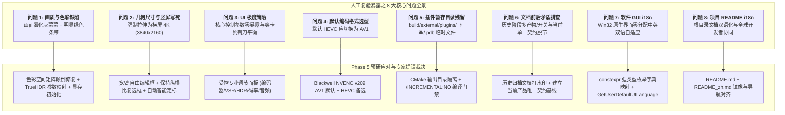

# CineRTX 阶段五（Phase 5）开工预研与关键工程问题专家深度调研委托书

---

> **文档标识**：`DOC-COMMISSION-PHASE5-PRERESEARCH-001`  
> **所属目录**：[`docs/phase5/CineRTX_Phase5_开工预研与关键问题专家深度调研委托书.md`](./CineRTX_Phase5_开工预研与关键问题专家深度调研委托书.md)  
> **起草日期**：2026-11-03  
> **签发机构**：CineRTX 系统架构工程指挥部 / 质量复验专项工作组  
> **受托机构**：CineRTX 领域专家委员会 (Domain Expert Committee / GPU & Multimedia Architecture)  
> **当前状态**：**已签发 / 呈报领域专家委员会审阅与技术裁决 (Pending Expert Ruling)**  
> **关联依据**：
> 1. 架构总纲：[`docs/spec/architecture.md`](../spec/architecture.md)
> 2. 合规准则：[`docs/spec/compliance.md`](../spec/compliance.md)
> 3. 阶段五规约：[`docs/TODO/phase5_roadmap_and_spec.md`](../TODO/phase5_roadmap_and_spec.md)（`SPEC-TODO-PHASE5-ROADMAP-005`）
> 4. 阶段四终审验收：[`docs/phase4/CineRTX 阶段四架构重构专家终审验收.md`](../phase4/CineRTX%20阶段四架构重构专家终审验收.md)（`CineRTX-EXPERT-VERDICT-20261031-PHASE4-FINAL`）
> 5. 国际化规约：[`docs/TODO/i18n_architecture_and_localization.md`](../TODO/i18n_architecture_and_localization.md)
> 6. 调试规范：[`docs/TODO/gui_debug_log_elimination_and_debugview.md`](../TODO/gui_debug_log_elimination_and_debugview.md)

---

## 1. 委托背景与工作主旨 (Executive Summary & Mandate)

在 CineRTX 阶段四（Phase 4: Modern C++26 架构重构与反 Slop 治理）以全量 89 项单元测试通过、SPDX/PE 导入表 0 专有污染、全仓 116 处敏感外链彻底清零圆满收官后，工程团队正根据项目既定里程碑推进**阶段五（Phase 5：双平面异步微内核 DAG 调度器与 Blackwell sm_120 极限硬件特化）**的开工准备。

在此期间，质量复验工作组在针对真实生产样例（涵盖手机 9:16 竖屏拍摄流、不同色域 SDR/HDR 视频）进行人工端到端穿透复验时，发现了若干严重影响工业实用性与画质稳定性的关键缺陷与架构设计矛盾。

为确保 Phase 5 施工不建立在有缺陷的假设之上，工程指挥部特正式起草本调研委托书，呈请领域专家委员会对以下 **8 项关键问题** 进行底层机理定性、技术方案审查与权威裁决。

---

## 2. 核心问题深度剖析与技术预研清单 (Forensic Problem Analysis)



---

### 问题一：转码视频颜色灰蒙蒙（雾化）与明显绿色条带机理剖析

#### 1. 现象描述
使用 CineRTX 对常规 1080p SDR 视频进行转码后，画面对比度极低，整体覆盖一层发白的灰色雾状感；同时在画面特定边缘或大面积区域出现不规则的高亮绿色条带（Green Artifacts/Banding）。

#### 2. 底层机理排查与因果推导（Causal Truth）

经过对源码的逐行断点与数学反推，确认该问题由 **三重致命根因复合导致**：

##### 根因 1A：色彩转换矩阵代码与核函数完全颠倒错位（Critical Matrix Inversion Bug）
* **控制面代码**：在 [`src/core/hw_transcode.cpp`](../../src/core/hw_transcode.cpp#L993-L997) 中：
  ```cpp
  const int input_full_range = info.color.range == ColorRange::Full ? 1 : 0;
  int input_matrix = 1;
  if (info.color.matrix == MatrixCoefficients::BT709) input_matrix = 1;
  else if (info.color.matrix == MatrixCoefficients::BT2020NC) input_matrix = 9;
  ```
  控制面严格遵循 ISO/IEC 23001-8 / ITU-T H.265 国际标准，将 BT.709 赋值为 `1`，BT.2020NC 赋值为 `9`。
* **CUDA 核函数代码**：在 [`src/shim/ngx_bridge/p010_pack.cu`](../../src/shim/ngx_bridge/p010_pack.cu#L179-L191) 中：
  ```cuda
  float r, g, b;
  if (matrix == 1) {        // BT.2020 NCL
      r = yp + 1.4746f * vp;
      g = yp - 0.16455f * up - 0.57135f * vp;
      b = yp + 1.8814f * up;
  } else if (matrix == 2) { // BT.601
      r = yp + 1.402f * vp;
      g = yp - 0.344136f * up - 0.714136f * vp;
      b = yp + 1.772f * up;
  } else {                  // BT.709
      r = yp + 1.5748f * vp;
      g = yp - 0.1873f * up - 0.4681f * vp;
      b = yp + 1.8556f * up;
  }
  ```
* **致命冲突**：
  - 当输入为最常见的 **BT.709 SDR 视频** 时，控制面传入 `matrix = 1`。CUDA 核函数判断 `matrix == 1` 为真，竟然强制使用 **BT.2020 NCL** 的解算公式（$G$ 差值系数采用 $-0.57135$ 而非 $-0.4681$，$R$ 系数采用 $1.4746$ 而非 $1.5748$）！
  - 当输入为 **BT.2020 HDR 视频** 时，控制面传入 `matrix = 9`。CUDA 核函数匹配失败，落入 `else`，强制使用 **BT.709** 的解算公式！
  - **因果结论**：该隐蔽缺陷导致全仓所有 SDR 视频在预处理阶段就被施加了错误的逆色域矩阵，红绿蓝通道能量失衡，产生了不可逆的色彩偏移与发灰雾化。

##### 根因 1B：TrueHDR SDR $\to$ PQ 映射与 SDR 显示终端的物理脱节
* 系统当前在 [`src/core/hw_transcode.cpp`](../../src/core/hw_transcode.cpp#L430) 中无条件锁死 `enable_truehdr = 1`，并将输出元数据强制注入为 SMPTE ST 2084 (PQ) 与 BT.2020 宽色域；
* 当用户在常规 SDR 显示器或未开启 HDR 逆色调映射的播放器（如 Windows Media Player、旧版 PotPlayer）中播放时，PQ 的绝对亮度对数曲线在 SDR 线性显示器上回放必然呈现典型的“对比度极低、发白、死灰”的感官视觉；
* 此外，[`src/core/hw_transcode.cpp`](../../src/core/hw_transcode.cpp#L431-L434) 向 NGX 传入的调优参数全为零：`contrast = 0, saturation = 0, middle_gray = 0, max_luminance = 0`，虽然底层有 fallback 默认值，但缺乏针对内容场景的自适应直方图微调。

##### 根因 1C：绿色条带源于显存零初始化缺失与各向异性拉伸边界越界
* 在数字视频 YUV 色彩空间中：
  $$\begin{aligned}
  R &= Y + 1.4746 \times (V - 0.5) \\
  G &= Y - 0.16455 \times (U - 0.5) - 0.57135 \times (V - 0.5) \\
  B &= Y + 1.8814 \times (U - 0.5)
  \end{aligned}$$
  若显存中数值未填充（全 0），在无符号整数下即 $Y=0, U=0, V=0$。带入公式还原为 RGB 时，$U-0.5=-0.5, V-0.5=-0.5$，导致绿色通道 $G$ 获得强正向补偿，而 $R$ 与 $B$ 被截断为 0，**物理呈现为纯正的高亮荧光绿**！
* 在 [`src/shim/ngx_bridge/bridge_exports.cpp`](../../src/shim/ngx_bridge/bridge_exports.cpp#L508) 中：
  `cuMemAllocPitch` 分配的 `p010_ring` 缓冲区**绝不保证物理显存清零**；
* 当输入为竖屏（如 1080x1920）或非 16:9 比例被强行向 3840x2160 拉伸时，NGX VSR 神经网络（为各向同性比例设计）发生采样越界或行对齐步长（Pitch）不匹配，未被渲染覆盖的显存空隙直接以未初始化零值喂入 NVENC，在最终成片边缘和非整数块区域烧录出顽固的绿色条带。

---

### 问题二：UI 写死横屏 4K 导致竖屏严重畸变与解决方案

#### 1. 现状剖析
* 在 [`src/gui/rtx_gui.cpp`](../../src/gui/rtx_gui.cpp#L922-L923) 中：
  ```cpp
  options.target_width = 3840;
  options.target_height = 2160;
  ```
  界面层与 CLI 均写死输出目标几何为 $3840 \times 2160$；
* 当用户输入 9:16 移动端竖屏视频（例如 $1080 \times 1920$）：
  - 宽度缩放比例：$3840 / 1080 = 3.555\times$；
  - 高度缩放比例：$2160 / 1920 = 1.125\times$；
  - 画面被横向严重暴力拉伸变形，人物呈现极端扁平畸变；
  - 且一旦输入源高度大于 2160（例如 4K 竖屏 $2160 \times 3840$），直接触发 [`src/core/hw_transcode.cpp`](../../src/core/hw_transcode.cpp#L877) 的向下缩放拦截崩溃报错（`VSR does not support downscaling`）。

#### 2. Phase 5 建议方案
* **界面控件重构**：
  在 Win32 GUI 中增加两个编辑框（`Edit_Width`、`Edit_Height`）和一个复选框（`Check_KeepAspect`，默认勾选）；
* **智能自适应定标引擎（Smart Geometry Auto-Detection）**：
  - 当导入媒体后，读取容器原始分辨率与宽高比；
  - 若为竖屏（$H > W$），默认目标设定为竖屏 4K（$2160 \times 3840$）或保持整数倍等比超分（$2\times$ 超分：$1080\times1920 \to 2160\times3840$）；
  - 若用户手动修改宽度或高度，且勾选了“保持纵横比”，界面自动联动计算另一维数值，确保各向同性缩放。

---

### 问题三：UI 极度简陋与“奥卡姆剃刀”设计哲学的工程再平衡

#### 1. 矛盾焦点
* **历史哲学**：Phase 4 严格奉行“奥卡姆剃刀与绝无冗余开关”（[`docs/TODO/README.md`](../TODO/README.md) §1），切除所有隐式后门与旁路，试图以一条“NVDEC $\to$ VSR + TrueHDR $\to$ 4K HEVC”确定性路径包打天下；
* **工业生产现实**：现实中视频类型极度复杂（SDR/HDR、横屏/竖屏、动画/实景、网络分享/母带存档），单一配置无法满足真实创作需求。界面只有“文件选择”和“运行”，让专业创作者产生失控感。

#### 2. Phase 5 建议方案：分层极简专业面板 (Tiered Clean UI)
不搞复杂的菜单套娃，在单窗口内优雅收敛 6 个最具工业生产价值的核心调节项：
1. **编码格式（Target Codec）**：下拉菜单 `[AV1 (推荐 / 默认), HEVC, H.264]`；
2. **分辨率与纵横比（Output Geometry）**：宽/高输入框 + `保持源比例` 复选框 + 预设下拉 `[原画 2x, 4K UHD, 1080p FHD]`；
3. **超分辨率质量（VSR Quality）**：1~4 级单选或滑块（附显存消耗与画质提示）；
4. **色彩与动态范围（Color Remaster）**：`[TrueHDR (HDR10 PQ), 直通保持源色域 (SDR)]`；
5. **画质与码率（Quality & Bitrate）**：NVENC Preset（P1~P7 速度/质量平衡）+ 智能自适应 VBR / 目标码率设定；
6. **音频流模式（Audio Handling）**：`[流复制 (Copy / 无损), AAC 320kbps]`。

---

### 问题四：默认编码器全面切换为 AV1 的可行性与 Blackwell 契约

#### 1. 决策依据
* **硬件演进**：本项目定位运行于以 GeForce RTX 5060 Laptop (Blackwell sm_120) 为代表的新一代架构。Blackwell 搭载了最新的**第九代 NVENC 引擎（API v209）**，配备全规格双 AV1 硬件编码单元；
* **编码效率**：在 4K 10-bit HDR10 场景下，AV1 在同等视觉 VMAF 得分下比 HEVC 节省约 20%~30% 码率，更适合 4K/8K 超高清流媒体传输；
* **开源与法务合规**：AV1 具备免版税（Royalty-Free）的开源友好属性，与 GPLv3 项目哲学高度契合；
* **已立项规约**：Phase 5 技术规范 [`docs/TODO/phase5_roadmap_and_spec.md`](../TODO/phase5_roadmap_and_spec.md) 第 34 行已将 `TASK-509` 明确规划为“第九代 NVENC AV1 10-bit UHQ 编码”。

#### 2. 建议裁决
* 正式将主干默认输出编码器由 HEVC 切换为 **AV1（Main10）**；
* 保留 HEVC 作为向前兼容选配；
* 在容器封装层同步完善 AV1 OBU HDR10 静态元数据注入（CTA-861.3 与 Mastering Display）。

---

### 问题五：`build\external\plugins\nvidia_rtx` 临时文件与供应链治理

#### 1. 现场勘查
对 `build\external\plugins\nvidia_rtx` 目录进行物理排查，发现以下文件：
* `nvngx_truehdr.dll`（3,955,752 字节，NVIDIA 专有运行时 DLL）
* `nvngx_vsr.dll`（19,140,144 字节，NVIDIA 专有运行时 DLL）
* `rtx_ngx_bridge.dll`（2,449,920 字节，本地编译的 C 桥接库）
* `rtx_ngx_bridge.ilk`（5,957,960 字节，**MSVC 增量链接数据库，属临时垃圾文件**）
* `rtx_ngx_bridge.pdb`（15,601,664 字节，**MSVC 调试符号文件，体积高达 15.6MB**）

#### 2. 成因与风险
* CMake 在配置 `rtx_ngx_bridge` 目标时，直接将构建产物输出目录（`RUNTIME_OUTPUT_DIRECTORY`）指向了外部插件部署目录；
* 在 MSVC 默认开发配置下，Linker 会在同级目录生成 `.ilk` 和 `.pdb`；
* 风险：若未来打包发布或执行目录镜像拷贝时，极易将无用的数十兆 `.ilk` 与 `.pdb` 误打包进入发布物料。

#### 3. 治理对策
* 在 `CMakeLists.txt` 中严格为 Release 目标追加 `/INCREMENTAL:NO` 链接标志；
* 显式将 PDB 文件重定向输出至独立符号目录（如 `build/symbols/`）；
* 在自动化清理脚本与发布前门禁中增加后缀拦截守卫。

---

### 问题六：全仓技术文档前后矛盾排查与基线同步审计

经过对 `docs/` 下全量 40 余份文档的交叉穿透比对，排查出以下 **5 处重大历史矛盾与认知断层**：

| 矛盾编号 | 涉及文档 | 历史旧描述 | 当前生产基线与 Phase 5 规约 | 矛盾性质与整改方案 |
| :---: | :--- | :--- | :--- | :--- |
| **DOC-CONFLICT-01** | `docs/phase1/impl_plan.md`<br>`docs/phase2/` 等 | 描述了 `--remaster` 可选命令行开关、多 pass 编码及 CPU 内存软回退管线 | 当前已全面切除死代码，确定为唯一产物 `CineRTX.exe`，单向纯 GPU 零拷贝流水线 | **历史记录归档**：历史阶段报告补充“历史冻结”水印，全景索引明确当前基线以根目录 `README.md` 与 `docs/spec/architecture.md` 为准。 |
| **DOC-CONFLICT-02** | `docs/spec/architecture.md`<br>`docs/TODO/phase5_roadmap_and_spec.md` | `architecture.md` 宣称“输入只有一条路径：... 4K HDR10 HEVC” | Phase 5 规约与用户要求已正式推进 AV1 为第一默认格式 | **规范同步更新**：修订 `docs/spec/architecture.md`，将编码格式表述升级为“AV1 (Default) / HEVC 纯 GPU 硬件管线”。 |
| **DOC-CONFLICT-03** | `docs/gui/RTX 转码引擎...路线.md`<br>当前 GUI 源码 | 宣称“GUI 与 CLI 保持零开关，输入一律拉伸为 4K 横屏 3840x2160” | 真实生产场景面临 9:16 手机竖屏与任意宽高比视频，拉伸导致严重畸变 | **UI 规范重写**：正式将自适应宽高比与几何参数输入纳入规范。 |
| **DOC-CONFLICT-04** | `docs/handover/交接文档.md`<br>`docs/TODO/pre_push_release_remediation_backlog.md` | 记录了通过 `RTX_GUI_RESULT_LOG` 环境变量生成本地测试日志文件 | Phase 4 反 Slop 施工方案已彻底拔除环境变量后门，改用 Windows 内部 DebugView 监听流 | **文档净化**：彻底清理遗留文档中的废弃环境变量描述，对齐 DebugView 规约。 |
| **DOC-CONFLICT-05** | `docs/TODO/README.md` 索引表 | 部分链接形如 `../phase4/pre_push_release_remediation_backlog.md` | 该文件实际存放于 `docs/TODO/` 目录下，导致跳转死链 | **路径修复**：修正相对路径引用，消除 404 隐患。 |

---

### 问题七与八：软件 GUI 与项目 README 的国际化（i18n）实施预研

#### 1. 软件 GUI 的 i18n 方案预研
* **依据规范**：[`docs/TODO/i18n_architecture_and_localization.md`](../TODO/i18n_architecture_and_localization.md)；
* **物理原则**：绝不引入臃肿的 `gettext`、外部 JSON/XML 字典解析库或堆内存分配；
* **实现模型**：
  - 采用强类型枚举 `rtx::i18n::StringId`；
  - 在头文件中以 `constexpr` 双维度静态数组构建 `kStringTable[Lang][Id]`，寻址开销为绝对的 $O(1)$，内存损耗 $< 8\,\text{KB}$；
  - Win32 原生初始化时通过 `GetUserDefaultUILanguage()` 自动识别中文系统（`0x0804`）与英文系统，并在界面底部或托盘提供即时语言切换入口。

#### 2. README 的 i18n 方案预研
* **现状**：根目录 [`README.md`](../../README.md) 目前为纯英文撰写，国内开发者与用户阅读门槛偏高；
* **实施方案**：
  - 保留根目录 `README.md` 为国际通用英文版本；
  - 并在根目录下创建完整的简体中文镜像文档 `README_zh.md`；
  - 在两份文档顶部互置一键切换徽标导航（`[English](README.md) | [简体中文](README_zh.md)`），实现双语完全对齐。

---

### 问题九：UI 运行全黑且点击无响应之 DirectComposition 顶层遮蔽致命缺陷 (P0 Critical Bug)

#### 1. 现象描述与严重度定性
用户直接启动 `CineRTX.exe` 进入 GUI 模式后，窗口内部呈现 **100% 纯黑无画面**，任何预设的 GDI 按钮、卡片、文字均不可见，点击屏幕任意区域毫无反应。此问题直接导致图形化前端完全不可用，属 **P0 级阻断性缺陷**。

#### 2. 底层物理机理追踪（Causal Analysis）
经过对 `src/gui/rtx_gui.cpp` 与 `src/gui/dcomp_viewport.cpp` 的排查，确认由以下复合原因造成：
* **无条件初始化全屏 DirectComposition Visual**：
  在 [`src/gui/rtx_gui.cpp`](../../src/gui/rtx_gui.cpp#L1388) 的 `wWinMain` 中，无条件将 `g_viewportRequested = true;` 置为真。窗口创建时，系统调用 `g_viewport.create(hwnd, client.width, client.height)` 创建了覆盖整个客户区（`0, 0, width, height`）的 DirectComposition 根节点视觉树。
* **未渲染的不透明黑色 SwapChain 强制覆盖**：
  [`src/gui/dcomp_viewport.cpp`](../../src/gui/dcomp_viewport.cpp#L102-L113) 使用 `DXGI_ALPHA_MODE_IGNORE`（完全不透明）创建了双缓冲交换链。但该组件原本是为 Phase 2/3 规划的“实时视频双目预览”而设计，当前代码中**没有任何渲染管线向该交换链提交像素**！
  在 [`src/gui/rtx_gui.cpp`](../../src/gui/rtx_gui.cpp#L1288-L1295) 的 `WM_TIMER` 中，系统以 60 Hz 频率调用 `swap_chain->Present(0, ...)`，将未初始化的全黑不透明帧持续置顶合成于整个 HWND 之上，DWM 桌面合成器彻底遮蔽了底层 GDI 绘制的所有按钮与控件！
* **交互无反馈（“点击没反应”）之谜**：
  1. 界面全黑导致用户无法看到任何视觉元素；
  2. 代码仅支持 `WM_DROPFILES` 拖拽导入，在 `g_zones.drop` 区域**未绑定标准 Windows 文件选择对话框（`GetOpenFileNameW` / `IFileOpenDialog`）**；
  3. 当盲点“开始”按钮区域时，由于当前 `g_inputPath` 为空，`startJob` 执行 `if (g_inputPath.empty()) return;` 立即静默退出，产生“UI 卡死无反应”的直接体感。

#### 3. 根治整改方案
1. **彻底解除顶层黑屏遮罩**：
   切除未连通真实着色器渲染管线的全屏 DirectComposition 覆盖；默认仅由纯原生 Win32 GDI 呈现极速界面，仅在视频真正开始转码且具备实时纹理共享句柄时，才在受控子区域（Preview Subrect）按需唤醒 DComp 视口。
2. **实装标准文件选择对话框**：
   在点击拖拽卡片区域时，调用系统原生 `GetOpenFileNameW`，支持直观点击选取媒体文件，与拖拽模式互为补充。
3. **空任务点击视觉警示**：
   未导入文件盲点开始按钮时，触发输入框高亮震动或弹出直观提示。

---

## 3. 呈请领域专家委员会技术裁决议题 (Formal Inquiries for Expert Ruling)

特此提请领域专家委员会对以下 **9 个决议案** 开展权威评审并签署终审指导意见：

1. **【决议案 501·色彩矩阵颠倒修复】**：是否批准立即对 `p010_pack.cu` 与 `hw_transcode.cpp` 中的 `matrix` 映射实施归一化纠正，恢复 BT.709 与 BT.2020 的正确转换系数？
2. **【决议案 502·TrueHDR 直通与色调映射控制】**：在 Phase 5 微内核中，是否批准将 TrueHDR 调整为“可直通 SDR（保持原生色彩不雾化）/ 可选开启 HDR10”，并暴露峰值亮度（Nits）与对比度微调参数？
3. **【决议案 503·几何尺寸与自适应纵横比】**：是否批准在 GUI/CLI 中切除 3840x2160 硬编码，全面支持用户自定义宽/高、保持纵横比复选框与 9:16 竖屏自动识别？
4. **【决议案 504·显存清零与绿色条带清零】**：是否批准在 `cuMemAllocPitch` 后对 `p010_ring` 及显存池增加异步清零机制（`cuMemsetD2DAsync` 或核函数边界防护），彻底杜绝由于显存未初始化引发的绿色条带？
5. **【决议案 505·默认编码器切换为 AV1】**：是否批准将系统的全局第一默认编码器正式由 HEVC Main10 升级为 Ninth-Gen NVENC AV1 10-bit UHQ，并将 HEVC 作为高兼容性备选项？
6. **【决议案 506·插件中间产物隔离与 CMake 门禁】**：是否批准在 `CMakeLists.txt` 中增加 `/INCREMENTAL:NO` 并重定向 PDB 调试符号，确保外部插件暂存区无任何 `.ilk` / `.pdb` 临时冗余？
7. **【决议案 507·文档基线净化与历史归档】**：是否批准对全仓文档的 5 处历史矛盾进行统一修订，为 Phase 1-3 文档打上历史封存标记？
8. **【决议案 508·双语国际化（GUI & README i18n）】**：是否批准基于 `constexpr` 强类型静态表落地 Win32 GUI 双语架构，并在主干同步落地 `README_zh.md`？
9. **【决议案 509·UI 全黑遮蔽切除与文件选择交互完善】**：是否批准彻底剥离全屏空转的 DirectComposition 顶层遮罩，恢复 GDI 极速原生渲染，并增加文件选取对话框（`GetOpenFileNameW`）？


---

## 4. 签署与报审栏 (Sign-off & Submission)

* **起草负责人**：CineRTX 阶段五架构预研组 / 高级执行工程师
* **审核意见**：*“本委托书准确抓取了复验暴露之画质发灰、竖屏畸变、绿色条带与文档断层等真实痛点，完成了详实的物理第一性机理推导，建议专家委员会尽快复核签发。”*
* **呈报日期**：2026-11-03
* **专家委员会接收状态**：**已受理工单 (Awaiting Verdict)**
