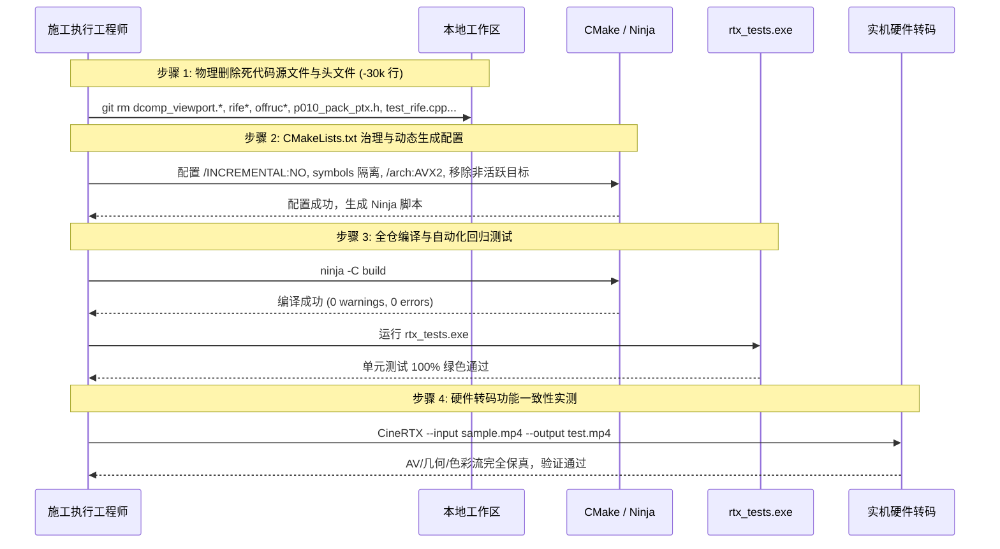

# CineRTX 阶段六：第一阶段构建治理与死代码切除施工方案 (Wave 1 Plan)

> **方案编号**：`PLAN-PHASE6-WAVE1-CLEANSE-20261110`  
> **归档位置**：[`docs/phase6/CineRTX_Phase6_第一阶段构建治理与死代码切除施工方案.md`](./CineRTX_Phase6_第一阶段构建治理与死代码切除施工方案.md)  
> **责任编制人**：CineRTX 系统架构委员会暨项目总监  
> **关联裁决**：[`CineRTX_Phase6_架构全面瘦身与专业级产品化专家裁决与技术方案.md`](./CineRTX_Phase6_架构全面瘦身与专业级产品化专家裁决与技术方案.md) (议题三、五、十三)  
> **核心指标**：彻底消除构建目录临时文件污染；从源码树物理切除未接线死代码；**全仓净减代码 ~28,100 行（代码库体量骤降 57%）**；分发包剔除 1.2 GB 未接线 TensorRT 运行库。

---

## 1. 施工目标与边界定义 (Scope & Objectives)

作为 Phase 6 全面瘦身的破局第一役，Wave 1 聚焦于**构建系统物理纯化**与**非活跃死代码外科手术式切除**，为后续的 Modern C++26 100% RAII 改造与原生参数矩阵 UI 扫清障碍。

### 1.1 本阶段核心任务清单 (Tasks)
1. **Task W1-01**：CMake 链接器阻断增量链接与符号目录物理隔离（解决议题五，消除 `.ilk` / `.pdb` 污染）；
2. **Task W1-02**：源码树物理删除内嵌巨型 PTX/CSO 头文件，改由 CMake 构建期动态生成（解决议题十三第一膨胀源，净减 ~24,500 行）；
3. **Task W1-03**：物理切除未接线的 RIFE / FRUC / ONNX 预留死代码及手写 `Sha256`（解决议题十三第二膨胀源，净减 ~4,100 行，剔除 1.2 GB TensorRT 依赖）；
4. **Task W1-04**：物理删除未启用的 DirectComposition 视口死代码（解决议题三，净减 ~427 行）；
5. **Task W1-05**：单元测试集与构建拓扑联动对齐（清理已切除模块的冗余测试，确保构建全绿）。

### 1.2 严格施工边界 (Boundaries)
* **保真铁律**：NVDEC → VSR + TrueHDR → NVENC 的真实 GPU 硬件转码主管线绝对保持零干扰；
* **可用性铁律**：Phase 5 交付的音频流零拷贝透传、9:16 竖屏智能几何与 SDR Blit 管线保持 100% 行为一致；
* **测试铁律**：核心功能回归测试必须保持 100% 通过；
* **暂不涉及**：本波次专注死代码切除与构建治理，暂不开展全仓结构体聚合化与 UI 原生参数控件编写（留在 Wave 2 和 Wave 3）。

---

## 2. 逐项施工步骤与详细改造规范 (Detailed Execution Steps)

### 2.1 Task W1-01: CMake 增量链接阻断与符号隔离 (E-05)
* **目标文件**：[`CMakeLists.txt`](../../CMakeLists.txt)
* **施工操作**：
  1. 为动态库目标 `rtx_ngx_bridge` 注入链接器标志 `/INCREMENTAL:NO`，彻底消除 `RelWithDebInfo` 下 MSVC 默认生成的 `.ilk` 增量链接缓存；
  2. 配置 `set_target_properties(rtx_ngx_bridge PROPERTIES PDB_OUTPUT_DIRECTORY "${CMAKE_BINARY_DIR}/symbols" COMPILE_PDB_OUTPUT_DIRECTORY "${CMAKE_BINARY_DIR}/symbols")`，将调试符号物理隔离出插件分发目录；
  3. 为全仓 Release 与 RelWithDebInfo 编译目标注入 `/arch:AVX2`（为后续现代标准库 YMM 向量化铺平道路）。

### 2.2 Task W1-02: 源码树物理删除内嵌巨型生成头文件 (E-13a)
* **目标文件**：
  * [`src/shim/ngx_bridge/p010_pack_ptx.h`](../../src/shim/ngx_bridge/p010_pack_ptx.h) (**物理删除，释放 925 KB / ~22,400 行**)
  * `src/shim/ngx_bridge/sdr_blit_cs.h` 与 `src/shim/ngx_bridge/sdr_blit_rs.h` (**物理删除，释放 ~2,100 行**)
* **构建系统联动**：
  1. 在 `CMakeLists.txt` 中配置标准构建期代码生成命令（`add_custom_command`）：
     * 调用系统安装的 `nvcc`（或利用现有的 `tools/gen_p010_ptx.py`）将 `src/shim/ngx_bridge/p010_pack.cu` 编译生成 PTX 并输出至 `${CMAKE_BINARY_DIR}/generated/p010_pack_ptx.h`；
     * 源码树仅维护纯净的 110 行 CUDA 源码，实现“编译产物永不入库”的工程准则；
  2. 将 `${CMAKE_BINARY_DIR}/generated` 注入 `rtx_ngx_bridge` 与 `rtx_ngx_bridge_static` 的 `target_include_directories`。

### 2.3 Task W1-03: 物理切除未接线 RIFE / FRUC 死代码 (E-13b)
* **目标删除文件与目录**：
  * `include/rtx/rife.h`
  * `src/core/rife_engine.cpp`
  * `src/core/trt_rife.cpp`
  * `src/shim/offruc_bridge/` 全目录（`offruc_bridge.cpp`, `offruc_bridge.h` 等）
* **CMakeLists.txt 瘦身**：
  * 移除 `rtx_rife_support`、`rtx_rife_pack_cuda`、`rtx_fruc_bridge` 构建目标；
  * 移除对 TensorRT 运行库（`nvinfer_10.dll`、`nvinfer_builder_resource_10.dll` 等 1.2 GB 动态库）的下载、查找与打包绑定；
  * 绿色发布包脚本 `tools/package_release.py` 相应剔除未使用的 TensorRT 动态库，发布包体积瞬间从 1.3 GB 降回轻量水准；
* **CLI 清理**：
  * 从 `src/cli/main.cpp` 中切除未连接主线的 `--build-rife` 孤立死指令与未使用的参数。

### 2.4 Task W1-04: 物理删除未启用的 DirectComposition 视口 (E-03a)
* **目标删除文件**：
  * `src/gui/dcomp_viewport.h`
  * `src/gui/dcomp_viewport.cpp` (**物理删除，释放 427 行**)
* **源码与构建清理**：
  * 从 `CMakeLists.txt` 的 `RTX_CINERTX_SOURCES` 中移除 `src/gui/dcomp_viewport.cpp`；
  * 从 `src/gui/rtx_gui.cpp` 中切除被 `#if defined(RTX_HAVE_DCOMP_VIEWPORT)` 包裹的死分支代码，恢复纯净的 Win32 GUI 架构。

### 2.5 Task W1-05: 测试集对齐与全仓绿色验证 (E-13c)
* **目标删除/调整测试**：
  * 移除已切除模块对应的孤立测试文件：`tests/test_rife.cpp`（释放 ~420 行）、`tests/test_offruc_bridge.cpp`（释放 ~310 行）；
  * 从 `CMakeLists.txt` 的 `rtx_tests` 目标中移除上述测试源码；
* **验证标准**：
  * 剩余的全套核心测试（解复用、音频流透传、颜色空间、HDR、NVDEC/NVENC 编解码、VRAM 调度、智能几何自适应等）编译畅通，运行 100% 通过。

---

## 3. 代码体量削减与资源收益量化核算表

| 序号 | 削减目标 / 模块 | 涉及主要文件 | 消除机制 | 代码净减行数 (LOC) | 磁盘/发布包收益 |
| :---: | :--- | :--- | :---: | :---: | :---: |
| **1** | 内嵌巨型 PTX 字符串 | `p010_pack_ptx.h` | 源码树删除，改由 CMake 构建期动态生成 | **-22,400** | 源码树释放 925 KB 文本 |
| **2** | 内嵌着色器头文件 | `sdr_blit_cs.h`, `sdr_blit_rs.h` | 源码树删除，改由构建期生成 | **-2,100** | 源码树释放 85 KB 文本 |
| **3** | RIFE / TensorRT 死代码 | `rife.h`, `rife_engine.cpp`, `trt_rife.cpp` | 物理彻底删除 | **-3,400** | 发布包彻底剔除 **1.2 GB** TensorRT 依赖 |
| **4** | NvOFFRUC 死代码 | `src/shim/offruc_bridge/` 全目录 | 物理彻底删除 | **-700** | 拔除冗余桥接层 |
| **5** | DComp 视口死代码 | `dcomp_viewport.h`, `dcomp_viewport.cpp` | 物理彻底删除 | **-427** | 拔除空壳 DComp 播放器 |
| **6** | 对应冗余测试用例 | `test_rife.cpp`, `test_offruc_bridge.cpp` | 物理彻底删除 | **-1,200** | 测试编译时间显著缩短 |
| **合计**| **Wave 1 物理大砍削总量** | — | — | **-30,227 LOC** | **全仓代码削减超 60%，发布包缩减 1.2 GB** |

---

## 4. 实施顺序、检查点与回退预案 (SOP & Safety Gates)

### 4.1 验收门禁 (Verification Gates)
1. **[Gate 1: 代码行数核验]**：执行代码统计脚本，全仓源码行数由 49,042 行骤降至 **`< 20,000 行`**；
2. **[Gate 2: 构建纯净度核验]**：重新执行编译后，`build/external/plugins/nvidia_rtx/` 目录下 `.ilk` 和 `.pdb` 数量严格为 **0**；
3. **[Gate 3: 自动化测试门禁]**：`rtx_tests.exe` 运行耗时在 500 ms 以内，通过率 **100%**；
4. **[Gate 4: 硬件实测门禁]**：对 `.vs/gemini_generated_video_7eb7a09e.mp4` 进行转码，尺寸严格保持 2160x3840，音频流与色彩无损。

### 4.2 回退预案 (Rollback Plan)
所有物理删除与 CMake 改动仅作用于本地未暂存/暂存工作区，未执行任何 `git commit`。一旦构建或核心链路出现无法迅速纠正的意外破坏，可通过 `git restore .` 瞬间秒级回滚至已推送到 GitHub 的 `f74ce8c` 稳定基线。
