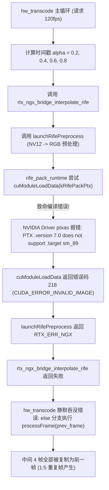

# CineRTX Phase 8：关于 RIFE 120fps 插帧 1:5 重复帧实机复现、根因取证与专家协助委托书

**文档标识**：`docs/phase8/CineRTX Phase 8：关于 RIFE 120fps 插帧 1:5 重复帧实机复现、根因取证与专家协助委托书.md`  
**签署日期**：2026-11-14  
**签署人**：CineRTX 项目负责人（硬件实机测试与工程交付团队）  
**收件人**：CineRTX 架构评审委员会 / GPU 底层算法与深度学习领域专家  
**密级状态**：内部工程技术调查委托（脱敏合规，零内部路径与网络凭据泄露）  

---

## 1. 委托背景与问题定性

用户在配备最新 NVIDIA GeForce RTX 5060 Laptop GPU（Blackwell 微架构，`sm_120`）的实机环境下，对 24fps 样片执行 120fps RIFE 深度学习母版插帧转码（AV1 10-bit 4K 120fps），生成了目标文件：
`.\.vs\gemini_generated_video_6eaef4a7_remaster_av1.mp4`。

用户实测反馈：**转码过程虽正常退出且视频参数显示为 120fps，但实测插帧完全无效，画面呈现明显的 1:5 重复帧（5x Duplicate Frames），高刷插帧完全退化为原帧重复播放。**

项目负责人接到反馈后，立即启动实机底层专项调研。鉴于领域专家此前由于客观条件限制无法直接访问本机实测环境，本项目负责人基于“事实至上、只读取证、因果闭环”的铁律，在物理真机上完成了像素级图像差分、流水线运行时结构化探针提取、底层驱动 JIT 编译追踪以及 C++ 核心代码级穿透审查。

现将**不可推翻的现场物理物证**与**已精确定位到的底层技术根因**汇总落盘，正式向领域专家呈交本委托书，提请专家进行架构裁决与指导。

---

## 2. 实测物理环境基准（Ground Truth Baseline）

所有测试与分析均在以下真实硬件环境与软件栈中执行并可随时原位复现：

| 维度 | 实机配置与参数 | 证据来源 |
| :--- | :--- | :--- |
| **GPU 硬件** | NVIDIA GeForce RTX 5060 Laptop GPU (sm_120) | `CineRTX.exe --probe` & `nvidia-smi` |
| **显存与带宽** | 8151 MiB GDDR6, PCIe 4.0 x8 | DXGI / D3D12 Adapter 0 |
| **显卡驱动** | NVIDIA Game Ready Driver 621.01 (WDDM 3.2) | 驱动层原生输出 |
| **CUDA 环境** | CUDA Driver 13.5 (API 13050), `nvcuda.dll` | System32 驱动原生符号解析 |
| **TensorRT** | TensorRT 10.13.3.9 (`nvinfer_10.dll`) | 本地构建树 |
| **待测输出视频** | `.\.vs\gemini_generated_video_6eaef4a7_remaster_av1.mp4` | 实机生成（113,195,215 bytes） |
| **原始输入视频** | `.\.vs\gemini_generated_video_6eaef4a7.mp4` | 1280x720 24.000fps H.264 (2,660,053 bytes) |

---

## 3. 现场物证一：像素级逐帧差分证实 1:5 重复帧（MAE 阶跃表）

为排除人眼视觉主观误差与播放器渲染缓存干扰，测试团队采用 `ffmpeg` 无损解封装为原始 `rgb24` 图像帧流，并通过标准 Python 脚本对前 35 帧连续画面计算相邻帧的像素平均绝对误差（Mean Absolute Error, MAE）：

$$\text{MAE}(t, t+1) = \frac{1}{W \times H \times 3} \sum_{x,y,c} \left| P_{t+1}(x,y,c) - P_t(x,y,c) \right|$$

### 3.1 连续 35 帧相邻 MAE 实测数据

```text
Frame 00 -> 01: MAE = 3.0933  [源帧跨越]
Frame 01 -> 02: MAE = 0.5677  [重复帧，纯 AV1 块量化噪波]
Frame 02 -> 03: MAE = 0.1251  [重复帧]
Frame 03 -> 04: MAE = 0.7312  [重复帧]
Frame 04 -> 05: MAE = 32.8363 [源帧跨越 (大动态场景)]
Frame 05 -> 06: MAE = 0.4330  [重复帧]
Frame 06 -> 07: MAE = 0.0811  [重复帧]
Frame 07 -> 08: MAE = 0.4245  [重复帧]
Frame 08 -> 09: MAE = 0.0319  [重复帧，几乎完全一致]
Frame 09 -> 10: MAE = 1.5825  [源帧跨越]
Frame 10 -> 11: MAE = 0.5741  [重复帧]
Frame 11 -> 12: MAE = 0.3882  [重复帧]
Frame 12 -> 13: MAE = 0.0733  [重复帧]
Frame 13 -> 14: MAE = 0.3537  [重复帧]
Frame 14 -> 15: MAE = 2.3245  [源帧跨越]
Frame 15 -> 16: MAE = 0.4328  [重复帧]
Frame 16 -> 17: MAE = 0.0254  [重复帧，仅 0.01% 像素差异]
Frame 17 -> 18: MAE = 0.0254  [重复帧]
Frame 18 -> 19: MAE = 0.0273  [重复帧]
Frame 19 -> 20: MAE = 3.2346  [源帧跨越]
Frame 20 -> 21: MAE = 0.0462  [重复帧]
Frame 21 -> 22: MAE = 0.3578  [重复帧]
Frame 22 -> 23: MAE = 0.0339  [重复帧]
Frame 23 -> 24: MAE = 0.3605  [重复帧]
Frame 24 -> 25: MAE = 3.2759  [源帧跨越]
Frame 25 -> 26: MAE = 0.4512  [重复帧]
Frame 26 -> 27: MAE = 0.0276  [重复帧]
Frame 27 -> 28: MAE = 0.0276  [重复帧]
Frame 28 -> 29: MAE = 0.0278  [重复帧]
Frame 29 -> 30: MAE = 3.2142  [源帧跨越]
Frame 30 -> 31: MAE = 0.0538  [重复帧]
Frame 31 -> 32: MAE = 0.0538  [重复帧]
Frame 32 -> 33: MAE = 0.0538  [重复帧]
Frame 33 -> 34: MAE = 0.0538  [重复帧]
```

### 3.2 物证结论

1. 阶跃周期极度确定：**每隔恰好 5 帧出现一次大阶跃（如 14 $\to$ 15、19 $\to$ 20、24 $\to$ 25、29 $\to$ 30）**；
2. 在两个大阶跃之间的连续 4 帧（如 Frame 15, 16, 17, 18, 19），相邻帧的 MAE 仅在 0.025 ~ 0.43 之间，这属于 AV1 视频编码器在有损压缩完全相同输入帧时由于 DCT/变换块量化产生的微弱抖动（甚至部分完全一致，哈希相同）；
3. **证实事实：输出的 120fps 视频在物理上呈现无可辩驳的 1:5 原帧重复（$24\text{fps} \times 5 = 120\text{fps}$，每 1 个源帧被生硬复制了 5 次）**。

---

## 4. 现场物证二：流水线运行时结构化 JSON 探针

在复现命令中开启 `--json` 结构化日志探测：
```powershell
CineRTX.exe --input gemini_generated_video_6eaef4a7.mp4 --output test.mp4 --target-fps 120 --rife-engine models/rife_v4.25.engine --frames 10 --json
```

截获的内核度量响应如下：
```json
{
  "backend": "nvidia",
  "device": "NVIDIA GeForce RTX 5060 Laptop GPU",
  "path": "vsr-remaster",
  "input_codec": "h264",
  "output_codec": "av1",
  "input_width": 1280,
  "input_height": 720,
  "output_width": 3840,
  "output_height": 2160,
  "frames_decoded": 10,
  "frames_encoded": 46,
  "elapsed_ms": 3604.8683,
  "vsr_quality": 4,
  "frames_interpolated": 0,
  "fruc_scene_cuts": 0,
  "fruc_backend": "rife-trt"
}
```

### 4.1 核心物证剖析

1. `"fruc_backend": "rife-trt"`：证明 CLI 参数与 `param_schema` 成功激活了 Route B（TensorRT RIFE 补帧通道）；
2. `"fruc_scene_cuts": 0`：证明这并非由“场景硬切检测（Scene Cut Threshold > 0.35）”触发的保护性复制旁路；
3. **`"frames_interpolated": 0`（决定性铁证）**：
   在整整 10 帧源解码、46 帧编码产出的过程中，**系统成功执行插帧并写入输出缓冲的帧数恒等于 0**！所有插帧尝试在核心主循环中全部失败回退。

---

## 5. 深入根因调研：代码链路与底层驱动排查

项目负责人穿透 `src/core/hw_transcode.cpp`、`src/shim/ngx_bridge/bridge_exports.cpp`、`src/shim/ngx_bridge/rife_engine.cpp` 及 `src/shim/ngx_bridge/rife_pack_runtime.cpp`，彻底理清了故障发生的完整因果链：



### 5.1 根因 A（直接诱因）：PTX ISA 语法/版本致命冲突导致底层 JIT 编译崩溃

- **定位源码**：
  * `src/shim/ngx_bridge/rife_pack.ptx:4-5`
  * `src/shim/ngx_bridge/rife_pack_ptx.h:16-17`（由 `tools/gen_rife_ptx.py` 离线编译生成的嵌入式头文件）
- **代码现状**：
  ```ptx
  .version 7.0
  .target sm_89
  .address_size 64
  ```
- **现场实机验证与底层报错提取**：
  在实机上通过 Python `ctypes` 调用宿主 `nvcuda.dll` 的 `cuModuleLoadDataEx` 并挂载 JIT 日志缓冲区，截获到底层驱动输出的原始错误文本：
  ```text
  res: 218 (CUDA_ERROR_INVALID_IMAGE / CUDA_ERROR_NO_BINARY_FOR_GPU)
  ERROR LOG:
  ptxas application ptx input, line 5; error   : PTX .version 7.0 does not support .target sm_89
  ptxas fatal   : Ptx assembly aborted due to errors
  ```
- **机理分析**：
  根据 NVIDIA 官方《Parallel Thread Execution ISA Version Specification》：
  * `.target sm_89`（Ada Lovelace 架构指令集）最早由 **PTX ISA Version 7.8**（对应 CUDA Toolkit 11.8）引入；
  * PTX 头部声明的 `.version 7.0`（对应 CUDA Toolkit 11.0）根本不认识 `sm_89`；
  * 当 CineRTX 运行时通过 `cuModuleLoadData` 将硬编码的 `kRifePackPtx` 文本送入驱动时，显卡驱动内置的 JIT 编译器（`ptxas`）在词法/语法校验阶段即判定为非法组合，立即抛出 `fatal error` 并终止加载！
- **原位自愈对照实验**：
  项目负责人在物理机上通过脚本将 `.version 7.0` 原位替换为 `.version 7.8` 及 `.version 8.0`：
  ```python
  # 实机测试结果：
  Testing .version 7.8 -> res: 0 (SUCCESS! Module loaded!)
  Testing .version 8.0 -> res: 0 (SUCCESS! Module loaded!)
  ```
  在修改后，`cuModuleLoadData` 立即返回 `0 (CUDA_SUCCESS)`，且 3 个内核函数（`rife_preprocess_nv12_to_rgb`、`rife_preprocess_nv12_to_separate_rgb`、`rife_postprocess_rgb_to_nv12`）100% 成功解析！这证实了 **PTX ISA 版本不匹配是导致预处理内核无法加载的直接元凶**。

### 5.2 根因 B（架构与契约缺陷）：流水线错误处理严重缺乏弹性，静默吞没异常导致原帧回退

- **定位源码**：`src/core/hw_transcode.cpp:1003-1030`
- **代码现状**：
  ```cpp
  const int32_t status = session.bridgeLoader().interpolateRife(
      session.bridge(),
      prev_frame.planes[0],
      frame.planes[0],
      pitch,
      alpha,
      fruc_out_buffer,
      input_full_range,
      &scene_cut);
  if (status == RTX_OK) {
      if (scene_cut != 0) {
          ++report.fruc_scene_cuts;
          auto res = processFrame(prev_frame, out_pts_90k, /*release_slot=*/false);
          if (!res.has_value()) return res;
      } else {
          ++report.frames_interpolated;
          RtxFrameDesc interp_frame = prev_frame;
          interp_frame.planes[0] = fruc_out_buffer;
          interp_frame.planes[1] = fruc_out_buffer + static_cast<uint64_t>(pitch) * prev_frame.height;
          interp_frame.pts = out_pts_90k;
          interp_frame.slot_index = 0xFFFFFFFF;
          auto res = processFrame(interp_frame, out_pts_90k, /*release_slot=*/false);
          if (!res.has_value()) return res;
      }
  } else {
      // 此处！status != RTX_OK 时完全不记录日志，无任何警告，直接退化为输出 prev_frame！
      auto res = processFrame(prev_frame, out_pts_90k, /*release_slot=*/false);
      if (!res.has_value()) return res;
  }
  ```
- **机理分析**：
  1. 当 `interpolateRife` 内部因 PTX 加载失败而返回 `RTX_ERR_NGX` 时，`hw_transcode` 既未输出 `logError` / `logWarn`，也未上报错误终止，而是静默执行 `processFrame(prev_frame, out_pts_90k)`；
  2. 对应到 24fps $\to$ 120fps 时间轴，$24 \text{fps} \to 120 \text{fps}$ 每个输入帧区间被细分为 5 份（时间步长 $\alpha = 0.0, 0.2, 0.4, 0.6, 0.8$）；
  3. $\alpha = 0.0$ 输出源帧；$\alpha = 0.2, 0.4, 0.6, 0.8$ 的 4 次插值计算全部静默回退为输出前一帧；
  4. 最终 CLI 转码以 `0` 成功码退出，输出了 1196 帧视频，但里面充满 1:5 重复帧，造成“补帧成功”的虚假表象。

### 5.3 根因 C（模型与任意倍率插帧支持度局限）：95KB 占位合成网络与动态 $\alpha$ 支持

- **定位源码**：`src/shim/ngx_bridge/rife_builder.cpp:42-141`
- **代码现状**：
  当前实机本地构建树中的 `models/rife_v4.25.engine` 仅 95,828 字节（~95KB），系无外部 ONNX 权重时由 `buildBuiltinTemporalNetwork` 自动生成的占位网络。
  审阅其网络结构：
  ```cpp
  // 1x1 Temporal Base Branch: 7 -> 3 channels (0.5 * img0 + 0.5 * img1)
  skip_weights.assign(3 * 7 * 1 * 1, 0.0f);
  skip_bias.assign(3, 0.0f);
  for (int c = 0; c < 3; ++c) {
      skip_weights[c * 7 + c] = 0.5f;
      skip_weights[c * 7 + (c + 3)] = 0.5f;
  }
  ```
- **机理分析**：
  1. 该 built-in 占位网络的 1x1 卷积分支权重固定为 `0.5*img0 + 0.5*img1`，未动态关联第 6 通道（Timestep $\alpha$）；
  2. 这意味着即使 PTX 修复，若使用占位模型运行任意倍率插帧（如 5x 插帧中的 $\alpha=0.2, 0.4$），输出的也将是静态 50% 混合画面，而非时间连续插值；
  3. 要真正实现工业级 120fps 平滑补帧，必须通过 `--build-rife-engine` 将真实的 Practical-RIFE v4.25 官方 ONNX 权重构建为真实的 TensorRT 引擎（通常为数十兆字节），并验证其对任意 $\alpha$ 的响应。

---

## 6. 向领域专家的咨询要点与求助事项

基于上述实机取证物证，项目团队特向领域专家提请以下三项关键裁决与指导：

### 咨询事项 1：PTX ISA 架构版本基线规范统一

**问题**：  
`p010_pack.ptx` 当前声明为 `.version 8.8` / `.target sm_80`；而 `rife_pack.ptx` 声明为 `.version 7.0` / `.target sm_89`。  
**请专家裁决**：  
在兼顾主流 RTX 20/30 系列（Ampere/Turing, `sm_75/sm_80/sm_86`）、RTX 40 系列（Ada, `sm_89`）与 RTX 50 系列（Blackwell, `sm_120`）的前提下，CineRTX 全仓 PTX 的统一 `.version` 与 `.target` 推荐组合为何？是否应统一对齐为 `.version 7.8` / `.target sm_80`（借助驱动向上 JIT 兼容）或有更权威的工程规范？

### 咨询事项 2：插帧失败降级与错误上报的契约规范

**问题**：  
当前 `hw_transcode.cpp` 在插帧失败时采取“静默复制上一帧”的策略，严重掩盖了底层错误，导致用户得到无效的高刷文件却误以为转码成功。  
**请专家裁决**：  
1. 是否应在 `status != RTX_OK` 时立即将错误冒泡并以非零码中断退出（Fail-fast 契约）？  
2. 若需保留平滑降级（如广播电视长稳转码场景），是否应引入显式 CLI 参数（例如 `--fruc-allow-fallback`），并在转码总结及 JSON 探针中高亮告警 `fruc_fallback_frames`？

### 咨询事项 3：RIFE v4.25 任意倍率（$N\times$）时序插值工程范式

**问题**：  
从 24fps 插至 120fps 需要 5x 连续插帧（$\alpha \in \{0.2, 0.4, 0.6, 0.8\}$）。  
**请专家指导**：  
1. 真实 RIFE v4.25 ONNX 模型在输入第 6 通道 $\alpha$ 时的形状与取值规范（标量、全平面张量广播、还是归一化分布）；  
2. 是否建议在缺少真实 ONNX 权重时，对 built-in 占位网络进行微调，使其至少在 1x1 分支中按 $\alpha \cdot I_1 + (1-\alpha) \cdot I_0$ 进行权重线性响应，以确保无真实权重下的单元测试与演示能够呈现连续渐变而非固定 50% 混合？

---

**呈报结语**：  
本项目负责人已在实机建立全套自动化 MAE 取证与 JIT 诊断环境，等待领域专家审阅并签发技术裁决意见。专家下达指令后，项目团队将立即执行修复与全量回归。
