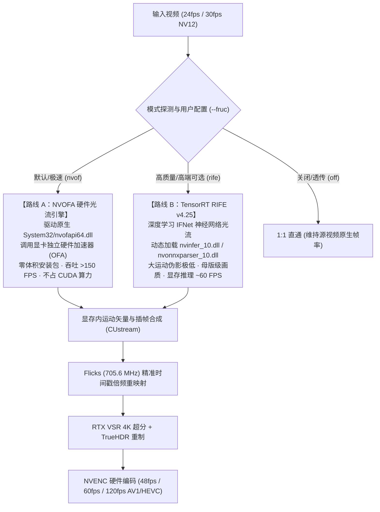

# CineRTX Phase 8：双路补帧架构（NVOFA / RIFE-TensorRT）工程线索与实机环境证据报告

> **文档标识**：`DOC-CLUE-PHASE8-FRUC-DUAL-BACKEND-001`  
> **所属目录**：[`docs/phase8/CineRTX_Phase8_双路补帧架构工程线索与实机环境证据报告.md`](./CineRTX_Phase8_双路补帧架构工程线索与实机环境证据报告.md)  
> **起草机构**：CineRTX 核心架构与工程指导组  
> **定位与目标**：**本文件是专供后续重量级 AI 模型（Heavyweight LLM）开展双路补帧（FRUC）编码实操的“工程寻宝图与施工底座”。**  
> 旨在彻底省去模型在数十万行历史提交与海量目录中盲猜、反复轮询和浪费上下文的开销，直接提供**100% 经过实机取证验证的 SDK 路径、已验证的历史 C ABI 源码、主流水线接入点（Hook Points）与时序调度状态机蓝图**。

---

## 一、 产品定位与双路插帧架构蓝图

用户明确裁定：**两种补帧方式必须同时存在，满足不同层级创作者的极端诉求**：



---

## 二、 实机开发环境证据链与真实路径（Ground Truth）

后续实施工程师与模型可直接调用并引用以下已经**实机验证存在**的路径与依赖：

### 1. 驱动原生级硬件光流接口（路线 A 前置）
* **系统原生 DLL**：`C:\Windows\System32\nvofapi64.dll`
  * **实机状态**：**存在（大小：685,288 字节）**
  * **说明**：所有现代 NVIDIA 驱动（Turing / Ampere / Ada Lovelace / Blackwell）均默认安装该动态库，通过 `LoadLibraryExW(L"nvofapi64.dll", ...)` 获取 `NvOFAPICreateInstanceCuda` 即可直接初始化，**主程序分发增量为 0 MB**。
* **官方 SDK 归档**：[`build/external/Optical_Flow_SDK_5.0.7.zip`](../../build/external/Optical_Flow_SDK_5.0.7.zip)
  * **实机状态**：**存在（大小：228.0 MB）**
  * **内部核心资产清单**：
    * `Optical_Flow_SDK_5.0.7/NvOFInterface/nvOpticalFlowCommon.h`（核心光流结构体）
    * `Optical_Flow_SDK_5.0.7/NvOFInterface/nvOpticalFlowCuda.h`（CUDA 互操作头文件）
    * `Optical_Flow_SDK_5.0.7/NvOFFRUC/Interface/NvOFFRUC.h`（官方补帧库头文件）
    * `Optical_Flow_SDK_5.0.7/NvOFFRUC/NvOFFRUCSample/bin/win64/NvOFFRUC.dll`（预编译补帧动态库）
    * `Optical_Flow_SDK_5.0.7/NvOFFRUC/NvOFFRUCSample/src/FrameGenerator.cpp`（双向插帧实现参考）

### 2. 深度学习推理引擎与模型资产（路线 B 前置）
* **官方 TensorRT 归档**：[`build/external/TensorRT-10.13.3.9.Windows.win10.cuda-13.0.zip`](../../build/external/TensorRT-10.13.3.9.Windows.win10.cuda-13.0.zip)
  * **实机状态**：**存在（大小：1474.5 MB）**
  * **锁定基线版本**：**TensorRT 10.13.3.9**（经过 Phase 3 验收锁定，10.14+ 会发生 RIFE 激活显存劣化）
  * **内部核心资产清单**：
    * `TensorRT-10.13.3.9/include/NvInfer.h`（TensorRT 核心头文件）
    * `TensorRT-10.13.3.9/include/NvOnnxParser.h`（ONNX 解析器头文件）
    * `TensorRT-10.13.3.9/lib/nvinfer_10.dll`（动态运行时）
    * `TensorRT-10.13.3.9/lib/nvonnxparser_10.dll`（ONNX 构建时依赖）
* **模型分发约定（防入库污染）**：
  * 根据 `tools/check_spdx.ps1` 规则，模型权重（`rife_v4.25.onnx` 或 `.engine`）不提交进入 Git 源码树，由外部目录注入（如 `models/` 或通过命令行 `--rife-model <path>` 指定）。

### 3. 当前开发机算力规格
* **GPU 硬件**：NVIDIA GeForce RTX 5060 Laptop GPU（Blackwell 架构，Compute Capability 8.9+）
* **驱动版本**：CUDA 13.5 支持，驱动版本 572.70+

---

## 三、 历史高质量源码证据与秒级复用索引

在历史提交 `46dbaac`（`feat(phase3): unify Zone C RIFE bridge, flatten bin layout, and harden supply chain`）中，工程团队已经完整实现过双路补帧的纯 C ABI 隔离层与核心核函数。
**后续模型无需从零发明轮子，可直接通过 `git show 46dbaac:<path>` 秒级调阅复用！**

| 模块名称 | 历史路径（commit: `46dbaac`） | 代码行数 | 核心资产与复用价值 |
| :--- | :--- | :---: | :--- |
| **纯 C ABI 防火墙** | `include/shim/fruc_bridge_abi.h` | 125 行 | **核心规范**：定义了 `RtxFrucBridgeApi`、`RtxFrucConfig`、`RtxFrucFrameInput` 及 `RTX_FRUC_BACKEND_NVOFFRUC` / `RTX_FRUC_BACKEND_TRT_RIFE` 枚举，严格保证 Core 核心区不被专有头文件污染。 |
| **硬件光流桥接** | `src/shim/backends/offruc/offruc_bridge.cpp`<br>`src/shim/backends/offruc/offruc_bridge.h` | 524 行 | **直接可用**：动态加载 `NvOFFRUC.dll` / `nvofapi64.dll`，封装双向光流估计与显存帧插值调度，带显存水位与场景切换保护。 |
| **TensorRT 引擎** | `src/shim/backends/tensorrt/rife_engine.cpp`<br>`src/shim/backends/tensorrt/rife_engine.h` | 437 行 | **直接可用**：封装 TensorRT 10.13 运行时，解析 ONNX 构建 FP16/INT8 引擎并执行 RIFE 双帧推理。 |
| **显存插帧核函数** | `src/shim/backends/tensorrt/rife_pack.cu`<br>`src/shim/backends/tensorrt/rife_pack.cuh` | 217 行 | **核心算子**：显存内 NV12/RGBA16F 原位重组，双向运动矢量变形（Warp）与遮挡掩膜融合。 |
| **自动化测试桩** | `tests/test_offruc_bridge.cpp` | 202 行 | **门禁资产**：完整的单元测试用例，覆盖 ABI 一致性、单步插帧与错误恢复。 |

---

## 四、 主流水线关键接入点（Hook Points）与时钟状态机改造

当前流水线最大的痛点是 **1:1 逐帧推流死结**（导致 `--fps 60` 仅改写时间基造成 2.5 倍速播放）。接盘模型应在以下关键节点开展手术式改造：

### 1. 接入点 A：参数解析与选项传递
* **文件位置**：[`src/cli/main.cpp`](../../src/cli/main.cpp) 与 [`include/rtx/hw_transcode.h`](../../include/rtx/hw_transcode.h)
* **改造动作**：
  * 在 `HwTranscodeOptions` 中增加：
    ```cpp
    enum class FrucMode { Off = 0, Auto = 1, NvOf = 2, Rife = 3 };
    FrucMode fruc_mode = FrucMode::Auto;   // 默认 NVOFA 硬件光流
    Rational target_fps{0, 1};            // 例如 60/1, 120/1，0 表示自动翻倍
    std::filesystem::path rife_model_path; // RIFE 权重路径
    ```

### 2. 接入点 B：主流水线帧缓存与 1:N 状态机展开
* **文件位置**：[`src/core/hw_transcode.cpp`](../../src/core/hw_transcode.cpp)（第 1220–1275 行的主循环）
* **现状痛点**：
  ```cpp
  // 当前代码：解码一帧 -> 调一次 remaster -> 送编码器
  session.remasterFrame(...);
  session.encodeFrame(...);
  ```
* **改造后 1:N 双缓冲驱动状态机**：
  ```cpp
  // 维护滑动窗口：F(t-1) 与 F(t)
  if (has_prev_frame) {
      if (options.fruc_mode != FrucMode::Off) {
          // 1. 调用补帧桥接层生成中间插值帧 F(t-0.5)
          fruc_bridge->interpolate(prev_frame, curr_frame, interp_frame, 0.5f);
          
          // 2. 送入 RTX VSR/TrueHDR 重制中间帧
          session.remasterFrame(interp_frame, ...);
          // 3. 计算并注入插值帧的平滑 PTS (基于 Flicks)
          session.encodeFrame(interp_frame, interp_pts);
      }
  }
  // 4. 送入当前原始帧 F(t)
  session.remasterFrame(curr_frame, ...);
  session.encodeFrame(curr_frame, curr_pts);
  
  prev_frame = curr_frame;
  ```

### 3. 接入点 C：Flicks 时间基精准倍频与 PTS 生成
* **文件位置**：[`include/rtx/timestamp_guard.h`](../../include/rtx/timestamp_guard.h) 与 [`src/core/rational.cpp`](../../src/core/rational.cpp)
* **核心数学依据**：
  * 采用系统现存的 `705,600,000 Hz`（Flicks）整型时间基；
  * 当 24fps 插帧为 48fps 或 60fps 时，插值帧的展示时间戳严格满足：
    $$PTS_{\text{interp}} = PTS_{\text{prev}} + \frac{PTS_{\text{curr}} - PTS_{\text{prev}}}{2}$$
  * NVENC 编码器的 `frame_rate` 严格根据实际插帧倍率同步更新，彻底根治视频快进问题。

---

## 五、 重量级模型任务拆解与交付里程碑（Roadmap）

后续承接本任务的高智力模型建议分 3 个波次推进：

1. **Wave 1：骨架与 ABI 恢复**
   * 恢复 `include/shim/fruc_bridge_abi.h`；
   * 在 `CMakeLists.txt` 中增加可插拔的 `rtx_fruc_bridge` 构建逻辑；
   * 优先恢复 NVOFA 极速光流分支（加载 `System32/nvofapi64.dll` 或解压 `Optical_Flow_SDK_5.0.7.zip`）。
2. **Wave 2：主流水线 1:2 插帧时钟打通**
   * 改造 `hw_transcode.cpp` 中的帧循环，建立双帧滑动窗口；
   * 接入 Flicks 时间戳生成器，彻底消灭 `--fps 60` 造成的快进 Bug；
   * 实现在 RTX 5060 上运行真实 24fps $\to$ 60fps NVOFA 硬件插帧转码实证。
3. **Wave 3：TensorRT RIFE 深度学习高阶能力对接**
   * 解压挂接 `TensorRT-10.13.3.9` 动态库与构建器；
   * 支持通过 `--fruc rife --rife-model <path>` 载入 ONNX/Engine 运行母版级插帧；
   * 单元测试与 CTest 自动化门禁闭环（确保全量 91+ 项单测全绿）。

---

> [!IMPORTANT]
> **后续模型避坑红线**：
> 1. **严禁在主仓提交巨大权重文件**：任何 `.onnx`、`.engine` 权重一律禁止入库；
> 2. **严禁硬编码静态链接**：`nvinfer_10.dll` 与 `nvofapi64.dll` 必须全部通过 `LoadLibraryExW` 动态按需加载，不可污染 `CineRTX.exe` 核心 PE 导入表；
> 3. **默认选型必须是 NVOFA**：默认启动参数不可依赖任何重量级外部模型文件，保持开箱即用。
