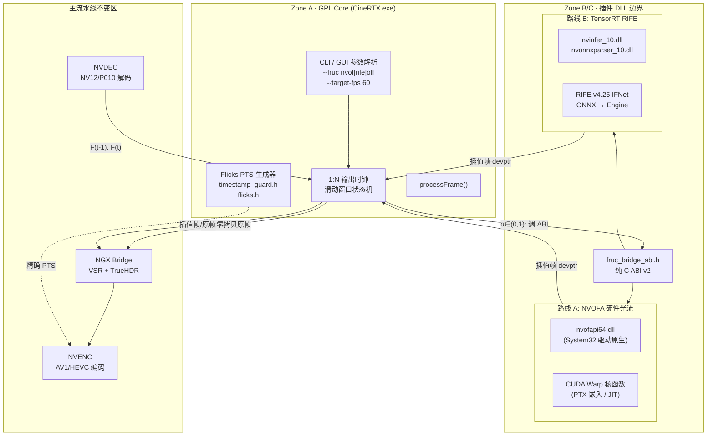
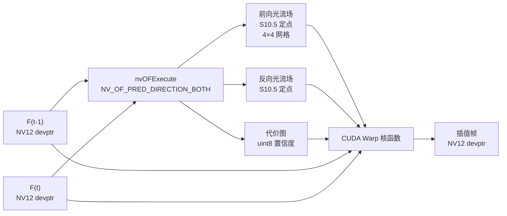
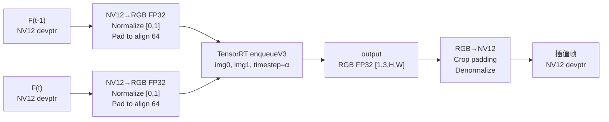
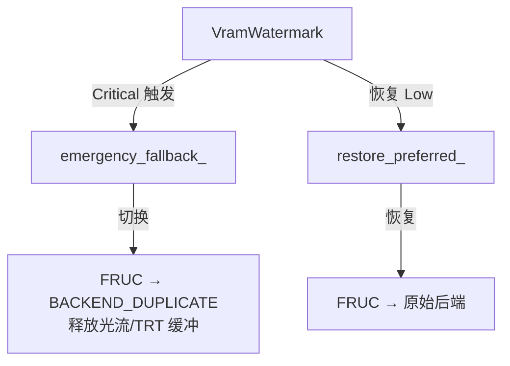
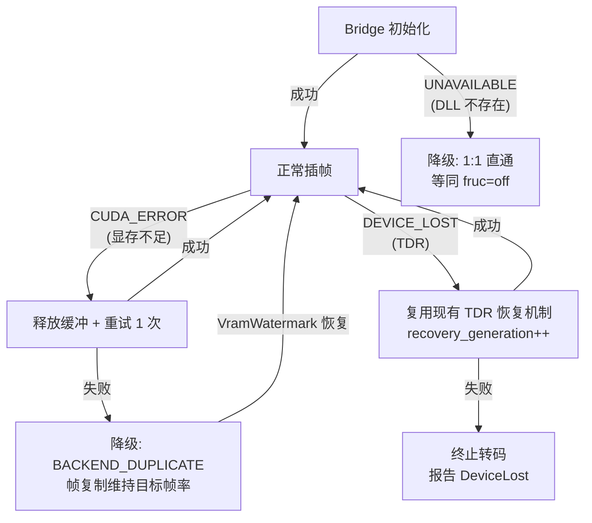

# CineRTX Phase 8：双路补帧（FRUC）架构设计

> **文档标识**：`ARCH-PHASE8-FRUC-DUAL-PATH-001`
> **定位**：纯架构层面的设计推演。不涉及编码实现，仅定义边界、职责、数据流、状态机与分层契约。

---

## 〇、设计原则

| # | 原则 | 在本设计中的体现 |
|---|------|-----------------|
| 1 | **最小侵入** | 现有 `hw_transcode.cpp` 主循环结构不拆、不重写；补帧作为可选的"帧倍增器"嵌入循环内部 |
| 2 | **ABI 防火墙** | GPL Zone A 核心永不 `#include` 任何 NVIDIA 专有头文件。所有 FRUC 交互通过纯 C ABI (`fruc_bridge_abi.h`) |
| 3 | **零静态链接** | `nvofapi64.dll`、`nvinfer_10.dll`、`nvonnxparser_10.dll` 全部 `LoadLibraryExW` 动态加载 |
| 4 | **默认零依赖** | `FrucMode::Auto` 选中 NVOFA（驱动原生），不要求任何外部模型文件 |
| 5 | **整数时间基** | 所有 PTS 计算在 Flicks（705,600,000 Hz）域内完成，`int64_t` 精确整除，零浮点漂移 |

---

## 一、架构总览



> [!IMPORTANT]
> 插帧桥接层位于 NVDEC **之后**、NGX Bridge（VSR + TrueHDR）**之前**。插值帧与原始帧都经过完整的超分与 HDR 重制链路，保证画质一致性。

---

## 二、分层架构与职责划分

### 层级 0：参数解析层

**所在文件**：`src/cli/main.cpp`、`include/rtx/hw_transcode.h`

**改造内容**：在 `HwTranscodeOptions` 中追加以下字段：

| 字段 | 类型 | 语义 | 默认值 |
|------|------|------|--------|
| `fruc_mode` | `enum class FrucMode { Off, Auto, NvOf, Rife }` | 补帧路线选择。`Auto` 探测驱动优先映射至 `NvOf` | `FrucMode::Off` |
| `target_fps` | `Rational` | 目标帧率。`{0,1}` 表示自适应翻倍 | `{0, 1}` |
| `rife_model_path` | `std::filesystem::path` | RIFE 权重路径（仅 Rife 模式） | `""` |
| `fruc_scene_threshold` | `int` | 场景硬切拦截代价阈值（0~255） | `160` |

> [!NOTE]
> 1. **`Auto` 探测策略**：探测驱动原生 `nvofapi64.dll` 是否可加载且支持当前架构。可加载 → 启用 `NvOf`；不可加载且 `--rife-model` 路径有效 → 启用 `Rife`；均不可用 → 自动降级为 `Off`（1:1 直通）并记录警告日志。
> 2. **`target_fps` 决策闭环**：当 `fruc_mode != Off` 时，若未指定 `--target-fps` 或指定为 `0`：
>    - 输入源帧率 $\le 30$ fps（如 23.976 / 24 / 25 / 30 fps）：自动 2× 翻倍（对应 47.952 / 48 / 50 / 60 fps）；
>    - 输入源帧率 $> 30$ fps（如 50 / 59.94 / 60 fps）：若未显式指定，保持原生直通或根据显式指定的 `--target-fps 120` 精准对齐；
>    - 用户显式指定（如 `--target-fps 60`）：严格以指定帧率作为输出时钟驱动累加，覆盖任意输入帧率（例如 24 → 60 的 2.5× 插值）。

---

### 层级 1：输出时钟驱动的滑动窗口状态机

**所在文件**：`src/core/hw_transcode.cpp`（主循环内部）

这是整个架构的**核心状态机**。当前代码的致命缺陷是 **1:1 逐帧推流**：解码一帧 → 重制 → 编码一帧。`--fps 60` 仅改写 NVENC 时间基却不增加帧数，导致 2.5× 快进。

#### 状态机模型

```mermaid
stateDiagram-v2
    [*] --> WaitFirstFrame

    WaitFirstFrame --> SlidingWindow : 收到 F(0)

    SlidingWindow --> EmitOutputs : 收到 F(t), 形成 [F(t-1), F(t)] 窗口
    EmitOutputs --> CheckPhase : 初始化 next_out_pts

    CheckPhase --> EmitOriginal : α == 0.0 或 α == 1.0
    CheckPhase --> EmitInterpolated : α ∈ (0.0, 1.0)

    EmitOriginal --> AdvancePTS : remaster + encode
    EmitInterpolated --> CallFRUC : 调用 fruc_bridge interpolate()
    CallFRUC --> AdvancePTS : remaster(interp) + encode

    AdvancePTS --> CheckPhase : next_out_pts += delta_out; 仍在 [t0, t1) 内
    AdvancePTS --> SlidingWindow : next_out_pts >= t1, 滑窗前进
    SlidingWindow --> [*] : EOS
```



#### 关键不变量

1. **双帧滑动窗口**：始终维护 `prev_frame`（NV12 devptr）和 `curr_frame`（NV12 devptr）。首帧到来时仅缓存，不产生插值。
2. **输出时钟驱动**：核心循环是 `while (next_out_pts < t1)`，由目标帧率的 Flicks 步长 `delta_out` 累加驱动。
3. **α 精确计算**：

$$\alpha = \frac{\text{next\_out\_pts} - t_0}{t_1 - t_0}$$

所有运算均为 `int64_t` 除法 → `float` 单精度（满足 S10.5 或 RIFE `timestep` 的精度需求）。

4. **α = 0 / α = 1 零拷贝**：当输出时间戳精确命中原始帧时，不调用补帧算子，直接复用原帧 devptr，**无损保留原画细节**。
5. **显存租约生命周期（Surface Lease Invariant）**：
   - 现存 `hw_transcode.cpp` 在处理完原始帧后立即执行 `session.releaseDecodedFrame(frame.slot_index)`；
   - 在滑动窗口中，当前帧 $F(t)$ 在进入下一轮滑窗前必须作为 $F(t-1)$ 参考帧继续存活。因此**严禁立即释放当前槽位**；
   - **所有权延期释放模型**：
     - 首帧 $F(0)$ 抵达：持有其 `slot_index` 租约，不释放；
     - 帧 $F(t)$ 抵达：与 $F(t-1)$ 形成窗口完成插帧与输出。当输出时间推进至 $next\_out\_pts \ge t_1$ 时，滑窗推进：
       ```cpp
       if (has_prev_lease) {
           (void)session.releaseDecodedFrame(prev_frame.slot_index); // 释放旧槽位
       }
       prev_frame = curr_frame; // 租约转移给新的 prev_frame
       has_prev_lease = true;
       ```
     - 解码环最大持有槽位数为 2（`prev` 与 `curr`），NVDEC 配置了 `max_surfaces = 32`，完全处于安全运行域，零撕裂且永不饥饿。
6. **边界确界与 EOS（流结束）排水（Drain）机制**：
   - **单帧/零帧极端情况**：若视频仅有 1 帧或 0 帧，滑动窗口不触发插值，直接 1:1 直通输出并释放槽位；
   - **EOS 尾帧收敛**：当解码器 EOF 触发 `drainFrames(end_of_stream = true)`：
     - 此时最后一个有效帧为 $F_{\text{last}}$，若 $next\_out\_pts \le t_{\text{last}}$，在 $\alpha = 1.0$ 处直接直通发射 $F_{\text{last}}$；
     - 发射完毕后，强制释放持有的尾帧租约 `releaseDecodedFrame(last_slot)`；
     - 通知编码队列进入 `finishPipeline()`，确保总输出时长在 Flicks 整数域内与音频流精准闭环（误差严格 $< 0.5$ 帧周期）。
   - **异常与 TDR 恢复清理**：若发生设备丢失或转码取消，析构函数或 TDR 重建块中必须清空滑动窗口并释放 `prev_frame.slot_index`，杜绝 NVDEC 显存泄漏。

#### 典型倍率分析

| 转换 | 输入步长 (Flicks) | 输出步长 (Flicks) | 每对输入帧产出 | α 序列 |
|------|-------------------|-------------------|---------------|--------|
| 24 → 48 (2×) | 29,400,000 | 14,700,000 | 2 帧 | 0.0, 0.5 |
| 24 → 60 (2.5×) | 29,400,000 | 11,760,000 | 2 或 3 帧 | 0.0, 0.4, 0.8 / 0.2, 0.6 交替 |
| 30 → 60 (2×) | 23,520,000 | 11,760,000 | 2 帧 | 0.0, 0.5 |
| 24 → 120 (5×) | 29,400,000 | 5,880,000 | 5 帧 | 0.0, 0.2, 0.4, 0.6, 0.8 |
| 23.976 → 59.94 | 29,429,400 | 11,771,760 | 2~3 帧 | 非均匀、精确整除 |

> [!TIP]
> 所有步长都是 705,600,000 的精确整除因子。`int64_t` 累加永远不会产生浮点漂移。即使转码持续 10 小时的电影母版，时间戳误差恒为 **0**。

---

### 层级 2：纯 C ABI 防火墙

**所在文件**：`include/shim/fruc_bridge_abi.h`（恢复历史 `46dbaac` 版本并微调）

此层是 GPL Core 与专有 NVIDIA SDK 之间的**唯一合法边界**。设计与现有 `ngx_bridge_abi.h` 完全同构：

```
┌─────────────────────────────────────┐
│  Zone A (GPL)                       │
│  hw_transcode.cpp                   │
│  只看到 fruc_bridge_abi.h           │
│  只调用 RtxFrucBridgeApi 函数表     │
└─────────────┬───────────────────────┘
              │ LoadLibraryExW("rtx_fruc_bridge.dll")
              │ GetProcAddress("rtx_fruc_bridge_get_api")
              ▼
┌─────────────────────────────────────┐
│  Zone B/C (MIT OR Apache-2.0)       │
│  rtx_fruc_bridge.dll                │
│  内部 #include NVIDIA SDK headers   │
│  动态加载 nvofapi64 / nvinfer_10    │
└─────────────────────────────────────┘
```

#### 函数表设计（ABI v2）

| 函数 | 签名概要 | 职责 |
|------|---------|------|
| `create` | `(cfg, &bridge, err_buf, err_cap) → status` | 根据 `backend_type` 初始化对应后端 |
| `interpolate` | `(bridge, &frame_input) → status` | 异步提交插值到 CUstream |
| `build_engine` | `(onnx, engine_out, w, h, fp16, err) → status` | RIFE 离线构建 TRT Engine（仅路线 B） |
| `query_vram_footprint` | `(bridge) → bytes` | 报告当前后端显存占用 |
| `destroy` | `(bridge)` | 释放所有资源 |

#### ABI 红线

- **所有字段固定宽度**：无 `bool`、无 `size_t`、无跨边界指针算术。
- **Append-only**：`RtxFrucConfig`、`RtxFrucFrameInput` 结构体末尾留 `reserved[]`。ABI 版本号变更时整体替换函数表。
- **CUdeviceptr 以 `uint64_t` 传递**：ABI 层不引入任何 CUDA 类型。
- **错误传播**：`err_buf` + `err_cap` 模式，与 `ngx_bridge_abi.h` 的 `last_error` 对齐。

---

### 层级 3A：NVOFA 硬件光流后端

**所在目录**：`src/shim/backends/offruc/`

这是**默认后端**，核心优势：

| 属性 | 值 |
|------|------|
| 外部 DLL 增量 | 0 MB（驱动原生 `System32/nvofapi64.dll`） |
| 硬件单元 | 独立 OFA ASIC，不占 CUDA SM / Tensor Core |
| 吞吐量 | > 150 FPS @ 1080p（硬件瓶颈在显存带宽） |
| 显存开销 | ~30 MB（双向光流场 + 代价图 + 1 帧 NV12 输出） |

#### 数据流



#### Warp 核函数关键算法

1. **S10.5 解码与网格双线性滤波（消除 4 像素锯齿）**：
   - 硬件 OFA 输出为 $4 \times 4$ 块粒度（网格尺寸 $\frac{W}{4} \times \frac{H}{4}$），矢量编码为 `int16_t`（高 11 位整数，低 5 位小数，除以 32.0f 还原亚像素位移）；
   - 若直接按块取值，画面细线条会出现肉眼可见的 4 像素阶梯状锯齿；
   - **双线性网格插值**：对像素 $(x, y)$，将其映射到连续网格坐标 $u = \frac{x + 0.5}{4} - 0.5, v = \frac{y + 0.5}{4} - 0.5$，在 CUDA 核中对周围 $2 \times 2$ 网格节点执行双线性插值，平滑重构全分辨率连续矢量场：
     $$\vec{V}(x, y) = \text{Bilerp}\left(\text{Grid}, u, v\right)$$

2. **双向逆向采样与亚像素纹理滤波**：
   - 参考像素采样坐标计算：
     $$\mathbf{p}_0 = \mathbf{p} - \alpha \cdot \vec{V}_{0 \to 1}(x, y), \quad \mathbf{p}_1 = \mathbf{p} - (1 - \alpha) \cdot \vec{V}_{1 \to 0}(x, y)$$
   - 利用 CUDA 硬件纹理单元（`cudaTextureObject_t`，配置 `cudaFilterModeLinear` 与 `cudaAddressModeClamp`）或高效亚像素插值算子，对 $F_0$ 与 $F_1$ 的 NV12 亮度（Y）及交错色度（UV）平面进行双线性重采样，消除坐标量化抖动。

3. **前后一致性遮挡检测（Forward-Backward Consistency）与自适应加权**：
   - 往返位移一致性检验：
     $$\epsilon_{\text{fb}} = \left\| \vec{V}_{0 \to 1}(\mathbf{p}) + \vec{V}_{1 \to 0}\left(\mathbf{p} + \vec{V}_{0 \to 1}(\mathbf{p})\right) \right\|_2$$
   - 结合 NVOFA `outputCostBuffer` 的 uint8 置信度图：当 $\epsilon_{\text{fb}} > \tau_{\text{occ}}$ 或代价值过高时，标记为遮挡/出幅区域，动态衰减遮挡侧权重，权重完全倾斜至可见侧，根除插值空洞与拉伸伪影。

4. **场景硬切硬保护**：
   - 统计整帧平均光流代价 `mean_cost`。当 `mean_cost > fruc_scene_threshold`（默认 160）时触发硬切保护：$\alpha < 0.5$ 直接输出 $F_0$，$\alpha \geq 0.5$ 直接输出 $F_1$，严禁跨镜头合成过渡怪影。

> [!WARNING]
> 光流网格的 4×4 块粒度是硬件 ASIC 的物理限制。在 Warp 核中必须通过上述步骤 1 的网格双线性滤波进行亚像素平滑，并在步骤 2 中使用硬件纹理线性过滤，否则细纹理边缘会出现肉眼可见的微锯齿。

#### PTX 嵌入策略

Warp 核函数以 `.cu` 源码离线编译为 `.ptx`（保留 `compute_89` 虚拟架构 PTX → Blackwell `sm_120` 驱动 JIT），然后用现有的 `tools/embed_ptx.py` 嵌入为 C 头文件常量字符串。**与 `p010_pack.ptx` 的嵌入策略完全对称**，已有成熟管线。

---

### 层级 3B：TensorRT RIFE 深度学习后端

**所在目录**：`src/shim/backends/tensorrt/`

这是**可选高质量后端**，需用户显式 `--fruc rife --rife-model <path>`。

| 属性 | 值 |
|------|------|
| 外部依赖 | `nvinfer_10.dll` + `nvonnxparser_10.dll`（~200 MB） |
| 硬件单元 | CUDA SM + Tensor Core（FP16 混合精度） |
| 吞吐量 | ~60 FPS @ 1080p（取决于模型版本与 GPU 算力） |
| 显存开销 | ~800 MB（Engine workspace + 中间激活 + I/O 缓冲） |
| 画质 | 母版级，大运动伪影极低 |

#### 数据流



#### 关键工程约束

1. **TensorRT 10.13 API 强制迁移**：
   - 废弃 Binding Index API → 使用 Tensor Name API (`setTensorAddress` + `enqueueV3`)
   - `setMaxWorkspaceSize` → `setMemoryPoolLimit(kWORKSPACE, 1ULL << 30)`

2. **空间对齐 Padding**：输入宽高必须 Pad 至 64 的倍数（`scale=0.5` 时需 128）。1920×1080 → 1920×1088。推理后 CUDA 核函数裁剪回原尺寸。

3. **FP16 精度保护**：`GridSample` 和 `flow` 相关层强制锁 FP32（`layer->setPrecision(DataType::kFLOAT)`），否则 4K 分辨率下坐标量化产生阶梯伪影。

4. **Engine 缓存**：首次加载 ONNX 需 20~40 秒构建。缓存命名 `<model>_sm<arch>_trt1013_<w>x<h>.engine`，后续直接反序列化。

> [!CAUTION]
> RIFE 模型权重（`.onnx` / `.engine`）**绝对禁止入库**。`tools/check_spdx.ps1` 已有规则拦截。运行时通过 `--rife-model` CLI 参数或环境变量注入。

---

### 层级 4：显存管理与背压协调

#### 新增显存分配

| 后端 | 新增缓冲 | 预估大小 (1080p) | 来源 |
|------|---------|------------------|------|
| NVOFA | 前向光流场 | ~1.0 MB | `nvOFCreateGPUBufferCuda` |
| NVOFA | 反向光流场 | ~1.0 MB | 同上 |
| NVOFA | 代价图 | ~0.5 MB | 同上 |
| NVOFA | 1 帧 NV12 输出缓冲 | ~3.1 MB | `cuMemAlloc` via `DeviceAllocator` |
| 共用 | 滑动窗口 prev_frame 引用 | 0 MB | 引用 NVDEC decode ring 已有 slot |
| RIFE | 2× RGB FP32 输入 | ~24 MB | TRT 引擎管理 |
| RIFE | 1× RGB FP32 输出 | ~12 MB | 同上 |
| RIFE | Engine workspace | ~1 GB | `setMemoryPoolLimit` |

#### 与现有 VRAM 背压机制的集成

现有的 `VramWatermark` 已经具备 `WatermarkTier`（Low / Medium / High / Critical）分级和紧急降级回调机制。双路补帧应接入：

1. **初始化阶段**：FRUC 后端的显存预算通过 `computeBudget()` 纳入总 VRAM 规划，在 `validateBudget()` 阶段即可发现不足。
2. **运行时降级**：当 `VramWatermark` 进入 `Critical` 水位，触发 `emergency_fallback_` 回调 → FRUC 后端临时切换为 `BACKEND_DUPLICATE`（纯帧复制），释放光流/TRT 显存。`restore_preferred_` 回调恢复原后端。
3. **背压传导**：现有 `slot_free.wait()` 的 3-slot 限流机制不变。插值帧复用 `PendingEncode` 队列的同一条通道。



---

### 层级 5：与下游流水线的接口契约

#### 5.1 插值帧如何进入 Remaster 链路

插值帧的 NV12 devptr 与原始解码帧具有**完全相同的内存布局**（NV12/P010, luma pitch, chroma pitch）。对 `processFrame()` 而言，它只是另一个 `RtxFrameDesc`，自然流入 `session.bridgeLoader().remaster()` → VSR → TrueHDR → NVENC。

**关键修改**：`processFrame()` 需要接受一个额外的 `int64_t override_pts` 参数，因为插值帧的 PTS 不来自解码器，而来自状态机的 `next_out_pts`。

#### 5.2 PTS 注入规则

```
原始帧 F(t):   pts = rescaleToFlicks(frame.pts, time_base)   // 来自解码器
插值帧 F(α):   pts = t0 + α * (t1 - t0)                      // 整数运算
```

编码器端的 `StreamTimestampGuard::sanitize()` 现有实现已保证严格递增。插值帧的 PTS 天然处于 `(t0, t1)` 开区间内，不可能违反单调性。

#### 5.3 NVENC 帧率同步

**这是根治快进 Bug 的关键**：NVENC 创建时的 `frameRateNum/frameRateDen` 必须设为**目标帧率**（而非源帧率）。当 `fruc_mode != Off` 且 `target_fps` 有效时，编码器参数使用 `target_fps` 而非 `session.frameRate()`。

---

## 三、线程模型与 CUDA Stream 拓扑

当前主循环已经是 **生产者-消费者双线程**（生产者：decode + remaster，消费者：encode + mux）。补帧不引入新线程。

```
生产者线程:
  while (has_packet) {
      decode(packet) → frame
      if (first_frame) { prev = frame; continue; }  // 缓存首帧
      // ---- 滑动窗口状态机 ----
      while (next_out_pts < curr_pts_flicks) {
          if (α == 0.0) {
              enqueue(prev_frame, next_out_pts)  // 零拷贝
          } else if (α == 1.0) {
              // 跳过，由下一轮 α=0 覆盖
          } else {
              fruc_bridge->interpolate(prev, curr, out, α)  // 异步 GPU
              cuStreamSynchronize(fruc_stream)               // 等待完成
              enqueue(out_frame, next_out_pts)
          }
          next_out_pts += delta_out
      }
      // 原始帧在窗口滑动时由 α=0 路径或 窗口结束时的最后一帧处理
      prev = curr
  }

消费者线程:
  // 不变——从 encode_queue 中取 PendingEncode，调 encodeFrame + writeMux
```

#### CUDA Stream 分配

| Stream | 用途 | 归属 |
|--------|------|------|
| `decode_stream` | NVDEC 解码 | NvidiaTranscodeSession（现有） |
| `remaster_stream` | NGX VSR + TrueHDR + Pack | NGX Bridge（现有） |
| `fruc_stream` | 光流估计 / TRT 推理 / Warp | FRUC Bridge（新增） |
| `encode_stream` | NVENC 编码 | NvidiaTranscodeSession（现有） |

`fruc_stream` 与 `remaster_stream` 串行（同一生产者线程），无需跨 Stream 同步。`CUevent` 在 `RtxFrucFrameInput` 中的 `wait_prev_event` / `signal_done_event` 用于**可选的**异步流水线化（Phase 9+ 优化）。

> [!NOTE]
> 在 Phase 8 初始实现中，建议采用**同步串行**（`cuStreamSynchronize` 在 interpolate 后立即调用）。异步流水线化涉及 3-slot 帧环的跨 Stream 引用计数，是 Phase 9 的优化课题。

---

## 四、构建系统集成

### CMake 模块设计

```
CMakeLists.txt
├── rtx_core                 (现有, STATIC)
├── rtx_shim_static          (现有, STATIC)
├── rtx_ngx_bridge           (现有, SHARED DLL)
├── rtx_fruc_bridge          (新增, SHARED DLL)     ← Zone B/C
│   ├── src/shim/backends/offruc/offruc_bridge.cpp
│   ├── src/shim/backends/tensorrt/rife_engine.cpp
│   ├── src/shim/backends/fruc_bridge_exports.cpp
│   └── 嵌入 fruc_warp.ptx
└── CineRTX                  (现有, EXE)
    └── 依赖 rtx_core → 通过 LoadLibraryExW 按需加载 rtx_fruc_bridge.dll
```

#### 构建开关

```cmake
option(RTX_BUILD_FRUC "Build the FRUC interpolation bridge DLL" ON)

# NVOFA 后端：零外部依赖，直接编译
# RIFE/TRT 后端：需要 TensorRT SDK 路径
set(RTX_TENSORRT_ROOT "" CACHE PATH "TensorRT 10.13 root for RIFE backend")
```

当 `RTX_TENSORRT_ROOT` 未设置时，TRT 后端编译为**空壳**（`create()` 返回 `RTX_FRUC_ERR_UNAVAILABLE`），但 DLL 仍然可以加载，NVOFA 后端正常工作。

#### MSVC CRT 对齐

`rtx_fruc_bridge.dll` 与 `rtx_ngx_bridge.dll` 采用相同的 `/MT` 静态 CRT 策略：

```cmake
set_property(TARGET rtx_fruc_bridge PROPERTY
    MSVC_RUNTIME_LIBRARY "MultiThreaded$<$<CONFIG:Debug>:Debug>")
```

---

## 五、与现有模块的交互矩阵

| 现有模块 | 交互方式 | 改动程度 |
|---------|---------|---------|
| `hw_transcode.h` | 新增 `FrucMode`、`target_fps`、`rife_model_path` 字段 | **微量** |
| `hw_transcode.cpp` | 主循环内嵌滑动窗口状态机；`processFrame` 接受 override PTS | **中等** |
| `flicks.h` | 无改动，现有 `rescaleToFlicks` + `FlicksDriftCompensator` 直接复用 | **零** |
| `timestamp_guard.h` | 无改动，`StreamTimestampGuard::sanitize()` 天然兼容插值帧 PTS | **零** |
| `vram_pool.h` | 新增 FRUC 后端的 `PoolSpec` 条目纳入预算 | **微量** |
| `ngx_bridge_abi.h` | 无改动。插值帧以标准 NV12 devptr 进入 `rtx_ngx_bridge_remaster()` | **零** |
| `rational.h` | 无改动，PTS 计算复用 `Rational` | **零** |
| `main.cpp` (CLI) | 新增 `--fruc` / `--target-fps` / `--rife-model` 参数解析 | **微量** |
| `CMakeLists.txt` | 新增 `rtx_fruc_bridge` 目标及 staging 逻辑 | **中等** |
| 测试 | 新增 `tests/test_fruc_bridge.cpp`（ABI 一致性 + 单步插帧） | **新文件** |

> [!TIP]
> 设计的核心指导思想是**零改动区域最大化**。Flicks 时间基、时间戳卫兵、VRAM 背压、NGX 重制链路——这些模块**无需任何改动**即可自然承载插值帧。

---

## 六、场景切换（Scene Cut）全链路保护

场景切换时跨镜头插帧会产生**灾难性鬼影**。保护机制分三层：

| 层级 | 检测手段 | 响应动作 |
|------|---------|---------|
| **L1: 光流层** | NVOFA `outputCostBuffer` 平均代价 > 阈值 | `RtxFrucFrameInput::is_scene_cut = 1` |
| **L1: 光流层** | RIFE 输出帧与两端参考帧的 PSNR < 阈值 | 同上 |
| **L2: ABI 层** | `is_scene_cut` 标志 | interpolate() 内部短路为 `BACKEND_DUPLICATE` |
| **L3: 状态机层** | 收到 duplicate 结果 | α < 0.5 → 输出 F(t-1)，α ≥ 0.5 → 输出 F(t) |

> [!WARNING]
> 场景切换检测的阈值基线：NVOFA `mean_cost > 160`（uint8 域，满值 255），RIFE `PSNR < 20.0 dB`。本设计已正式在层级 0 引入 `--fruc-scene-threshold` 参数（默认 160），允许高级用户针对特殊低噪点/高动态摄影素材微调灵敏度。

---

## 七、错误处理与降级策略



**关键原则**：FRUC 失败**绝不**导致转码直接终止。最坏情况退化为帧复制（视觉上等同于无插帧但保持目标帧率的时间基）。

---

## 八、测试策略

| 测试类别 | 文件 | 验证目标 |
|---------|------|---------|
| ABI 一致性 | `test_fruc_bridge.cpp` | `abi_version == RTX_FRUC_BRIDGE_ABI_VERSION` |
| 单步插帧 | `test_fruc_bridge.cpp` | α=0 返回 F0、α=1 返回 F1、α=0.5 返回有效帧 |
| 滑动窗口数学 | `test_flicks_timebase.cpp` | 24→60、23.976→59.94 等全倍率 PTS 序列正确性 |
| 端到端帧数 | CTest integration | 输入 100 帧 24fps → 输出 250 帧 60fps |
| 快进回归 | CTest integration | 输出文件时长 ≈ 输入文件时长（误差 < 1 帧） |
| 场景切换 | `test_fruc_bridge.cpp` | 硬切处不产生鬼影帧 |
| 显存降级 | `test_vram.cpp` | Critical 水位触发 DUPLICATE 降级并恢复 |

---

## 九、阶段路线图

| 阶段 | 交付物 | 核心里程碑 |
|------|--------|-----------|
| **Wave 1** | ABI 恢复 + NVOFA 骨架 | `fruc_bridge_abi.h` 恢复；`rtx_fruc_bridge.dll` 可插拔构建；NVOFA 驱动原生分支跑通；TRT 后端以空壳桩（返回 `RTX_FRUC_ERR_UNAVAILABLE`）保证无外部权重环境下的极速绿色构建 |
| **Wave 2** | 主循环 1:N 状态机 | 滑动窗口 + Surface Lease 槽位管理 + Flicks PTS 生成器；24→60 真实插帧转码；快进 Bug 彻底根治 |
| **Wave 3** | TRT RIFE 高阶能力 | 解压挂接 TensorRT 10.13；引擎构建/推理；`--fruc rife` 端到端通过；Engine 缓存 |
| **Wave 4** | 打磨与优化 | 场景切换阈值校准；显存降级自动化；异步流水线化（可延至 Phase 9） |

---

> [!IMPORTANT]
> **本文件是纯架构设计**，不包含任何实现代码。所有"代码片段"仅为伪代码示意，阐释数据流和接口契约。实际编码应以 `git show 46dbaac:<path>` 中的历史高质量源码为起点，而非从零发明。
