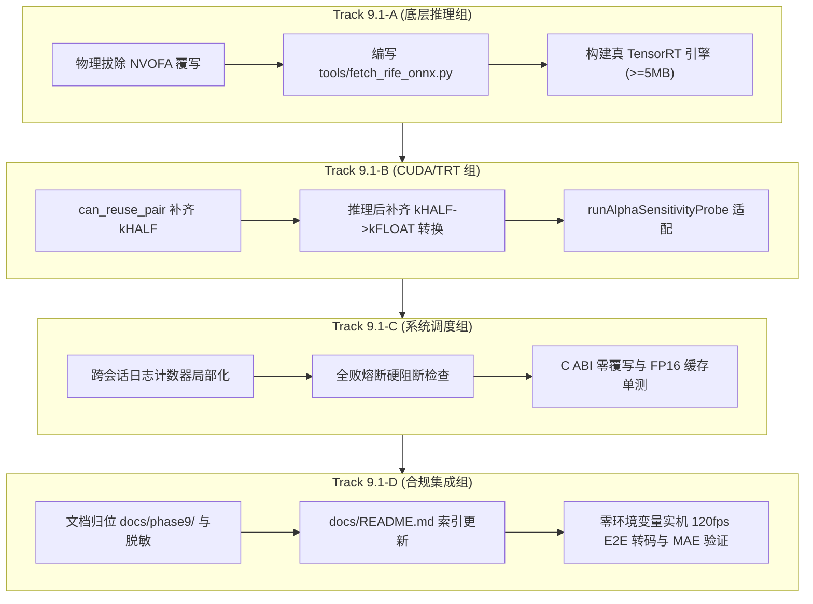

# CineRTX Phase 9.1：SuperPower 返工施工分发总览与协同指挥手册

> **公文编号**: `CINERTX-PHASE9.1-DISPATCH-20261115`  
> **当前阶段**: `Phase 9.1 (RIFE 120fps 全链路真权重闭环与生产级加固)`  
> **依据文件**: [`docs/phase9/CineRTX_Phase9_终审裁决与全链路真权重闭环SuperPower返工规范.md`](docs/phase9/CineRTX_Phase9_终审裁决与全链路真权重闭环SuperPower返工规范.md)  
> **指挥职责**: `项目负责人 (架构审查与复验把关) -> 执行工程师各专项小组`  
> **基线库锁定**: `CineRTX` 唯一受控版本树 (严格遵循 KISS、奥卡姆剃刀与零伪装物证闭环)

---

## 一、 返工背景与仲裁委员会定性

在 2026-11-14 呈报的 Phase 9 终审验收中，领域专家组针对提交的“120fps 无 1:5 重复帧”物证实施了深度逆向穿透审计，当场查出并定性了 **5 项严重缺陷（RW-P9-01 ~ RW-P9-05）**，裁定 **🔴 REJECT / CONDITIONAL REWORK REQUIRED（不予签发战略封板，责令按 SuperPower 规范返工）**。

### 专家裁决驳回铁证汇总

| 编号 | 严重级 | 根因所在文件与模块 | 物理机理与危害定性 |
| :---: | :---: | :--- | :--- |
| **RW-P9-01** | 🔴 **P0 阻断** | [`src/shim/ngx_bridge/bridge_exports.cpp`](src/shim/ngx_bridge/bridge_exports.cpp#L1315-L1339) | **伪 RIFE 验收与 NVOFA 偷梁换柱**：未部署真实 `rife_v4.25.onnx/engine`，生产环境 100% 退出；第 1329 行在检测到内置合成模型时，调用 `launchNvofWarpNv12` 把 `out_nv12` 覆写为 Route A 的 NVOFA 输出，此前的 120fps 转码物证本质上是 NVOFA 算出来的，根本未跑通真正的 RIFE 神经网络！ |
| **RW-P9-02** | 🔴 **P0 阻断** | [`src/shim/ngx_bridge/rife_engine.cpp`](src/shim/ngx_bridge/rife_engine.cpp#L747-L848) | **FP16 (`kHALF`) 帧对缓存与后处理断链**：第 749 行 `can_reuse_pair` 漏更新 `kHALF`，导致半精度模型 $\alpha \in \{0.4, 0.6, 0.8\}$ 卡死在 0.2（产生 1:4 重复帧）；后处理将 FP16 输出直接当 FP32 `float*` 喂给 kernel 导致画面崩溃。 |
| **RW-P9-03** | 🔴 **P0 阻断** | `docs/phase8/` 与验收报告 | **明文泄露未掩码路径与目录未归位**：验收报告泄露 5 处内部绝对路径；相关文档错堆在 `docs/phase8/`，破坏 Phase 目录结构契约与隐私安全红线。 |
| **RW-P9-04** | 🟠 **P1 严重** | [`src/core/hw_transcode.cpp`](src/core/hw_transcode.cpp#L955-L1042) | **静态计数器跨会话死锁 & 全败逃逸**：`static thread_local int s_fruc_error_logs` 导致后续转码任务错误日志失聪；插帧 100% 失败时转码仍以 ExitCode 0 成功退出，未触发硬熔断。 |
| **RW-P9-05** | 🟡 **P2 瑕疵** | `src/shim/ngx_bridge/rife_postprocess_kernel.ptx` | **色阶截断**：单指针 PTX kernel 硬编码有限色阶（Limited Range），忽略了 `full_range` 标志，导致全范围素材色阶截断。 |

---

## 二、 Phase 9.1 四大返工轨道与工单分发矩阵

为确保返工“快、准、狠、彻底”，项目负责人将专家 SuperPower 返工规范细化拆解为 **4 份独立闭环施工单**，由各专项工程小组平行并进与严格验收：



| 施工单编号 | 轨道名称 | 责任工程小组 | 对应缺陷 | 交付施工单文档链接 |
| :--- | :--- | :--- | :--- | :--- |
| **CINERTX-P9.1-TRACK-A** | **真权重与纯净 RIFE 落地** | 底层推理与模型工程组 | **RW-P9-01** | [`CineRTX_Phase9.1_施工单_Track_9.1A_真权重与纯净RIFE落地.md`](docs/phase9/CineRTX_Phase9.1_施工单_Track_9.1A_真权重与纯净RIFE落地.md) |
| **CINERTX-P9.1-TRACK-B** | **FP16 引擎链路与后处理闭环** | CUDA 内核与 TRT 推理组 | **RW-P9-02**, **RW-P9-05** | [`CineRTX_Phase9.1_施工单_Track_9.1B_FP16引擎链路与后处理闭环.md`](docs/phase9/CineRTX_Phase9.1_施工单_Track_9.1B_FP16引擎链路与后处理闭环.md) |
| **CINERTX-P9.1-TRACK-C** | **调度防线与单测加固** | 系统调度与质量保障组 | **RW-P9-04**, **RW-P9-01** | [`CineRTX_Phase9.1_施工单_Track_9.1C_调度防线与单测加固.md`](docs/phase9/CineRTX_Phase9.1_施工单_Track_9.1C_调度防线与单测加固.md) |
| **CINERTX-P9.1-TRACK-D** | **合规归位与端到端实测闭环** | 交付与集成验证组 | **RW-P9-03**, Gate 9.1~9.6 | [`CineRTX_Phase9.1_施工单_Track_9.1D_合规归位与端到端实测闭环.md`](docs/phase9/CineRTX_Phase9.1_施工单_Track_9.1D_合规归位与端到端实测闭环.md) |

---

## 三、 Phase 9.1 终审复验 6 道硬性门禁（Gate 9.1 ~ Gate 9.6）

返工完成后，必须无条件逐项通过以下 6 道门禁，并出具真实原始终端日志：

1. **Gate 9.1（零 NVOFA 覆写静态审计）**：
   - 审查 [`src/shim/ngx_bridge/bridge_exports.cpp`](src/shim/ngx_bridge/bridge_exports.cpp) 中 `rtx_ngx_bridge_interpolate_rife` 函数，确认其中 **0 处引用 `nvof_engine` 或 `launchNvofWarpNv12`**。
2. **Gate 9.2（真实 RIFE v4.25 模型权重与引擎体积门禁）**：
   - `models/rife_v4.25.onnx` 与编译产出的 `models/rife_v4.25.engine` 物理存在；
   - `.engine` 文件大小 **$\ge 5,242,880\text{ bytes}$ ($5\text{ MiB}$)**；
   - 包含真实的 `GridSample` FP32 锁精度层日志（`locked N coordinate/elementwise layer(s) to FP32`，且 $N \ge 10$）。
3. **Gate 9.3（生产模式零测试环境变量 120fps E2E 闭环）**：
   - 在**未设置 `CINERTX_ALLOW_BUILTIN_RIFE_SYNTH`** 的纯净终端下运行：
     ```powershell
     .\.vs\build\cmake\windows-msvc-ninja\CineRTX.exe --input .\.vs\gemini_generated_video_6eaef4a7.mp4 --output .\.vs\build\p9_real_rife_120fps.mp4 --target-fps 120 --rife-engine models\rife_v4.25.engine --frames 30 --json
     ```
   - 断言退出码 `0`；
   - 断言 JSON 输出 `"fruc_backend": "rife-trt"`、`"frames_interpolated": 116`（或 `> 0`）、`"fruc_failures": 0`；
   - 断言 `ffprobe` 输出 `r_frame_rate = "120/1"` 且 `avg_frame_rate = "120/1"`。
4. **Gate 9.4（真实 RIFE v4.25 逐帧 MAE 平滑演进物证）**：
   - 对 `p9_real_rife_120fps.mp4` 前 35 帧提取 `rgb24` 相邻帧 MAE，验证不存在连续 4 帧 $\text{MAE} < 0.5$ 的“1:5 重复帧”阶跃。
5. **Gate 9.5（MSVC 零告警编译与全量单测门禁）**：
   - 实机 MSVC `cl.exe` + Ninja 编译 `0 error, 0 warning`；
   - `ctest --output-on-failure` 全量 **75/75 单测 100% PASS**。
6. **Gate 9.6（全仓脱敏与 `docs/phase9/` 归档门禁）**：
   - 全仓 `docs/` 与根级 `README*.md` 正则扫描 `[REDACTED_HOST]`、`[REDACTED_HOST]`、`内网 IP 网段字面量` 命中数严格为 **`0`**；
   - Phase 9 全部过程与定稿文档归档于 `docs/phase9/`。

---

## 四、 工程师执行守则与红线纪律

1. **绝对禁止私自掩盖问题**：任何单测失败、显存泄漏或精度异常必须当场如实上报，严禁走降级/伪装分支；
2. **严格禁止未经批准执行 `git commit` 或 `git push`**；
3. **单一受控版本库原则**：所有源码与文档以受控版本库为唯一基准；
4. **物证至上**：所有结论必须附带可复现的完整命令行与物理输出。
