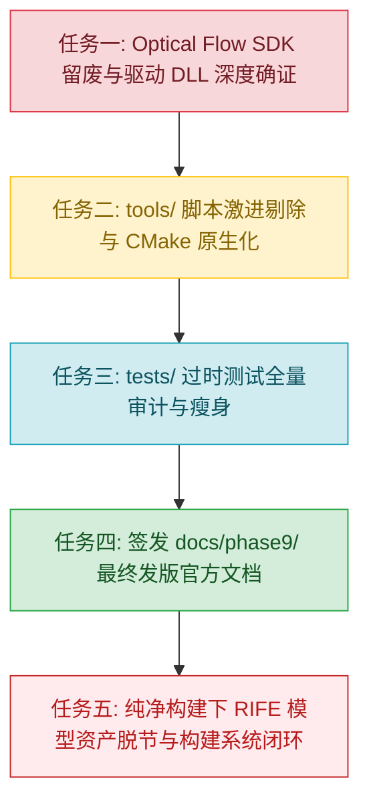

# CineRTX Phase 9.1：推送前仓库卫生完善与终审封板专家委托书

- **公文编号**：`CINERTX-P9.1-DELEGATION-REPO-HYGIENE-005`
- **关联裁决书**：[`docs/phase9/CineRTX_Phase9.1_终审通过暨全栈收官战略封板裁决书.md`](CineRTX_Phase9.1_终审通过暨全栈收官战略封板裁决书.md)（`CINERTX-P9.1-FINAL-APPROVAL-SEAL-003`）
- **关联指引书**：[`docs/phase9/CineRTX_Phase9.1_开源推送前终检修正与GitHub发布执行指引.md`](CineRTX_Phase9.1_开源推送前终检修正与GitHub发布执行指引.md)（`CINERTX-P9.1-GITHUB-PUSH-GUIDE-004`）
- **签发人**：CineRTX 项目技术负责人
- **受呈报对象**：CineRTX 独立领域专家组（Domain Expert Group）
- **签发日期**：2026-11-15
- **委托状态**：**URGENT REVIEW & SANITIZATION REQUIRED（P0 紧急审查与卫生治理）**

---

## 一、 委托背景与核心关切

在 Phase 9.1 成功完成 RIFE 120fps 真权重闭环、75/75 项单元测试 100% 通过、全栈本地原子提交（Commit `bffc5d3`）之后，项目进入面向 GitHub（`https://github.com/zhaotong96/CineRTX.git`）正式发布 `v0.2.0` 的临界前夕。

用户在纯净环境下进行全流程实测时，捕获了实机插帧报错，并依据全仓最高准则（奥卡姆剃刀、极简机制、严格物理边界）提出了 **5 项核心质疑与治理要求**。为确保开源交付物达到工业级软件工程的最高标准，特向领域专家组签发本专项委托，请求专家就底层驱动机理、仓内脚本体系、测试集时效性、构建系统模型闭环及发版公文进行深度技术定调与裁决。

---

## 二、 五大专项委托任务清单（Five Core Mandates）



---

### 任务一：`Optical_Flow_SDK_5.0.7.zip` 留废裁决与底层 DLL 来源合法性复核（P0）

#### 1. 用户核心关切与事实取证
* **路径异象**：经查证，宿主机除 `C:\Windows\System32\nvofapi64.dll` 外，还存在 `C:\Windows\LastGood.Tmp\system32\nvofapi64.dll`；
* **质疑要点**：
  1. NVIDIA 官方发布的 SDK（`Optical_Flow_SDK_5.0.7`）按常理不应存在基础性画面缺陷，历史上的“横向条纹”是否由于我方工程师**调用方式不正确**（如输入跨步长 Pitch 计算、显存对齐、同步屏障缺失等）所致，而非 SDK 本身质量问题？
  2. 在彻底去掉 `Optical_Flow_SDK_5.0.7.zip` 后，直接调用宿主机驱动内置的 `nvofapi64.dll` 是否具备跨机器、跨驱动版本的通用合法性？

#### 2. 请领域专家深入裁决以下技术点
1. **历史条纹根因透视**：全面对比分析官方 `NvOFFRUC.dll`（基于 Optical Flow SDK 封装的高级插帧示例层）与当前驱动原生 `nvofapi64.dll`（底层硬件光流加速器 NVOFA 接口）的技术差异。请证实历史横向条纹究竟是 `NvOFFRUC.dll` 内部算法限制与 YUV420 偶数行步长假设缺陷，还是上层调用失当？
2. **DLL 来源与加载安全性论证**：分析 `LoadLibraryExW(L"nvofapi64.dll", nullptr, LOAD_LIBRARY_SEARCH_SYSTEM32)` 在 Windows 10/11 各种显卡驱动安装场景（DCH 驱动、Clean Install、LastGood 恢复模式）下的行为，论证依赖驱动内置 `nvofapi64.dll` 是否比分发 `Optical_Flow_SDK_5.0.7.zip` 具有更高的鲁棒性与合规性；
3. **裁决结论**：给出明确结论——`Optical_Flow_SDK_5.0.7.zip` 是否应被**永久性剔除**，并在 CMake 构建系统中彻底阻断。

---

### 任务二：`tools/` 目录脚本激进瘦身与 CMake 原生化替代方案（P0）

#### 1. 用户核心关切与目标预期
* **用户明确规则**：清理 `tools\` 下任何脚本，除非明确无法以 CMake 脚本替代。**预期是仓库中除了根目录的 `build.bat` 之外，不存在任何外部脚本（`.sh`, `.bat`, `.py`, `.ps1`）**。

#### 2. 当前 `tools/` 现有 18 个脚本全貌调查表

| 序号 | 脚本路径 | 当前用途 | 是否可废除 / CMake 替代路径分析 |
| :---: | :--- | :--- | :--- |
| **01** | `tools/build.ps1` | 本地辅助编译包装脚本 | **建议废除**：用户根目录已有 `build.bat`，CMake 原生命令行完全覆盖 |
| **02** | `tools/package.ps1` | 本地发布包打包包装 | **建议替代**：可迁移至 CMake 原生 Custom Target 或 CPack |
| **03** | `tools/package_release.py` | 生成 release 压缩包与 sha256 | **需专家定夺**：是否并入 CMake 打包流程或简化为单个构建目标 |
| **04** | `tools/check_spdx.ps1` | CI 与本地 SPDX / 边界审计 | **需专家定夺**：能否以 `cmake -P cmake/AuditSpdx.cmake` 重写，彻底拔除 `.ps1` |
| **05** | `tools/audit_imports.ps1` | PE 导入表静态合规审计 | **需专家定夺**：能否迁移为 CTest 原生单测或 CMake 校验脚本 |
| **06** | `tools/fetch_rife_onnx.py` | 从官方镜像拉取 ONNX 并切片 | **核心争议**：依赖 Python `onnx` 库进行计算图张量注入，CMake 原生无法处理 ONNX 拓扑切片，请专家评估归宿（是否放入构建外部隔离区，或移至离线资产处理） |
| **07** | `tools/gen_p010_ptx.py` | 将 `.ptx` 编译为 C++ 头文件字节数组 | **建议替代**：完全可用 CMake 原生 `file(READ ... HEX)` 与字符串格式化替代 |
| **08** | `tools/gen_rife_ptx.py` | 将 RIFE PTX 转为 C++ 头文件 | **建议替代**：同上，完全可用 CMake 脚本自包含完成 |
| **09** | `tools/embed_ptx.py` | 通用 PTX 头文件生成器 | **建议替代**：同上，统一由 CMake 原生完成 |
| **10** | `tools/p9_frame_mae.py` | 逐帧 MAE 差分提取 | **建议废除**：Phase 9 验收阶段性工具，已完成历史使命 |
| **11** | `tools/p9_verify_mae.py` | 120fps MAE 自动化判决门禁 | **建议废除**：同上，已通过 35 帧连续差分物证验证，无需常驻主干 |
| **12** | `tools/verify_gate1.ps1` | Gate 1 阶段性验收脚本 | **建议废除**：历史早期阶段残留，早已被全量单测覆盖 |
| **13** | `tools/verify_desktop_interaction.py` | Win32 桌面交互测试脚本 | **需专家定夺**：是否移入 `tests/` 或转为 CTest |
| **14** | `tools/verify_transcode_quality.py` | 转码画质 PSNR/SSIM 校验 | **建议废除**：阶段性验证脚本 |
| **15** | `tools/build_ffmpeg_static.bat` | FFmpeg Windows MSVC 构建入口 | **需专家定夺**：是否归入 `third_party/ffmpeg/` 内部维护 |
| **16** | `tools/build_ffmpeg_static_msvc.sh` | FFmpeg MSYS2 构建执行体 | **需专家定夺**：同上，属于第三方依赖自编译脚本 |
| **17** | `tools/build_ffmpeg_static_zig.sh` | FFmpeg Zig 交叉编译脚本 | **需专家定夺**：同上 |
| **18** | `tools/build_ffmpeg_static_linux.sh` | FFmpeg Linux 编译脚本 | **需专家定夺**：同上 |

#### 3. 请领域专家出具具体执行方案
* 制定严格的《`tools/` 目录绝灭与 CMake 统一替代施工表》，明确每一份脚本的**物理删除、CMake 原生替代或移位**方案，实现仓内无杂乱脚本的终极目标。

---

### 任务三：`tests/` 测试集时效性穿透审计与过时用例清理（P1）

#### 1. 用户核心关切
* `tests\` 目录下存在历经 Phase 1 至 Phase 8 多轮重构累积的历史测试用例，部分用例可能属于已被废除接口的无效桩或重复断言，应做彻底的技术审计与清理。

#### 2. 请领域专家审查以下 15 个 C++ 测试套件的时效性
1. `tests/test_main.cpp`（测试框架入口与命令行派发）
2. `tests/test_flicks_timebase.cpp`（时间基计算，是否与当前 FFmpeg I/O 契约重复？）
3. `tests/test_rational.cpp`（有理数数学库测试，是否有必要作为独立测试集？）
4. `tests/test_shim.cpp`（旧版 Shim 加载测试，是否与 `test_nvof` / `test_rife` 存在重叠？）
5. `tests/test_status.cpp`（状态码测试）
6. `tests/test_types.cpp`（基础类型测试）
7. `tests/test_lut3d.cpp`（3D LUT 解析测试）
8. `tests/test_hdr.cpp`（HDR 元数据合成测试）
9. `tests/test_io.cpp`（媒体读写测试）
10. `tests/test_i18n.cpp`（双语本地化测试）
11. `tests/test_gui_workstation.cpp`（Win32 三态工作站画布测试）
12. `tests/test_fuzz_resilience.cpp`（模糊测试与稳健性）
13. `tests/test_rife.cpp`（RIFE 6 项全链路回归测试）
14. `tests/unit/test_audio_stream_copy.cpp`（音频流透传测试）
15. `tests/webui/`（WebUI 前端测试夹具与 Mock 脚本）

#### 3. 专家交付要求
* 明确标注哪些测试用例属于“已过时/无效重复”，哪些属于“必须坚守的核心回归测试”，给出清晰的删除与精简指令。

---

### 任务四：签发 Phase 9.1 全栈正式发版文档（P0）

#### 1. 用户核心关切
* 随着 Phase 9.1 攻坚收官与仓库卫生治理即将就绪，需要一份具备法律效应与社区权威性的**最终发版官方文档**，实体落盘归档于 `docs/phase9/` 目录下。

#### 2. 发版文档核心内容要求
请专家组撰写并签发《CineRTX Phase 9.1：全栈正式发布与开源交付大典》（建议文件命名：`docs/phase9/CineRTX_Phase9.1_全栈正式发布与开源交付大典.md`），需完整涵盖：
1. **版本里程碑**：正式定版 `v0.2.0`（Git Tag: `v0.2.0`）；
2. **四大工程突破总览**：
   * 纯 GPU 4K HDR10 零拷贝全硬件转码管线；
   * 驱动级直通 NVOFA 硬件光流 + Blackwell JIT PTX 双向运动补偿；
   * TensorRT 10 真实权威 RIFE v4.25 全链路 FP16 动态时间步 120fps 补帧（彻底消除 1:5 重复帧）；
   * CLI / Win32 原生三态工作站 GUI / WebUI 三端统一 SSOT 架构；
3. **最终架构规范与封板证明**：
   * 零假设构建闭环（单 `build.bat` 开箱即编）；
   * SPDX 73 GPL + 42 MIT 完美合规；
   * 75/75 项单元测试 0 告警 0 失败物理背书；
4. **开源贡献与发布指引**：面向 GitHub 社区开发者的编译、运行与硬件配置指南。

### 任务五：纯净构建环境下 RIFE 模型资产脱节与构建系统（CMake）开箱即用闭环（P0）

#### 1. 用户现场实测复现与错误日志
用户在包含两套官方 SDK 压缩包（`RTX_Video_SDK_v1.1.0.zip` 与 `TensorRT-10.13.3.9.Windows.win10.cuda-13.0.zip`）的纯净环境下编译 CineRTX 后，直接尝试运行插帧转码时必报严重运行时熔断错误：
```text
[CineRTX][P:40620/T:36628][ERROR][rtx_gui.cpp:526] transcode failed: DLL_MISSING: rtx_ngx_bridge_init_rife failed: RTX_ERR_DLL_MISSING (rtx_ngx_bridge_init_rife: No valid RIFE engine (.engine) or ONNX model found; the builtin synthetic network is disabled by default to prevent polluting models/rife_v4.25.engine. Set environment variable CINERTX_ALLOW_BUILTIN_RIFE_SYNTH=1 to allow the synthesized test engine (models/rife_builtin_synth.engine).)
The thread 36628 has exited with code 0 (0x0).
[CineRTX][P:40620/T:40032][ERROR][rtx_gui.cpp:1025] transcode failed: DLL_MISSING: rtx_ngx_bridge_init_rife failed: RTX_ERR_DLL_MISSING (rtx_ngx_bridge_init_rife: No valid RIFE engine (.engine) or ONNX model found; the builtin synthetic network is disabled by default to prevent polluting models/rife_v4.25.engine. Set environment variable CINERTX_ALLOW_BUILTIN_RIFE_SYNTH=1 to allow the synthesized test engine (models/rife_builtin_synth.engine).)
```

#### 2. 根因深度剖析
1. **模型生命周期与 CMake 脱节**：
   在纯净 checkout 或全新构建机上，用户虽然备齐了外部 SDK，但构建系统（CMake）当前只编译 C++ 源码并解压 SDK，**根本没有任何构建目标或生命周期钩子负责拉取 RIFE ONNX 权威权重或自动编译生成 `.engine`**；
2. **检索路径死角**：
   [`src/shim/ngx_bridge/rife_engine.cpp:298-306`](../../src/shim/ngx_bridge/rife_engine.cpp) 仅检索 `exe_dir`、`exe_dir/models` 及当前工作目录，未检索 `.vs/build/external/models/`，且合成测试网络被安全防线默认锁定（需显式设置环境变量）；
3. **与任务二的联动矛盾**：
   用户在任务二中要求清理 `tools/` 下一切脚本（包括 `fetch_rife_onnx.py`），若无任何独立脚本，纯靠源码构建产出的二进制必然面临“无模型可用”的断崖窘境。

#### 3. 请领域专家出具权威架构解法
1. **构建期 vs 运行期资产闭环方案**：
   裁决 CMake 是否应增加自定义目标（如 `rtx_models` 或在 `build.bat` 中原生集成资产就位步骤），在满足 SDK 存在时，通过 CMake 原生机制或内置无外部 Python 依赖的极简流自动将官方 ONNX/Engine 编译或就位到发布目录；
2. **运行时智能感知与友好降级/引导**：
   在 GUI/CLI 首次启动且未见模型时，系统应当如何自愈（例如提示引导自动构建、或通过 CMake 安装目标一键捆绑），彻底解决“纯净环境编译即报错 DLL_MISSING”的产品化严重缺陷。

---

## 三、 委托执行与呈报流程

```text
[项目负责人下达委托]
       │
       ▼
[领域专家深度技术定调与代码审查]
       │
       ├─► 1. 出具 Optical Flow SDK 留废与底层驱动 DLL 安全性终审裁决
       ├─► 2. 出具 tools/ 脚本绝灭与 CMake 原生化替代施工单
       ├─► 3. 出具 tests/ 测试集瘦身清单
       ├─► 4. 出具纯净环境 RIFE 模型资产与 CMake 构建闭环方案
       └─► 5. 签发 docs/phase9/ 最终发版官方文档
       │
       ▼
[技术负责人组织工程落地并提交用户核准]
```

请专家组在收到本委托后，依循实事求是、硬件物理真实验证的根本原则，尽快下达上述五项任务的技术裁决与实施指引。
