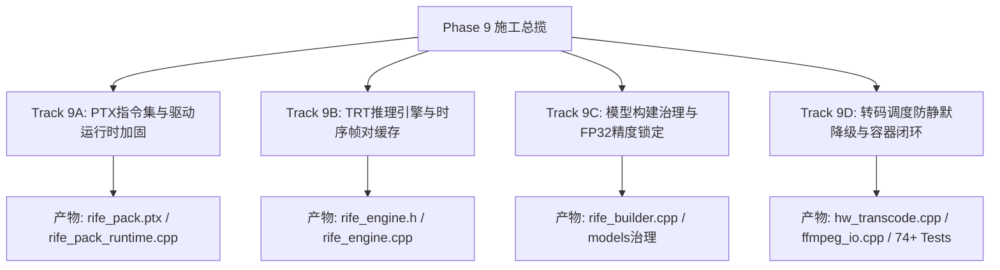

# CineRTX Phase 9：施工分发总览与 SuperPower 任务编排书
## FRUC Route B 120fps 任意时刻插帧全链路根治

- **文档编号**：`CINERTX-P9-DISPATCH-MASTER-001`
- **关联主规范**：`docs/phase8/CineRTX Phase 9：RIFE 120fps 插帧 1比5 重复帧根因穿透取证与全链路根治施工规范.md`
- **阶段目标**：彻底根治 RIFE 120fps 插帧“1:5 重复帧”缺陷，加固 PTX ISA 指令集、TensorRT 推理引擎、模型构建器与转码调度全链路，实现工业级零静默降级与高刷时钟闭环。
- **发布日期**：2026-11-14
- **执行团队**：CineRTX 核心工程团队（4 泳道正交施工）

---

## 一、工程背景与问题定义

在 Phase 8 收官实机测试中，用户在 RTX 5060 Laptop GPU（Blackwell，`sm_120`）上对 24fps 视频执行 120fps（$1:5$ 倍率）RIFE 补帧时，发现输出视频虽然标记为 120fps，但实测呈现无可辩驳的 **1:5 原帧重复**。

经过项目团队与领域专家的穿透式指令级取证，锁定了从底层 PTX ISA 语法、驱动 JIT 加载、TensorRT Profile 对齐，到调度循环静默错误吞没的六层因果链路。领域专家已签发主施工规范。为保障工程落地的正交性、原子性与可追溯性，现将全链路根治任务拆解为 **4 大正交施工轨（Track 9A ～ 9D）**。

---

## 二、4 大施工轨（Tracks）正交分发矩阵

| 施工单编号 | 施工轨 (Track) | 责任模块与核心文件 | 核心施工目标 | 前置依赖 |
| :--- | :--- | :--- | :--- | :--- |
| **SP-P9-9A** | **Track 9A**：PTX 指令集与驱动运行时加固 | `src/shim/ngx_bridge/rife_pack.ptx` `src/shim/ngx_bridge/rife_pack.cu` `src/shim/ngx_bridge/rife_pack_runtime.h` `src/shim/ngx_bridge/rife_pack_runtime.cpp` | 1. 替换为 `.version 7.0` + `.target sm_70` 兼容头部； 2. 全面消除十进制浮点字面量，对齐 IEEE-754 十六进制常量； 3. 根除 SAD Warp 规约发散异常； 4. 加固驱动 Context 绑定与精确错误码回传。 | 无（最先开工） |
| **SP-P9-9B** | **Track 9B**：TRT 推理引擎与时序帧对缓存 | `src/shim/ngx_bridge/rife_engine.h` `src/shim/ngx_bridge/rife_engine.cpp` `src/shim/ngx_bridge/bridge_exports.cpp` | 1. `loadEngine` 强制前置校验 PTX 可用性； 2. 自适应 1080 vs 1088 优化 Profile 尺寸； 3. 实现 120fps 帧对缓存（Frame-Pair Caching），省去 75% 冗余预处理与 3 次 CPU-GPU 同步； 4. 植入 $\alpha$ 时序敏感度探针。 | Track 9A |
| **SP-P9-9C** | **Track 9C**：模型构建治理与 FP32 精度锁定 | `src/shim/ngx_bridge/rife_builder.cpp` `src/shim/ngx_bridge/bridge_exports.cpp` | 1. 扩展 ONNX 候选搜索列表，严禁将占位网络写入正式引擎文件； 2. 修复测试合成网络的 $\alpha$ 动态响应； 3. 补齐 `GridSample` 坐标流（Cast/Recip/Mul/Sub）FP32 强制锁精度。 | 无（可并行） |
| **SP-P9-9D** | **Track 9D**：转码调度防静默降级与容器闭环 | `src/core/hw_transcode.cpp` `src/io/ffmpeg_io.cpp` `tests/test_rife.cpp` | 1. 彻底拔除静默吞错，失败时上报 `[FRUC-ERROR]` 并记录指标； 2. 场景切与回退引入最近邻相位阶跃（$\alpha < 0.5 \to F_k, \ge 0.5 \to F_{k+1}$）； 3. 修复容器头 `output_info_.frame_rate` 与 `r_frame_rate` 失真； 4. 落地端到端 120fps 回归与 MAE 阶跃门禁。 | Track 9A, 9B, 9C |

---

## 三、施工单文件索引

各执行工程师请遵照对应的单项施工单执行，严格履行单内定义的逐行修改规范与测试断言：
1. [`CineRTX_Phase9_施工单_Track_9A_PTX指令集与驱动运行时加固.md`](CineRTX_Phase9_施工单_Track_9A_PTX指令集与驱动运行时加固.md)
2. [`CineRTX_Phase9_施工单_Track_9B_TRT推理引擎与时序帧对缓存.md`](CineRTX_Phase9_施工单_Track_9B_TRT推理引擎与时序帧对缓存.md)
3. [`CineRTX_Phase9_施工单_Track_9C_模型构建治理与FP32精度锁定.md`](CineRTX_Phase9_施工单_Track_9C_模型构建治理与FP32精度锁定.md)
4. [`CineRTX_Phase9_施工单_Track_9D_转码调度防静默降级与容器闭环.md`](CineRTX_Phase9_施工单_Track_9D_转码调度防静默降级与容器闭环.md)

---

## 四、全阶段交付与合拢准则（Definition of Done）

1. **零告警与零回归**：MSVC `cl.exe` + Ninja 编译 `0 error, 0 warning`；
2. **单测全绿**：`rtx_tests.exe` 全量用例（含新增用例）100% PASS；
3. **实机 120fps 闭环**：对 `gemini_generated_video_6eaef4a7.mp4` 进行 120fps RIFE 转码，`report.frames_interpolated > 0`，逐帧 MAE 呈现平滑单调演进，1:5 原帧重复彻底清零；
4. **全仓规范受控**：全仓公开文档无未经掩码的内部私有路径，严格坚守奥卡姆剃刀与 KISS 原则。
